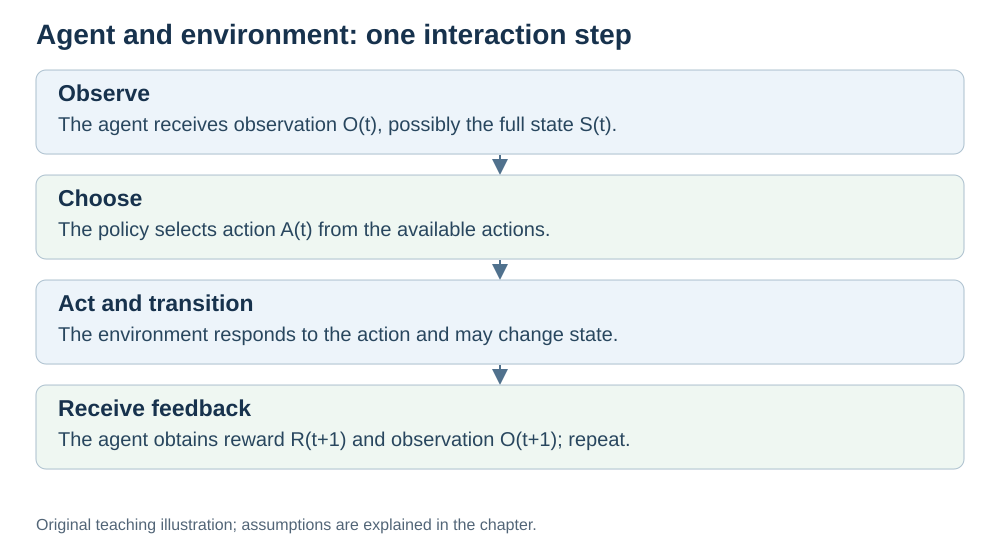

# What Is an Agent?

Previous: [Introduction](INTRODUCTION.md) · [Module map](OUTLINE.md) · Next: [Q-learning](Q-LEARNING.md)

**Status:** revised with AI-assisted technical checks; awaiting team peer review.

**Prerequisites:** the introduction's action, reward and environment concepts.

## Learning objectives

After this chapter, you should be able to:

1. Describe the boundary between an agent and its environment.
2. Identify state, observation, action, reward and policy in a small example.
3. Explain why an agent need not be a learning agent.

## 1. Agents and policies

An **agent** observes its environment and selects actions. It can be software, such as a chess player, or a controller operating a robot.

An agent need not learn. A vacuum cleaner could follow programmed rules: move forward, turn when a bumper activates, then continue. An RL controller instead uses reward-bearing experience to improve its estimates or policy.

A **policy** is the rule for selecting an action from the available information. It may always select one action in a given state, or assign probabilities to several actions. A Q-table helps a value-based agent choose actions; the table and the action-selection rule are different objects. [Spinning Up, policies](https://spinningup.openai.com/en/latest/spinningup/rl_intro.html#policies).

## 2. The terms in one maze

| Term | Meaning | Maze example |
|---|---|---|
| State | A complete task description relevant to what happens next | Grid position, plus whether a required key has been collected |
| Observation | Information the agent actually receives | A full grid state, or only a camera view |
| Action | A choice available to the agent | Move north, south, east or west |
| Reward | A numerical signal associated with an outcome | −5 after colliding with a wall |
| Policy | The rule for selecting actions | Usually choose a currently high-valued move, sometimes explore |
| Episode | One run ending under the task's termination rule | Start position to terminal exit |

Including the key matters: being at the same square with and without a key can lead to different outcomes at a locked exit. A single image may hide information, so our tabular examples explicitly assume a fully observed, small state space. [Spinning Up, states and observations](https://spinningup.openai.com/en/latest/spinningup/rl_intro.html#states-and-observations).

## 3. The agent–environment loop

*Original teaching diagram prepared for this revision.*

For one transition, the agent receives $S_t$, selects $A_t$, and then receives $R_{t+1}$ and $S_{t+1}$. It uses this experience to learn. The reward and next state describe the same transition; they are not separate tasks.

For instance, a fully observed maze agent at square A chooses “north”. The move encounters a wall, so the next square is still A and the reward is −5. Learning may reduce its estimate for that choice.

## 4. Choosing the system boundary

Suppose a controller commands a robot arm to collect a block. If the **agent** is the learning controller, the robot body, table and block belong to its **environment**. Images and joint measurements are observations; motor commands are actions.

Other descriptions can choose a different boundary. The important requirement is to say what your model includes and use it consistently. Calling the physical camera part of the environment is therefore not automatically an error.

## 5. Common misconceptions

- **“Any autonomous robot uses RL.”** It can use fixed control rules or a preplanned path.
- **“The state is always everything the camera sees.”** A camera supplies an observation; important information may remain hidden.
- **“Reward tells the agent the correct action.”** A scalar reward evaluates an outcome without necessarily identifying the best action.

## 6. Check yourself

1. **AGENT-1:** Define the agent, environment, observations and actions for a learning robot arm. State your chosen boundary.
2. **AGENT-2:** A robot follows a fixed rule to turn after a bumper collision. Is it an agent? Does this alone establish RL?
3. **AGENT-3:** Why might a robot need two camera frames rather than one to estimate an object's motion?

[Explained answers](ANSWER-KEY.md#agent-1)

## 7. Scope boundaries

- **Detailed:** agent/environment boundary, policies, the interaction loop and basic terminology.
- **Brief:** partial observations and fixed-rule controllers.
- **Out of scope:** formal partially observed models, sensor fusion and robot control mathematics.

[Next: Q-learning](Q-LEARNING.md)
