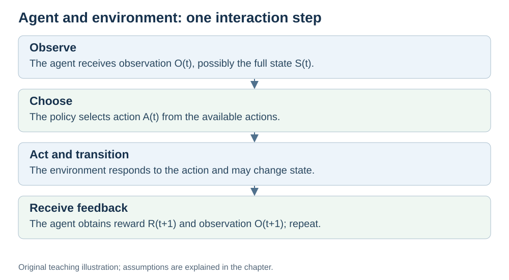
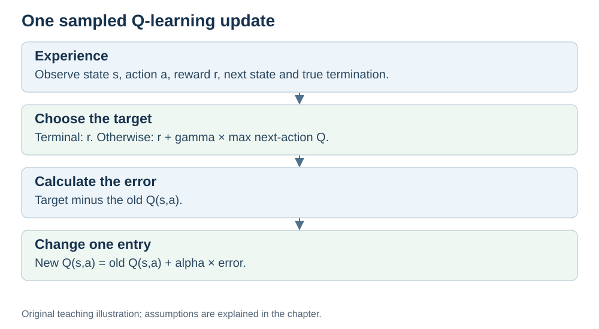
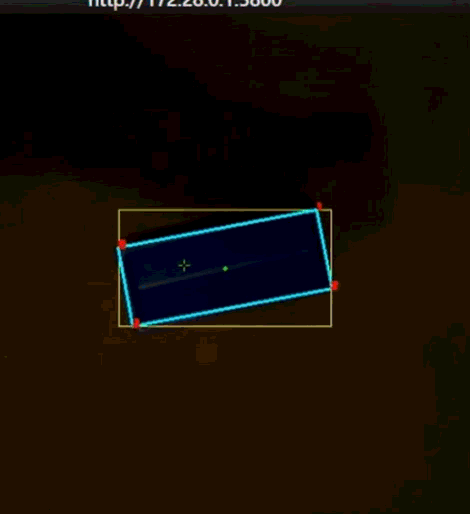
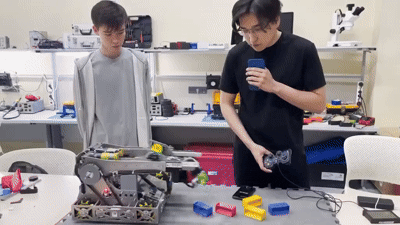
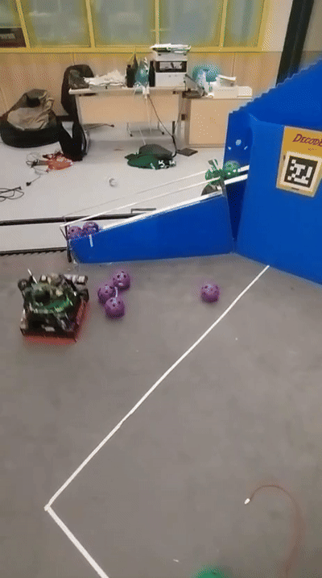
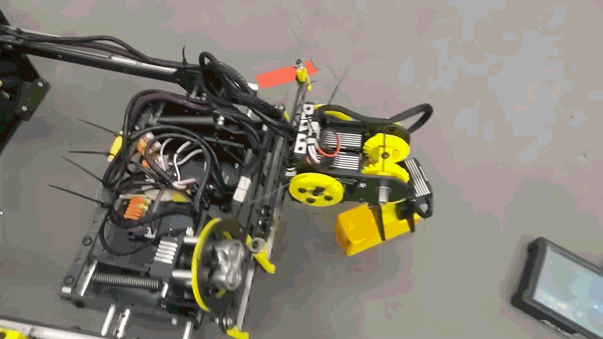
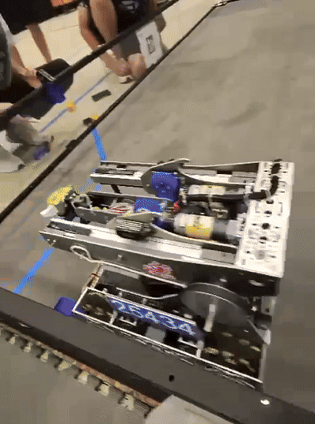

# Behaviorist AI: General Study Guide

## Module Map and Development Status

**Audience:** beginners with basic computing familiarity.

**Status:** revised with AI-assisted technical checks; awaiting team peer review.

## Purpose and reading order

Explain how reward-bearing experience can improve decisions, while distinguishing this learning process from perception, fixed calculations and path planning.

| Order | Chapter | Main outcome | Current material |
|---|---|---|---|
| 1 | [Introduction](#introduction-to-behaviorist-ai) | Recognize interaction and evaluate a reward scheme | Explanation, maze arithmetic, activity and answers |
| 2 | [Agents](#what-is-an-agent) | Identify state, observation, action, reward and policy | Glossary, original diagram and boundary exercise |
| 3 | [Q-learning](#q-learning-from-experience-to-an-action-value-table) | Trace and calculate a tabular learning update | Stage 1 anchor: complete procedure, worked episode, terminal update and learner activity |
| 4 | [On/off-policy](#on-policy-and-off-policy-learning) | Compare behavior and target policies | SARSA/Q-learning numerical comparison and conditional cliff example |
| 5 | [DQN](#deep-q-networks-replacing-a-table-with-an-approximation) | Explain value approximation, replay and target networks | Plain-language training cycle; qualified hardware and research examples |
| 6 | [Robotics](#robotics-case-study-perception-navigation-and-a-possible-rl-extension) | Separate reported implementation, evidence and proposed RL | Team-account case study plus original coordinate example |

Chapter links specify prerequisites and scope boundaries. The [explained answers](#explained-answers) support attempts at the chapter questions. Inline source links identify the specific definitions, algorithm claims and external examples used.

## Stage 1 developed topic

The Q-learning chapter is the main developed topic. It supplies:

- Explicit assumptions and measurable objectives.
- Definitions before the update rule.
- ε-greedy exploration and a complete learning procedure.
- A two-step illustrative episode retaining the correct result 55.
- A terminal update with no future-value term.
- Changed-number questions with explained answers.
- Specific academic/official sources and an original flow diagram.

The other chapters provide context and further learning. Their presence does not mean all final presentation or video deliverables are complete.

## Evidence and authorship boundaries

The existing personal log retained in the private submission records Ilya’s authorship of the initial reinforcement-learning introduction. It does not establish authorship of every later chapter or identify the owner of the earlier FTC code.

This revision was prepared with AI assistance and checked against the linked technical sources. It is not a completed human peer review. Chapter ownership, reviewer names and review outcomes should be recorded when the team confirms or performs them.

The robotics chapter labels the FTC implementation as a team member's account. Original Java code, training evidence, the dataset count and end-to-end performance have not been independently verified by this revision.

## Original teaching assets

- [Agent/environment loop](assets/agent-environment-loop.svg).
- [Q-learning target/update flow](assets/q-learning-update.svg).

Both diagrams and the small arithmetic/geometry exercises were created for this revision. They are illustrations rather than experimental evidence.

## Next review tasks

1. Have a team member attempt the Q-learning activity before reading the key; record actual feedback.
2. Check the rendered mathematics, diagrams and navigation in the submission format.
3. Confirm chapter ownership and attach an authentic review outcome.
4. Ask the FTC case owner to confirm historical details and provide a small attributable exhibit if available.
5. Use these sources and exercises when preparing the later slides, videos and mini-lecture.

These are pending tasks. No past approvals or experimental results are implied.

## Connection with the rest of the project

[Hardware](../Hardware/GENERAL.md#introduction) explains how computations run. [Networks](../Networks/GENERAL.md) explains how devices communicate. This module explains a learning objective and decision process that can run on that infrastructure; a network connection or GPU is not compulsory for every example.

---

## Introduction to Behaviorist AI

[Module map](#module-map-and-development-status) · Next: [What is an agent?](#what-is-an-agent)

**Status:** revised with AI-assisted technical checks; awaiting team peer review.

**Prerequisites:** none beyond basic familiarity with a computer program. Hardware and Networks provide useful context, but no robotics or machine-learning background is assumed.

## Learning objectives

After this chapter, you should be able to:

1. Identify an agent, its actions and its reward signal.
2. Explain why a learner considers several steps rather than only the next reward.
3. Distinguish supervised learning from reinforcement learning.
4. Suggest and critique a simple reward scheme.

## 1. Learning through interaction

In this project, the **Behaviorist AI** module focuses on **reinforcement learning (RL)**. The name connects our topic with learning from consequences; it is a course framing, rather than a claim that RL explains all animal behavior.

An RL agent chooses actions, observes what happens, and uses experience to improve its decisions. Its objective is to maximize an accumulated reward called **return**. An action with a small immediate reward may lead to a much better outcome later.

For example, a maze agent may need to take a step away from the exit to get around a wall. Judging only the next step would miss that opportunity. RL formalizes this problem of learning from consequences over time. [Dayan and Watkins, *Reinforcement Learning*, introduction](https://www.gatsby.ucl.ac.uk/~dayan/papers/dw01.pdf).

## 2. The interaction loop

There are two main parts:

- **Agent:** the decision-maker.
- **Environment:** the system with which it interacts.

At time step $t$:

1. The agent receives an observation of the environment.
2. It selects an action $A_t$.
3. The environment responds with a new observation and reward $R_{t+1}$.
4. The learner uses that experience to update its estimates or policy.

An **episode** is one run of a task, such as an attempt to reach a maze exit. A **policy** is the rule used to select an action. Learning changes that rule or the estimates used by it.

For our small maze examples, we assume the agent can see its full **state**, such as its grid position. A camera image can instead be a partial observation: one photograph may not reveal an object's velocity. [Spinning Up, key concepts and states/observations](https://spinningup.openai.com/en/latest/spinningup/rl_intro.html).

## 3. Different kinds of learning

| Approach | Typical feedback | Example |
|---|---|---|
| Supervised learning | Input examples with target labels | Learn from labeled animal photographs to classify a new photograph |
| Unsupervised learning | Data without target labels for that task | Group similar examples or discover structure |
| Reinforcement learning | Rewards associated with interaction | Learn a maze policy from attempted moves and their consequences |

Supervised learning aims to make useful predictions on new examples. Memorizing training examples without generalizing is a possible failure, not its definition. [Goodfellow, Bengio and Courville, *Deep Learning*, §§5.1.3 and 5.2](https://www.deeplearningbook.org/contents/ml.html).

## 4. Worked example: reward and a maze

Consider one illustrative episodic maze. Use these rules:

- Ordinary move: −1.
- Wall collision: −5; the agent stays in place.
- Reaching the exit: +10; the episode ends.

For this short example, add rewards without discounting. A route with three ordinary moves and then the exit returns $-3+10=7$. A route with six ordinary moves and then the exit returns $-6+10=4$.

The shorter collision-free route receives more reward. These values are a design choice; they are not results from a trained robot.

Positive reward merely for moving closer is not automatically sufficient. An agent might collect rewards without completing the intended task. Reward shaping can even change which policy is optimal, so the behavior must be checked against the real goal. [Ng, Harada and Russell, 1999, introduction and reward-shaping examples](https://people.eecs.berkeley.edu/~russell/papers/icml99-shaping.pdf).

## 5. Connecting hardware, networks and AI

Sensors and processors provide observations and run control software. A GPU can accelerate a large neural network; it is not required for every RL example. A network connection can support monitoring or remote computation, while some decisions run locally.

A published quadruped study trained locomotion policies in simulation and transferred them to real robots, while addressing differences between simulation and reality. This is a specific research example, rather than evidence about our own implementation. [Tan et al., 2018](https://arxiv.org/abs/1804.10332).

## 6. Check yourself

1. **INTRO-1:** Using the maze rules above, calculate the return for two ordinary moves, one collision and then the exit.
2. **INTRO-2:** Is an image classifier trained on labeled cat photographs necessarily using RL? Explain.
3. **INTRO-3:** Propose a reward scheme for reaching an exit quickly. Explain one behavior you would check before calling it successful.

[Explained answers](#intro-1)

## 7. Scope boundaries

- **Detailed:** interaction, rewards and return, learning paradigms, a worked reward example.
- **Brief:** partial observations, simulation and connections with hardware/networks.
- **Out of scope:** psychological theories of learning, optimization proofs, production robot training.

[Next: What is an agent?](#what-is-an-agent)

---

## What Is an Agent?

Previous: [Introduction](#introduction-to-behaviorist-ai) · [Module map](#module-map-and-development-status) · Next: [Q-learning](#q-learning-from-experience-to-an-action-value-table)

**Status:** revised with AI-assisted technical checks; awaiting team peer review.

**Prerequisites:** the introduction's action, reward and environment concepts.

## Learning objectives

After this chapter, you should be able to:

1. Describe the boundary between an agent and its environment.
2. Identify state, observation, action, reward and policy in a small example.
3. Explain why an agent need not be a learning agent.

## 1. Agents and policies

An **agent** observes its environment and selects actions. It can be software, such as a chess player, or a controller operating a robot.

An agent need not learn. A vacuum cleaner could follow programmed rules: move forward, turn when a bumper activates, then continue. An RL controller instead uses reward-bearing experience to improve its estimates or policy.

A **policy** is the rule for selecting an action from the available information. It may always select one action in a given state, or assign probabilities to several actions. A Q-table helps a value-based agent choose actions; the table and the action-selection rule are different objects. [Spinning Up, policies](https://spinningup.openai.com/en/latest/spinningup/rl_intro.html#policies).

## 2. The terms in one maze

| Term | Meaning | Maze example |
|---|---|---|
| State | A complete task description relevant to what happens next | Grid position, plus whether a required key has been collected |
| Observation | Information the agent actually receives | A full grid state, or only a camera view |
| Action | A choice available to the agent | Move north, south, east or west |
| Reward | A numerical signal associated with an outcome | −5 after colliding with a wall |
| Policy | The rule for selecting actions | Usually choose a currently high-valued move, sometimes explore |
| Episode | One run ending under the task's termination rule | Start position to terminal exit |

Including the key matters: being at the same square with and without a key can lead to different outcomes at a locked exit. A single image may hide information, so our tabular examples explicitly assume a fully observed, small state space. [Spinning Up, states and observations](https://spinningup.openai.com/en/latest/spinningup/rl_intro.html#states-and-observations).

## 3. The agent–environment loop

*Original teaching diagram prepared for this revision.*

For one transition, the agent receives $S_t$, selects $A_t$, and then receives $R_{t+1}$ and $S_{t+1}$. It uses this experience to learn. The reward and next state describe the same transition; they are not separate tasks.

For instance, a fully observed maze agent at square A chooses “north”. The move encounters a wall, so the next square is still A and the reward is −5. Learning may reduce its estimate for that choice.

## 4. Choosing the system boundary

Suppose a controller commands a robot arm to collect a block. If the **agent** is the learning controller, the robot body, table and block belong to its **environment**. Images and joint measurements are observations; motor commands are actions.

Other descriptions can choose a different boundary. The important requirement is to say what your model includes and use it consistently. Calling the physical camera part of the environment is therefore not automatically an error.

## 5. Common misconceptions

- **“Any autonomous robot uses RL.”** It can use fixed control rules or a preplanned path.
- **“The state is always everything the camera sees.”** A camera supplies an observation; important information may remain hidden.
- **“Reward tells the agent the correct action.”** A scalar reward evaluates an outcome without necessarily identifying the best action.

## 6. Check yourself

1. **AGENT-1:** Define the agent, environment, observations and actions for a learning robot arm. State your chosen boundary.
2. **AGENT-2:** A robot follows a fixed rule to turn after a bumper collision. Is it an agent? Does this alone establish RL?
3. **AGENT-3:** Why might a robot need two camera frames rather than one to estimate an object's motion?

[Explained answers](#agent-1)

## 7. Scope boundaries

- **Detailed:** agent/environment boundary, policies, the interaction loop and basic terminology.
- **Brief:** partial observations and fixed-rule controllers.
- **Out of scope:** formal partially observed models, sensor fusion and robot control mathematics.

[Next: Q-learning](#q-learning-from-experience-to-an-action-value-table)

---

## Q-Learning: From Experience to an Action-Value Table

Previous: [Agents](#what-is-an-agent) · [Module map](#module-map-and-development-status) · Next: [On-policy and off-policy](#on-policy-and-off-policy-learning)

**Status:** revised with AI-assisted technical checks; awaiting team peer review.

**Stage 1 anchor topic:** this chapter contains the assumptions, algorithm, worked examples, activity and explained answers needed to study one topic from start to finish.

**Prerequisites:** state, action, reward, policy and episode from Agents section; ordinary arithmetic.

## Learning objectives

After this chapter, you should be able to:

1. Interpret a Q-value as an estimate of future return.
2. Trace a small Q-learning episode, including action selection and termination.
3. Calculate an update for a nonterminal or terminal transition.
4. Explain why exploration and repeated updates are needed.

## 1. The question a Q-value answers

In this chapter, states and actions form small, finite sets and the agent observes its full state. For example, it knows which grid square it occupies and chooses from four moves.

A **Q-table** stores one estimate $Q(s,a)$ for each state–action pair. It estimates the return from taking action $a$ in state $s$. In Q-learning, these estimates aim toward the values of an optimal policy.

Return includes more than the next reward. With discount factor $\gamma$:

$$
G_t=R_{t+1}+\gamma R_{t+2}+\gamma^2R_{t+3}+\cdots
$$

Later rewards receive less weight when $\gamma<1$. For our finite examples we can also define an undiscounted return with $\gamma=1$. We do not assume an infinite sum with $\gamma=1$ is always finite.

“Action value” is the formal term; “quality” is only a memory aid. A high estimated value can be wrong when little relevant experience has been collected. [Watkins and Dayan, 1992, pp. 280–282](https://www.gatsby.ucl.ac.uk/~dayan/papers/cjch.pdf).

## 2. The sampled update

After taking $a$ in state $s$, the agent observes reward $r$ and next state $s'$. For a nonterminal next state:

$$
Q(s,a)\leftarrow Q(s,a)+
\alpha\left[r+\gamma\max_{a'}Q(s',a')-Q(s,a)\right].
$$

| Symbol | Meaning in this chapter |
|---|---|
| $s,a$ | State and action of the experienced transition |
| $r$ | Observed immediate reward |
| $s'$ | Observed next state |
| $a'$ | A valid action available in the next state |
| $\max_{a'}Q(s',a')$ | Largest current next-action estimate |
| $\alpha$ | Learning rate; $0<\alpha\leq1$ in our examples |
| $\gamma$ | Discount factor; $0\leq\gamma\leq1$, with task assumptions as above |

The **target** is $r+\gamma\max_{a'}Q(s',a')$. Subtracting the old estimate gives the error; multiplying by $\alpha$ determines how far to move toward the target.

This is a sampled Q-learning update based on Bellman optimality. It is not an assertion that an imperfect estimate already equals its true expected value.

**Terminal rule:** if the transition reaches a true terminal state, the target is just $r$; there is no later task reward to bootstrap from. An external time limit is not automatically the same as task termination. [PyTorch DQN tutorial, final-state handling](https://docs.pytorch.org/tutorials/intermediate/reinforcement_q_learning.html).

## 3. Choosing actions: exploration and exploitation

**Exploitation** chooses an action with a currently high estimate. **Exploration** tries alternatives to obtain information.

One simple rule is **ε-greedy**: with probability $1-\varepsilon$, choose a highest-valued valid action; with probability $\varepsilon$, choose a random valid action. If $\varepsilon=0.1$, the random-choice branch is used about 10% of the time; it can still happen to select the greedy action.

Q-learning uses the experienced reward and transition. Its target uses the largest next-action estimate even when the behavior policy actually selects another next action. This makes it an off-policy method. [David Silver, Model-Free Control, slides 10 and 34–37](https://davidstarsilver.wordpress.com/wp-content/uploads/2025/04/lecture-5-model-free-control-.pdf).

## 4. A complete small learning procedure

1. Initialize the Q-table, often with zeros, and choose $\alpha$, $\gamma$ and an exploration rule.
2. Start an episode and observe its first state.
3. Select a valid action using the behavior policy, such as ε-greedy.
4. Execute it and observe the reward, next state and termination signal.
5. Form the target: reward only if terminal; otherwise reward plus the discounted largest next-state estimate.
6. Update the experienced table entry.
7. If the task terminated, end the episode. Otherwise use the next state and repeat from step 3.
8. Collect more episodes to improve the estimates.

*Original teaching diagram. Only the experienced entry is changed by this update.*

A short run is not guaranteed to find optimal values. The tabular convergence result requires suitable assumptions, including sufficient exploration and appropriate learning rates. We use simple constant rates for arithmetic demonstrations, not as a proof of convergence. [Watkins and Dayan, 1992, convergence theorem](https://www.gatsby.ucl.ac.uk/~dayan/papers/cjch.pdf).

## 5. Worked episode: retaining the result 55

This is an illustrative two-step task, separate from the introductory maze's reward scheme. Initially:

| State | Action | Current estimate |
|---|---|---:|
| A | X | 20 |
| A | Y | 12 |
| B | left | 50 |
| B | right | 30 |

Take $\alpha=1$ and $\gamma=0.9$. The behavior policy selects X in A. It receives reward 10 and reaches **nonterminal** B.

$$
\text{target}=10+0.9(50)=55
$$

$$
Q(A,X)=20+1(55-20)=55.
$$

At B, suppose the policy selects left, receives reward 50 and reaches the terminal exit. Its target is 50, so $Q(B,\mathrm{left})=50+1(50-50)=50$. The episode ends.

| Step | Experienced transition | Target | Updated entry |
|---|---|---:|---|
| 1 | A, X → reward 10, B, nonterminal | 55 | $Q(A,X):20\rightarrow55$ |
| 2 | B, left → reward 50, terminal exit | 50 | $Q(B,\mathrm{left}):50\rightarrow50$ |

The other two entries remain unchanged. The value 55 uses current estimates; a different outcome or later evidence could change them.

## 6. Worked terminal update

In a separate transition, an entry has old value 20, reward 10 and learning rate 0.5. The next state is terminal:

$$
\text{target}=10,\qquad
Q_{\mathrm{new}}=20+0.5(10-20)=15.
$$

Adding a future-state estimate here would invent rewards after the task has ended.

## 7. Your turn

1. **QL-1:** Old Q is 5; reward is 4; the next state is nonterminal with largest Q estimate 15; $\gamma=0.8$ and $\alpha=0.5$. Calculate the target and new Q.
2. **QL-2:** Repeat QL-1 if the transition instead terminates the task.
3. **QL-3:** The greedy action currently looks best. Why still explore?
4. **QL-4:** In the worked episode, which entries changed? Does one episode establish an optimal policy?

Try the questions before opening the [explained answers](#ql-1).

## 8. From tables to neural networks

A table becomes impractical when there are enormous numbers of distinct observations. A neural network can instead share parameters across inputs and approximate action values.

Standard DQN uses a finite, discrete action set and predicts a value for each available action. Continuous motor commands require different treatment or an explicit discretization. Neural networks do not make every unseen prediction correct, and large models are not necessary for this table-based example. [Spinning Up, action spaces](https://spinningup.openai.com/en/latest/spinningup/rl_intro.html#action-spaces).

## 9. Scope boundaries

- **Detailed:** Q-table, sampled update, ε-greedy actions, terminal handling and arithmetic.
- **Brief:** convergence assumptions and the connection with DQN.
- **Out of scope:** convergence proofs, full Bellman derivations, continuous control, PPO/SAC derivations and production training.

[Next: On-policy and off-policy learning](#on-policy-and-off-policy-learning)

---

## On-Policy and Off-Policy Learning

Previous: [Q-learning](#q-learning-from-experience-to-an-action-value-table) · [Module map](#module-map-and-development-status) · Next: [DQN](#deep-q-networks-replacing-a-table-with-an-approximation)

**Status:** revised with AI-assisted technical checks; awaiting team peer review.

**Prerequisites:** policy, Q-value and target from Q-learning section.

## Learning objectives

After this chapter, you should be able to:

1. Distinguish the policy generating data from the policy being learned about.
2. Compare the next-state targets of SARSA and Q-learning.
3. Explain what the cliff-walking example demonstrates and what it does not.

## 1. Two roles for a policy

The **behavior policy** selects the actions that generate experience. The **target policy** is the policy being evaluated or improved.

- **On-policy learning** learns about the policy generating its data.
- **Off-policy learning** can learn about a target policy using data generated by a different behavior policy.

The policies need not come from different people or programs. For example, an agent can use exploratory behavior while learning values for a greedy policy. Off-policy methods can also reuse older experience; the term does not mean “imagining” an unobserved reward. [Spinning Up, kinds of RL algorithms](https://spinningup.openai.com/en/latest/spinningup/rl_intro2.html).

## 2. SARSA and Q-learning

Both methods use an experienced state, action, reward and next state. Their one-step targets differ:

| Method | Nonterminal target | Which next action matters? |
|---|---|---|
| SARSA | $r+\gamma Q(s',a_{\mathrm{next}})$ | The next action selected by the current policy |
| Q-learning | $r+\gamma\max_{a'}Q(s',a')$ | The action with the largest current Q estimate |

For a terminal transition, both omit future value and use reward alone. SARSA's name refers to the sequence State–Action–Reward–State–Action.

The difference is the next-state target, not whether the current transition really happened. Also, using a maximum is a feature of Q-learning, rather than a definition of every off-policy method. [David Silver, Model-Free Control, slides 19 and 34–36](https://davidstarsilver.wordpress.com/wp-content/uploads/2025/04/lecture-5-model-free-control-.pdf).

## 3. Worked comparison

The experienced reward is 1. In the nonterminal next state B, the behavior policy chooses left:

- $Q(B,\mathrm{left})=2$.
- $Q(B,\mathrm{right})=8$, the largest estimate.
- $\gamma=0.9$.

SARSA's target is $1+0.9(2)=2.8$.

Q-learning's target is $1+0.9(8)=8.2$.

Q-learning uses the largest **estimate**, even though right was not selected on this occasion. It does not know in advance that right is truly best.

## 4. Cliff walking: a conditional comparison

The textbook cliff-walking task uses a grid with start, goal and cliff cells. A normal move receives −1. Entering a cliff cell gives −100 and returns the agent to the start; reaching the goal ends the episode.

When both learners continue ε-greedy exploration, an occasional exploratory move near the cliff is costly. Q-learning learns values for a greedy route near the edge, while SARSA accounts for its continuing exploratory behavior and can favor a longer route farther away.

This compares targets and behavior under a particular reward scheme and exploration rule. It is not a universal safety ranking. Changing exploration, rewards or the task can change the outcome. [Sutton and Barto, *Reinforcement Learning*, second edition, §6.5, Example 6.6 (publisher's record)](https://mitpress.mit.edu/9780262039246/reinforcement-learning/); [David Silver, cliff-walking example, slide 39](https://davidstarsilver.wordpress.com/wp-content/uploads/2025/04/lecture-5-model-free-control-.pdf).

## 5. Common misconceptions

- **“On-policy means safe and off-policy means risky.”** Neither label guarantees safety. The task, actions, objective and control restrictions matter.
- **“Off-policy always means expert demonstrations.”** Exploratory or earlier behavior can supply the data.
- **“One category always learns faster.”** Data reuse can help, but results depend on the method and problem.
- **“An algorithm label determines the goal.”** The reward and task definition determine what successful behavior means.

## 6. Check yourself

1. **POLICY-1:** In the worked example, which next-state value does each algorithm use, and why?
2. **POLICY-2:** If the transition is terminal and reward is −3, what target does each use?
3. **POLICY-3:** Does SARSA necessarily produce a safe robot? Explain without relying only on the algorithm's label.

[Explained answers](#policy-1)

## 7. Scope boundaries

- **Detailed:** behavior/target policies, SARSA/Q-learning targets and one numerical comparison.
- **Brief:** data reuse and the cliff-walking illustration.
- **Out of scope:** importance sampling, formal safe RL, convergence proofs and autonomous-driving design.

[Next: Deep Q-networks](#deep-q-networks-replacing-a-table-with-an-approximation)

---

## Deep Q-Networks: Replacing a Table with an Approximation

Previous: [On-policy and off-policy](#on-policy-and-off-policy-learning) · [Module map](#module-map-and-development-status) · Next: [Robotics case study](#robotics-case-study-perception-navigation-and-a-possible-rl-extension)

**Status:** revised with AI-assisted technical checks; awaiting team peer review.

**Prerequisites:** a Q-table, a Q-learning target, exploration and task termination.

## Learning objectives

After this chapter, you should be able to:

1. Explain why a separate table entry for every camera input becomes impractical.
2. Describe a DQN's input and discrete-action outputs.
3. Explain the different roles of replay memory, the online network and target network.
4. Distinguish a published DQN result from our own unperformed experiments.

## 1. From table to network

A camera can produce an enormous number of distinct images. The problem is not simply the number of pixels: it is the number of possible input configurations. Storing a separate value for every image–action pair is impractical.

A **deep Q-network (DQN)** instead approximates action values using shared neural-network parameters. For an illustrative action set {left, right, stop}, one forward calculation might output {5.2, 1.1, −3.0}. A greedy policy would choose left; an exploratory policy might choose something else.

This standard architecture assumes a finite, discrete action set. It does not directly enumerate every possible continuous motor command.

An individual screenshot may omit motion information. The Atari DQN used a representation based on recent frames. Approximation can support generalization across inputs, but does not guarantee correct values on unseen situations. [David Silver, Value Function Approximation, slides 37–38](https://davidstarsilver.wordpress.com/wp-content/uploads/2025/04/lecture-6-value-function-approximation-.pdf).

## 2. Why two networks and a memory?

Neural-network Q-learning can be unstable. The 2015 DQN system combined two mechanisms:

- **Experience replay:** store transitions, then mix past experiences by sampling minibatches. This reduces correlations between consecutive training samples and permits reuse.
- **Separate target network:** compute targets with a copy whose parameters change less often than the online network's. This reduces the movement of the targets during learning.

These mechanisms help stabilize training; they do not guarantee success in every problem. DQN was presented in 2013 and developed in the 2015 Nature paper. Replay was not invented by that paper. [Mnih et al., 2013](https://arxiv.org/abs/1312.5602); [Mnih et al., 2015, main text and Methods](https://deepmind-media.storage.googleapis.com/dqn/DQNNaturePaper.pdf).

## 3. One training cycle in plain language

1. Select an action using the behavior policy.
2. Store the observation, action, reward, next observation and whether the task truly terminated.
3. Sample a mixed batch from replay memory.
4. Compute a target for each sample using the target network; a terminal sample uses reward alone.
5. Adjust the **online network** so its action-value predictions move toward those targets.
6. Periodically copy its parameters into the **target network**.

The online network is adjusted directly by training. The target network supplies a more slowly changing reference. Some implementations use gradual copying instead; our description follows the periodic-copy idea.

For example, a nonterminal sample with reward 2, discount 0.9 and largest target-network estimate 5 has target 6.5. If it terminates the task, its target is 2. [PyTorch DQN tutorial, replay and optimization](https://docs.pytorch.org/tutorials/intermediate/reinforcement_q_learning.html).

## 4. Hardware helps, but scale matters

Training time depends on the task, simulation, network, software and hardware. GPUs can accelerate large neural-network computations. Small teaching examples can run on a CPU; the official PyTorch tutorial includes a CPU fallback.

**CUDA** is NVIDIA's platform for GPU computing, with programming tools and libraries. It is not a requirement for every neural network, and a CPU-versus-GPU time claim needs a specified experiment. [PyTorch device selection](https://docs.pytorch.org/tutorials/intermediate/reinforcement_q_learning.html); [NVIDIA CUDA](https://developer.nvidia.com/cuda).

## 5. What the research demonstrated

Atari DQN learned from visual inputs and reward signals, without a separately written playing strategy for each game. Its performance varied across games; it exceeded the human tester on some. These are published research results, not measurements produced by our team. [Mnih et al., 2015, Atari evaluation](https://deepmind-media.storage.googleapis.com/dqn/DQNNaturePaper.pdf).

Other RL methods also learn from rewards. For example, InstructGPT's feedback-training study used **PPO**, which is a different method from DQN. Mentioning RLHF does not establish that it uses DQN. [Ouyang et al., 2022, training overview](https://arxiv.org/html/2203.02155v1#S3.SS1).

## 6. Check yourself

1. **DQN-1:** Why does a high-resolution camera make a Q-table difficult to use?
2. **DQN-2:** What does mixing replay samples help with?
3. **DQN-3:** Which network is trained directly, and which computes the target?
4. **DQN-4:** Does DQN require a GPU? What information would support a meaningful runtime comparison?

[Explained answers](#dqn-1)

## 7. Scope boundaries

- **Detailed:** value approximation, discrete outputs, replay and target-network roles.
- **Brief:** hardware scaling, Atari results and the distinction from PPO/RLHF.
- **Out of scope:** backpropagation derivations, loss-function details, continuous-action algorithms and implementing a production training system.

[Next: Robotics case study](#robotics-case-study-perception-navigation-and-a-possible-rl-extension)

---

## Robotics Case Study: Perception, Navigation and a Possible RL Extension

Previous: [DQN](#deep-q-networks-replacing-a-table-with-an-approximation) · [Module map](#module-map-and-development-status) · [Explained answers](#robot-1)

**Status:** revised with AI-assisted technical checks; awaiting team peer review.

**Prerequisites:** the agent/environment loop; the distinction between fixed calculations and learning from reward.

**Evidence status:** the FTC example below is a team member's account of an earlier project. This teaching repository does not currently include the original Java implementation, model or training evidence. The account is not independently verified by this revision.

## Learning objectives

After this chapter, you should be able to:

1. Separate perception, localization, path planning and mechanism control.
2. Distinguish the reported implementation from intended behavior and a proposed RL extension.
3. Explain why target positions require compatible coordinate frames and units.
4. Identify evidence needed to check a robotics claim.

## 1. What the team account describes

A team member reports building a computer-vision system during high school for an FTC (FIRST Tech Challenge) robot. The account describes:

- A recognizer trained using approximately **10,000 photographs of game elements**.
- A **Limelight 3** camera supplying visual information.
- Java integration through a **Vision** class.
- **Pedro Pathing** for generating paths toward collection targets.
- Coordination with slides, wrist and claw mechanisms.

These are reported historical details. The current repository contains the description, not the referenced code or an independently checked dataset count. Keep the approximate image count attached to the account until its meaning is confirmed.

## 2. How the components connect

| Component | Its job | Status in this case |
|---|---|---|
| Perception | Detect relevant game elements | Reported in the team account |
| Localization | Estimate robot position and heading | Reported integration |
| Target calculation | Convert observations into a collection target | Reported Vision-class responsibility; source not included |
| Path generation | Construct a route toward the target | Reported Pedro Pathing integration |
| Mechanism control | Extend slides, orient wrist and close claw | Described autonomous sequence; measured completion not documented here |
| Reinforcement learning | Improve a policy using reward-bearing experience | Proposed extension, not demonstrated by the description |

The intended data flow is:

**camera observations → detection filtering → calibrated target → path generation → robot movement → mechanism control**

The described Vision class receives detections, filters unwanted colors, calculates a target using the estimated pose and offsets, generates a path and caches the last suitable target. This is a description of the reported design, not a verified code review.

The official Limelight guide documents color and neural-network pipelines, Java results and result age. Those capabilities make such integration plausible; they do not prove which pipeline or model the earlier project used. Current FTC examples use the Limelight3A name, so the owner should confirm the exact historical camera and software version. [Limelight FTC programming guide](https://docs.limelightvision.io/docs/docs-limelight/apis/ftc-programming).

## 3. A detection is not yet a field position

Camera pixels, angular offsets and field distances are different quantities. You cannot add image coordinates directly to a robot's field position.

First define:

- The sensor's outputs and units.
- The camera mounting relative to the robot.
- How detection data becomes a displacement in distance units.
- The coordinate frame of that displacement.
- Any offset between camera, robot centre, claw and collection target.

Let $\mathbf p_{\mathrm{robot}}$ be a two-dimensional field position and $\Delta\mathbf p_{\mathrm{field}}$ be a calibrated displacement expressed in the **same field frame and units**:

$$
\mathbf p_{\mathrm{target}}=
\mathbf p_{\mathrm{robot}}+\Delta\mathbf p_{\mathrm{field}}.
$$

This addition assumes the sensor conversion has already happened. It does not perform that conversion. A **pose** contains position and heading; the position vector in this equation contains only two spatial coordinates.

If the displacement is instead expressed relative to the robot, rotate it into the field frame first:

$$
\mathbf p_{\mathrm{target}}=
\mathbf p_{\mathrm{robot}}+
\begin{bmatrix}
\cos\theta&-\sin\theta\\
\sin\theta&\cos\theta
\end{bmatrix}
\mathbf d_{\mathrm{robot}}.
$$

For this formula, the robot's positive x-axis points forward, its positive y-axis points left, and $\theta$ is its counterclockwise heading from the field's positive x-axis. The displacement already includes the necessary calibrated offsets.

This is a teaching model, not a claim about the missing Vision code. Actual FTC and Pedro frames may differ; use the coordinate conventions and units of the version being integrated. [Pedro coordinate reference](https://pedropathing.com/docs/pathing/reference/coordinates).

## 4. Worked geometry example

Use an illustrative field frame with centimetres. The robot position is $(20,30)$ and a calibrated target lies 10 cm forward in the robot frame.

- Heading 0°: forward points along field +x, giving target $(30,30)$.
- Heading 90°: forward points along field +y, giving target $(20,40)$.

The target changes when the robot turns even though the robot-relative displacement stays the same. These numbers are original teaching examples, not measurements from the FTC project. Convert units when integrating a library with other distance conventions.

## 5. Fresh observations and control stages

Keeping a previous target can be useful if a detection temporarily disappears. It also needs an explicit validity rule. Check its age, whether it still matches the selection criteria, and whether robot motion or object motion has invalidated it.

If the cached target is no longer valid, detect again or follow a defined fallback rather than treating old data as a new observation. The Limelight API exposes result staleness, but no threshold for the historical project is documented here. [Limelight results and freshness](https://docs.limelightvision.io/docs/docs-limelight/apis/ftc-programming#8-is-the-data-fresh).

Path generation also does not automatically extend slides or close a claw. The intended collection sequence is detect → locate → navigate → extend → orient → grab. Each stage needs its own conditions and coordination. The current account does not provide a measured success rate for this complete sequence.

## 6. Where reinforcement learning could fit

The described approach combines computer vision with predefined geometric calculations and path generation. It does **not** demonstrate an RL agent updating a policy from rewards.

A future RL experiment could define observations from localization and detections, a small action set, a reward for successful collection and an episode termination rule. It would then need evidence of experience collection, learning updates and evaluation.

Simulation can reduce the cost of trying actions, but successful simulation behavior does not guarantee transfer to hardware. Published sim-to-real work treats that gap as an engineering problem. [Tan et al., 2018](https://arxiv.org/abs/1804.10332).

## 7. What would verify the account?

The project owner could supply:

1. An attributed original code excerpt or stable repository link for Vision and the mechanism integration.
2. The exact robot/year, camera model, software versions and pipeline type.
3. A dataset summary explaining the image count, labels, model and separate evaluation data, if a trained recognizer was used.
4. A genuine screenshot, execution trace or recording showing which steps ran, with any measured results clearly described.

Do not invent these items or infer a result from the intended sequence. A small authentic exhibit can support a beginner case study; a full reproducible robotics release is a larger deliverable.

## 8. Check yourself

1. **ROBOT-1:** Does using a camera, neural recognizer and planned path establish that a robot learns through RL? Explain.
2. **ROBOT-2:** In the geometry example, what is the target for heading 90°? Why cannot raw image pixels be substituted for the calibrated displacement?
3. **ROBOT-3:** Name one condition for reusing a cached target and one piece of evidence that would support the earlier implementation account.

[Explained answers](#robot-1)

## 9. Scope boundaries

- **Detailed:** component roles, implementation/evidence boundaries, compatible frames and a worked coordinate example.
- **Brief:** result freshness, mechanism coordination and a possible RL extension.
- **Out of scope:** reproducing the historical robot, full camera calibration, a complete control implementation or claims of measured training performance.

[Return to the module map](#module-map-and-development-status)

---

## Explained Answers

[Module map](#module-map-and-development-status)

**Status:** revised with AI-assisted technical checks; awaiting team peer review.

Try each chapter's questions before reading its answers. These are solutions to illustrative teaching tasks, not results from a trained robot.

## INTRO-1

Two ordinary moves give −2, one collision gives −5 and reaching the exit gives +10. The undiscounted return is $-2-5+10=3$. Count each event once; reaching the exit ends the episode.

## INTRO-2

No. An image classifier trained on supplied cat labels is a supervised-learning example. RL would require a task involving actions, reward-bearing consequences and a learning procedure that uses them. A neural network by itself does not identify the learning paradigm.

## INTRO-3

One possible scheme gives −1 for an ordinary move, −5 for a collision and +10 at the terminal exit. Test whether the learned behavior actually reaches the exit rather than exploiting a reward loophole. Other schemes are valid if their objective and consequences are clear; a positive reward for proximity is not a universal requirement.

## AGENT-1

One consistent choice defines the agent as the learning controller. The arm's physical body, block, table and surrounding world are its environment. Camera images and joint measurements are observations; motor commands are actions. Other boundaries can be valid if the roles stay consistent.

## AGENT-2

It is an agent because it observes and chooses an action. The described rule alone does not establish RL: it could remain unchanged rather than being learned from reward-bearing experience.

## AGENT-3

A single image may show position without showing the direction or speed of motion. Changes between frames can reveal motion, although additional assumptions or measurements may still be needed.

## QL-1

The successor is nonterminal, so include its largest estimated action value:

$$
\text{target}=4+0.8(15)=16.
$$

$$
Q_{\mathrm{new}}=5+0.5(16-5)=10.5.
$$

The learning rate moves halfway from the old estimate 5 toward target 16. The target 16 and updated estimate 10.5 are different quantities.

## QL-2

The true terminal successor contributes no later value, so the target is 4:

$$
Q_{\mathrm{new}}=5+0.5(4-5)=4.5.
$$

The discount and stated next-action estimate do not enter this terminal update.

## QL-3

The currently highest estimate may reflect little or misleading experience. Exploration supplies information about alternatives. It is a trade-off: choosing the currently preferred action can yield reward now, while trying another action can improve later decisions. In ε-greedy selection, the random-choice branch can also choose the current greedy action.

## QL-4

The worked episode updated Q(A,X), from 20 to 55, and processed Q(B,left), which remained 50 because its target already equaled 50. Q(A,Y) and Q(B,right) were untouched. One episode does not establish that all estimates or the resulting policy are optimal.

## POLICY-1

SARSA uses Q(B,left) = 2, the next action selected by its current policy. Its target is $1+0.9(2)=2.8$. Q-learning uses the largest next-action estimate, Q(B,right) = 8, giving $1+0.9(8)=8.2$. Both use the same experienced reward and transition.

## POLICY-2

Both use target −3. There is no future-value term after true task termination, regardless of the nonterminal next-action rule.

## POLICY-3

No. On-policy describes where the learning data comes from relative to the policy being learned about. It does not guarantee safe actions, an appropriate reward, accurate sensors or suitable control restrictions. The cliff example illustrates a particular task and exploration setting.

## DQN-1

The number of possible images, and therefore image–action pairs, is enormous. It is not merely one row per pixel. A network shares parameters to approximate values across inputs, though its predictions can still be wrong.

## DQN-2

Consecutive observations are often closely related. Mixed sampling reduces the correlation among training samples and allows experiences to be reused. It does not guarantee that all samples are independent or that training succeeds.

## DQN-3

The online network is adjusted directly to reduce its prediction error. The separate target network computes targets and receives copies of parameters periodically in the described version. The slower-changing target helps reduce instability.

## DQN-4

No. Small examples can run on a CPU, while GPUs can help with larger workloads. A useful comparison specifies the task, network, number of training steps, software, hardware, stopping rule and measured result. An unsupported “hours versus weeks” statement is not a benchmark.

## ROBOT-1

No. Perception can use a trained recognizer while navigation follows fixed calculations. An RL claim needs evidence that reward-bearing interaction is used to improve a policy or value estimates. The chapter explicitly labels RL as a possible extension to the reported FTC account.

## ROBOT-2

At heading 90°, forward points along field +y. Adding the rotated displacement (0,10) cm to (20,30) cm gives (20,40) cm. Raw pixels have different units and a different coordinate frame; calibration and conversion must happen before addition.

## ROBOT-3

For example, reuse a target only while it is recent and still valid for the robot's current state. An attributed source excerpt from the actual Vision class, linked to a genuine execution trace or screenshot, could help substantiate the implementation account. Manufacturer documentation confirms capabilities, not the team's historical result.

For sources and assumptions, return to the relevant chapter. Additional defensible answers are possible for the design and system-boundary questions.
