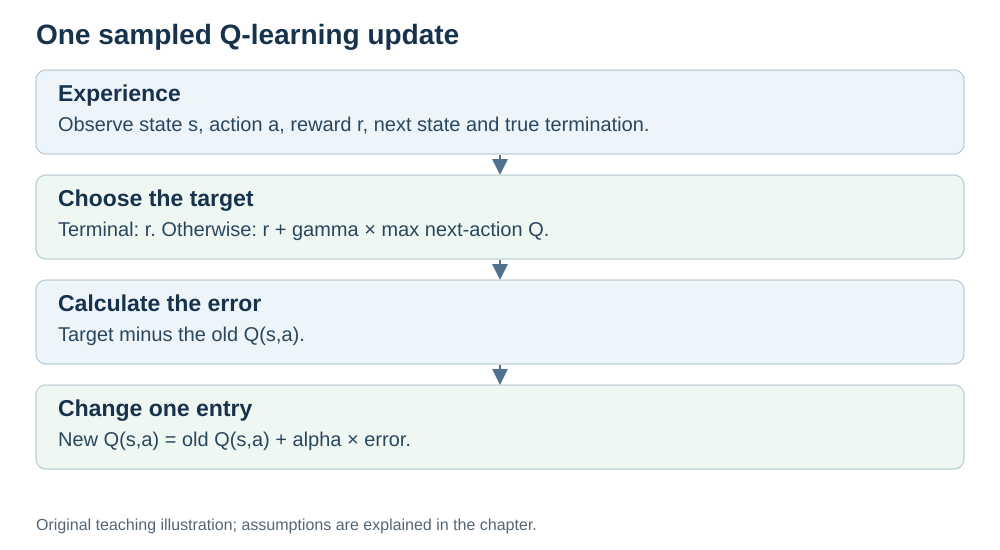

# Q-Learning: From Experience to an Action-Value Table

Previous: [Agents](AGENT.md) · [Module map](OUTLINE.md) · Next: [On-policy and off-policy](POLICY-RULE.md)

**Status:** revised with AI-assisted technical checks; awaiting team peer review.

**Stage 1 anchor topic:** this chapter contains the assumptions, algorithm, worked examples, activity and explained answers needed to study one topic from start to finish.

**Prerequisites:** state, action, reward, policy and episode from AGENT.md; ordinary arithmetic.

## Learning objectives

After this chapter, you should be able to:

1. Interpret a Q-value as an estimate of future return.
2. Trace a small Q-learning episode, including action selection and termination.
3. Calculate an update for a nonterminal or terminal transition.
4. Explain why exploration and repeated updates are needed.

## 1. The question a Q-value answers

In this chapter, states and actions form small, finite sets and the agent observes its full state. For example, it knows which grid square it occupies and chooses from four moves.

A **Q-table** stores one estimate $Q(s,a)$ for each state–action pair. It estimates the return from taking action $a$ in state $s$. In Q-learning, these estimates aim toward the values of an optimal policy.

Return includes more than the next reward. With discount factor $\gamma$:

$$
G_t=R_{t+1}+\gamma R_{t+2}+\gamma^2R_{t+3}+\cdots
$$

Later rewards receive less weight when $\gamma<1$. For our finite examples we can also define an undiscounted return with $\gamma=1$. We do not assume an infinite sum with $\gamma=1$ is always finite.

“Action value” is the formal term; “quality” is only a memory aid. A high estimated value can be wrong when little relevant experience has been collected. [Watkins and Dayan, 1992, pp. 280–282](https://www.gatsby.ucl.ac.uk/~dayan/papers/cjch.pdf).

## 2. The sampled update

After taking $a$ in state $s$, the agent observes reward $r$ and next state $s'$. For a nonterminal next state:

$$
Q(s,a)\leftarrow Q(s,a)+
\alpha\left[r+\gamma\max_{a'}Q(s',a')-Q(s,a)\right].
$$

| Symbol | Meaning in this chapter |
|---|---|
| $s,a$ | State and action of the experienced transition |
| $r$ | Observed immediate reward |
| $s'$ | Observed next state |
| $a'$ | A valid action available in the next state |
| $\max_{a'}Q(s',a')$ | Largest current next-action estimate |
| $\alpha$ | Learning rate; $0<\alpha\leq1$ in our examples |
| $\gamma$ | Discount factor; $0\leq\gamma\leq1$, with task assumptions as above |

The **target** is $r+\gamma\max_{a'}Q(s',a')$. Subtracting the old estimate gives the error; multiplying by $\alpha$ determines how far to move toward the target.

This is a sampled Q-learning update based on Bellman optimality. It is not an assertion that an imperfect estimate already equals its true expected value.

**Terminal rule:** if the transition reaches a true terminal state, the target is just $r$; there is no later task reward to bootstrap from. An external time limit is not automatically the same as task termination. [PyTorch DQN tutorial, final-state handling](https://docs.pytorch.org/tutorials/intermediate/reinforcement_q_learning.html).

## 3. Choosing actions: exploration and exploitation

**Exploitation** chooses an action with a currently high estimate. **Exploration** tries alternatives to obtain information.

One simple rule is **ε-greedy**: with probability $1-\varepsilon$, choose a highest-valued valid action; with probability $\varepsilon$, choose a random valid action. If $\varepsilon=0.1$, the random-choice branch is used about 10% of the time; it can still happen to select the greedy action.

Q-learning uses the experienced reward and transition. Its target uses the largest next-action estimate even when the behavior policy actually selects another next action. This makes it an off-policy method. [David Silver, Model-Free Control, slides 10 and 34–37](https://davidstarsilver.wordpress.com/wp-content/uploads/2025/04/lecture-5-model-free-control-.pdf).

## 4. A complete small learning procedure

1. Initialize the Q-table, often with zeros, and choose $\alpha$, $\gamma$ and an exploration rule.
2. Start an episode and observe its first state.
3. Select a valid action using the behavior policy, such as ε-greedy.
4. Execute it and observe the reward, next state and termination signal.
5. Form the target: reward only if terminal; otherwise reward plus the discounted largest next-state estimate.
6. Update the experienced table entry.
7. If the task terminated, end the episode. Otherwise use the next state and repeat from step 3.
8. Collect more episodes to improve the estimates.

*Original teaching diagram. Only the experienced entry is changed by this update.*

A short run is not guaranteed to find optimal values. The tabular convergence result requires suitable assumptions, including sufficient exploration and appropriate learning rates. We use simple constant rates for arithmetic demonstrations, not as a proof of convergence. [Watkins and Dayan, 1992, convergence theorem](https://www.gatsby.ucl.ac.uk/~dayan/papers/cjch.pdf).

## 5. Worked episode: retaining the result 55

This is an illustrative two-step task, separate from the introductory maze's reward scheme. Initially:

| State | Action | Current estimate |
|---|---|---:|
| A | X | 20 |
| A | Y | 12 |
| B | left | 50 |
| B | right | 30 |

Take $\alpha=1$ and $\gamma=0.9$. The behavior policy selects X in A. It receives reward 10 and reaches **nonterminal** B.

$$
\text{target}=10+0.9(50)=55
$$

$$
Q(A,X)=20+1(55-20)=55.
$$

At B, suppose the policy selects left, receives reward 50 and reaches the terminal exit. Its target is 50, so $Q(B,\mathrm{left})=50+1(50-50)=50$. The episode ends.

| Step | Experienced transition | Target | Updated entry |
|---|---|---:|---|
| 1 | A, X → reward 10, B, nonterminal | 55 | $Q(A,X):20\rightarrow55$ |
| 2 | B, left → reward 50, terminal exit | 50 | $Q(B,\mathrm{left}):50\rightarrow50$ |

The other two entries remain unchanged. The value 55 uses current estimates; a different outcome or later evidence could change them.

## 6. Worked terminal update

In a separate transition, an entry has old value 20, reward 10 and learning rate 0.5. The next state is terminal:

$$
\text{target}=10,\qquad
Q_{\mathrm{new}}=20+0.5(10-20)=15.
$$

Adding a future-state estimate here would invent rewards after the task has ended.

## 7. Your turn

1. **QL-1:** Old Q is 5; reward is 4; the next state is nonterminal with largest Q estimate 15; $\gamma=0.8$ and $\alpha=0.5$. Calculate the target and new Q.
2. **QL-2:** Repeat QL-1 if the transition instead terminates the task.
3. **QL-3:** The greedy action currently looks best. Why still explore?
4. **QL-4:** In the worked episode, which entries changed? Does one episode establish an optimal policy?

Try the questions before opening the [explained answers](ANSWER-KEY.md#ql-1).

## 8. From tables to neural networks

A table becomes impractical when there are enormous numbers of distinct observations. A neural network can instead share parameters across inputs and approximate action values.

Standard DQN uses a finite, discrete action set and predicts a value for each available action. Continuous motor commands require different treatment or an explicit discretization. Neural networks do not make every unseen prediction correct, and large models are not necessary for this table-based example. [Spinning Up, action spaces](https://spinningup.openai.com/en/latest/spinningup/rl_intro.html#action-spaces).

## 9. Scope boundaries

- **Detailed:** Q-table, sampled update, ε-greedy actions, terminal handling and arithmetic.
- **Brief:** convergence assumptions and the connection with DQN.
- **Out of scope:** convergence proofs, full Bellman derivations, continuous control, PPO/SAC derivations and production training.

[Next: On-policy and off-policy learning](POLICY-RULE.md)
