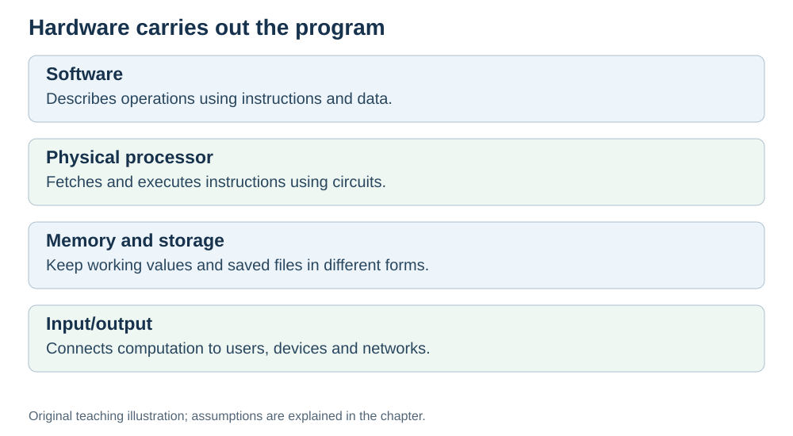

# Why hardware matters

**Status:** Revised on 26 October 2026 with AI-assisted technical checks; awaiting team peer review.

[Reading order](../OUTLINE.md) · [Teaching-machine conventions](../OUTLINE.md#teaching-machine-conventions) · [Explained answers](../ANSWER-KEY.md#h01-01)

**Learning objective:** after this section, a beginner should be able to explain why a program needs hardware to run, and why knowing hardware helps you understand performance.

## 1. Why this matters

You write code, press Run, and something happens. It is easy to think the program "just runs". It does not. Source code may be text; executable instructions are encoded as bits. Something physical has to read it, follow it, and produce a result. That physical something is hardware.

If you do not know what hardware does, every performance problem looks like magic. Once you know the parts, "why is this slow?" becomes a question you can actually answer.

## 2. Explanation

A program is a list of instructions. Instructions are just numbers stored somewhere. On their own, they do nothing — like a recipe lying on a table.

To turn a recipe into a meal, you need a kitchen: a cook, a counter, a fridge, a stove. To turn instructions into a running program, you need hardware: a CPU to execute them, memory to hold them, storage to keep them, and ways to get data in and out.

The simple way to remember it:

> **Software is the recipe. Hardware is the kitchen.**

The recipe tells you what to do. The kitchen is what actually gets it done. Both are needed. A perfect recipe in an empty room produces nothing, and a great kitchen with no recipe produces nothing either.

This is why we study hardware in this project: not to become chip designers, but to understand the kitchen well enough to know why some meals are fast and some are slow.

## 3. Diagram

*Original teaching diagram created for the 26 October revision. Read the stated model assumptions alongside it.*

## 4. Example

You write a loop that sums a million numbers and press Run.

- The **recipe** is your loop — a list of steps.
- The **kitchen** is your laptop: the CPU follows the steps, RAM holds the numbers, the disk holds your file, the screen shows the result.

If the loop is slow, the reason is somewhere in that kitchen: maybe the CPU is waiting for memory, maybe the numbers do not fit in cache, maybe the code produces too many instructions. You cannot tell which without knowing the parts.

## 5. Check yourself

Try these first, then use the [explained answers](../ANSWER-KEY.md#h01-01).

1. In your own words: why does a program need hardware?
2. What does "software is the recipe, hardware is the kitchen" mean?
3. Why does knowing hardware help you understand why a program is slow?
4. Give one example of a program you use, and name two hardware parts it depends on.

## 6. Sources

- [MIT OpenCourseWare, 6.004 (Spring 2017), 13.1 Building the Beta](https://ocw.mit.edu/courses/6-004-computation-structures-spring-2017/pages/c13/c13s1/)
- [Cornell CS 3410 (Spring 2025), Input/Output: devices, storage and interconnects](https://www.cs.cornell.edu/courses/cs3410/2025sp/notes/io.html)

These sources support the technical concepts; our pseudocode, examples and analogies are teaching simplifications. Course-specific coverage is still to be checked by the team.
