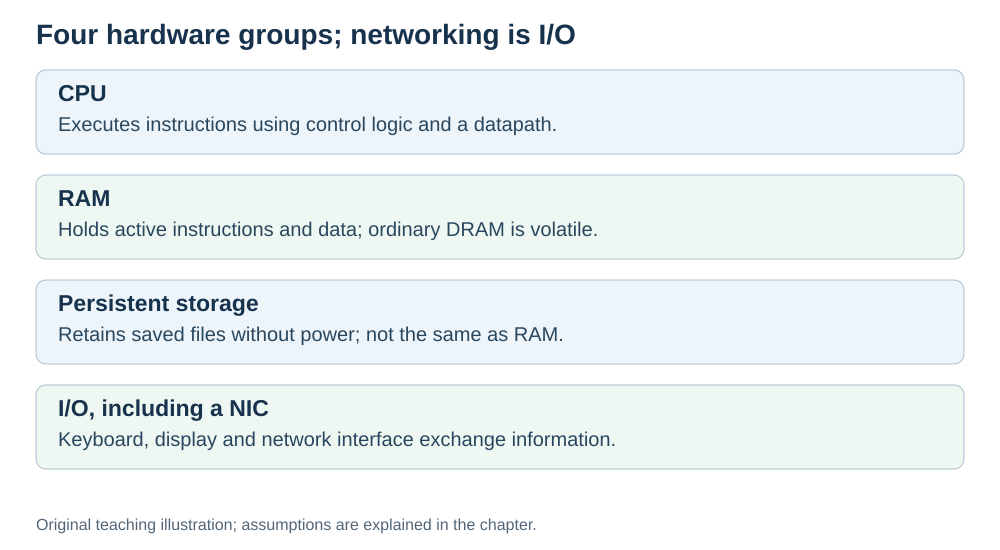

# The hardware groups used in this project

**Status:** Revised on 26 October 2026 with AI-assisted technical checks; awaiting team peer review.

[Reading order](../OUTLINE.md) · [Teaching-machine conventions](../OUTLINE.md#teaching-machine-conventions) · [Explained answers](../ANSWER-KEY.md#h01-02)

**Learning objective:** after this section, a beginner should be able to name the main hardware groups used in this project and explain what each one does.

## 1. Why this matters

For this project we group the discussion into CPU, main memory, persistent storage and I/O, then examine networking as an important I/O use. These groups give you a map for the later topics. They are a practical teaching view, not five separate components required in every computer.

## 2. Explanation

Here are our hardware groups, in plain words. Networking is listed separately for teaching, while remaining part of I/O.

**CPU (processor)** — runs instructions. It does the actual work: adds numbers, compares values, decides what happens next. It is the part that "thinks".

**Memory (RAM)** — fast but temporary storage. It holds the data the CPU is working on right now. Ordinary DRAM loses its stored information without power. Its technology and connection to the processor make it suitable for active data; access is generally slower than on-chip cache.

**Storage (SSD or disk)** — persistent storage, generally slower to access than RAM. It holds files, programs, photos — everything that must survive a reboot. It is much larger than RAM but much slower.

**Input/Output (I/O)** — keyboard, mouse, screen, speakers, network card. These are how the computer talks to the outside world. Input comes in, output goes out.

**Networking through a NIC** — connects this computer to other computers and is one type of I/O. It is how data travels between machines: web pages, messages, videos, cloud storage.

The key idea: **a computer is not one thing — it is a few parts working together.** Each part has one job. The CPU computes, memory holds, storage keeps, I/O communicates, the network connects.

## 3. Diagram

*Original teaching diagram created for the 26 October revision. Read the stated model assumptions alongside it.*

## 4. Example

You open a video on your laptop:

- **Storage** — the video file sits on the disk.
- **RAM** — a chunk of the video is loaded into memory so the CPU can work with it.
- **CPU** — decodes the video frames.
- **I/O** — the picture goes to the screen, the sound goes to the speakers.
- **Network** — if the video is online, it first arrives over the network.

For an online video, all these groups can participate. For a local file, the network is unnecessary. Many systems also use dedicated video-decoding hardware; this example follows a simple CPU-based path.

## 5. Check yourself

Try these first, then use the [explained answers](../ANSWER-KEY.md#h01-02).

1. Name the hardware groups used in this project.
2. Which group is working memory, and which retains saved data without power?
3. What does I/O mean, and give two examples.
4. Why is a computer "not one thing"?
5. Which part connects your computer to the internet?

## 6. Sources

- [MIT OpenCourseWare, 6.004 (Spring 2017), 13.1 Building the Beta](https://ocw.mit.edu/courses/6-004-computation-structures-spring-2017/pages/c13/c13s1/)
- [Cornell CS 3410 (Spring 2025), Input/Output: devices, storage and interconnects](https://www.cs.cornell.edu/courses/cs3410/2025sp/notes/io.html)

These sources support the technical concepts; our pseudocode, examples and analogies are teaching simplifications. Course-specific coverage is still to be checked by the team.
