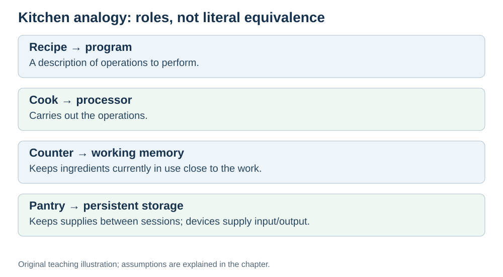

# The kitchen analogy

**Status:** Revised on 26 October 2026 with AI-assisted technical checks; awaiting team peer review.

[Reading order](../OUTLINE.md) · [Teaching-machine conventions](../OUTLINE.md#teaching-machine-conventions) · [Explained answers](../ANSWER-KEY.md#h01-03)

**Learning objective:** after this section, a beginner should be able to match each part of a computer to a part of a kitchen, and use the analogy to explain how the parts work together.

## 1. Why this matters

Technical words are easy to forget. A picture is easy to remember. This file gives you one picture — a kitchen — that you can use for the rest of the Hardware part. Every time you meet a new term, you can ask: "which part of the kitchen is this?"

## 2. Explanation

Here is the analogy, part by part.

- The **CPU** is the **cook**. It follows the recipe, one step at a time.
- **Memory (RAM)** is the **counter and the fridge**. It holds the ingredients the cook is using right now — close at hand, but gone when the kitchen closes.
- **Storage (SSD/disk)** is the **pantry**. It holds everything, but walking to the pantry takes time.
- **Buses** are the **cook's hands and the pass-through window**. They carry things between the counter and the cook.
- A **program** is the **recipe book**. It is a list of steps, stored somewhere, waiting to be followed.
- **Input/Output** is the **serving window and the delivery door**. Food goes out to customers; new ingredients come in.
- The **network** is the **delivery route**. It connects this kitchen to other kitchens and suppliers.

A cook does not "understand" ingredients. The cook just moves them, combines them, and puts the result on a plate. A CPU works the same way: it does not understand your variables. It moves values between places and performs operations on them.

The analogy is not perfect — a kitchen does not have a clock ticking billions of times per second — but it gives you the right intuition: **small parts, each with one job, working together.**

## 3. Diagram

*Original teaching diagram created for the 26 October revision. Read the stated model assumptions alongside it.*

## 4. Example

Trace `a = b + c` through the kitchen:

- The **recipe** says: "take b, take c, add them, put the result in a."
- The **cook (CPU)** reads the line.
- The **hands (buses)** bring `b` and `c` from the **counter (RAM)**.
- The cook **combines** them (the ALU adds them).
- The result goes back to the counter as `a`.

No part is magic. Each one just did its job. This models the main data movement; real processors use registers and caches between arithmetic and main memory.

## 5. Check yourself

Try these first, then use the [explained answers](../ANSWER-KEY.md#h01-03).

1. Which kitchen part matches the CPU? Which matches RAM?
2. Why is storage like a pantry, and not like the counter?
3. What do the buses match in the kitchen?
4. In your own words: why does the analogy help you understand hardware?
5. Where does the analogy break down? Name one thing a kitchen cannot show.

## 6. Sources

- [MIT OpenCourseWare, 6.004 (Spring 2017), 13.1 Building the Beta](https://ocw.mit.edu/courses/6-004-computation-structures-spring-2017/pages/c13/c13s1/)
- [Cornell CS 3410 (Spring 2025), Input/Output: devices, storage and interconnects](https://www.cs.cornell.edu/courses/cs3410/2025sp/notes/io.html)

These sources support the technical concepts; our pseudocode, examples and analogies are teaching simplifications. Course-specific coverage is still to be checked by the team.
