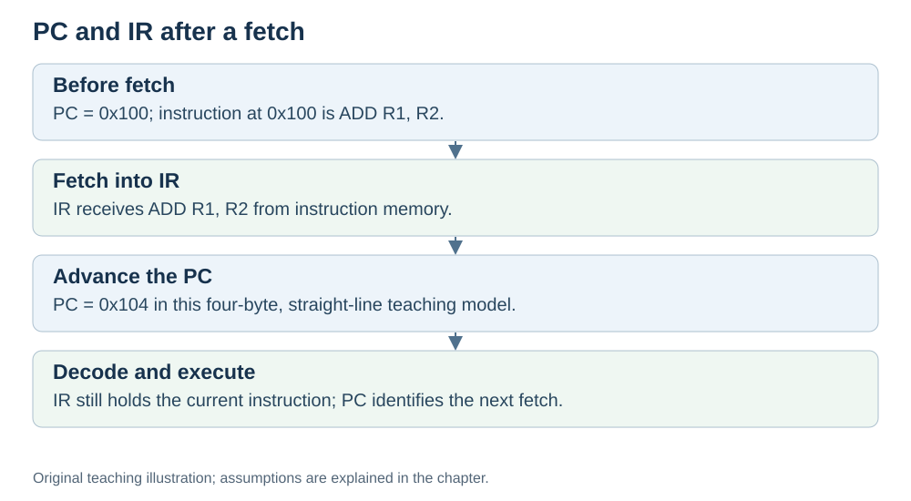

# PC and IR: where the CPU keeps its place

**Status:** Revised on 26 October 2026 with AI-assisted technical checks; awaiting team peer review.

[Reading order](../OUTLINE.md) · [Teaching-machine conventions](../OUTLINE.md#teaching-machine-conventions) · [Explained answers](../ANSWER-KEY.md#h02-01)

**Learning objective:** after this section, a beginner should be able to explain what the Program Counter and the Instruction Register are, and why the CPU needs both.

## 1. Why this matters

The CPU runs instructions one after another. To do that, it needs to answer two questions at every moment: "where is the next instruction?" and "what am I doing right now?" The CPU answers these with two small registers: PC and IR. Without them, it would lose its place.

## 2. Explanation

**PC (Program Counter)** identifies an instruction address. In our teaching cycle, it holds the fetch address at the start and advances to the following instruction during fetch. Think of it as a bookmark: it tells the CPU where to read next. After an instruction is fetched, the PC moves forward to point at the following one.

**IR (Instruction Register)** is a register that holds the **current instruction** — the one being worked on right now. Think of it as the line of the recipe you are reading at this moment.

The difference is simple:

- **PC** = "where to go next" (an address).
- **IR** = "what I am doing now" (an instruction).

Both are needed. The PC is how the CPU keeps moving forward; the IR is how it holds on to the instruction long enough to decode and execute it.

In this teaching model PC advances during fetch, before execute finishes. This is a convention for our traces, not a universal timing rule for every processor. A branch or jump can redirect it.

## 3. Diagram

*Original teaching diagram created for the 26 October revision. Read the stated model assumptions alongside it.*

## 4. Example

Suppose the program is at address `0x100` and each instruction is 4 bytes.

- PC = `0x100` → the CPU fetches the instruction at `0x100`.
- That instruction goes into IR.
- PC becomes `0x104` → it now points to the next instruction.
- The CPU decodes and executes what is in IR.
- Then the cycle repeats with PC = `0x104`.

During decode and execute in this model, PC already identifies the next sequential fetch address and IR holds the instruction currently being processed.

## 5. Check yourself

Try these first, then use the [explained answers](../ANSWER-KEY.md#h02-01).

1. What does the PC hold? What does the IR hold?
2. Why does PC already point to the following instruction during execute in our teaching model?
3. What would happen if the CPU had no PC?
4. What would happen if the CPU had no IR?

## 6. Sources

- [MIT OpenCourseWare, 6.004 (Spring 2017), 13.1 Building the Beta](https://ocw.mit.edu/courses/6-004-computation-structures-spring-2017/pages/c13/c13s1/)
- [RISC-V International, RV32I specification v20260120, programmer model and load/store instructions](https://docs.riscv.org/reference/isa/v20260120/unpriv/rv32.html)

These sources support the technical concepts; our pseudocode, examples and analogies are teaching simplifications. Course-specific coverage is still to be checked by the team.
