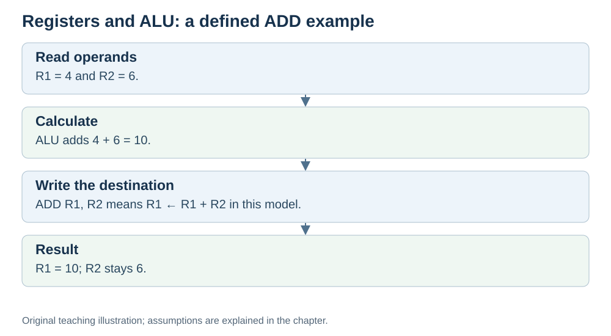

# Registers and the ALU: where values live and where math happens

**Status:** Revised on 26 October 2026 with AI-assisted technical checks; awaiting team peer review.

[Reading order](../OUTLINE.md) · [Teaching-machine conventions](../OUTLINE.md#teaching-machine-conventions) · [Explained answers](../ANSWER-KEY.md#h02-02)

**Learning objective:** after this section, a beginner should be able to explain what registers are, what the ALU does, and why the CPU needs both.

## 1. Why this matters

The CPU works with values: numbers, addresses, intermediate results. Those values have to live somewhere, and the math has to happen somewhere. Registers are the "somewhere" for values; the ALU is the "somewhere" for math. Together they are the working core of the CPU.

## 2. Explanation

**Registers** are small, very fast storage slots inside the CPU. For illustration, some instruction sets expose 16 or 32 general-purpose registers; the number depends on the architecture. They hold the values the CPU is working on right now: operands, results, addresses.

Registers are the **fastest storage in the machine**. Much faster than RAM, much much faster than disk. That is why the CPU keeps its active values there.

**ALU (Arithmetic Logic Unit)** is a circuit that performs operations on values:

- **Arithmetic**: add and subtract; multiplication/division may use separate functional units, depending on the processor.
- **Logic**: AND, OR, NOT, compare.

The ALU takes inputs from registers, performs the operation, and produces a result. That result is then written back to a register.

The flow is simple:

> **registers → ALU → register**

Values come from registers, the ALU computes, the result goes back to a register. This is the simplified datapath used by our arithmetic examples; real CPUs can contain additional specialised execution units.

## 3. Diagram

*Original teaching diagram created for the 26 October revision. Read the stated model assumptions alongside it.*

## 4. Example

`ADD R1, R2` (meaning "R1 = R1 + R2"):

- R1 = 5, R2 = 3.
- The ALU receives 5 and 3 as inputs.
- The ALU computes 5 + 3 = 8.
- The result 8 is written back to R1.

After the instruction: R1 = 8, R2 = 3. The ALU did the math; the registers held the values.

## 5. Check yourself

Try these first, then use the [explained answers](../ANSWER-KEY.md#h02-02).

1. What are registers, and why are they fast?
2. What does the ALU do? Give two examples of operations.
3. In `ADD R1, R2`, what goes into the ALU, and where does the result go?
4. Why can't the CPU keep all its values in registers?

## 6. Sources

- [MIT OpenCourseWare, 6.004 (Spring 2017), 13.1 Building the Beta](https://ocw.mit.edu/courses/6-004-computation-structures-spring-2017/pages/c13/c13s1/)
- [RISC-V International, RV32I specification v20260120, programmer model and load/store instructions](https://docs.riscv.org/reference/isa/v20260120/unpriv/rv32.html)

These sources support the technical concepts; our pseudocode, examples and analogies are teaching simplifications. Course-specific coverage is still to be checked by the team.
