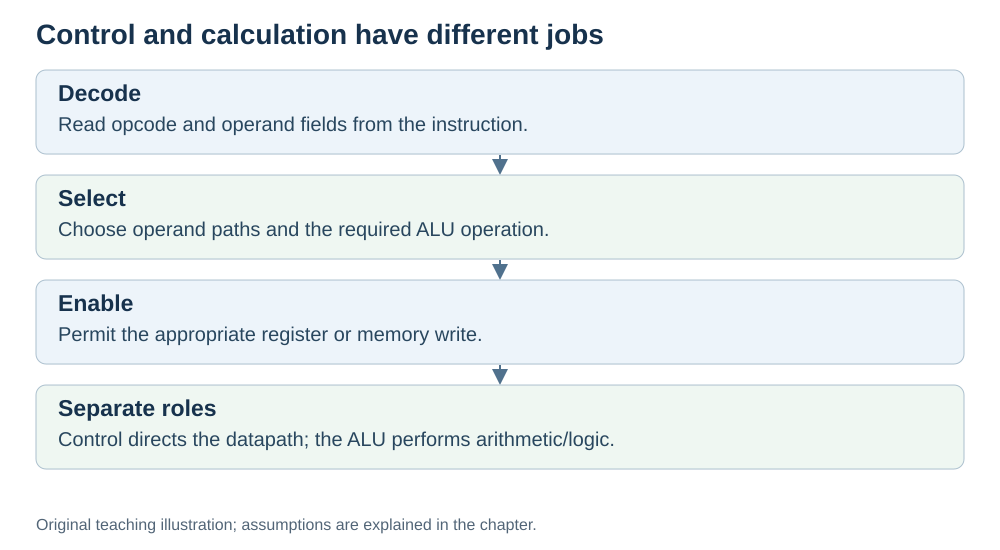

# The control unit: the manager of the CPU

**Status:** Revised on 26 October 2026 with AI-assisted technical checks; awaiting team peer review.

[Reading order](../OUTLINE.md) · [Teaching-machine conventions](../OUTLINE.md#teaching-machine-conventions) · [Explained answers](../ANSWER-KEY.md#h02-03)

**Learning objective:** after this section, a beginner should be able to explain what the control unit does and why the CPU needs a "manager".

## 1. Why this matters

The CPU has many parts: registers, ALU, buses, memory. Someone has to tell each part what to do and when. That someone is the control unit. Without it, the parts would not work together.

## 2. Explanation

The **control unit** is the part of the CPU that **reads the instruction and tells the other parts what to do**.

Here is what it does:

1. It reads the current instruction from IR.
2. It works out what the instruction means: what operation, which registers, where the result goes.
3. It sends **control signals** to the other parts: "read this register", "tell the ALU to add", "write the result here".

The control unit does not do math itself. It is not the storage location for the program's operand values; real control circuits can hold internal control state. It **directs**. It is the manager: it does not cook, but it tells the cook what to do next.

This is the "decode" part of the fetch–decode–execute cycle. The control unit is what turns an instruction into a set of actions.

## 3. Diagram

*Original teaching diagram created for the 26 October revision. Read the stated model assumptions alongside it.*

## 4. Example

Instruction in IR: `ADD R1, R2`.

- The control unit reads it and understands: "this is an add, sources are R1 and R2, destination is R1".
- It sends a signal to the registers: "put R1 and R2 on the ALU inputs".
- It sends a signal to the ALU: "add".
- It sends a signal to the register file: "write the ALU result into R1".

In this example, the control unit directed the data movement; the register file held operands and the ALU performed the addition. It just told everyone what to do — and that is exactly its job.

## 5. Check yourself

Try these first, then use the [explained answers](../ANSWER-KEY.md#h02-03).

1. What does the control unit do?
2. Does the control unit do math? Why or why not?
3. In `ADD R1, R2`, what signals does the control unit send?
4. What does the control unit determine during decode, and why are control signals also needed in other phases?

## 6. Sources

- [MIT OpenCourseWare, 6.004 (Spring 2017), 13.1 Building the Beta](https://ocw.mit.edu/courses/6-004-computation-structures-spring-2017/pages/c13/c13s1/)
- [RISC-V International, RV32I specification v20260120, programmer model and load/store instructions](https://docs.riscv.org/reference/isa/v20260120/unpriv/rv32.html)

These sources support the technical concepts; our pseudocode, examples and analogies are teaching simplifications. Course-specific coverage is still to be checked by the team.
