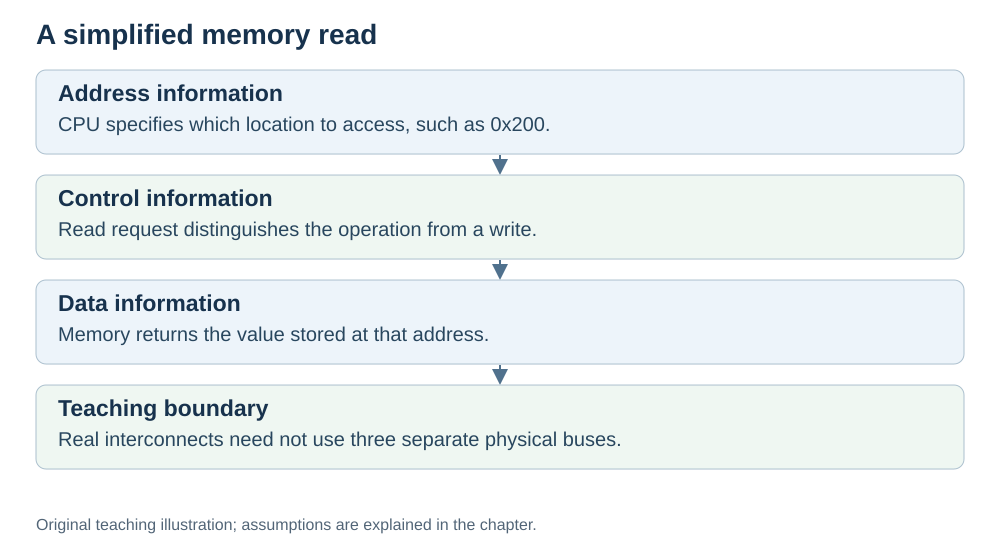

# Buses: the roads between parts

**Status:** Revised on 26 October 2026 with AI-assisted technical checks; awaiting team peer review.

[Reading order](../OUTLINE.md) · [Teaching-machine conventions](../OUTLINE.md#teaching-machine-conventions) · [Explained answers](../ANSWER-KEY.md#h02-04)

**Learning objective:** after this section, a beginner should be able to explain what a bus is, and the difference between the address bus and the data bus.

## 1. Why this matters

The CPU, memory, and other parts need to exchange information. They do it over **buses** — sets of wires that carry signals. If you do not know the buses, you cannot understand how the CPU talks to memory.

## 2. Explanation

A **bus** is a communication path and its signalling rules for exchanging information between components. Our simple drawing separates address, data and control paths; modern interconnects can combine or packetise these signals. Think of it as a road: things travel along it from one place to another.

Two buses matter most:

**Address path** — carries **addresses**. For the CPU-initiated memory operation shown here, direction: CPU → memory. The CPU says: "give me what is at this address."

**Data bus** — carries **data** (values and instructions). Direction: memory → CPU (and back). Memory says: "here is the value."

The difference is simple:

- **Address bus** = "which place?" (a location)
- **Data bus** = "what is in it?" (the content)

In kitchen terms: the address bus is the cook pointing at a shelf; the data bus is the hand bringing the item back.

There is also a **control bus**, which carries signals like "read" or "write" — telling memory whether the CPU wants to read a value or write one. For now, the two main buses (address and data) are enough.

## 3. Diagram

*Original teaching diagram created for the 26 October revision. Read the stated model assumptions alongside it.*

## 4. Example

The CPU wants to read the instruction at address `0x100`:

- The CPU puts `0x100` on the **address bus**.
- Memory finds the cell at `0x100`.
- Memory puts the contents of that cell on the **data bus**.
- The CPU reads the value from the data bus.

Two buses, two jobs: one says *where*, the other carries *what*.

## 5. Check yourself

Try these first, then use the [explained answers](../ANSWER-KEY.md#h02-04).

1. What is a bus?
2. What does the address bus carry? In which direction?
3. What does the data bus carry? In which direction?
4. What is the difference between "which place" and "what is in it"?
5. In the kitchen analogy, what matches the address bus?

## 6. Sources

- [MIT OpenCourseWare, 6.004 (Spring 2017), 13.1 Building the Beta](https://ocw.mit.edu/courses/6-004-computation-structures-spring-2017/pages/c13/c13s1/)
- [RISC-V International, RV32I specification v20260120, programmer model and load/store instructions](https://docs.riscv.org/reference/isa/v20260120/unpriv/rv32.html)

These sources support the technical concepts; our pseudocode, examples and analogies are teaching simplifications. Course-specific coverage is still to be checked by the team.
