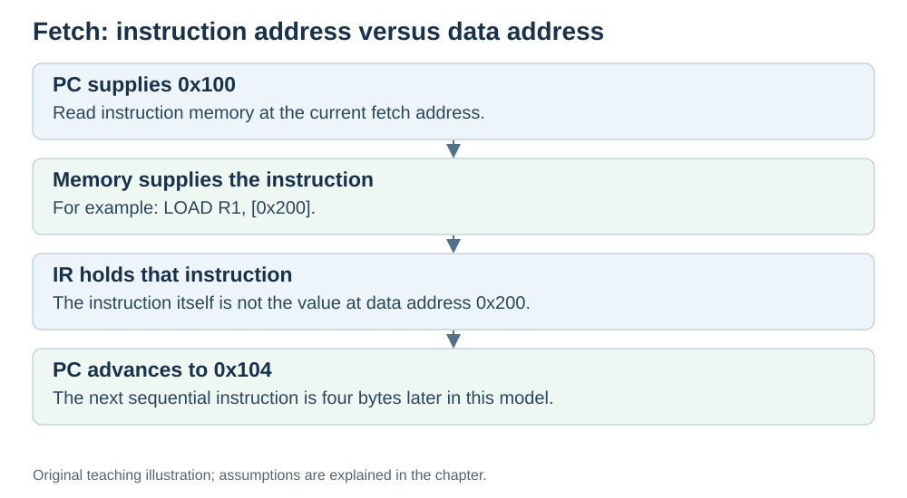

# Fetch: get the next instruction

**Status:** Revised on 26 October 2026 with AI-assisted technical checks; awaiting team peer review.

[Reading order](../OUTLINE.md) · [Teaching-machine conventions](../OUTLINE.md#teaching-machine-conventions) · [Explained answers](../ANSWER-KEY.md#h03-01)

**Learning objective:** after this section, a beginner should be able to describe the steps of the fetch phase and explain what the PC and the two buses do during it.

## 1. Why this matters

Before the CPU can do anything with an instruction, it has to get it. Fetch is the first phase of the cycle — the step where the CPU reads the next instruction from memory. If you understand fetch, you understand how the CPU keeps moving forward.

## 2. Explanation

Fetch answers one question: **what is the next instruction, and where is it?**

In our simplified sequential teaching cycle:

1. **PC holds the address** of the next instruction.
2. The CPU puts that address on the **address bus**.
3. **Memory returns the instruction** on the **data bus**.
4. The instruction is loaded into **IR**.
5. **PC is incremented** — it now points to the following instruction.

Notice the order: the PC moves forward *before* the instruction is executed. During decode/execute in this model, PC therefore holds the following sequential address. Other implementations and branches need different details.

In kitchen terms: the cook looks at the next line of the recipe and reads it. The bookmark (PC) moves to the next line, and the current line (IR) is now in hand.

## 3. Diagram

*Original teaching diagram created for the 26 October revision. Read the stated model assumptions alongside it.*

## 4. Example

Suppose the PC = `0x100`, and each instruction is 4 bytes.

- Address `0x100` goes on the address bus.
- Memory returns the instruction at `0x100` on the data bus.
- The instruction lands in IR.
- PC becomes `0x104`.

Now the CPU has the instruction in IR and is ready to decode it. The PC is already pointing at the next one.

## 5. Check yourself

Try these first, then use the [explained answers](../ANSWER-KEY.md#h03-01).

1. What question does fetch answer?
2. List the five steps of fetch in order.
3. Why does PC already point to the following instruction during execute in this teaching model?
4. Which bus carries the address, and which carries the instruction?
5. In the kitchen analogy, what does fetch match?

## 6. Sources

- [MIT OpenCourseWare, 6.004 (Spring 2017), 13.1 Building the Beta](https://ocw.mit.edu/courses/6-004-computation-structures-spring-2017/pages/c13/c13s1/)
- [MIT OpenCourseWare, 6.004 (Spring 2017), 15.1 Pipelining the Beta](https://ocw.mit.edu/courses/6-004-computation-structures-spring-2017/pages/c15/c15s1/)

These sources support the technical concepts; our pseudocode, examples and analogies are teaching simplifications. Course-specific coverage is still to be checked by the team.
