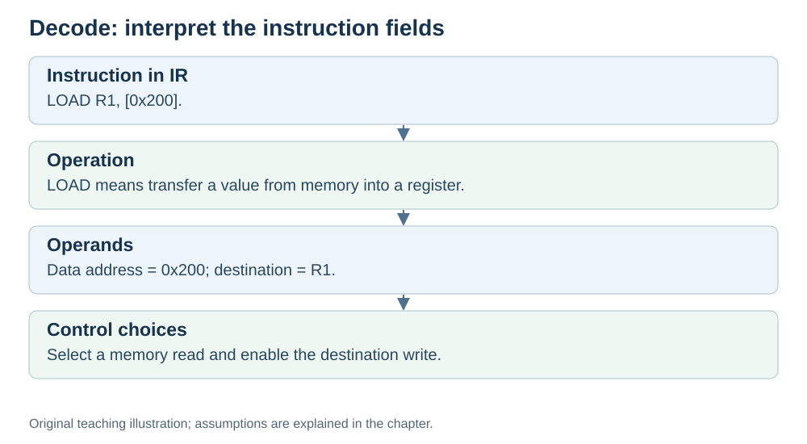

# Decode: figure out what the instruction means

**Status:** Revised on 26 October 2026 with AI-assisted technical checks; awaiting team peer review.

[Reading order](../OUTLINE.md) · [Teaching-machine conventions](../OUTLINE.md#teaching-machine-conventions) · [Explained answers](../ANSWER-KEY.md#h03-02)

**Learning objective:** after this section, a beginner should be able to explain what the decode phase does and what the control unit works out during it.

## 1. Why this matters

An instruction is just a number. On its own, it means nothing. Before the CPU can execute it, something has to work out what it means: what operation, which registers, where the result goes. That is what decode does.

## 2. Explanation

Decode answers one question: **what does this instruction mean?**

The **control unit** reads the instruction from IR and works out three things:

1. **What operation is this?** Add, subtract, load, store, jump…
2. **Which registers are the operands?** Where do the input values come from?
3. **Where does the result go?** Which register or memory location?

Once it knows these three things, the control unit sends **control signals** to the other parts: "read this register", "tell the ALU to add", "write the result here".

In kitchen terms: the cook reads "chop the onion" and figures out which knife and which board to use. The instruction is understood; the tools are chosen.

In this model, decode does not yet change the program's destination register or data memory. It determines control signals and can read operands into internal working state.

## 3. Diagram

*Original teaching diagram created for the 26 October revision. Read the stated model assumptions alongside it.*

## 4. Example

Instruction in IR: `ADD R1, R2`.

The control unit works out:

- **Operation:** add.
- **Operands:** R1 and R2.
- **Destination:** R1.

It then sends signals: "put R1 and R2 on the ALU inputs", "tell the ALU to add", "write the result into R1".

No values have changed yet. The CPU is now ready to execute.

## 5. Check yourself

Try these first, then use the [explained answers](../ANSWER-KEY.md#h03-02).

1. What question does decode answer?
2. What three things does the control unit work out during decode?
3. Does decode change the destination register or data memory in our model? What does it prepare?
4. In `LOAD R1, [0x200]`, what does the control unit work out?
5. In the kitchen analogy, what does decode match?

## 6. Sources

- [MIT OpenCourseWare, 6.004 (Spring 2017), 13.1 Building the Beta](https://ocw.mit.edu/courses/6-004-computation-structures-spring-2017/pages/c13/c13s1/)
- [MIT OpenCourseWare, 6.004 (Spring 2017), 15.1 Pipelining the Beta](https://ocw.mit.edu/courses/6-004-computation-structures-spring-2017/pages/c15/c15s1/)

These sources support the technical concepts; our pseudocode, examples and analogies are teaching simplifications. Course-specific coverage is still to be checked by the team.
