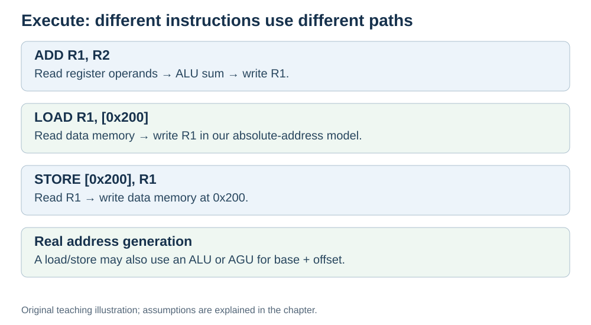

# Execute: actually do it

**Status:** Revised on 26 October 2026 with AI-assisted technical checks; awaiting team peer review.

[Reading order](../OUTLINE.md) · [Teaching-machine conventions](../OUTLINE.md#teaching-machine-conventions) · [Explained answers](../ANSWER-KEY.md#h03-03)

**Learning objective:** after this section, a beginner should be able to explain what happens during the execute phase, for both arithmetic and memory instructions.

## 1. Why this matters

Fetch gets the instruction, decode understands it — execute is where the work actually happens. This is the phase where values change and results appear.

## 2. Explanation

Execute answers one question: **do the operation.**

For an **arithmetic instruction** (like `ADD`):

1. Operands are read from registers.
2. They are fed into the **ALU**.
3. The ALU performs the operation.
4. The result is written back to a register.

For a **memory instruction** (like `LOAD` or `STORE`):

1. The address is put on the **address bus**.
2. Memory reads or writes the value on the **data bus**.
3. The value is written into a register (for `LOAD`) or taken from a register (for `STORE`).

A real load/store may first calculate an **effective address**, often using an ALU or an address-generation unit (AGU). Our absolute-address pseudocode supplies the complete address directly, so the trace omits that calculation. In a load-store instruction set, arithmetic uses register operands and separate load/store instructions access data memory; this does not mean that loads can never use an ALU.

In kitchen terms: the cook actually chops, stirs, or plates. The work happens here.

## 3. Diagram

*Original teaching diagram created for the 26 October revision. Read the stated model assumptions alongside it.*

## 4. Example

**Arithmetic:** `ADD R1, R2`, R1 = 5, R2 = 3.

- ALU receives 5 and 3.
- ALU computes 8.
- Result 8 goes back to R1.

**Memory:** `LOAD R1, [0x200]`.

- Address `0x200` goes on the address bus.
- Memory returns the value on the data bus.
- The value is written into R1.
- This absolute-address teaching trace omits address arithmetic. A base-plus-offset load would also need an address calculation.

Same phase, different paths — depending on the instruction.

## 5. Check yourself

Try these first, then use the [explained answers](../ANSWER-KEY.md#h03-03).

1. What question does execute answer?
2. What happens during execute for an `ADD` instruction?
3. What happens during execute for a `LOAD` instruction?
4. What moves during `LOAD`, and how might a real processor calculate its memory address?
5. In the kitchen analogy, what does execute match?

## 6. Sources

- [MIT OpenCourseWare, 6.004 (Spring 2017), 13.1 Building the Beta](https://ocw.mit.edu/courses/6-004-computation-structures-spring-2017/pages/c13/c13s1/)
- [MIT OpenCourseWare, 6.004 (Spring 2017), 15.1 Pipelining the Beta](https://ocw.mit.edu/courses/6-004-computation-structures-spring-2017/pages/c15/c15s1/)

These sources support the technical concepts; our pseudocode, examples and analogies are teaching simplifications. Course-specific coverage is still to be checked by the team.
