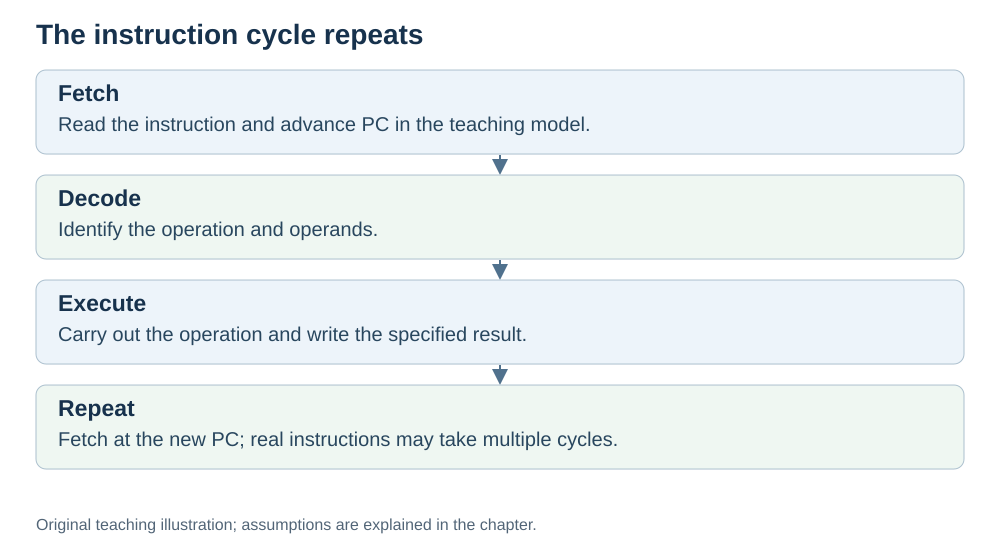

# Repeat and the clock: why the cycle never stops

**Status:** Revised on 26 October 2026 with AI-assisted technical checks; awaiting team peer review.

[Reading order](../OUTLINE.md) · [Teaching-machine conventions](../OUTLINE.md#teaching-machine-conventions) · [Explained answers](../ANSWER-KEY.md#h03-04)

**Learning objective:** after this section, a beginner should be able to explain why the fetch–decode–execute cycle repeats and what the clock does.

## 1. Why this matters

A program is not one instruction — it is millions or billions of them. The CPU runs them by repeating the same three phases over and over. The **clock** is what keeps this loop moving at a steady pace.

## 2. Explanation

After execute finishes, the cycle **repeats** with the next PC value. The CPU goes back to fetch, reads the next instruction, decodes it, executes it, and so on. This loop never stops while the program runs.

What drives the loop is the **clock**. The clock is a timing signal. Our examples assume a fixed rate; real CPUs may change frequency while running. Each tick is one **cycle**. A 3 GHz clock ticks about 3 billion times per second — about 0.33 nanoseconds per cycle.

The clock does not decide *what* to do. It decides *when* to move to the next step. It is the heartbeat: every phase of the cycle is timed by it.

In kitchen terms: the clock is the rhythm of the kitchen — the pace at which the cook moves from one step to the next.

## 3. Diagram

*Original teaching diagram created for the 26 October revision. Read the stated model assumptions alongside it.*

## 4. Example

A program with 1,000 instructions:

- Instruction 1: fetch, decode, execute.
- Instruction 2: fetch, decode, execute.
- …
- Instruction 1,000: fetch, decode, execute.

Each phase takes some number of clock cycles. For a non-overlapping teaching CPU, we can add the cycles used by the individual instructions. In a pipeline, instructions overlap, so use the total elapsed CPU-cycle count rather than adding their individual latencies. That is why the clock rate matters — but, as we will see in the Performance file, it is not the only thing that matters.

## 5. Check yourself

Try these first, then use the [explained answers](../ANSWER-KEY.md#h03-04).

1. Why does the cycle repeat?
2. What does the clock do? What does it *not* do?
3. A 3 GHz clock ticks how many times per second? How long is one cycle?
4. In the kitchen analogy, what does the clock match?

## 6. Sources

- [MIT OpenCourseWare, 6.004 (Spring 2017), 13.1 Building the Beta](https://ocw.mit.edu/courses/6-004-computation-structures-spring-2017/pages/c13/c13s1/)
- [MIT OpenCourseWare, 6.004 (Spring 2017), 15.1 Pipelining the Beta](https://ocw.mit.edu/courses/6-004-computation-structures-spring-2017/pages/c15/c15s1/)

These sources support the technical concepts; our pseudocode, examples and analogies are teaching simplifications. Course-specific coverage is still to be checked by the team.
