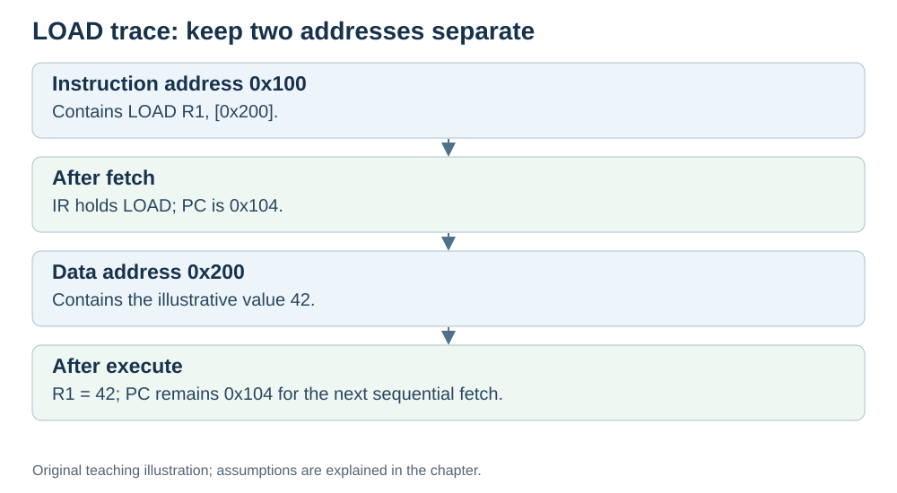

# Worked examples: tracing instructions

**Status:** Revised on 26 October 2026 with AI-assisted technical checks; awaiting team peer review.

[Reading order](../OUTLINE.md) · [Teaching-machine conventions](../OUTLINE.md#teaching-machine-conventions) · [Explained answers](../ANSWER-KEY.md#h03-05)

**Learning objective:** after this section, a beginner should be able to trace a simple instruction through fetch, decode, and execute, and state the final register values and the new PC.

## 1. Why this matters

Reading about the cycle is one thing; tracing a real instruction is another. This file puts the three phases together with concrete numbers, so you can see exactly what changes at each step.

## 2. Explanation

To trace an instruction, follow the same pattern every time:

1. **Start:** note the PC, the instruction, and the register values.
2. **Fetch:** PC → address bus → memory → data bus → IR; PC += 4.
3. **Decode:** control unit works out operation, operands, destination.
4. **Execute:** ALU computes (or memory is accessed); result written back.
5. **End:** state the new register values and the new PC.

This pattern applies to our four-byte, straight-line teaching instructions. Branches, interrupts and real processor implementation details are outside these particular traces.

## 3. Diagram

*Original teaching diagram created for the 26 October revision. Read the stated model assumptions alongside it.*

## 4. Example

### Example 1: `ADD R1, R2`

Suppose `ADD R1, R2` sits at address `0x100`. PC = `0x100`. R1 = 5, R2 = 3.

**Fetch:**
- PC = `0x100` → address bus.
- Memory returns the instruction → IR.
- PC becomes `0x104`.

**Decode:**
- Control unit reads IR: operation ADD, sources R1 and R2, destination R1.
- Prepares R1 and R2 as ALU inputs.

**Execute:**
- ALU receives 5 and 3, computes 8.
- Result 8 is written back to R1.

**Result:** R1 = 8, R2 = 3, PC = `0x104`.

### Example 2: `LOAD R1, [0x200]`

Suppose `LOAD R1, [0x200]` sits at address `0x100`. PC = `0x100`. Memory at `0x200` holds the value 42.

**Fetch:**
- PC = `0x100` → address bus.
- Memory returns the instruction → IR.
- PC becomes `0x104`.

**Decode:**
- Control unit reads IR: this is a load, address `0x200`, destination R1.

**Execute:**
- Address `0x200` goes on the address bus.
- Memory returns 42 on the data bus.
- 42 is written into R1.

**Result:** R1 = 42, PC = `0x104`.

### Example 3: `SUB R3, R4`

Suppose `SUB R3, R4` sits at address `0x200`. PC = `0x200`. R3 = 10, R4 = 4.

**Fetch:**
- PC = `0x200` → address bus.
- Memory returns the instruction → IR.
- PC becomes `0x204`.

**Decode:**
- Control unit reads IR: operation SUB, sources R3 and R4, destination R3.

**Execute:**
- ALU receives 10 and 4, computes 6.
- Result 6 is written back to R3.

**Result:** R3 = 6, R4 = 4, PC = `0x204`.

## 5. Check yourself

Try these first, then use the [explained answers](../ANSWER-KEY.md#h03-05).

1. Trace `ADD R5, R6` with R5 = 7, R6 = 2, instruction at `0x300`. What are the final values and the new PC?
2. Trace `LOAD R2, [0x400]`, located at instruction address `0x300`, with PC initially `0x300`. Memory at `0x400` holds 99. Assume a four-byte instruction. What is R2, and what is the new PC?
3. In all three examples, what stays the same? What changes?
4. Why does the PC always increase by 4 in these examples?

## 6. Sources

- [MIT OpenCourseWare, 6.004 (Spring 2017), 13.1 Building the Beta](https://ocw.mit.edu/courses/6-004-computation-structures-spring-2017/pages/c13/c13s1/)
- [MIT OpenCourseWare, 6.004 (Spring 2017), 15.1 Pipelining the Beta](https://ocw.mit.edu/courses/6-004-computation-structures-spring-2017/pages/c15/c15s1/)

These sources support the technical concepts; our pseudocode, examples and analogies are teaching simplifications. Course-specific coverage is still to be checked by the team.
