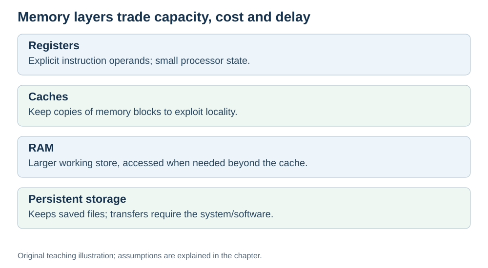

# Why memory has layers

**Status:** Revised on 26 October 2026 with AI-assisted technical checks; awaiting team peer review.

[Reading order](../OUTLINE.md) · [Teaching-machine conventions](../OUTLINE.md#teaching-machine-conventions) · [Explained answers](../ANSWER-KEY.md#h04-01)

**Learning objective:** after this section, a beginner should be able to explain why memory is organized in layers and why the CPU cannot use just one kind of memory.

## 1. Why this matters

The CPU is extremely fast. RAM is much slower. If the CPU had to wait for RAM every time it needed a value, it would spend most of its life doing nothing. The memory hierarchy is the trick that hides this gap.

## 2. Explanation

There is a trade-off in memory:

- **Fast memory is small and expensive.**
- **Large memory is slow and cheap.**

You cannot have a huge memory that is also as fast as the CPU. So computers use **several layers** instead of one.

| Layer | Size | Speed | What it holds |
|---|---|---|---|
| Registers | Tiny (architecture-dependent count) | Fastest | Values the CPU is using right now |
| Cache (L1/L2/L3) | Small (KB–MB) | Very fast | Recently used data and instructions |
| RAM | Large (GB) | Fast | The program and its active data |
| SSD/disk | Very large (TB) | Slow | Everything that must be saved |

In a typical hierarchy, the fast layers are small and on or near the processor. This reflects technology, cost and wiring trade-offs, not a rule that physical distance alone determines speed. Instructions explicitly name registers; cache hardware retains blocks of memory. **Temporal locality** means reusing an address soon, while **spatial locality** means accessing nearby addresses. These patterns make caching useful.

This is why a computer can feel fast even though RAM is much slower than the CPU: the fast layers (registers and cache) hide most of the waiting.

## 3. Diagram

*Original teaching diagram created for the 26 October revision. Read the stated model assumptions alongside it.*

## 4. Example

You run a loop that sums an array of 1,000 numbers.

- The **array** lives in RAM.
- The **current numbers** being added are copied into **cache**, then into **registers**.
- The CPU adds them in the ALU.
- The **result** stays in a register, then is written back to RAM.

Most of the work happens in registers and cache, not RAM. That is the hierarchy at work.

## 5. Check yourself

Try these first, then use the [explained answers](../ANSWER-KEY.md#h04-01).

1. Why can't a computer have one memory that is both huge and fast?
2. List the four layers from fastest to slowest.
3. Which layer is closest to the CPU? Which is farthest?
4. Why does the hierarchy make a computer feel faster than RAM alone would?

## 6. Sources

- [MIT OpenCourseWare, 6.004 (Spring 2017), 14.1 Caches and the Memory Hierarchy](https://ocw.mit.edu/courses/6-004-computation-structures-spring-2017/pages/c14/c14s1/)
- [Cornell CS 3410 (Fall 2024), Caches: memory technology, locality and cache levels](https://www.cs.cornell.edu/courses/cs3410/2024fa/notes/caches.html)

These sources support the technical concepts; our pseudocode, examples and analogies are teaching simplifications. Course-specific coverage is still to be checked by the team.
