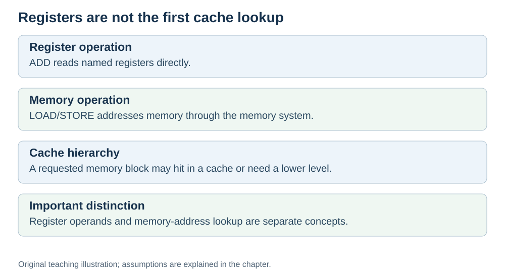

# Registers and cache: the fast layers

**Status:** Revised on 26 October 2026 with AI-assisted technical checks; awaiting team peer review.

[Reading order](../OUTLINE.md) · [Teaching-machine conventions](../OUTLINE.md#teaching-machine-conventions) · [Explained answers](../ANSWER-KEY.md#h04-02)

**Learning objective:** after this section, a beginner should be able to explain what registers and cache are, and why they are the fastest memory in the machine.

## 1. Why this matters

The CPU cannot wait for RAM on every operation. To keep running fast, it keeps the values it needs most in the two fastest layers: registers and cache. Understanding these two explains why some programs run much faster than others.

## 2. Explanation

**Registers** are the fastest storage in the machine. They live *inside* the CPU. The visible register count depends on the instruction set; 16 or 32 general-purpose registers are common teaching examples. They hold the values the CPU is working on right now: operands, results, addresses.

Registers are tiny. A whole large array generally cannot remain in registers; small fixed collections sometimes can. But for the values the CPU uses in the next microsecond, they are perfect.

**Cache** is the next layer. It is small memory (kilobytes to megabytes) that sits between the CPU and RAM. It holds **recently used data and instructions**, so the CPU can grab them again quickly.

Cache is organized in levels:

- **L1** — smallest, fastest, closest to the CPU.
- **L2** — bigger, a bit slower.
- **L3** — often the largest on-chip cache and shared between cores, generally slower to access than L1/L2. Exact topology varies by processor.

Instructions name the registers they read and write; the CPU does not search registers as an address cache. A memory load can be served by L1, a later cache, or RAM. A **hit** means the requested cache level contains the memory block; a **miss** means the request must proceed to a later level. An L1 miss can still hit in L2 or L3.

## 3. Diagram

*Original teaching diagram created for the 26 October revision. Read the stated model assumptions alongside it.*

## 4. Example

A loop reads the same array element many times.

- Assume the first read misses in all caches: the block is fetched from RAM.
- If the block remains in cache, further loads can hit there and avoid a RAM access.
- The values being added sit in **registers** during the addition.

Data reuse can improve performance through temporal locality. Sequential access to new nearby elements can also benefit from spatial locality, because a cache line holds several bytes. A compiler may keep a repeatedly used value in a register instead of loading it again.

## 5. Check yourself

Try these first, then use the [explained answers](../ANSWER-KEY.md#h04-02).

1. Where do registers live? Why are they the fastest?
2. What is cache, and what does it hold?
3. What is the difference between a cache hit and a cache miss?
4. Why do loops that reuse data run faster?
5. Order these from fastest to slowest: RAM, L1 cache, registers, L3 cache.

## 6. Sources

- [MIT OpenCourseWare, 6.004 (Spring 2017), 14.1 Caches and the Memory Hierarchy](https://ocw.mit.edu/courses/6-004-computation-structures-spring-2017/pages/c14/c14s1/)
- [Cornell CS 3410 (Fall 2024), Caches: memory technology, locality and cache levels](https://www.cs.cornell.edu/courses/cs3410/2024fa/notes/caches.html)

These sources support the technical concepts; our pseudocode, examples and analogies are teaching simplifications. Course-specific coverage is still to be checked by the team.
