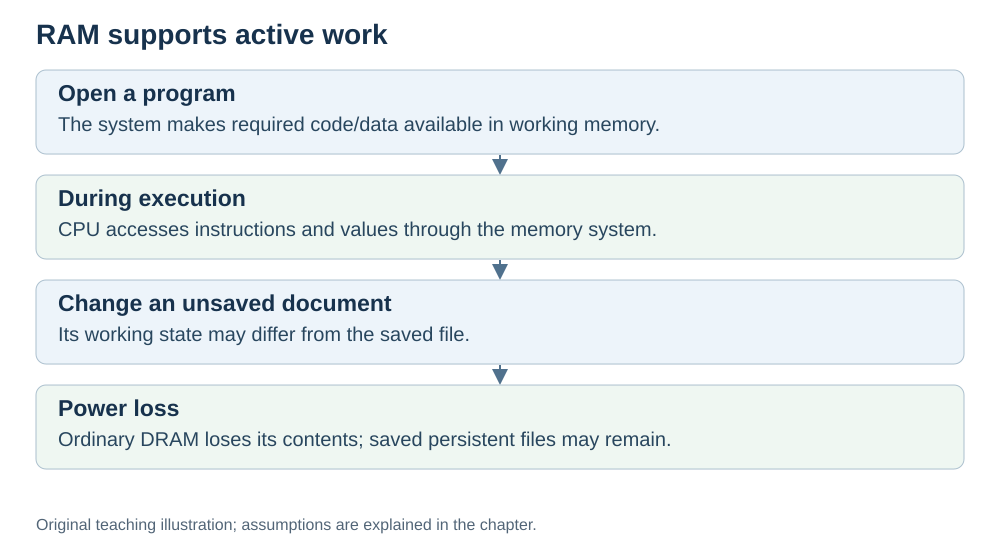

# RAM: the working memory

**Status:** Revised on 26 October 2026 with AI-assisted technical checks; awaiting team peer review.

[Reading order](../OUTLINE.md) · [Teaching-machine conventions](../OUTLINE.md#teaching-machine-conventions) · [Explained answers](../ANSWER-KEY.md#h04-03)

**Learning objective:** after this section, a beginner should be able to explain what RAM is, what it holds, and how it differs from registers and disk.

## 1. Why this matters

In the ordinary desktop model used here, executable code is loaded or mapped into main memory and fetched through the memory hierarchy, rather than executed directly from a disk. Some embedded systems can execute from other memory such as flash; that is outside this example. Understanding RAM explains why "more RAM" can help some workloads, and why it does not make the CPU itself faster.

## 2. Explanation

**RAM (Random Access Memory)** is the main working memory of the computer. It is:

- **Large** — gigabytes, not kilobytes.
- **Fast** — much faster than disk, but slower than cache.
- **Volatile** — ordinary DRAM needs power to retain its contents.
- **Addressable** — bytes have addresses. A running program may access only addresses permitted by the system; address translation and protection are hidden in our simplified examples.

When you start a program, it is loaded from disk into RAM. While it runs, its code and active data live in RAM. The CPU reads instructions and data from RAM (through cache) and writes results back.

The key difference:

- **Registers** hold values the CPU is using *right now* (tiny, fastest).
- **RAM** holds the program and its active data (large, fast).
- **Disk/SSD** retains saved data without power (persistent, generally slower to access). Persistent does not mean indestructible or automatically backed up.

## 3. Diagram

*Original teaching diagram created for the 26 October revision. Read the stated model assumptions alongside it.*

## 4. Example

You open a text editor.

- The editor's program file is on **disk**.
- When you launch it, it is loaded into **RAM**.
- As you type, the text is kept in **RAM**.
- The CPU reads and modifies the text through **cache** and **registers**.
- When you save, the file goes back to **disk**.

If the power goes off before saving, RAM is lost — but the disk copy remains.

## 5. Check yourself

Try these first, then use the [explained answers](../ANSWER-KEY.md#h04-03).

1. What does RAM hold while a program runs?
2. How is RAM different from registers? From disk?
3. Why is RAM called "temporary"?
4. Why is code fetched through working memory rather than read directly from disk in our desktop example?
5. Does more RAM make the CPU faster? Why or why not?

## 6. Sources

- [Cornell CS 3410 (Fall 2024), Caches: memory technology, locality and cache levels](https://www.cs.cornell.edu/courses/cs3410/2024fa/notes/caches.html)
- [Cornell CS 3410 (Spring 2025), Input/Output: devices, storage and interconnects](https://www.cs.cornell.edu/courses/cs3410/2025sp/notes/io.html)
- [Microsoft Learn, No-Execute (NX) Nonpaged Pool: memory execution permissions](https://learn.microsoft.com/en-us/windows-hardware/drivers/kernel/no-execute-nonpaged-pool)

These sources support the technical concepts; our pseudocode, examples and analogies are teaching simplifications. Course-specific coverage is still to be checked by the team.
