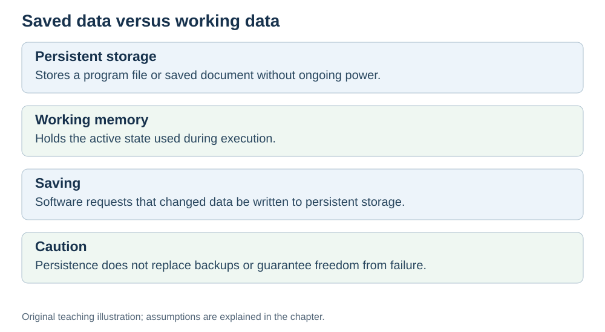

# Storage: the persistent layer

**Status:** Revised on 26 October 2026 with AI-assisted technical checks; awaiting team peer review.

[Reading order](../OUTLINE.md) · [Teaching-machine conventions](../OUTLINE.md#teaching-machine-conventions) · [Explained answers](../ANSWER-KEY.md#h04-04)

**Learning objective:** after this section, a beginner should be able to explain what storage is, why it is slower than RAM, and why it is still essential.

## 1. Why this matters

RAM is fast but temporary. If everything lived only in RAM, all your files would disappear when you turn off the computer. Storage is the layer that retains saved data without power — and understanding its speed matters for programs that read and write large files.

## 2. Explanation

**Storage** (SSD or hard disk) is the slowest and largest layer of memory. It is:

- **Very large** — terabytes.
- **Slow** — much slower than RAM (especially hard disks; SSDs are faster but still slower than RAM).
- **Persistent** — saved data remains when power is off, but can still be deleted, corrupted or lost through device failure.

Storage holds everything that must survive a reboot: the operating system, your programs, your files, your photos, your videos.

Designers combine different technologies and access methods. DRAM provides working capacity; flash or magnetic disks provide persistent capacity at higher access latency. Speed, capacity and cost are engineering trade-offs, not consequences of size alone.

When a program needs data from storage, it is **loaded into RAM first**, then used by the CPU through cache and registers. That is why opening a large file can take a moment: the data has to travel from disk to RAM.

## 3. Diagram

*Original teaching diagram created for the 26 October revision. Read the stated model assumptions alongside it.*

## 4. Example

You open a 1 GB video file.

- The file sits on **storage** (disk/SSD).
- The video player loads chunks into **RAM**.
- The CPU decodes frames using **cache** and **registers**.
- The picture goes to the screen.

The first moment may feel slow — that is the disk → RAM transfer. During playback the player keeps buffering more chunks; sustained storage speed, decoding capability and available memory must all keep up. Buffering can hide brief delays, but it cannot fix a source that is consistently too slow.

## 5. Check yourself

Try these first, then use the [explained answers](../ANSWER-KEY.md#h04-04).

1. What does storage hold?
2. Why is storage slower than RAM?
3. Why is storage still essential even though it is slow?
4. What happens when a program needs data from storage?
5. Order these by speed, fastest first: storage, RAM, cache, registers.

## 6. Sources

- [MIT OpenCourseWare, 6.004 (Spring 2017), 14.1 Caches and the Memory Hierarchy](https://ocw.mit.edu/courses/6-004-computation-structures-spring-2017/pages/c14/c14s1/)
- [Cornell CS 3410 (Fall 2024), Caches: memory technology, locality and cache levels](https://www.cs.cornell.edu/courses/cs3410/2024fa/notes/caches.html)

These sources support the technical concepts; our pseudocode, examples and analogies are teaching simplifications. Course-specific coverage is still to be checked by the team.
