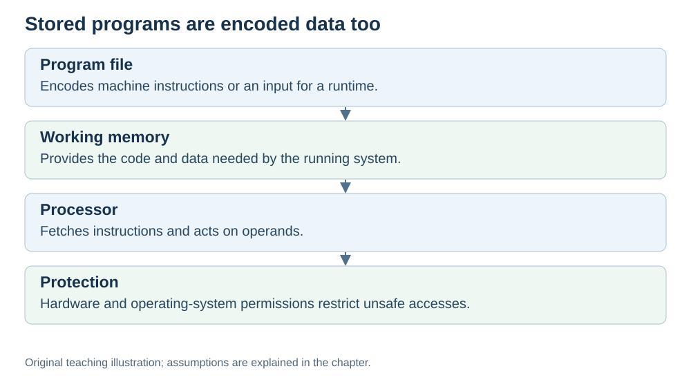

# The stored-program idea

**Status:** Revised on 26 October 2026 with AI-assisted technical checks; awaiting team peer review.

[Reading order](../OUTLINE.md) · [Teaching-machine conventions](../OUTLINE.md#teaching-machine-conventions) · [Explained answers](../ANSWER-KEY.md#h05-01)

**Learning objective:** after this section, a beginner should be able to explain what the stored-program idea is and why code and data can live in the same memory.

## 1. Why this matters

You write code in a text file, but the CPU never sees text. It sees numbers. The stored-program idea is what connects your code to those numbers: instructions are stored in memory just like data. Without this idea, computers as we know them would not exist.

## 2. Explanation

The **stored-program idea** means instructions are stored in memory rather than fixed by rewiring a machine. In the shared-memory model used here, instructions and data occupy one address space. Other implementations can use separate instruction/data memories or caches.

Before this idea, early computers had to be rewired for each new task. With it, a program is just data in memory — you load a new program, and the same machine can do something completely different.

Here is what this means in practice:

- Memory is a large array of numbered cells.
- Some cells hold **data** (numbers, text, values).
- Some cells hold **instructions** (encoded as numbers).
- The current operation determines whether bits are fetched as an instruction or read as data. Modern systems also enforce memory permissions; not every address is readable, writable or executable.

That is why a program is called a **sequence of instructions sitting in memory**. The CPU walks through them one by one.

## 3. Diagram



*Original teaching diagram created for the 26 October revision. Read the stated model assumptions alongside it.*


## 4. Example

A tiny program that adds two numbers:

```text
address 0x100: LOAD R1, [0x300] ← instruction
address 0x104: LOAD R2, [0x304] ← instruction
address 0x108: ADD R3, R1, R2 ← instruction
address 0x10C: STORE [0x308], R3 ← instruction
...
address 0x300: 5 ← data
address 0x304: 7 ← data
address 0x308: 0 ← data (result)
```

This is pseudocode for four-byte teaching instructions and four-byte integer data; it is not an assembler listing for a specific CPU.

The instructions at `0x100–0x10C` and the data at `0x300–0x308` live in the **same memory**. The CPU reads the instructions in order; the data is read and written by those instructions.

## 5. Check yourself

Try these first, then use the [explained answers](../ANSWER-KEY.md#h05-01).

1. What does the stored-program idea say?
2. Why is it useful that code and data live in the same memory?
3. How are instructions and data both represented, and why can memory permissions still distinguish executable and non-executable regions?
4. What does the PC point to in the example above?

## 6. Sources

- [MIT OpenCourseWare, 6.004 (Spring 2017), 13.1 Building the Beta](https://ocw.mit.edu/courses/6-004-computation-structures-spring-2017/pages/c13/c13s1/)
- [RISC-V International, RV32I specification v20260120, programmer model and load/store instructions](https://docs.riscv.org/reference/isa/v20260120/unpriv/rv32.html)
- [Microsoft Learn, No-Execute (NX) Nonpaged Pool: memory execution permissions](https://learn.microsoft.com/en-us/windows-hardware/drivers/kernel/no-execute-nonpaged-pool)

These sources support the technical concepts; our pseudocode, examples and analogies are teaching simplifications. Course-specific coverage is still to be checked by the team.
