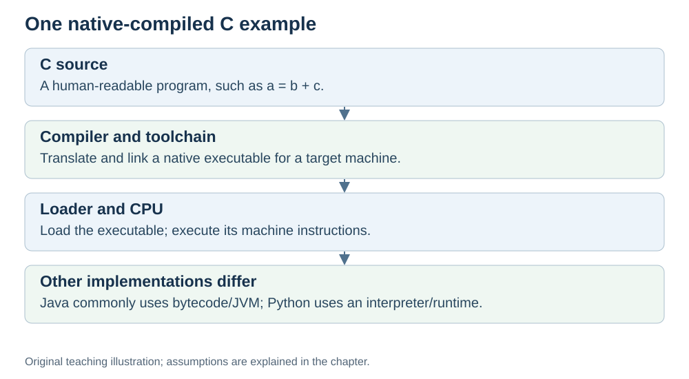

# The compiler: from code to instructions

**Status:** Revised on 26 October 2026 with AI-assisted technical checks; awaiting team peer review.

[Reading order](../OUTLINE.md) · [Teaching-machine conventions](../OUTLINE.md#teaching-machine-conventions) · [Explained answers](../ANSWER-KEY.md#h05-02)

**Learning objective:** after this section, a beginner should be able to explain what a compiler does and why the CPU does not understand variables.

## 1. Why this matters

You write `a = b + c`. The CPU has never seen a variable in its life. Something has to translate your code into the instructions the CPU can execute. That something is the **compiler**.

## 2. Explanation

A **compiler** translates a program into another representation. A native-code toolchain, for example for C, can produce machine instructions for a target CPU. CPython commonly compiles Python into **bytecode** for its interpreter; Java commonly targets JVM bytecode, which may be interpreted or compiled further at runtime. Our example uses simplified native-code pseudocode.

The key point for beginners: **the CPU does not know about variables.** It knows **registers** and **memory addresses**. The compiler's job is to connect the two:

- A variable like `b` becomes a **memory address** (or a register).
- An operation like `+` becomes an **instruction** (like `ADD`).
- If `a` must be saved in memory, assigning its result needs a **store**; an optimised value may instead remain in a register.

So the compiler takes your readable code and produces a list of small, exact steps the CPU can follow. That is why the same line of code can become several instructions.

Different compilers can produce different instruction lists for the same code. One may use more instructions, another fewer. This is one reason why **instruction count** matters for performance — we will see that in the Performance file.

## 3. Diagram



*Original teaching diagram created for the 26 October revision. Read the stated model assumptions alongside it.*


## 4. Example

Your source expression:

```text
a = b + c
```

An illustrative load-store translation (pseudocode, not a real assembler):

```text
load R1, [b] # load b into register R1
load R2, [c] # load c into register R2
add R3, R1, R2 # R3 = R1 + R2
store [a], R3 # write R3 back to memory
```

Four instructions for one line. The CPU only does small steps; the compiler is what turns a big step into small ones.

If `b` and `c` are already in registers, the loads can be skipped. The result needs `add` plus `store` if `a` must be written to memory, or just `add` if the result may remain in a register.

## 5. Check yourself

Try these first, then use the [explained answers](../ANSWER-KEY.md#h05-02).

1. What does a compiler do?
2. Why does the CPU not understand variables?
3. What do variables become after compilation?
4. Why can the same code produce different numbers of instructions on different compilers?
5. In the example, why might the compiler skip the two `load` instructions?

## 6. Sources

- [MIT OpenCourseWare, 6.004 (Spring 2017), 11.1 Compilers](https://ocw.mit.edu/courses/6-004-computation-structures-spring-2017/pages/c11/c11s1/)
- [Python documentation, Glossary: bytecode](https://docs.python.org/3/glossary.html#term-bytecode)
- [Oracle JVM Specification, Java SE 26, §2.13 Public Design, Private Implementation](https://docs.oracle.com/javase/specs/jvms/se26/html/jvms-2.html#jvms-2.13)

These sources support the technical concepts; our pseudocode, examples and analogies are teaching simplifications. Course-specific coverage is still to be checked by the team.
