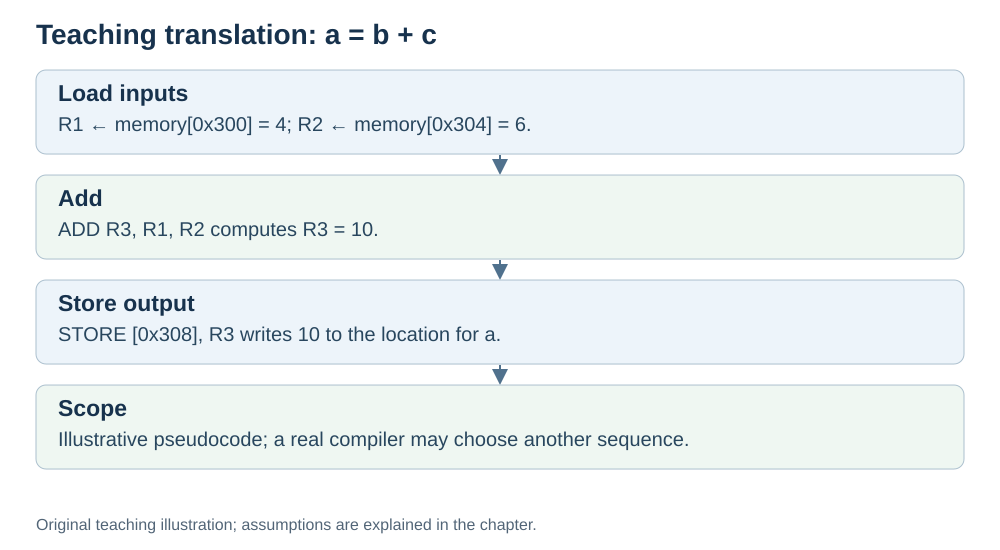

# Worked example: `a = b + c`

**Status:** Revised on 26 October 2026 with AI-assisted technical checks; awaiting team peer review.

[Reading order](../OUTLINE.md) · [Teaching-machine conventions](../OUTLINE.md#teaching-machine-conventions) · [Explained answers](../ANSWER-KEY.md#h05-03)

**Learning objective:** after this section, a beginner should be able to translate a simple line of code into instructions and trace how the values change.

## 1. Why this matters

This is the smallest complete example of "how a program runs": one line of code, four instructions, concrete values. If you can follow this, you can follow any larger program.

## 2. Explanation

We will trace `a = b + c` with `b = 4`, `c = 6`, and `a` initially 0. Suppose:

- `b` is at memory address `0x300`
- `c` is at memory address `0x304`
- `a` is at memory address `0x308`

One possible translation is the following pseudocode:

```text
load R1, [0x300] # R1 = b
load R2, [0x304] # R2 = c
add R3, R1, R2 # R3 = R1 + R2
store [0x308], R3 # a = R3
```

We will walk through what happens at each instruction.

## 3. Diagram



*Original teaching diagram created for the 26 October revision. Read the stated model assumptions alongside it.*

## 4. Example

**Step 1:** `load R1, [0x300]`
- Address `0x300` goes on the address bus.
- Memory returns 4.
- R1 = 4.

**Step 2:** `load R2, [0x304]`
- Address `0x304` goes on the address bus.
- Memory returns 6.
- R2 = 6.

**Step 3:** `add R3, R1, R2`
- ALU receives R1 = 4 and R2 = 6.
- ALU computes 10.
- R3 = 10.

**Step 4:** `store [0x308], R3`
- Address `0x308` goes on the address bus.
- Value 10 (from R3) goes on the data bus.
- Memory at `0x308` now holds 10.

**Final state:**
- `a` = 10 (at address `0x308`)
- R1 = 4, R2 = 6, R3 = 10

One line of code → four instructions → one result. This illustrates the machine-level data flow. A real compiler can change the instruction sequence while preserving the required program behaviour.

## 5. Check yourself

Try these first, then use the [explained answers](../ANSWER-KEY.md#h05-03).

1. Why are there two `load` instructions before the `add`?
2. What are the values of R1, R2, R3 after step 3?
3. What does the `store` instruction do?
4. If `b` and `c` were already in registers, how many instructions are needed when `a` must be stored in memory? What if the result may remain in a register?
5. What is the final value of `a`?

## 6. Sources

- [MIT OpenCourseWare, 6.004 (Spring 2017), 11.1 Compilers](https://ocw.mit.edu/courses/6-004-computation-structures-spring-2017/pages/c11/c11s1/)
- [RISC-V International, RV32I specification v20260120, programmer model and load/store instructions](https://docs.riscv.org/reference/isa/v20260120/unpriv/rv32.html)

These sources support the technical concepts; our pseudocode, examples and analogies are teaching simplifications. Course-specific coverage is still to be checked by the team.
