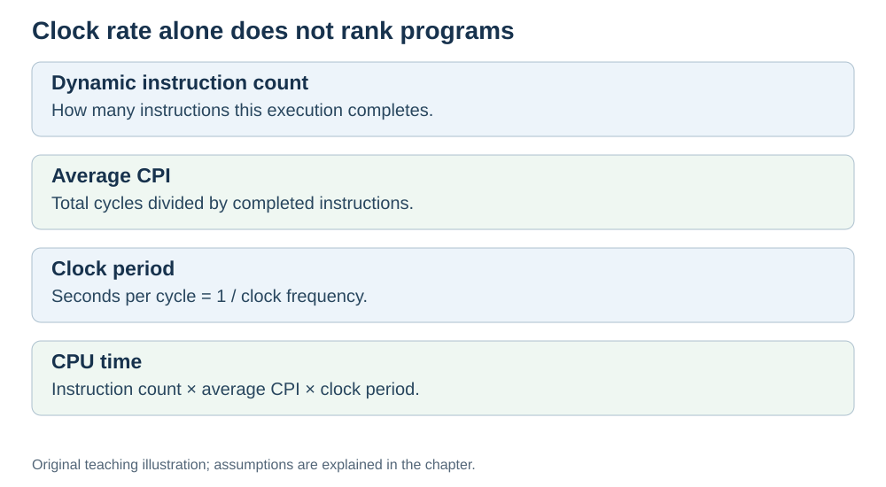

# Why "more GHz" is not the same as "faster"

**Status:** Revised on 26 October 2026 with AI-assisted technical checks; awaiting team peer review.

[Reading order](../OUTLINE.md) · [Teaching-machine conventions](../OUTLINE.md#teaching-machine-conventions) · [Explained answers](../ANSWER-KEY.md#h06-01)

**Learning objective:** after this section, a beginner should be able to explain why a higher clock speed does not automatically mean a faster CPU.

## 1. Why this matters

"A 4 GHz CPU must finish any program sooner than a 3 GHz CPU" sounds plausible, but clock rate alone cannot establish that. This is one of the most common beginner misconceptions, and it leads to bad decisions — both when buying a computer and when optimizing a program.

## 2. Explanation

The **clock speed** (in GHz) tells you how many cycles the CPU completes per second. A 3 GHz CPU completes about 3 billion cycles per second.

But a cycle is not a fixed amount of work. Different CPUs do different amounts of work per cycle, and different programs need different numbers of cycles per instruction.

Here we model **CPU execution time** — time spent executing the program on the CPU. Elapsed user-observed time may also include I/O and scheduling waits. It depends on three things:

- **Instruction count** — how many instructions the program needs.
- **CPI** — average cycles per instruction.
- **Clock period** — how long one cycle lasts (1 / clock frequency).

Clock speed is only one of the three. A faster clock can be cancelled out by worse CPI or a larger instruction count.

This is why two CPUs with the same GHz can perform very differently, and why a 3 GHz CPU can sometimes beat a 4 GHz one.

## 3. Diagram

*Original teaching diagram created for the 26 October revision. Read the stated model assumptions alongside it.*

## 4. Example

Program A: 2,000,000 instructions.

- CPU 1: 2 GHz, CPI = 2.0 → time ≈ 2 ms.
- CPU 2: 3 GHz, CPI = 3.0 → time ≈ 2 ms.

CPU 2 has the higher clock, but the same execution time. The faster clock was cancelled out by worse CPI. That is the whole point of this file.

## 5. Check yourself

Try these first, then use the [explained answers](../ANSWER-KEY.md#h06-01).

1. What does GHz actually measure?
2. Why is a cycle not a fixed amount of work?
3. Name the three factors that decide execution time.
4. Can a 3 GHz CPU be faster than a 4 GHz CPU? Why?
5. What would you look at instead of GHz to compare two CPUs?

## 6. Sources

- [Intel VTune Profiler, CPU Metrics Reference: cycles per instructions retired](https://www.intel.com/content/www/us/en/docs/vtune-profiler/user-guide/2024-2/cpu-metrics-reference.html)
- [Cornell CS 3410 (Spring 2026), Pipelining & Performance](https://www.cs.cornell.edu/courses/cs3410/2026sp/notes/pipelining.html)
- [Cornell CS 5220 (2020), Code Optimization: timing and CPU versus wall time](https://www.cs.cornell.edu/courses/cs5220/2020fa/lec/2020-09-15-opt.html)

These sources support the technical concepts; our pseudocode, examples and analogies are teaching simplifications. Course-specific coverage is still to be checked by the team.
