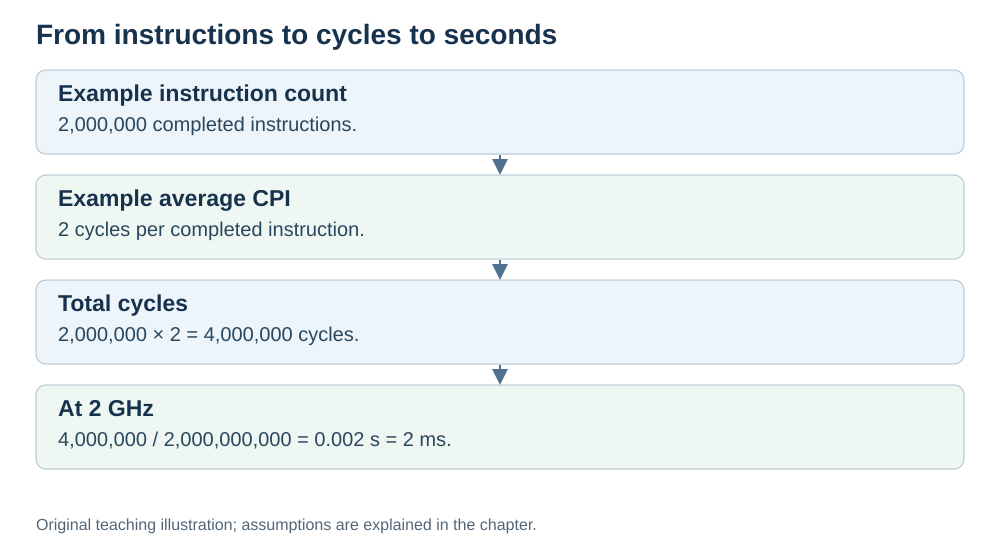

# Instruction count and CPI

**Status:** Revised on 26 October 2026 with AI-assisted technical checks; awaiting team peer review.

[Reading order](../OUTLINE.md) · [Teaching-machine conventions](../OUTLINE.md#teaching-machine-conventions) · [Explained answers](../ANSWER-KEY.md#h06-02)

**Learning objective:** after this section, a beginner should be able to explain what instruction count and CPI are, and why both matter for performance.

## 1. Why this matters

Clock speed is only one of three factors that decide execution time. The other two — instruction count and CPI — are just as important, and they are the ones beginners usually forget.

## 2. Explanation

**Dynamic instruction count** is the number of instructions actually executed, including repeated loop iterations. Ten instructions repeated 100 times contribute 1,000 executed instructions, not ten. It depends on:

- **The algorithm and input** — changing the method or input can change how many instructions execute.
- **The compiler** — a better compiler can produce fewer instructions.
- **The instruction set** — some architectures need more instructions to do the same thing.

**CPI (Cycles Per Instruction)** is total CPU cycles divided by completed instructions for the measured program. It measures the average completion rate, not the start-to-finish latency of one instruction. Instructions can overlap; completing two per cycle gives CPI = 0.5. It depends on:

- **The instruction type** — a simple add may take 1 cycle; a memory load may take many.
- **The pipeline** — an ideal single-issue pipeline can approach CPI = 1; a processor completing several instructions per cycle can have CPI below 1.
- **Cache hits and misses** — a cache miss makes the instruction wait, raising CPI.

For a fixed clock, CPU time depends on the product of dynamic instruction count and average CPI. Reducing one factor helps only if changes to the other do not cancel the gain.

A useful way to think about it:

- Instruction count = "how many steps does the program take?"
- CPI = "how many cycles does each step cost?"

Both multiply together to give the total number of cycles.

## 3. Diagram

*Original teaching diagram created for the 26 October revision. Read the stated model assumptions alongside it.*

## 4. Example

Two versions of the same program:

- **Version A:** 1,000,000 instructions, CPI = 2 → 2,000,000 cycles.
- **Version B:** 1,500,000 instructions, CPI = 1 → 1,500,000 cycles.

Version B has *more* instructions but *fewer* total cycles, because each instruction is cheaper. On the same clock, Version B is faster. This is why counting only instructions — or only CPI — is not enough.

## 5. Check yourself

Try these first, then use the [explained answers](../ANSWER-KEY.md#h06-02).

1. What is instruction count? What three things affect it?
2. What is CPI? What three things affect it?
3. How do instruction count and CPI combine to give total cycles?
4. Can a program with more instructions be faster? Why?
5. Why does a cache miss raise CPI?

## 6. Sources

- [Intel VTune Profiler, CPU Metrics Reference: cycles per instructions retired](https://www.intel.com/content/www/us/en/docs/vtune-profiler/user-guide/2024-2/cpu-metrics-reference.html)
- [Cornell CS 3410 (Spring 2026), Pipelining & Performance](https://www.cs.cornell.edu/courses/cs3410/2026sp/notes/pipelining.html)
- [Cornell CS 5220 (2020), Code Optimization: timing and CPU versus wall time](https://www.cs.cornell.edu/courses/cs5220/2020fa/lec/2020-09-15-opt.html)

These sources support the technical concepts; our pseudocode, examples and analogies are teaching simplifications. Course-specific coverage is still to be checked by the team.
