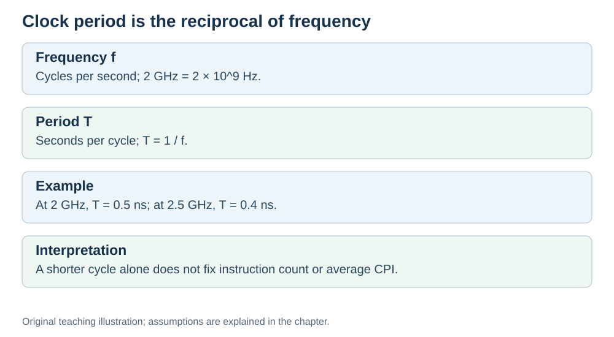

# Clock period: the length of one cycle

**Status:** Revised on 26 October 2026 with AI-assisted technical checks; awaiting team peer review.

[Reading order](../OUTLINE.md) · [Teaching-machine conventions](../OUTLINE.md#teaching-machine-conventions) · [Explained answers](../ANSWER-KEY.md#h06-03)

**Learning objective:** after this section, a beginner should be able to explain what clock period is, how it relates to clock frequency, and why it is only one of three performance factors.

## 1. Why this matters

Clock speed is usually given in GHz, but the formula for execution time uses **clock period** — the length of one cycle. If you do not know how to convert between the two, you cannot calculate execution time.

## 2. Explanation

**Clock period** is the time one clock cycle takes. It is the inverse of clock frequency:

```text
clock period = 1 / clock frequency
```

Examples:

- 2 GHz = 2 × 10⁹ cycles per second → clock period = 1 / (2 × 10⁹) s = 0.5 ns.
- 3 GHz → clock period ≈ 0.333 ns.
- 4 GHz → clock period = 0.25 ns.

So a higher frequency means a *shorter* period — each cycle takes less time. That is why higher GHz usually helps: each cycle is shorter.

But remember: execution time is not just the clock period. It is:

```text
CPU execution time = dynamic instruction count × average CPI × clock period
```


A shorter clock period helps, but if instruction count or CPI goes up, the gain can disappear. That is exactly what we saw in the previous files.

## 3. Diagram



*Original teaching diagram created for the 26 October revision. Read the stated model assumptions alongside it.*


## 4. Example

A program needs 10,000,000 cycles.

- On a 2 GHz CPU: time = 10,000,000 × 0.5 ns = 5 ms.
- On a 4 GHz CPU: time = 10,000,000 × 0.25 ns = 2.5 ms.

Same number of cycles, half the time — because each cycle is half as long. That is the benefit of a higher clock. But if the 4 GHz CPU needed 20,000,000 cycles due to worse CPI, the gain would vanish.

## 5. Check yourself

Try these first, then use the [explained answers](../ANSWER-KEY.md#h06-03).

1. What is clock period? How does it relate to clock frequency?
2. What is the clock period of a 3 GHz CPU?
3. Why does a higher frequency mean a shorter period?
4. Does a shorter clock period always make a program faster? Why or why not?
5. Convert: a 2.5 GHz clock has what period?

## 6. Sources

- [Intel VTune Profiler, CPU Metrics Reference: cycles per instructions retired](https://www.intel.com/content/www/us/en/docs/vtune-profiler/user-guide/2024-2/cpu-metrics-reference.html)
- [Cornell CS 3410 (Spring 2026), Pipelining & Performance](https://www.cs.cornell.edu/courses/cs3410/2026sp/notes/pipelining.html)
- [Cornell CS 5220 (2020), Code Optimization: timing and CPU versus wall time](https://www.cs.cornell.edu/courses/cs5220/2020fa/lec/2020-09-15-opt.html)

These sources support the technical concepts; our pseudocode, examples and analogies are teaching simplifications. Course-specific coverage is still to be checked by the team.
