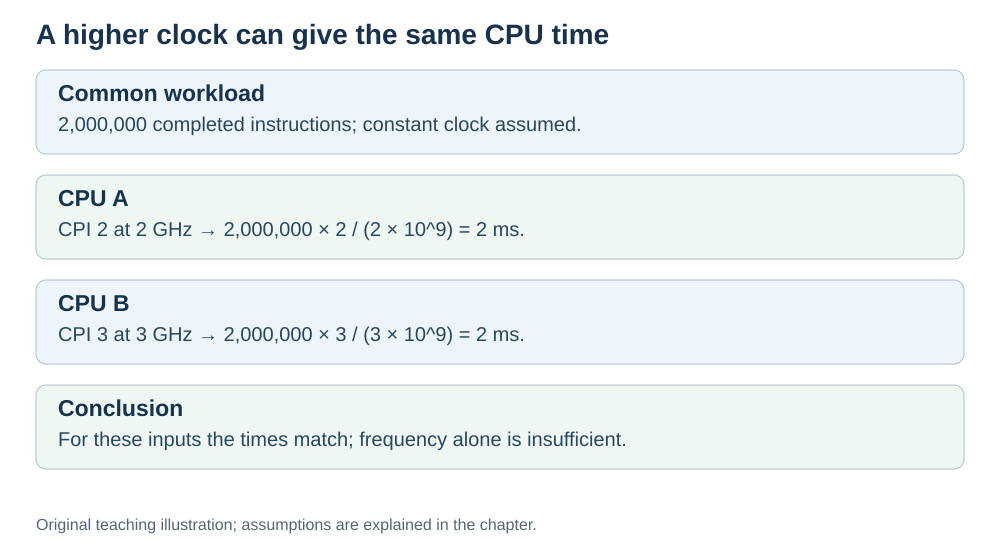

# Worked calculation: putting it all together

**Status:** Revised on 26 October 2026 with AI-assisted technical checks; awaiting team peer review.

[Reading order](../OUTLINE.md) · [Teaching-machine conventions](../OUTLINE.md#teaching-machine-conventions) · [Explained answers](../ANSWER-KEY.md#h06-04)

**Learning objective:** after this section, a beginner should be able to calculate execution time from instruction count, CPI, and clock frequency, and compare two CPUs.

## 1. Why this matters

The previous files gave you the pieces: instruction count, CPI, clock period. This file puts them together in one formula and shows how to use it to compare real CPUs.

## 2. Explanation

The formula for execution time is:

```text
CPU execution time = dynamic instruction count × average CPI × clock period
```

And since:

```text
clock period = 1 / clock frequency
```

you can also write:

```text
CPU execution time = (dynamic instruction count × average CPI) / clock frequency
```

To use it:

1. Find the **instruction count** (how many instructions the program runs).
2. Find the **CPI** (average cycles per instruction).
3. Find the **clock frequency** (in Hz), then convert to period if needed.
4. Multiply.

The result is in seconds (or milliseconds, if you keep the units consistent). These examples assume a constant clock and do not add periods when the program is waiting for I/O or not scheduled on the CPU. For different CPUs, use the dynamic instruction count of each measured version; “same program” does not always imply the same count.

## 3. Diagram



*Original teaching diagram created for the 26 October revision. Read the stated model assumptions alongside it.*


## 4. Example

**CPU A:** 2 GHz, CPI = 2.0, program = 2,000,000 instructions.

- Clock period = 1 / (2 × 10⁹) = 0.5 ns.
- Time = 2,000,000 × 2.0 × 0.5 ns = 2,000,000 ns = 2 ms.

**CPU B:** 3 GHz, CPI = 3.0, same program.

- Clock period = 1 / (3 × 10⁹) ≈ 0.333 ns.
- Time = 2,000,000 × 3.0 × 0.333 ns ≈ 2,000,000 ns = 2 ms.

Same result. CPU B has the faster clock, but its worse CPI cancels the advantage. This is the main takeaway of the Performance section.

**A second example:** program of 5,000,000 instructions, CPI = 1.5, clock = 2.5 GHz.

- Clock period = 1 / (2.5 × 10⁹) = 0.4 ns.
- Time = 5,000,000 × 1.5 × 0.4 ns = 3,000,000 ns = 3 ms.

## 5. Check yourself

Try these first, then use the [explained answers](../ANSWER-KEY.md#h06-04).

1. Write the execution time formula.
2. A program has 1,000,000 instructions, CPI = 2, clock = 2 GHz. What is the execution time?
3. A program has 3,000,000 instructions, CPI = 1.5, clock = 3 GHz. What is the execution time?
4. CPU A: 2 GHz, CPI = 1. CPU B: 4 GHz, CPI = 3. Which is faster for the same program? Show your calculation.
5. Why can two CPUs with different GHz have the same execution time?

## 6. Sources

- [Intel VTune Profiler, CPU Metrics Reference: cycles per instructions retired](https://www.intel.com/content/www/us/en/docs/vtune-profiler/user-guide/2024-2/cpu-metrics-reference.html)
- [Cornell CS 3410 (Spring 2026), Pipelining & Performance](https://www.cs.cornell.edu/courses/cs3410/2026sp/notes/pipelining.html)
- [Cornell CS 5220 (2020), Code Optimization: timing and CPU versus wall time](https://www.cs.cornell.edu/courses/cs5220/2020fa/lec/2020-09-15-opt.html)

These sources support the technical concepts; our pseudocode, examples and analogies are teaching simplifications. Course-specific coverage is still to be checked by the team.
