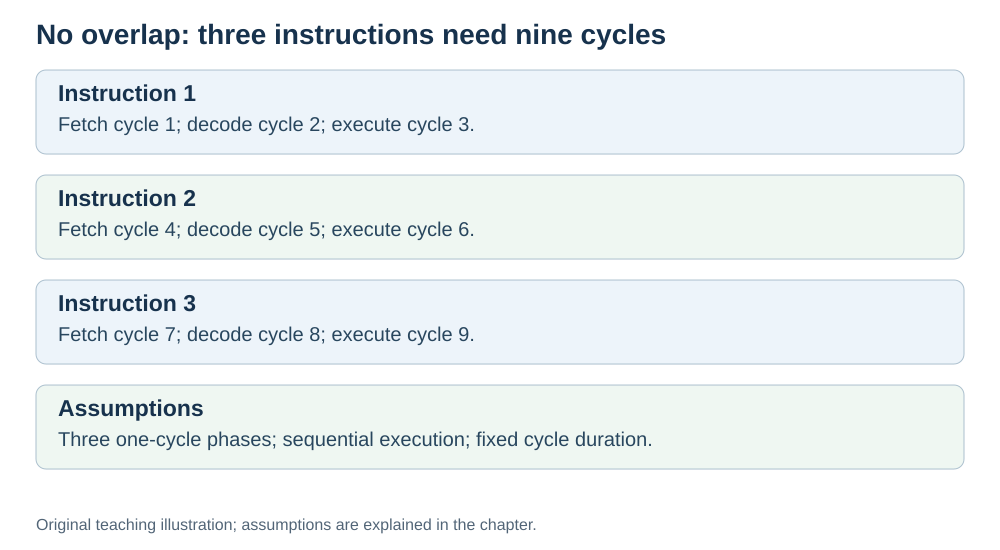

# The problem with doing one thing at a time

**Status:** Revised on 26 October 2026 with AI-assisted technical checks; awaiting team peer review.

[Reading order](../OUTLINE.md) · [Teaching-machine conventions](../OUTLINE.md#teaching-machine-conventions) · [Explained answers](../ANSWER-KEY.md#h07-01)

**Learning objective:** after this section, a beginner should be able to explain why a CPU that does fetch, then decode, then execute, one instruction at a time, wastes time.

## 1. Why this matters

The basic fetch–decode–execute cycle works, but it is inefficient. Understanding *why* it is inefficient is the first step to understanding pipelining — one of the main reasons modern CPUs are fast.

## 2. Explanation

In the basic cycle, each instruction goes through three phases in sequence:

1. Fetch — get the instruction.
2. Decode — figure out what it means.
3. Execute — do it.

The problem: **during each phase, most of the CPU is idle.**

- During **fetch**, some execution resources may wait. Fetch address updates can still use an adder.
- During **decode**, arithmetic execution resources may wait while control signals and operands are prepared.
- During **execute**, fetch hardware may wait in an unpipelined design; a load/store still uses data memory.

So a CPU running one instruction at a time uses only a small part of its hardware at any moment. The rest waits.

In kitchen terms: the cook reads the recipe (fetch), thinks about it (decode), then cooks (execute). While reading and thinking, the stove is idle. While cooking, the cook is not reading the next line. A lot of waiting.

If we could overlap these phases — read the next line while cooking the current dish — the kitchen would produce more meals in the same time.

## 3. Diagram

*Original teaching diagram created for the 26 October revision. Read the stated model assumptions alongside it.*

## 4. Example

For this timing example, assume a non-overlapping teaching CPU: three independent instructions, each taking three cycles (one per phase), with a fixed cycle duration. We ignore cache delays and shared-resource conflicts:

- Instruction 1: fetch (cycle 1), decode (cycle 2), execute (cycle 3).
- Instruction 2: fetch (cycle 4), decode (cycle 5), execute (cycle 6).
- Instruction 3: fetch (cycle 7), decode (cycle 8), execute (cycle 9).

Total: **9 cycles** for 3 instructions. During cycle 1, the ALU is idle. During cycle 3, the fetch hardware is idle. That is the waste.

## 5. Check yourself

Try these first, then use the [explained answers](../ANSWER-KEY.md#h07-01).

1. Why is the sequential cycle inefficient?
2. Which parts of the CPU are idle during fetch? During execute?
3. In the example, how many cycles do 3 instructions take?
4. In the kitchen analogy, what is idle while the cook reads the recipe?
5. What would you want to overlap to save time?

## 6. Sources

- [Cornell CS 3410 (Spring 2026), Pipelining & Performance](https://www.cs.cornell.edu/courses/cs3410/2026sp/notes/pipelining.html)
- [MIT OpenCourseWare, 6.004 (Spring 2017), 15.1 Pipelining the Beta](https://ocw.mit.edu/courses/6-004-computation-structures-spring-2017/pages/c15/c15s1/)

These sources support the technical concepts; our pseudocode, examples and analogies are teaching simplifications. Course-specific coverage is still to be checked by the team.
