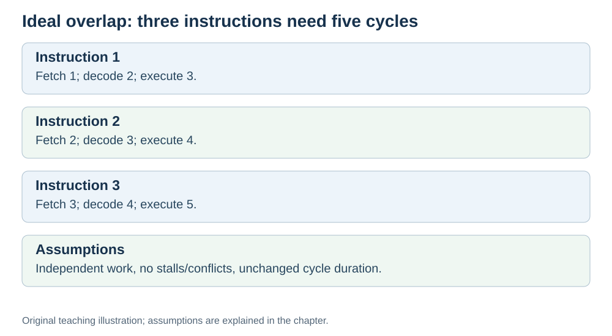

# The assembly-line idea

**Status:** Revised on 26 October 2026 with AI-assisted technical checks; awaiting team peer review.

[Reading order](../OUTLINE.md) · [Teaching-machine conventions](../OUTLINE.md#teaching-machine-conventions) · [Explained answers](../ANSWER-KEY.md#h07-02)

**Learning objective:** after this section, a beginner should be able to explain what pipelining is, using the assembly-line analogy, and why it makes the CPU faster.

## 1. Why this matters

Pipelining is the trick that fixes the idle-time problem from the previous file. It is one of the main reasons a modern CPU can run billions of instructions per second. The idea is simple — and the assembly-line analogy makes it easy to grasp.

## 2. Explanation

**Pipelining** means overlapping the phases of different instructions.

Instead of doing fetch → decode → execute for one instruction, then starting the next, the CPU works on several instructions at once, each in a different phase:

- While instruction 1 **executes**, instruction 2 **decodes**, and instruction 3 **fetches**.
- Next cycle: instruction 1 finishes, instruction 2 executes, instruction 3 decodes, instruction 4 fetches.
- And so on.

This is exactly how an **assembly line** works. A car factory does not build one car at a time, start to finish. Each station does one step, and many cars move through the line at once. Each car still goes through every station, but a new car rolls off the line much more often.

In our ideal three-stage model, **each instruction still spans three cycles**, but once the pipeline is full it completes one instruction per cycle instead of one every three. We assume the same cycle duration, balanced stages, independent instructions and no stalls or resource conflicts. That is the speedup.

The goal is higher **throughput** for the instruction stream, not lower latency for an individual instruction. Real pipeline-register overhead or a changed clock can change individual instruction latency.

## 3. Diagram

*Original teaching diagram created for the 26 October revision. Read the stated model assumptions alongside it.*

## 4. Example

Three instructions, three phases, with a 3-stage pipeline:

- Cycle 1: I1 fetch.
- Cycle 2: I1 decode, I2 fetch.
- Cycle 3: I1 execute, I2 decode, I3 fetch.
- Cycle 4: I2 execute, I3 decode.
- Cycle 5: I3 execute.

Total: **5 cycles** for 3 instructions, instead of 9. Each instruction still took 3 cycles, but they overlapped — so the CPU finished them much sooner.

## 5. Check yourself

Try these first, then use the [explained answers](../ANSWER-KEY.md#h07-02).

1. What does pipelining overlap?
2. Does pipelining make a single instruction faster? Why or why not?
3. In the example, how many cycles do 3 instructions take with a pipeline? Without?
4. What is the assembly-line analogy for pipelining?
5. Why does the CPU finish instructions more often with a pipeline?

## 6. Sources

- [Cornell CS 3410 (Spring 2026), Pipelining & Performance](https://www.cs.cornell.edu/courses/cs3410/2026sp/notes/pipelining.html)
- [MIT OpenCourseWare, 6.004 (Spring 2017), 15.1 Pipelining the Beta](https://ocw.mit.edu/courses/6-004-computation-structures-spring-2017/pages/c15/c15s1/)

These sources support the technical concepts; our pseudocode, examples and analogies are teaching simplifications. Course-specific coverage is still to be checked by the team.
