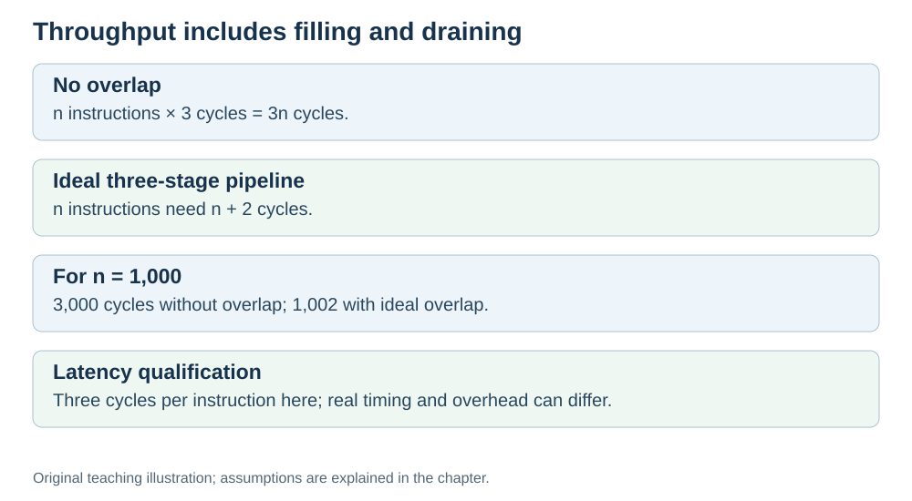

# Throughput: why the pipeline is faster overall

**Status:** Revised on 26 October 2026 with AI-assisted technical checks; awaiting team peer review.

[Reading order](../OUTLINE.md) · [Teaching-machine conventions](../OUTLINE.md#teaching-machine-conventions) · [Explained answers](../ANSWER-KEY.md#h07-03)

**Learning objective:** after this section, a beginner should be able to explain what throughput is, how pipelining increases it, and why latency and throughput are different.

## 1. Why this matters

Pipelining does not make one instruction faster — so why is the CPU faster overall? The answer is **throughput**: how many instructions finish per unit of time. Understanding throughput explains the real benefit of pipelining.

## 2. Explanation

Two different measures:

- **Latency** — how long one instruction takes from start to finish.
- **Throughput** — how many instructions finish per unit of time.

In our ideal three-stage example, an instruction still spans three cycles and the cycle duration is unchanged, so latency stays the same. In real designs, pipeline-register overhead and clock changes can alter latency. Pipelining primarily targets throughput.

But pipelining **increases throughput**. Because phases overlap, the CPU can finish one instruction every cycle (in the ideal case), instead of one every three cycles.

An analogy: a highway with more lanes does not make any single car faster. Each car still drives at the same speed. But **more cars arrive per hour** — the throughput is higher.

That is why pipelining matters: most programs run millions of instructions, so finishing them more often makes the whole program much faster, even if each individual instruction takes the same time.

## 3. Diagram

*Original teaching diagram created for the 26 October revision. Read the stated model assumptions alongside it.*

## 4. Example

Assume 1,000 independent instructions, three one-cycle stages, the same clock period in both designs, and no stalls or resource conflicts. In general, the ideal three-stage pipeline takes `n + 2` cycles for `n` instructions, versus `3n` without overlap.

- **Without pipeline:** 1,000 × 3 = 3,000 cycles.
- **With a 3-stage pipeline (ideal):** roughly 1,000 + 2 = 1,002 cycles.

Each instruction still takes 3 cycles (latency unchanged), but the total time is about **3× shorter** because the CPU finishes one instruction per cycle after the pipeline fills. That is the throughput gain.

(In practice, hazards and stalls reduce the gain — but the idea is the same.)

## 5. Check yourself

Try these first, then use the [explained answers](../ANSWER-KEY.md#h07-03).

1. What is latency? What is throughput?
2. In our ideal model, what happens to latency? Why might a real pipeline differ?
3. How does pipelining increase throughput?
4. In the example, how many cycles does the pipelined version take? The non-pipelined version?
5. What is the highway analogy for throughput?

## 6. Sources

- [Cornell CS 3410 (Spring 2026), Pipelining & Performance](https://www.cs.cornell.edu/courses/cs3410/2026sp/notes/pipelining.html)
- [MIT OpenCourseWare, 6.004 (Spring 2017), 15.1 Pipelining the Beta](https://ocw.mit.edu/courses/6-004-computation-structures-spring-2017/pages/c15/c15s1/)

These sources support the technical concepts; our pseudocode, examples and analogies are teaching simplifications. Course-specific coverage is still to be checked by the team.
