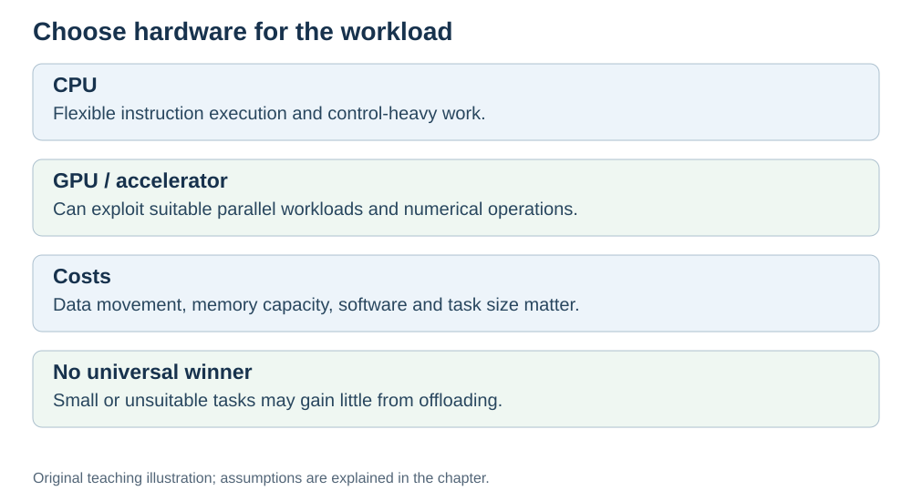

# GPU and AI accelerators

**Status:** Revised on 26 October 2026 with AI-assisted technical checks; awaiting team peer review.

[Reading order](../OUTLINE.md) · [Teaching-machine conventions](../OUTLINE.md#teaching-machine-conventions) · [Explained answers](../ANSWER-KEY.md#h08-01)

**Learning objective:** after this section, a beginner should be able to explain what a GPU is, why AI workloads use it, and what an AI accelerator is.

## 1. Why this matters

Large neural networks often expose many calculations that can run in parallel. **GPUs** and specialised **accelerators** can benefit these workloads, while CPUs also support parallel work and can be efficient for small models or control-heavy tasks. This file connects everything you learned about the CPU to the hardware that powers AI.

## 2. Explanation

The **CPU** is designed to run a few complex tasks quickly, one after another, with lots of branching and decision-making. It has general-purpose cores; their number varies widely by processor.

The **GPU (Graphics Processing Unit)** is designed differently: it provides many parallel arithmetic execution resources, often described as hundreds or thousands of small cores. These are not directly comparable to full CPU cores, and not every resource necessarily runs useful work at once. It is not good at complex logic, but it is excellent at doing the same simple operation on many pieces of data at once.

This matters for large neural networks because much of their computation is **matrix math**: multiplying and adding huge arrays of numbers. The same operation is applied to millions of values. That is exactly what a GPU is good at.

An **AI accelerator** (like a TPU, NPU, or other specialized chip) takes this further: it is designed specifically for the operations AI models use most. It trades general-purpose flexibility for speed on a narrow set of tasks.

So the picture is:

- **CPU** — few powerful cores, good for general work.
- **GPU** — thousands of small cores, good for parallel math.
- **AI accelerator** — specialized hardware for AI operations.

There is no universal months-versus-days speedup. Performance depends on the model, input size, batch size, numeric precision, memory and transfer costs. Use a relevant benchmark. The small tabular Q-learning example in our AI module can run on a CPU.

## 3. Diagram

*Original teaching diagram created for the 26 October revision. Read the stated model assumptions alongside it.*

## 4. Example

Suppose you want to multiply two large matrices (a common AI operation).

- A **CPU** can use multiple cores and vector operations, and avoids device-transfer overhead for data already in its memory.
- A **GPU** can provide high throughput for sufficiently large parallel matrix work. Small tasks or excessive transfers can erase the benefit.
- An **AI accelerator** can speed supported operations, but it is not automatically faster than every GPU. Supported shapes, precision and software matter.

The CPU is not "worse" — it is simply built for a different job.

## 5. Check yourself

Try these first, then use the [explained answers](../ANSWER-KEY.md#h08-01).

1. How is a GPU different from a CPU?
2. Why do large neural networks contain much matrix arithmetic, and why does that not describe every AI algorithm?
3. What is an AI accelerator, and how is it different from a GPU?
4. Why can a GPU train an AI model much faster than a CPU?
5. Is a GPU always better than a CPU? Why or why not?

## 6. Sources

- [NVIDIA CUDA C++ Best Practices Guide, §§2.4 and 3: workload assessment and heterogeneous computing](https://docs.nvidia.com/cuda/cuda-c-best-practices-guide/)
- [Cornell CS 3410 (Spring 2025), Input/Output: devices, storage and interconnects](https://www.cs.cornell.edu/courses/cs3410/2025sp/notes/io.html)

These sources support the technical concepts; our pseudocode, examples and analogies are teaching simplifications. Course-specific coverage is still to be checked by the team.
