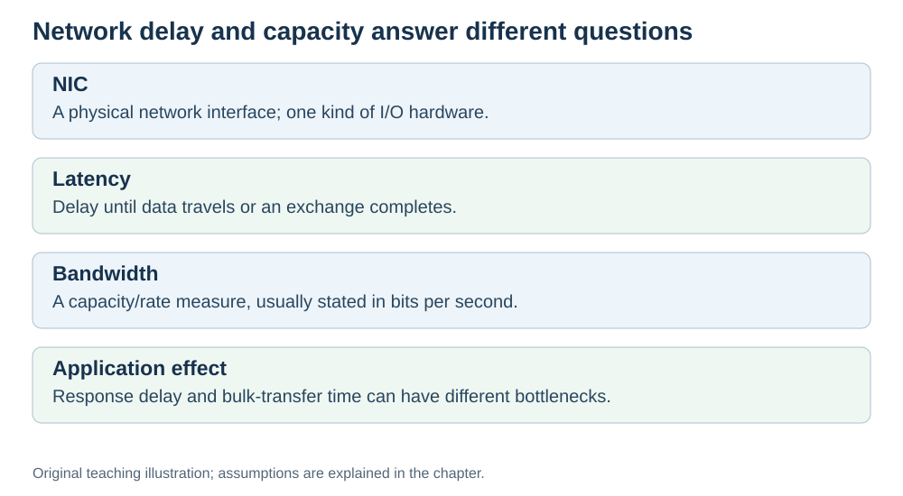

# Network cards, latency, and bandwidth

**Status:** Revised on 26 October 2026 with AI-assisted technical checks; awaiting team peer review.

[Reading order](../OUTLINE.md) · [Teaching-machine conventions](../OUTLINE.md#teaching-machine-conventions) · [Explained answers](../ANSWER-KEY.md#h08-02)

**Learning objective:** after this section, a beginner should be able to explain what a network card does, and the difference between latency and bandwidth.

## 1. Why this matters

Computers rarely work alone. They send and receive data over networks — web pages, messages, cloud storage, AI training data. The hardware that connects a computer to a network is the **network interface controller (NIC)**. End-to-end performance also depends on the path and other machines; two useful measures are **latency** and **bandwidth**. Confusing these two is a common beginner mistake.

## 2. Explanation

A **network card (NIC — Network Interface Card)** is the hardware that connects a computer to a network. It sends data out and receives data in. Every computer that talks to a network has one (sometimes built into the motherboard).

Two different measures describe network performance:

**Latency** — a specified transfer delay, such as one-way packet delay or request/response round-trip time; always say which measurement is meant. Measured in milliseconds (ms). Low latency means quick responses.

**Bandwidth** — here, the connection's data-carrying capacity per second. **Throughput** is the rate actually achieved, which can be lower because of contention, protocol overhead and bottlenecks. Measured in megabits or gigabits per second (Mbps, Gbps). High bandwidth means more data at once.

The difference matters:

- **Latency** is about **speed of a single message**.
- **Bandwidth** is about **volume of data**.

An analogy: a highway.

- **Latency** is how long one car takes to drive from A to B.
- **Bandwidth** is how many cars can drive side by side per hour.

More lanes illustrate higher capacity; they do not shorten the route. The analogy has limits: a higher link rate can reduce the time needed to serialise a finite packet, and lower queueing can reduce delay. That is why a high-bandwidth connection can still feel slow if latency is high.

## 3. Diagram

*Original teaching diagram created for the 26 October revision. Read the stated model assumptions alongside it.*

## 4. Example

You download a large file and make a video call.

- **Download:** bandwidth matters most. A high-bandwidth connection moves the file quickly.
- **Video call:** latency matters most. Even with high bandwidth, a high-latency connection makes the conversation feel delayed.

Same network, different needs. That is why "fast internet" is not one number — it is both latency and bandwidth.

## 5. Check yourself

Try these first, then use the [explained answers](../ANSWER-KEY.md#h08-02).

1. What does a network card do?
2. What is latency? What is bandwidth?
3. Which matters more for a video call? For downloading a large file?
4. What is the highway analogy for latency and bandwidth?
5. Why can a high-bandwidth connection still feel slow?

## 6. Sources

- [Cornell CS 3410 (Spring 2025), Input/Output: devices, storage and interconnects](https://www.cs.cornell.edu/courses/cs3410/2025sp/notes/io.html)
- [IETF RFC 5136, Defining Network Capacity, §§2 and 3.4](https://www.rfc-editor.org/rfc/rfc5136.html)

These sources support the technical concepts; our pseudocode, examples and analogies are teaching simplifications. Course-specific coverage is still to be checked by the team.
