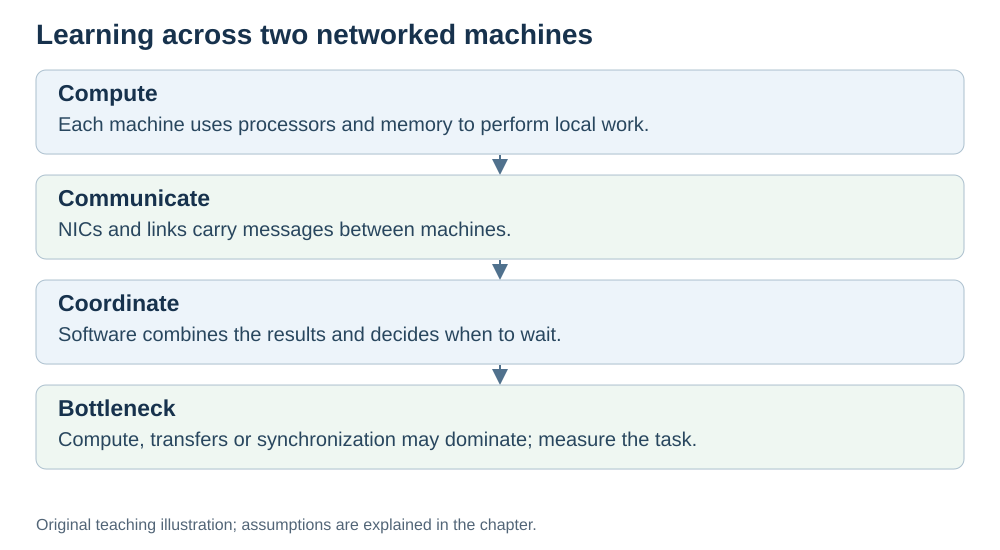

# Where hardware meets AI and networks

**Status:** Revised on 26 October 2026 with AI-assisted technical checks; awaiting team peer review.

[Reading order](../OUTLINE.md) · [Teaching-machine conventions](../OUTLINE.md#teaching-machine-conventions) · [Explained answers](../ANSWER-KEY.md#h08-03)

**Learning objective:** after this section, a beginner should be able to explain how the hardware topics connect to the AI and networks parts of the project.

## 1. Why this matters

Our project covers three areas: hardware, behavioral AI, and networks. They are not separate — they meet in specific places. This file shows those meeting points, so you can see the whole picture instead of three isolated topics.

## 2. Explanation

Here is where hardware meets the other two parts.

**Hardware ↔ AI:**

- Large neural-network workloads often benefit from parallel **matrix math** on GPUs or accelerators. Small tabular RL and control-heavy work can run efficiently on CPUs; the right device depends on the workload.
- The **memory hierarchy** matters: AI models are huge, and moving data between RAM, cache, and the chip is often the bottleneck.
- **Performance** matters: instruction count, CPI, and clock period apply to AI workloads too — but on a GPU, the "instructions" are parallel operations on many values.

**Hardware ↔ Networks:**

- The **network card (NIC)** is the hardware that connects a computer to a network.
- **Latency and bandwidth** describe network performance, and they depend on hardware: the NIC, the cables, the switches.
- **Interconnects** connect the NIC to the host system, often using PCIe. The address/data/control model introduced earlier gives the idea of communication, but a real NIC connection need not use those exact separate buses.
- In data centers, networks connect thousands of machines; the hardware of those networks decides how fast AI training can run across many GPUs.

**The common thread:** every AI model runs on hardware, and every network message travels through hardware. Algorithms, software implementation, data movement and hardware together determine execution time.

## 3. Diagram

*Original teaching diagram created for the 26 October revision. Read the stated model assumptions alongside it.*

## 4. Example

Training an AI model across multiple machines:

- **Hardware:** each machine has GPUs and a NIC.
- **AI:** work may be split by data (replicas process different batches) or by model (different GPUs hold different parts). Both can require communication.
- **Networks:** the GPUs exchange data over the network — latency and bandwidth decide how fast they can cooperate.

If the network is slow (high latency, low bandwidth), the GPUs sit idle waiting for data. The AI is only as fast as the hardware and network allow.

## 5. Check yourself

Try these first, then use the [explained answers](../ANSWER-KEY.md#h08-03).

1. Why do AI workloads use GPUs and accelerators?
2. How does the memory hierarchy matter for AI?
3. What hardware connects a computer to a network?
4. How do latency and bandwidth affect AI training across machines?
5. In your own words: why are hardware, AI, and networks not separate topics?

## 6. Sources

- [NVIDIA CUDA C++ Best Practices Guide, §§2.4 and 3: workload assessment and heterogeneous computing](https://docs.nvidia.com/cuda/cuda-c-best-practices-guide/)
- [Cornell CS 3410 (Spring 2025), Input/Output: devices, storage and interconnects](https://www.cs.cornell.edu/courses/cs3410/2025sp/notes/io.html)

These sources support the technical concepts; our pseudocode, examples and analogies are teaching simplifications. Course-specific coverage is still to be checked by the team.
