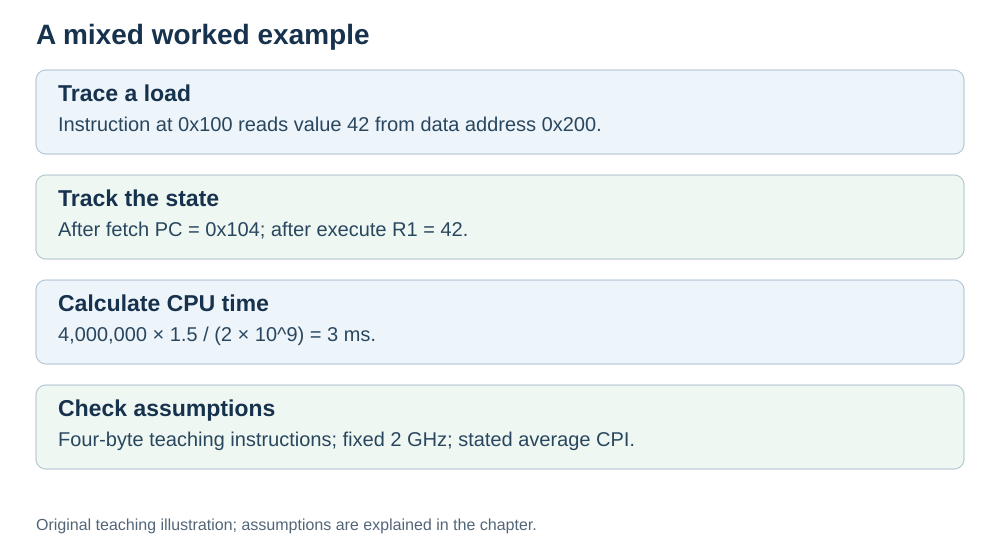

# Worked examples: putting it all together

**Status:** Revised on 26 October 2026 with AI-assisted technical checks; awaiting team peer review.

[Reading order](../OUTLINE.md) · [Teaching-machine conventions](../OUTLINE.md#teaching-machine-conventions) · [Explained answers](../ANSWER-KEY.md#h09-01)

**Learning objective:** after this section, a beginner should be able to solve mixed problems that combine tracing, memory, performance, and pipelining.

## 1. Why this matters

Each file so far focused on one topic. Real questions mix topics. This file gives you mixed examples, so you can practise using several ideas at once — which is exactly what the test bank and the Study Guide will ask.

## 2. Explanation

When you face a mixed problem, follow this checklist:

1. **What is being asked?** Tracing? A calculation? An explanation?
2. **Which topics are involved?** The cycle, memory, performance, pipelining?
3. **What are the given values?** PC, registers, instruction count, CPI, clock.
4. **Which formula or pattern applies?** Trace pattern, execution time formula, pipeline overlap.
5. **Write each step.** Do not skip; the steps are the answer.

The examples below show this checklist in action.

## 3. Diagram

*Original teaching diagram created for the 26 October revision. Read the stated model assumptions alongside it.*

## 4. Example

### Example 1 — trace + memory

`LOAD R1, [0x200]` sits at `0x100`. PC = `0x100`. Memory at `0x200` holds 42.

**Fetch:** PC `0x100` → memory → IR; PC becomes `0x104`.
**Decode:** control unit sees: load, address `0x200`, destination R1.
**Execute:** address `0x200` → address bus; memory returns 42 → data bus; R1 = 42.
**Result:** R1 = 42, PC = `0x104`. This absolute-address pseudocode omits address arithmetic; a real load may use an ALU or AGU to calculate its address.

### Example 2 — performance calculation

Program: 4,000,000 instructions, CPI = 1.5, clock = 2 GHz.

- Clock period = 1 / (2 × 10⁹) = 0.5 ns.
- Time = 4,000,000 × 1.5 × 0.5 ns = 3,000,000 ns = 3 ms.

### Example 3 — comparing two CPUs

CPU A: 3 GHz, CPI = 3. CPU B: 2 GHz, CPI = 1. Same program of 3,000,000 instructions.

- CPU A: period ≈ 0.333 ns → time = 3,000,000 × 3 × 0.333 ≈ 3 ms.
- CPU B: period = 0.5 ns → time = 3,000,000 × 1 × 0.5 = 1.5 ms.

CPU B is faster despite the lower clock, because its CPI is much better.

### Example 4 — pipeline throughput

Assume 1,000 independent instructions, three one-cycle stages, equal cycle duration in both designs, and no stalls or resource conflicts.

- Without pipeline: 1,000 × 3 = 3,000 cycles.
- With a 3-stage pipeline (ideal): about 1,000 + 2 = 1,002 cycles.

In this ideal model latency is unchanged and total-time speedup is approximately 3×. Real register overhead, dependencies and stalls can change the result.

## 5. Check yourself

Try these first, then use the [explained answers](../ANSWER-KEY.md#h09-01).

1. Trace `ADD R2, R3` with R2 = 4, R3 = 9, instruction at `0x400`. Final values and PC?
2. Program: 2,000,000 instructions, CPI = 2, clock = 4 GHz. Execution time?
3. CPU A: 4 GHz, CPI = 2. CPU B: 2 GHz, CPI = 0.5. Same program. Which is faster? Show the calculation.
4. Why does our ideal pipeline improve throughput while leaving latency unchanged, and why might real latency differ?
5. What does Example 1 omit about effective-address calculation in a real load?

## 6. Sources

- [MIT OpenCourseWare, 6.004 (Spring 2017), 13.1 Building the Beta](https://ocw.mit.edu/courses/6-004-computation-structures-spring-2017/pages/c13/c13s1/)
- [Intel VTune Profiler, CPU Metrics Reference: cycles per instructions retired](https://www.intel.com/content/www/us/en/docs/vtune-profiler/user-guide/2024-2/cpu-metrics-reference.html)
- [Cornell CS 3410 (Spring 2026), Pipelining & Performance](https://www.cs.cornell.edu/courses/cs3410/2026sp/notes/pipelining.html)

These sources support the technical concepts; our pseudocode, examples and analogies are teaching simplifications. Course-specific coverage is still to be checked by the team.
