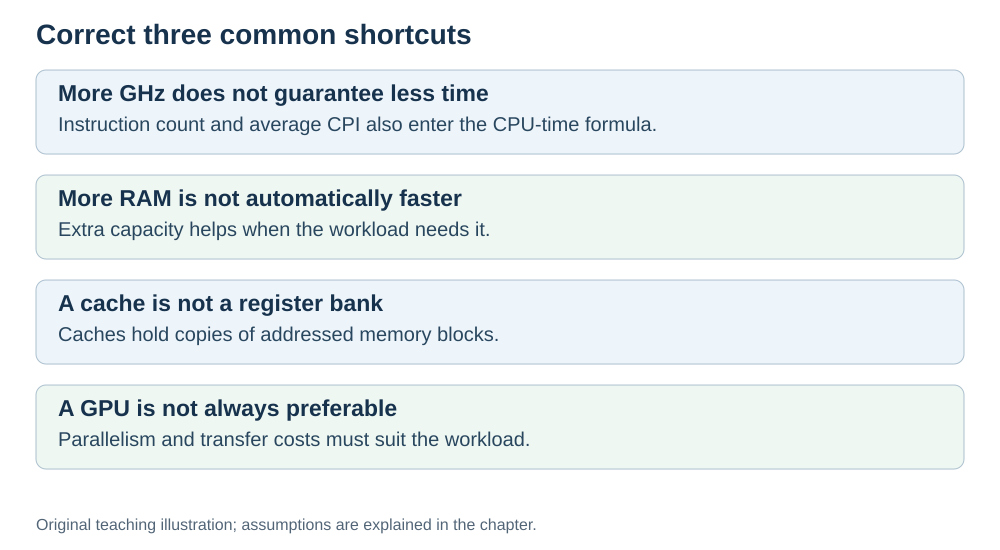

# Common misconceptions

**Status:** Revised on 26 October 2026 with AI-assisted technical checks; awaiting team peer review.

[Reading order](../OUTLINE.md) · [Teaching-machine conventions](../OUTLINE.md#teaching-machine-conventions) · [Explained answers](../ANSWER-KEY.md#h09-02)

**Learning objective:** after this section, a beginner should be able to recognize and correct the most common beginner mistakes about hardware.

## 1. Why this matters

Most beginner errors are not calculation errors — they are wrong mental models. Fixing the model is faster than fixing every individual mistake. This file lists the misconceptions that come up again and again.

## 2. Explanation

**"The CPU understands variables."**
No. The CPU understands registers and memory addresses. The compiler links variables to them. When you write `a = b + c`, the CPU only sees loads, adds, and stores.

**"Higher GHz is always faster."**
No. CPU execution time = dynamic instruction count × average CPI × clock period (constant-clock model; I/O and scheduling waits are separate). A faster clock can be cancelled out by worse CPI. Compare benchmarks, not GHz.

**"More RAM makes the CPU faster."**
No. More RAM means more data fits in memory, so the computer can keep more programs open. It does not make individual instructions faster. If a program is CPU-bound, extra RAM will not speed it up.

**"Cache is just extra RAM."**
No. Cache is a different layer: small, very fast, and managed automatically by the hardware. It holds recently used data to avoid going to RAM.

**"Pipelining makes each instruction faster."**
Pipelining primarily increases throughput: more instructions finish per unit time. Our ideal model leaves latency unchanged; real overhead and clock changes can alter it.

**"A GPU is always better than a CPU."**
No. A GPU is better for parallel math (like AI). A CPU is better for complex, branchy, general-purpose work. They are built for different jobs.

**"Latency and bandwidth are the same thing."**
No. Latency is how long one message takes; bandwidth is how much data can flow per second. High bandwidth does not fix high latency.

## 3. Diagram

*Original teaching diagram created for the 26 October revision. Read the stated model assumptions alongside it.*

## 4. Example

A friend says: "I upgraded from 3 GHz to 4 GHz, so my program must be 33% faster."

What is wrong:
- The program's instruction count and CPI may be different on the new CPU.
- A 33% higher clock does not guarantee 33% less time.
- You would need to measure or calculate execution time, not compare GHz.

Correct answer: "Maybe faster, but not necessarily by 33%. Check instruction count, CPI, and benchmark results."

## 5. Check yourself

Try these first, then use the [explained answers](../ANSWER-KEY.md#h09-02).

1. Why does the CPU not understand variables?
2. Why is higher GHz not always faster?
3. Does more RAM make the CPU faster? Why or why not?
4. What does pipelining primarily improve? What happens to latency in our ideal model and potentially in real hardware?
5. What is the difference between latency and bandwidth?
6. Which misconception have you held yourself? How would you correct it now?

## 6. Sources

- [MIT OpenCourseWare, 6.004 (Spring 2017), 13.1 Building the Beta](https://ocw.mit.edu/courses/6-004-computation-structures-spring-2017/pages/c13/c13s1/)
- [Intel VTune Profiler, CPU Metrics Reference: cycles per instructions retired](https://www.intel.com/content/www/us/en/docs/vtune-profiler/user-guide/2024-2/cpu-metrics-reference.html)
- [Cornell CS 3410 (Spring 2026), Pipelining & Performance](https://www.cs.cornell.edu/courses/cs3410/2026sp/notes/pipelining.html)

These sources support the technical concepts; our pseudocode, examples and analogies are teaching simplifications. Course-specific coverage is still to be checked by the team.
