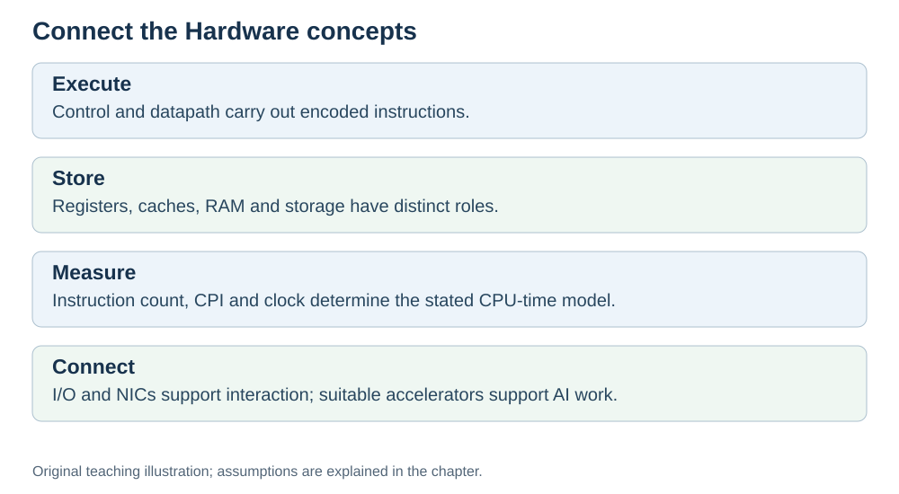

# Summary map: how it all fits together

**Status:** Revised on 26 October 2026 with AI-assisted technical checks; awaiting team peer review.

[Reading order](../OUTLINE.md) · [Teaching-machine conventions](../OUTLINE.md#teaching-machine-conventions) · [Explained answers](../ANSWER-KEY.md#h09-03)

**Learning objective:** after this section, a beginner should be able to describe the whole Hardware part in one page and see how the nine topics connect.

## 1. Why this matters

Nine sections can feel like nine separate topics. They are not — they are one story. This file is the one-page map: if you understand this, you understand the whole Hardware part.

## 2. Explanation

Here is the story in order.

**1. What is hardware.** We group the hardware discussion as CPU, RAM, persistent storage and I/O, with special attention to networking, which is a type of I/O. Software is the recipe; hardware is the kitchen.

**2. Inside the CPU.** The CPU has PC (next instruction), IR (current instruction), registers (values), ALU (math), control unit (manager), and buses (address and data).

**3. Fetch–decode–execute.** The CPU repeats one loop: fetch the next instruction, decode what it means, execute it. The clock drives the loop.

**4. Memory hierarchy.** Registers → cache → RAM → disk. The usual technology/cost trade-off places small fast layers near the processor; this is a model, not a law of distance alone. The hierarchy hides the speed gap.

**5. How programs run.** Native compilation produces CPU instructions; interpreters and virtual machines add other translation/execution steps. The CPU does not understand variables — only registers and addresses.

**6. Performance.** CPU execution time = dynamic instruction count × average CPI × clock period (constant-clock model; I/O and scheduling waits are separate). GHz is one lever, not the whole story.

**7. Pipelining.** Overlap phases of different instructions. Throughput improves in the ideal model; unchanged latency relies on its timing assumptions.

**8. Hardware, AI, and networks.** AI uses GPUs and accelerators for parallel math. Networks use NICs; latency and bandwidth describe their performance. Everything runs on the same hardware foundations.

**9. Practice and summary.** Mixed examples, misconceptions, and self-check questions.

The thread that ties it all together: **small parts, each with one job, working together in a loop, as fast as the hardware allows.**

## 3. Diagram

*Original teaching diagram created for the 26 October revision. Read the stated model assumptions alongside it.*

## 4. Example

You are asked: "Why is my Python loop slow?"

Using the map, you can answer at several levels:
- **Instruction level:** CPython bytecode runs through an interpreter, whose machine instructions contribute to dynamic instruction count. Native or JIT-compiled versions can behave differently.
- **Memory level:** the data may not fit in cache, causing misses (CPI goes up).
- **Performance level:** the clock is only one factor; instruction count and CPI matter too.
- **Parallel level:** a GPU could do the same math much faster if the work is parallel.

One question, several layers of the map. That is how the topics connect.

## 5. Check yourself

Try these first, then use the [explained answers](../ANSWER-KEY.md#h09-03).

1. Name the nine topics in order.
2. Which topic explains why GHz is not the whole story?
3. Which topic explains the difference between registers and RAM?
4. Which topic connects hardware to AI and networks?
5. In your own words: what is the one thread that ties all nine topics together?

## 6. Sources

- [MIT OpenCourseWare, 6.004 (Spring 2017), 13.1 Building the Beta](https://ocw.mit.edu/courses/6-004-computation-structures-spring-2017/pages/c13/c13s1/)
- [Intel VTune Profiler, CPU Metrics Reference: cycles per instructions retired](https://www.intel.com/content/www/us/en/docs/vtune-profiler/user-guide/2024-2/cpu-metrics-reference.html)
- [Cornell CS 3410 (Spring 2026), Pipelining & Performance](https://www.cs.cornell.edu/courses/cs3410/2026sp/notes/pipelining.html)

These sources support the technical concepts; our pseudocode, examples and analogies are teaching simplifications. Course-specific coverage is still to be checked by the team.
