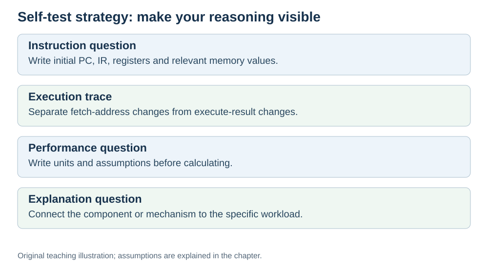

# Check yourself: final questions

**Status:** Revised on 26 October 2026 with AI-assisted technical checks; awaiting team peer review.

[Reading order](../OUTLINE.md) · [Teaching-machine conventions](../OUTLINE.md#teaching-machine-conventions) · [Explained answers](../ANSWER-KEY.md#h09-04)

**Learning objective:** after this section, a beginner should be able to test their understanding of the whole Hardware part and identify what to review.

## 1. Why this matters

This is the final self-test. It covers all nine topics. Use the explained answer key to identify what to review. The key links each topic to its supporting lessons; the guide and Test Bank can reuse these checked activities.

## 2. Explanation

Answer the questions below without looking at the files first. Then check your answers and note which topics you need to review. The questions mix topics on purpose — that is how real understanding is tested.

## 3. Diagram

*Original teaching diagram created for the 26 October revision. Read the stated model assumptions alongside it.*

## 4. Example

### Topic 1 — What is hardware
1. Name the hardware groups used in this project and one job for each.
2. Why is software "the recipe" and hardware "the kitchen"?

### Topic 2 — Inside the CPU
3. What is the difference between PC and IR?
4. What does the control unit do, and what does the ALU do?

### Topic 3 — Fetch–decode–execute
5. List the five steps of fetch.
6. Trace `ADD R1, R2` with R1 = 6, R2 = 4, instruction at `0x100`. Final values and PC?

### Topic 4 — Memory hierarchy
7. Order registers, cache, RAM, and disk from fastest to slowest.
8. What is the difference between a cache hit and a cache miss?

### Topic 5 — How programs run
9. What does the compiler do?
10. Why does the CPU not understand variables?

### Topic 6 — Performance
11. Write the execution time formula.
12. Program: 2,000,000 instructions, CPI = 2, clock = 2 GHz. Execution time?

### Topic 7 — Pipelining
13. What happens to latency in our ideal pipeline, what may happen in real hardware, and what does pipelining primarily increase?
14. Why does a pipeline make the program faster overall?

### Topic 8 — Hardware, AI, networks
15. Why do AI workloads use GPUs?
16. What is the difference between latency and bandwidth?

### Topic 9 — Summary
17. Name the one thread that ties all nine topics together.
18. Which topic do you need to review most? Why?

All 18 questions have [explained answers in this snapshot](../ANSWER-KEY.md#final-self-test). Reflection prompts below also have sample responses.

## 5. Check yourself

Try these first, then use the [explained answers](../ANSWER-KEY.md#h09-04).

1. Which questions did you answer without hesitation?
2. Which ones needed the files? Those are your review topics.
3. Can you explain each answer to a friend in one minute?
4. If not, which file will you reread first?

## 6. Sources

- [MIT OpenCourseWare, 6.004 (Spring 2017), 13.1 Building the Beta](https://ocw.mit.edu/courses/6-004-computation-structures-spring-2017/pages/c13/c13s1/)
- [Intel VTune Profiler, CPU Metrics Reference: cycles per instructions retired](https://www.intel.com/content/www/us/en/docs/vtune-profiler/user-guide/2024-2/cpu-metrics-reference.html)
- [Cornell CS 3410 (Spring 2026), Pipelining & Performance](https://www.cs.cornell.edu/courses/cs3410/2026sp/notes/pipelining.html)

These sources support the technical concepts; our pseudocode, examples and analogies are teaching simplifications. Course-specific coverage is still to be checked by the team.
