# Hardware — How Computers Actually Work

This single guide contains the introduction, reading order and teaching conventions, all 33 lessons, and the complete explained answer key. The examples use the assumptions stated below and in their lessons.

## Contents

- [Introduction](#introduction)
- [Reading order and teaching conventions](#reading-order-and-conventions)
- [01 What is Hardware](#section-01-what-is-hardware)
- [02 Inside the CPU](#section-02-inside-the-cpu)
- [03 Fetch Decode Execute](#section-03-fetch-decode-execute)
- [04 Memory Hierarchy](#section-04-memory-hierarchy)
- [05 How Program Runs](#section-05-how-program-runs)
- [06 Performance](#section-06-performance)
- [07 Pipelining](#section-07-pipelining)
- [08 Hardware and AI Networks](#section-08-hardware-and-ai-networks)
- [09 Practice and Summary](#section-09-practice-and-summary)
- [Explained answers](#explained-answers)

<a id="introduction"></a>
## Introduction

**Status:** Revised on 26 October 2026 with AI-assisted technical checks; awaiting team peer review.

[Reading order](#reading-order-and-conventions) · [Teaching-machine conventions](#reading-order-and-conventions--teaching-machine-conventions) · [Explained answers](#h00)

**File:** `/content/Hardware/GENERAL.md`
**Role:** Opening section of the Hardware guide. It gives the big picture and reading map; the detailed lessons follow below.
**Audience:** complete beginners. No prior hardware knowledge assumed.

---

<a id="introduction--0-what-you-will-be-able-to-do-after-this-chapter"></a>
### 0. What you will be able to do after this chapter

By the end of this chapter, you should be able to:

- Explain in plain words what hardware is and why software needs it.
- Name the main hardware groups used in this project and say what each one does.
- Describe, at a high level, what happens when a program runs.
- Know which file to read next for each topic.

You do **not** need any prior hardware knowledge. If you can write a simple loop in any programming language, you are ready.

---

<a id="introduction--1-what-hardware-means"></a>
### 1. What "hardware" means

A program by itself does nothing. Its source may be text, but executable instructions are encoded as bits. Something physical has to read it and execute it. That physical something is **hardware**.

A simple way to remember it: **software is the recipe, hardware is the kitchen.** The recipe tells you what to do. The kitchen — the cook, the counter, the fridge, the pantry, the hands — is what actually gets it done.

This part of the project is about that kitchen: what it is made of, how it works, and why some kitchens are faster than others.

---

<a id="introduction--2-the-big-picture-hardware-groups-used-in-this-project"></a>
### 2. The big picture: hardware groups used in this project

We group the topics as CPU, main memory, persistent storage and I/O, then give networking special attention. Network interfaces are I/O devices; a standalone computer does not require a network connection.

| Part | In plain words | Kitchen analogy |
|---|---|---|
| CPU (processor) | Runs instructions, does the actual work | The cook |
| Memory (RAM) | Fast, temporary storage for active data | Counter and fridge |
| Storage (SSD/disk) | Persistent storage, usually slower to access than RAM | Pantry |
| Input/Output | Keyboard, screen, network card | Serving window, delivery |
| Network | Connects this computer to others | Delivery route |

You do not need to memorize this now. The point is simple: **a computer is not one thing — it is a few parts working together.** Each part has one job, and the next files look at each job in turn.

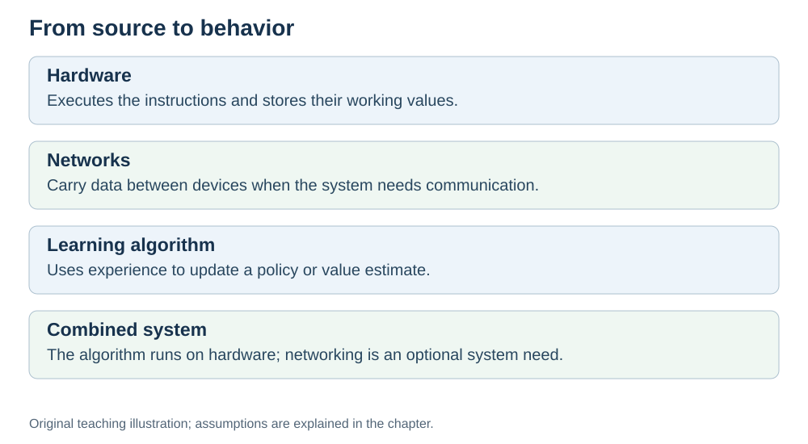

*Original teaching diagram created for the 26 October revision. Read the stated model assumptions alongside it.*


---

<a id="introduction--3-what-happens-when-a-program-runs-the-short-version"></a>
### 3. What happens when a program runs (the short version)

When you run a program, this is the story in one paragraph:

Your code is turned into a list of **instructions**. Those instructions sit in **memory**. The **CPU** reads them one at a time, figures out what each one means, and does it. Results go back to memory or to the screen. This repeats until the program ends.

That is the whole idea. The details — how the CPU reads an instruction, what is inside it, why some CPUs are faster — are in the files below.

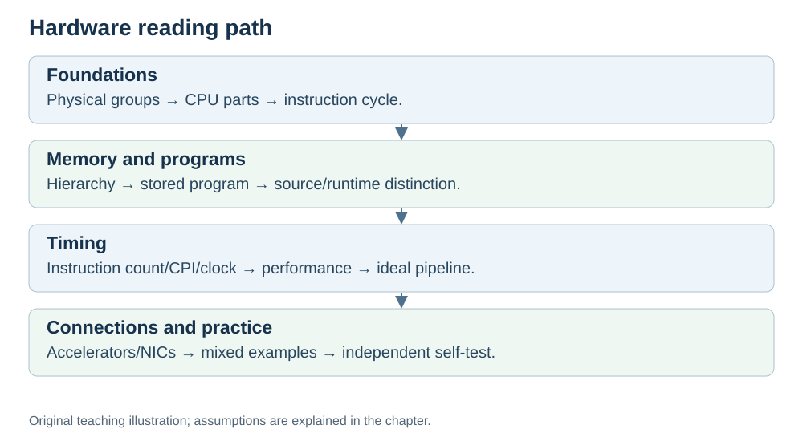

*Original teaching diagram created for the 26 October revision. Read the stated model assumptions alongside it.*


---

<a id="introduction--4-how-to-read-this-part"></a>
### 4. How to read this part

The Hardware part has nine sections containing 33 lessons. Read the sections in this order; the [reading order](#reading-order-and-conventions) links every lesson and its prerequisites:

1. **[What is hardware](#section-01-what-is-hardware)** — the hardware groups used in this project (this chapter gives the map; section 01 goes deeper).
2. **[Inside the CPU](#section-02-inside-the-cpu)** — what is inside the processor: PC, IR, registers, ALU, control unit, buses.
3. **[Fetch–decode–execute](#section-03-fetch-decode-execute)** — how the CPU actually runs one instruction, with worked examples.
4. **[Memory hierarchy](#section-04-memory-hierarchy)** — registers, cache, RAM, disk: why some memory is fast and some is slow.
5. **[How programs run](#section-05-how-program-runs)** — from your code to instructions the CPU can execute.
6. **[Performance](#section-06-performance)** — why "more GHz" does not always mean "faster".
7. **[Pipelining](#section-07-pipelining)** — the assembly-line idea that makes CPUs faster.
8. **[Hardware, AI and networks](#section-08-hardware-and-ai-networks)** — how hardware connects to the other parts of our project.
9. **[Practice and summary](#section-09-practice-and-summary)** — examples, common misconceptions, and questions.

You do not have to read everything at once. Each lesson has an objective, examples, questions, sources and an explained-answer link. Follow the prerequisite order rather than treating all lessons as independent.

---

<a id="introduction--5-three-things-to-keep-in-mind"></a>
### 5. Three things to keep in mind

These ideas come back in almost every file, so remember them now:

- **The CPU does not understand your variables.** It understands registers and memory addresses. The compiler is what connects your code to them.
- **"More GHz" is not the same as "faster".** Speed depends on several things, not just the clock.
- **Every part has one job.** CPU computes, memory holds, buses carry. Once you know each job, the whole machine stops being a black box.

---

<a id="introduction--6-check-yourself"></a>
### 6. Check yourself

1. In your own words: what is hardware, and why does software need it?
2. Name the hardware groups used in this project and one job for each.
3. Describe in 2–3 sentences what happens when a program runs.
4. Which file would you read to learn why 4 GHz is not always faster than 3 GHz?

[Read the explained answers](#h00). They are included in this snapshot; the future Study Guide can reuse them.

---

<a id="introduction--7-scope-boundaries"></a>
### 7. Scope boundaries

- **This chapter covers:** what hardware is, the hardware groups used in this project, the short version of how a program runs, and a reading map.
- **This chapter does not cover:** CPU internals, the fetch–decode–execute cycle in detail, memory hierarchy, performance calculations, pipelining. Those topics are developed in the sections below.
- **Out of scope for the whole Hardware part:** pipeline hazards, superscalar/out-of-order execution, cache replacement policies, instruction encoding details.

---

<a id="introduction--8-sources"></a>
### 8. Sources

- [MIT OpenCourseWare, 6.004 (Spring 2017), 13.1 Building the Beta](https://ocw.mit.edu/courses/6-004-computation-structures-spring-2017/pages/c13/c13s1/)
- [Cornell CS 3410 (Spring 2025), Input/Output: devices, storage and interconnects](https://www.cs.cornell.edu/courses/cs3410/2025sp/notes/io.html)

These sources support the technical concepts; our pseudocode, examples and analogies are teaching simplifications. Course-specific coverage is still to be checked by the team.

<a id="reading-order-and-conventions"></a>
## Reading Order and Teaching Conventions

**Status:** Revised on 26 October 2026 with AI-assisted technical checks; awaiting team peer review. This is a revision, not the original 24 October submission.

Start with the [introduction](#introduction). The nine section folders contain 33 lessons. The [answer key](#explained-answers) covers all lesson questions and the final self-test.

<a id="reading-order-and-conventions--learners-and-learning-goals"></a>
### Learners and learning goals

Assume basic computer literacy and the ability to read a simple assignment or loop. No prior processor-architecture knowledge is required. The units and pseudocode conventions needed below are defined here.

After this part, a learner should be able to:

- Identify the CPU, RAM, persistent storage and I/O, explaining why a NIC is an I/O device.
- Trace arithmetic and memory-transfer pseudocode, distinguishing instruction addresses, data addresses and stored values.
- Explain register operands, cache hits/misses and the purpose of working versus persistent memory.
- Explain the difference between native machine code, bytecode and runtime execution at an introductory level.
- Calculate constant-clock CPU time from dynamic instruction count and average CPI, and distinguish it from elapsed waiting time.
- Compare latency and throughput with an explicitly ideal three-stage pipeline.
- Explain when parallel hardware and network communication can help or limit an AI workload.

<a id="reading-order-and-conventions--teaching-machine-conventions"></a>
### Teaching-machine conventions

These conventions define the examples; they do not claim that every real CPU is implemented this way.

- **Byte/address:** a byte contains eight bits. Each byte has an address in our model; a four-byte word occupies four successive byte addresses.
- **Hexadecimal:** `0x` introduces base-16 notation, with digits 0–9 and A–F. Adding four to `0x100` gives `0x104`; `0x10C + 4 = 0x110`.
- **Instructions and data:** example instructions occupy four bytes; the integer data examples also use four-byte words. The address containing an instruction is separate from any data address it reads/writes.
- **PC/IR timing:** PC initially identifies the instruction to fetch. Fetch copies it into IR and advances PC by four. Decode/execute use IR. Branches can redirect PC, but the worked traces contain only sequential flow.
- **Arithmetic notation:** the full form is `ADD Rd, Rs1, Rs2`, meaning `Rd ← Rs1 + Rs2`. The two-operand form `ADD Rd, Rs` is shorthand for `ADD Rd, Rd, Rs`. `SUB Rd, Rs` similarly overwrites Rd with `Rd - Rs`. Both forms are explicitly defined pseudocode, not a claim about a particular real assembler.
- **Memory notation:** `LOAD R1, [0x200]` transfers the word at data address 0x200 into R1; `STORE [0x200], R1` transfers the other way. Absolute addresses omit effective-address arithmetic. Real processors can use an ALU/AGU for base-plus-offset address calculation.
- **Timing units:** Hz means cycles/second, GHz means 10^9 cycles/second, ns means 10^-9 seconds, and ms means 10^-3 seconds. CPU time calculations assume a constant clock. Dynamic instruction count includes repetitions; average CPI is cycles/completed instructions, not individual latency.
- **Ideal pipeline:** three one-cycle stages, unchanged clock period, independent instructions and no stalls or resource conflicts. Under these assumptions, n instructions take `3n` cycles sequentially or `n + 2` cycles when pipelined. Real pipeline timing may differ.

<a id="reading-order-and-conventions--section-map"></a>
### Section map

| Section | Prerequisites | Main example/activity | Scope | Current status |
| --- | --- | --- | --- | --- |
| 01 Hardware groups | Read the conventions above | Trace a video/recipe analogy to physical components | CPU, working/persistent memory and I/O; networking as I/O | Revised; awaiting team peer review |
| 02 Inside the CPU | Section 01 | Identify PC/IR and trace register/ALU data movement | Simple functional datapath/control/address/data model | Revised; awaiting team peer review |
| 03 Fetch/decode/execute | Section 02 | Trace ADD, LOAD and SUB with explicit initial values | Four-byte straight-line teaching instructions; real address-generation caveat | Revised; awaiting team peer review |
| 04 Memory hierarchy | Sections 01–03 | Explain array reuse and cache misses | Registers, locality, cache levels, RAM and persistent storage | Revised; awaiting team peer review |
| 05 How programs run | Sections 02–04 | Translate and trace a = b + c | Stored-program model, compiler/runtime distinction and pseudocode | Revised; awaiting team peer review |
| 06 Performance | Basic multiplication/division and timing units above | Calculate cycles, periods and CPU times | Dynamic count, average CPI and constant clock; no advanced benchmarking | Revised; awaiting team peer review |
| 07 Pipelining | Sections 03 and 06 | Count an ideal overlap timeline | Throughput/latency, fill/drain; detailed hazards excluded | Revised; awaiting team peer review |
| 08 Hardware, AI and networks | Sections 04 and 06; basic AI/network introductions useful | Choose hardware by workload and explain a distributed-training bottleneck | Conceptual GPU/accelerator/NIC use; no deep optimisation | Revised; awaiting team peer review |
| 09 Practice and summary | Sections 01–08 | Mixed worked examples and an 18-item final self-test | Review/application of the preceding lessons | Revised; awaiting team peer review |

<a id="reading-order-and-conventions--every-lesson-in-reading-order"></a>
### Every lesson in reading order

Each listed lesson has an objective, worked illustration, independent questions, linked explained answers and identifiable sources. Status applies to the revised text; no human peer approval is claimed.

| Lesson | Main learning objective | Answers | Status |
| --- | --- | --- | --- |
| [Why hardware matters](#lesson-01-what-is-hardware01-why-hardware-matters) | explain why a program needs hardware to run, and why knowing hardware helps you understand performance. | [4 explained answers](#h01-01) | Revised; awaiting team peer review |
| [The hardware groups used in this project](#lesson-01-what-is-hardware02-five-parts-of-a-computer) | name the main hardware groups used in this project and explain what each one does. | [5 explained answers](#h01-02) | Revised; awaiting team peer review |
| [The kitchen analogy](#lesson-01-what-is-hardware03-kitchen-analogy) | match each part of a computer to a part of a kitchen, and use the analogy to explain how the parts work together. | [5 explained answers](#h01-03) | Revised; awaiting team peer review |
| [PC and IR: where the CPU keeps its place](#lesson-02-inside-the-cpu01-pc-and-ir) | explain what the Program Counter and the Instruction Register are, and why the CPU needs both. | [4 explained answers](#h02-01) | Revised; awaiting team peer review |
| [Registers and the ALU: where values live and where math happens](#lesson-02-inside-the-cpu02-registers-and-alu) | explain what registers are, what the ALU does, and why the CPU needs both. | [4 explained answers](#h02-02) | Revised; awaiting team peer review |
| [The control unit: the manager of the CPU](#lesson-02-inside-the-cpu03-control-unit) | explain what the control unit does and why the CPU needs a "manager". | [4 explained answers](#h02-03) | Revised; awaiting team peer review |
| [Buses: the roads between parts](#lesson-02-inside-the-cpu04-buses) | explain what a bus is, and the difference between the address bus and the data bus. | [5 explained answers](#h02-04) | Revised; awaiting team peer review |
| [Fetch: get the next instruction](#lesson-03-fetch-decode-execute01-fetch) | describe the steps of the fetch phase and explain what the PC and the two buses do during it. | [5 explained answers](#h03-01) | Revised; awaiting team peer review |
| [Decode: figure out what the instruction means](#lesson-03-fetch-decode-execute02-decode) | explain what the decode phase does and what the control unit works out during it. | [5 explained answers](#h03-02) | Revised; awaiting team peer review |
| [Execute: actually do it](#lesson-03-fetch-decode-execute03-execute) | explain what happens during the execute phase, for both arithmetic and memory instructions. | [5 explained answers](#h03-03) | Revised; awaiting team peer review |
| [Repeat and the clock: why the cycle never stops](#lesson-03-fetch-decode-execute04-repeat-and-clock) | explain why the fetch–decode–execute cycle repeats and what the clock does. | [4 explained answers](#h03-04) | Revised; awaiting team peer review |
| [Worked examples: tracing instructions](#lesson-03-fetch-decode-execute05-worked-examples) | trace a simple instruction through fetch, decode, and execute, and state the final register values and the new PC. | [4 explained answers](#h03-05) | Revised; awaiting team peer review |
| [Why memory has layers](#lesson-04-memory-hierarchy01-why-layers) | explain why memory is organized in layers and why the CPU cannot use just one kind of memory. | [4 explained answers](#h04-01) | Revised; awaiting team peer review |
| [Registers and cache: the fast layers](#lesson-04-memory-hierarchy02-registers-and-cache) | explain what registers and cache are, and why they are the fastest memory in the machine. | [5 explained answers](#h04-02) | Revised; awaiting team peer review |
| [RAM: the working memory](#lesson-04-memory-hierarchy03-ram) | explain what RAM is, what it holds, and how it differs from registers and disk. | [5 explained answers](#h04-03) | Revised; awaiting team peer review |
| [Storage: the persistent layer](#lesson-04-memory-hierarchy04-storage) | explain what storage is, why it is slower than RAM, and why it is still essential. | [5 explained answers](#h04-04) | Revised; awaiting team peer review |
| [The stored-program idea](#lesson-05-how-program-runs01-stored-program-idea) | explain what the stored-program idea is and why code and data can live in the same memory. | [4 explained answers](#h05-01) | Revised; awaiting team peer review |
| [The compiler: from code to instructions](#lesson-05-how-program-runs02-compiler-and-instructions) | explain what a compiler does and why the CPU does not understand variables. | [5 explained answers](#h05-02) | Revised; awaiting team peer review |
| [Worked example: `a = b + c`](#lesson-05-how-program-runs03-example-a-equals-b-plus-c) | translate a simple line of code into instructions and trace how the values change. | [5 explained answers](#h05-03) | Revised; awaiting team peer review |
| [Why "more GHz" is not the same as "faster"](#lesson-06-performance01-why-ghz-is-not-speed) | explain why a higher clock speed does not automatically mean a faster CPU. | [5 explained answers](#h06-01) | Revised; awaiting team peer review |
| [Instruction count and CPI](#lesson-06-performance02-instruction-count-and-cpi) | explain what instruction count and CPI are, and why both matter for performance. | [5 explained answers](#h06-02) | Revised; awaiting team peer review |
| [Clock period: the length of one cycle](#lesson-06-performance03-clock-period) | explain what clock period is, how it relates to clock frequency, and why it is only one of three performance factors. | [5 explained answers](#h06-03) | Revised; awaiting team peer review |
| [Worked calculation: putting it all together](#lesson-06-performance04-worked-calculation) | calculate execution time from instruction count, CPI, and clock frequency, and compare two CPUs. | [5 explained answers](#h06-04) | Revised; awaiting team peer review |
| [The problem with doing one thing at a time](#lesson-07-pipelining01-problem-with-sequence) | explain why a CPU that does fetch, then decode, then execute, one instruction at a time, wastes time. | [5 explained answers](#h07-01) | Revised; awaiting team peer review |
| [The assembly-line idea](#lesson-07-pipelining02-assembly-line-idea) | explain what pipelining is, using the assembly-line analogy, and why it makes the CPU faster. | [5 explained answers](#h07-02) | Revised; awaiting team peer review |
| [Throughput: why the pipeline is faster overall](#lesson-07-pipelining03-throughput) | explain what throughput is, how pipelining increases it, and why latency and throughput are different. | [5 explained answers](#h07-03) | Revised; awaiting team peer review |
| [GPU and AI accelerators](#lesson-08-hardware-and-ai-networks01-gpu-and-ai-accelerators) | explain what a GPU is, why AI workloads use it, and what an AI accelerator is. | [5 explained answers](#h08-01) | Revised; awaiting team peer review |
| [Network cards, latency, and bandwidth](#lesson-08-hardware-and-ai-networks02-nic-latency-bandwidth) | explain what a network card does, and the difference between latency and bandwidth. | [5 explained answers](#h08-02) | Revised; awaiting team peer review |
| [Where hardware meets AI and networks](#lesson-08-hardware-and-ai-networks03-where-hardware-meets-ai-and-networks) | explain how the hardware topics connect to the AI and networks parts of the project. | [5 explained answers](#h08-03) | Revised; awaiting team peer review |
| [Worked examples: putting it all together](#lesson-09-practice-and-summary01-worked-examples) | solve mixed problems that combine tracing, memory, performance, and pipelining. | [5 explained answers](#h09-01) | Revised; awaiting team peer review |
| [Common misconceptions](#lesson-09-practice-and-summary02-common-misconceptions) | recognize and correct the most common beginner mistakes about hardware. | [6 explained answers](#h09-02) | Revised; awaiting team peer review |
| [Summary map: how it all fits together](#lesson-09-practice-and-summary03-summary-map) | describe the whole Hardware part in one page and see how the nine topics connect. | [5 explained answers](#h09-03) | Revised; awaiting team peer review |
| [Check yourself: final questions](#lesson-09-practice-and-summary04-check-yourself) | test their understanding of the whole Hardware part and identify what to review. | [4 explained answers](#h09-04) | Revised; awaiting team peer review |

<a id="reading-order-and-conventions--open-checks-and-boundaries"></a>
### Open checks and boundaries

- A teammate still needs to attempt the activities and review the revised claims, figures and sources. Record actual findings and corrections after that review occurs.
- Verify coverage against the team's actual course materials, especially the required depth of CUDA, assembler and performance. No course lecture numbers or teacher approvals are invented here.
- Visuals and prose must use the same conventions. The final source package must contain the figures it uses and render without dependence on GitHub.
- Detailed pipeline hazards, out-of-order execution, cache replacement policy, machine-instruction encoding and production GPU programming remain outside this beginner part.
- The sources in each lesson support technical concepts; model assumptions and original teaching examples are stated explicitly. General descriptions do not substitute for measured device-performance claims.

<a id="reading-order-and-conventions--reusing-one-connected-topic"></a>
### Reusing one connected topic

Use Section 03 as the first connected teaching sequence. In the **Study Guide**, place the model box before the fetch/decode/execute explanation, then use a trace table and the independent ADD/LOAD questions with their explained answers. In **PPT**, show instruction memory, PC, IR, registers and data memory, revealing one transfer at a time. In a **video tutorial**, narrate a fresh ADD trace and pause before the result; then contrast the separate instruction/data addresses of LOAD. These are production plans, not claims that finished media or human-reviewed lessons already exist.

<a id="reading-order-and-conventions--source-entry-points"></a>
### Source entry points

- [MIT 6.004, Building the Beta](https://ocw.mit.edu/courses/6-004-computation-structures-spring-2017/pages/c13/c13s1/): explicitly defined processor model and datapath.
- [MIT 6.004, Caches and the Memory Hierarchy](https://ocw.mit.edu/courses/6-004-computation-structures-spring-2017/pages/c14/c14s1/): memory trade-offs and locality.
- [Cornell CS 3410, Pipelining & Performance](https://www.cs.cornell.edu/courses/cs3410/2026sp/notes/pipelining.html): timing assumptions and pipeline completion rate.
- [NVIDIA CUDA Best Practices Guide](https://docs.nvidia.com/cuda/cuda-c-best-practices-guide/): workload assessment and parallel/transfer costs.

Use the narrower lesson source lists for bytecode, I/O, CPI definitions and memory permissions.

<a id="section-01-what-is-hardware"></a>
## 01 What is Hardware

<a id="lesson-01-what-is-hardware01-why-hardware-matters"></a>
### Why hardware matters

**Status:** Revised on 26 October 2026 with AI-assisted technical checks; awaiting team peer review.

[Reading order](#reading-order-and-conventions) · [Teaching-machine conventions](#reading-order-and-conventions--teaching-machine-conventions) · [Explained answers](#h01-01)

**Learning objective:** after this section, a beginner should be able to explain why a program needs hardware to run, and why knowing hardware helps you understand performance.

<a id="lesson-01-what-is-hardware01-why-hardware-matters--1-why-this-matters"></a>
#### 1. Why this matters

You write code, press Run, and something happens. It is easy to think the program "just runs". It does not. Source code may be text; executable instructions are encoded as bits. Something physical has to read it, follow it, and produce a result. That physical something is hardware.

If you do not know what hardware does, every performance problem looks like magic. Once you know the parts, "why is this slow?" becomes a question you can actually answer.

<a id="lesson-01-what-is-hardware01-why-hardware-matters--2-explanation"></a>
#### 2. Explanation

A program is a list of instructions. Instructions are just numbers stored somewhere. On their own, they do nothing — like a recipe lying on a table.

To turn a recipe into a meal, you need a kitchen: a cook, a counter, a fridge, a stove. To turn instructions into a running program, you need hardware: a CPU to execute them, memory to hold them, storage to keep them, and ways to get data in and out.

The simple way to remember it:

> **Software is the recipe. Hardware is the kitchen.**

The recipe tells you what to do. The kitchen is what actually gets it done. Both are needed. A perfect recipe in an empty room produces nothing, and a great kitchen with no recipe produces nothing either.

This is why we study hardware in this project: not to become chip designers, but to understand the kitchen well enough to know why some meals are fast and some are slow.

<a id="lesson-01-what-is-hardware01-why-hardware-matters--3-diagram"></a>
#### 3. Diagram

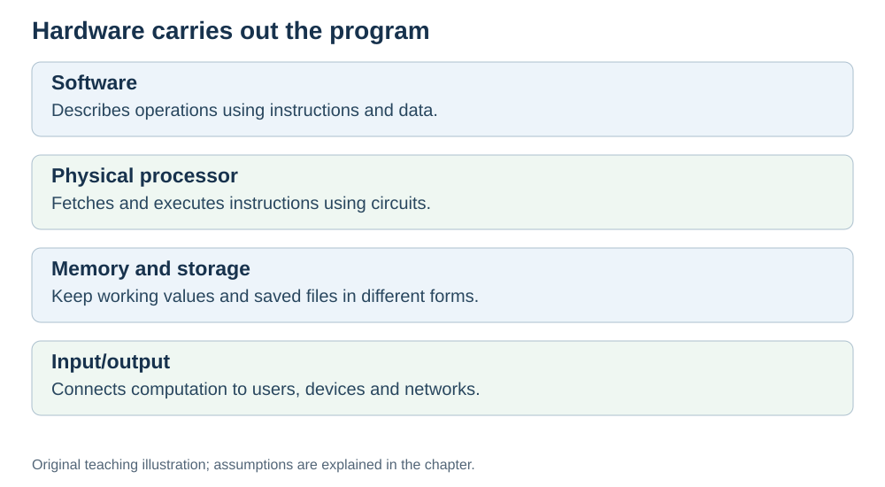

*Original teaching diagram created for the 26 October revision. Read the stated model assumptions alongside it.*


<a id="lesson-01-what-is-hardware01-why-hardware-matters--4-example"></a>
#### 4. Example

You write a loop that sums a million numbers and press Run.

- The **recipe** is your loop — a list of steps.
- The **kitchen** is your laptop: the CPU follows the steps, RAM holds the numbers, the disk holds your file, the screen shows the result.

If the loop is slow, the reason is somewhere in that kitchen: maybe the CPU is waiting for memory, maybe the numbers do not fit in cache, maybe the code produces too many instructions. You cannot tell which without knowing the parts.

<a id="lesson-01-what-is-hardware01-why-hardware-matters--5-check-yourself"></a>
#### 5. Check yourself

Try these first, then use the [explained answers](#h01-01).

1. In your own words: why does a program need hardware?
2. What does "software is the recipe, hardware is the kitchen" mean?
3. Why does knowing hardware help you understand why a program is slow?
4. Give one example of a program you use, and name two hardware parts it depends on.

<a id="lesson-01-what-is-hardware01-why-hardware-matters--6-sources"></a>
#### 6. Sources

- [MIT OpenCourseWare, 6.004 (Spring 2017), 13.1 Building the Beta](https://ocw.mit.edu/courses/6-004-computation-structures-spring-2017/pages/c13/c13s1/)
- [Cornell CS 3410 (Spring 2025), Input/Output: devices, storage and interconnects](https://www.cs.cornell.edu/courses/cs3410/2025sp/notes/io.html)

These sources support the technical concepts; our pseudocode, examples and analogies are teaching simplifications. Course-specific coverage is still to be checked by the team.

<a id="lesson-01-what-is-hardware02-five-parts-of-a-computer"></a>
### The hardware groups used in this project

**Status:** Revised on 26 October 2026 with AI-assisted technical checks; awaiting team peer review.

[Reading order](#reading-order-and-conventions) · [Teaching-machine conventions](#reading-order-and-conventions--teaching-machine-conventions) · [Explained answers](#h01-02)

**Learning objective:** after this section, a beginner should be able to name the main hardware groups used in this project and explain what each one does.

<a id="lesson-01-what-is-hardware02-five-parts-of-a-computer--1-why-this-matters"></a>
#### 1. Why this matters

For this project we group the discussion into CPU, main memory, persistent storage and I/O, then examine networking as an important I/O use. These groups give you a map for the later topics. They are a practical teaching view, not five separate components required in every computer.

<a id="lesson-01-what-is-hardware02-five-parts-of-a-computer--2-explanation"></a>
#### 2. Explanation

Here are our hardware groups, in plain words. Networking is listed separately for teaching, while remaining part of I/O.

**CPU (processor)** — runs instructions. It does the actual work: adds numbers, compares values, decides what happens next. It is the part that "thinks".

**Memory (RAM)** — fast but temporary storage. It holds the data the CPU is working on right now. Ordinary DRAM loses its stored information without power. Its technology and connection to the processor make it suitable for active data; access is generally slower than on-chip cache.

**Storage (SSD or disk)** — persistent storage, generally slower to access than RAM. It holds files, programs, photos — everything that must survive a reboot. It is much larger than RAM but much slower.

**Input/Output (I/O)** — keyboard, mouse, screen, speakers, network card. These are how the computer talks to the outside world. Input comes in, output goes out.

**Networking through a NIC** — connects this computer to other computers and is one type of I/O. It is how data travels between machines: web pages, messages, videos, cloud storage.

The key idea: **a computer is not one thing — it is a few parts working together.** Each part has one job. The CPU computes, memory holds, storage keeps, I/O communicates, the network connects.

<a id="lesson-01-what-is-hardware02-five-parts-of-a-computer--3-diagram"></a>
#### 3. Diagram

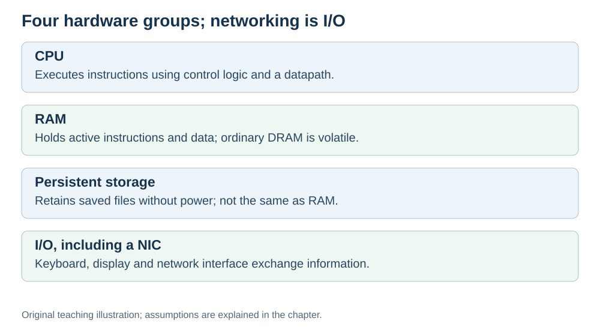

*Original teaching diagram created for the 26 October revision. Read the stated model assumptions alongside it.*


<a id="lesson-01-what-is-hardware02-five-parts-of-a-computer--4-example"></a>
#### 4. Example

You open a video on your laptop:

- **Storage** — the video file sits on the disk.
- **RAM** — a chunk of the video is loaded into memory so the CPU can work with it.
- **CPU** — decodes the video frames.
- **I/O** — the picture goes to the screen, the sound goes to the speakers.
- **Network** — if the video is online, it first arrives over the network.

For an online video, all these groups can participate. For a local file, the network is unnecessary. Many systems also use dedicated video-decoding hardware; this example follows a simple CPU-based path.

<a id="lesson-01-what-is-hardware02-five-parts-of-a-computer--5-check-yourself"></a>
#### 5. Check yourself

Try these first, then use the [explained answers](#h01-02).

1. Name the hardware groups used in this project.
2. Which group is working memory, and which retains saved data without power?
3. What does I/O mean, and give two examples.
4. Why is a computer "not one thing"?
5. Which part connects your computer to the internet?

<a id="lesson-01-what-is-hardware02-five-parts-of-a-computer--6-sources"></a>
#### 6. Sources

- [MIT OpenCourseWare, 6.004 (Spring 2017), 13.1 Building the Beta](https://ocw.mit.edu/courses/6-004-computation-structures-spring-2017/pages/c13/c13s1/)
- [Cornell CS 3410 (Spring 2025), Input/Output: devices, storage and interconnects](https://www.cs.cornell.edu/courses/cs3410/2025sp/notes/io.html)

These sources support the technical concepts; our pseudocode, examples and analogies are teaching simplifications. Course-specific coverage is still to be checked by the team.

<a id="lesson-01-what-is-hardware03-kitchen-analogy"></a>
### The kitchen analogy

**Status:** Revised on 26 October 2026 with AI-assisted technical checks; awaiting team peer review.

[Reading order](#reading-order-and-conventions) · [Teaching-machine conventions](#reading-order-and-conventions--teaching-machine-conventions) · [Explained answers](#h01-03)

**Learning objective:** after this section, a beginner should be able to match each part of a computer to a part of a kitchen, and use the analogy to explain how the parts work together.

<a id="lesson-01-what-is-hardware03-kitchen-analogy--1-why-this-matters"></a>
#### 1. Why this matters

Technical words are easy to forget. A picture is easy to remember. This file gives you one picture — a kitchen — that you can use for the rest of the Hardware part. Every time you meet a new term, you can ask: "which part of the kitchen is this?"

<a id="lesson-01-what-is-hardware03-kitchen-analogy--2-explanation"></a>
#### 2. Explanation

Here is the analogy, part by part.

- The **CPU** is the **cook**. It follows the recipe, one step at a time.
- **Memory (RAM)** is the **counter and the fridge**. It holds the ingredients the cook is using right now — close at hand, but gone when the kitchen closes.
- **Storage (SSD/disk)** is the **pantry**. It holds everything, but walking to the pantry takes time.
- **Buses** are the **cook's hands and the pass-through window**. They carry things between the counter and the cook.
- A **program** is the **recipe book**. It is a list of steps, stored somewhere, waiting to be followed.
- **Input/Output** is the **serving window and the delivery door**. Food goes out to customers; new ingredients come in.
- The **network** is the **delivery route**. It connects this kitchen to other kitchens and suppliers.

A cook does not "understand" ingredients. The cook just moves them, combines them, and puts the result on a plate. A CPU works the same way: it does not understand your variables. It moves values between places and performs operations on them.

The analogy is not perfect — a kitchen does not have a clock ticking billions of times per second — but it gives you the right intuition: **small parts, each with one job, working together.**

<a id="lesson-01-what-is-hardware03-kitchen-analogy--3-diagram"></a>
#### 3. Diagram

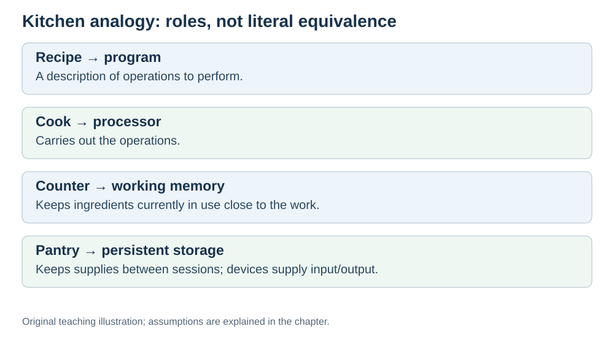

*Original teaching diagram created for the 26 October revision. Read the stated model assumptions alongside it.*

<a id="lesson-01-what-is-hardware03-kitchen-analogy--4-example"></a>
#### 4. Example

Trace `a = b + c` through the kitchen:

- The **recipe** says: "take b, take c, add them, put the result in a."
- The **cook (CPU)** reads the line.
- The **hands (buses)** bring `b` and `c` from the **counter (RAM)**.
- The cook **combines** them (the ALU adds them).
- The result goes back to the counter as `a`.

No part is magic. Each one just did its job. This models the main data movement; real processors use registers and caches between arithmetic and main memory.

<a id="lesson-01-what-is-hardware03-kitchen-analogy--5-check-yourself"></a>
#### 5. Check yourself

Try these first, then use the [explained answers](#h01-03).

1. Which kitchen part matches the CPU? Which matches RAM?
2. Why is storage like a pantry, and not like the counter?
3. What do the buses match in the kitchen?
4. In your own words: why does the analogy help you understand hardware?
5. Where does the analogy break down? Name one thing a kitchen cannot show.

<a id="lesson-01-what-is-hardware03-kitchen-analogy--6-sources"></a>
#### 6. Sources

- [MIT OpenCourseWare, 6.004 (Spring 2017), 13.1 Building the Beta](https://ocw.mit.edu/courses/6-004-computation-structures-spring-2017/pages/c13/c13s1/)
- [Cornell CS 3410 (Spring 2025), Input/Output: devices, storage and interconnects](https://www.cs.cornell.edu/courses/cs3410/2025sp/notes/io.html)

These sources support the technical concepts; our pseudocode, examples and analogies are teaching simplifications. Course-specific coverage is still to be checked by the team.


<a id="section-02-inside-the-cpu"></a>
## 02 Inside the CPU

<a id="lesson-02-inside-the-cpu01-pc-and-ir"></a>
### PC and IR: where the CPU keeps its place

**Status:** Revised on 26 October 2026 with AI-assisted technical checks; awaiting team peer review.

[Reading order](#reading-order-and-conventions) · [Teaching-machine conventions](#reading-order-and-conventions--teaching-machine-conventions) · [Explained answers](#h02-01)

**Learning objective:** after this section, a beginner should be able to explain what the Program Counter and the Instruction Register are, and why the CPU needs both.

<a id="lesson-02-inside-the-cpu01-pc-and-ir--1-why-this-matters"></a>
#### 1. Why this matters

The CPU runs instructions one after another. To do that, it needs to answer two questions at every moment: "where is the next instruction?" and "what am I doing right now?" The CPU answers these with two small registers: PC and IR. Without them, it would lose its place.

<a id="lesson-02-inside-the-cpu01-pc-and-ir--2-explanation"></a>
#### 2. Explanation

**PC (Program Counter)** identifies an instruction address. In our teaching cycle, it holds the fetch address at the start and advances to the following instruction during fetch. Think of it as a bookmark: it tells the CPU where to read next. After an instruction is fetched, the PC moves forward to point at the following one.

**IR (Instruction Register)** is a register that holds the **current instruction** — the one being worked on right now. Think of it as the line of the recipe you are reading at this moment.

The difference is simple:

- **PC** = "where to go next" (an address).
- **IR** = "what I am doing now" (an instruction).

Both are needed. The PC is how the CPU keeps moving forward; the IR is how it holds on to the instruction long enough to decode and execute it.

In this teaching model PC advances during fetch, before execute finishes. This is a convention for our traces, not a universal timing rule for every processor. A branch or jump can redirect it.

<a id="lesson-02-inside-the-cpu01-pc-and-ir--3-diagram"></a>
#### 3. Diagram

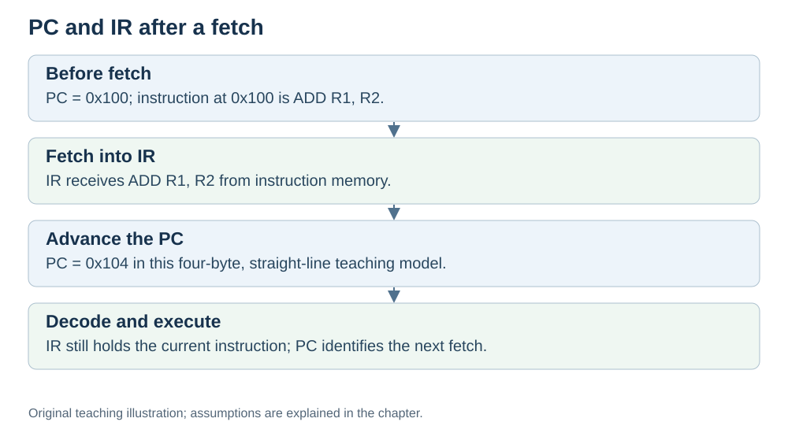

*Original teaching diagram created for the 26 October revision. Read the stated model assumptions alongside it.*


<a id="lesson-02-inside-the-cpu01-pc-and-ir--4-example"></a>
#### 4. Example

Suppose the program is at address `0x100` and each instruction is 4 bytes.

- PC = `0x100` → the CPU fetches the instruction at `0x100`.
- That instruction goes into IR.
- PC becomes `0x104` → it now points to the next instruction.
- The CPU decodes and executes what is in IR.
- Then the cycle repeats with PC = `0x104`.

During decode and execute in this model, PC already identifies the next sequential fetch address and IR holds the instruction currently being processed.

<a id="lesson-02-inside-the-cpu01-pc-and-ir--5-check-yourself"></a>
#### 5. Check yourself

Try these first, then use the [explained answers](#h02-01).

1. What does the PC hold? What does the IR hold?
2. Why does PC already point to the following instruction during execute in our teaching model?
3. What would happen if the CPU had no PC?
4. What would happen if the CPU had no IR?

<a id="lesson-02-inside-the-cpu01-pc-and-ir--6-sources"></a>
#### 6. Sources

- [MIT OpenCourseWare, 6.004 (Spring 2017), 13.1 Building the Beta](https://ocw.mit.edu/courses/6-004-computation-structures-spring-2017/pages/c13/c13s1/)
- [RISC-V International, RV32I specification v20260120, programmer model and load/store instructions](https://docs.riscv.org/reference/isa/v20260120/unpriv/rv32.html)

These sources support the technical concepts; our pseudocode, examples and analogies are teaching simplifications. Course-specific coverage is still to be checked by the team.

<a id="lesson-02-inside-the-cpu02-registers-and-alu"></a>
### Registers and the ALU: where values live and where math happens

**Status:** Revised on 26 October 2026 with AI-assisted technical checks; awaiting team peer review.

[Reading order](#reading-order-and-conventions) · [Teaching-machine conventions](#reading-order-and-conventions--teaching-machine-conventions) · [Explained answers](#h02-02)

**Learning objective:** after this section, a beginner should be able to explain what registers are, what the ALU does, and why the CPU needs both.

<a id="lesson-02-inside-the-cpu02-registers-and-alu--1-why-this-matters"></a>
#### 1. Why this matters

The CPU works with values: numbers, addresses, intermediate results. Those values have to live somewhere, and the math has to happen somewhere. Registers are the "somewhere" for values; the ALU is the "somewhere" for math. Together they are the working core of the CPU.

<a id="lesson-02-inside-the-cpu02-registers-and-alu--2-explanation"></a>
#### 2. Explanation

**Registers** are small, very fast storage slots inside the CPU. For illustration, some instruction sets expose 16 or 32 general-purpose registers; the number depends on the architecture. They hold the values the CPU is working on right now: operands, results, addresses.

Registers are the **fastest storage in the machine**. Much faster than RAM, much much faster than disk. That is why the CPU keeps its active values there.

**ALU (Arithmetic Logic Unit)** is a circuit that performs operations on values:

- **Arithmetic**: add and subtract; multiplication/division may use separate functional units, depending on the processor.
- **Logic**: AND, OR, NOT, compare.

The ALU takes inputs from registers, performs the operation, and produces a result. That result is then written back to a register.

The flow is simple:

> **registers → ALU → register**

Values come from registers, the ALU computes, the result goes back to a register. This is the simplified datapath used by our arithmetic examples; real CPUs can contain additional specialised execution units.

<a id="lesson-02-inside-the-cpu02-registers-and-alu--3-diagram"></a>
#### 3. Diagram

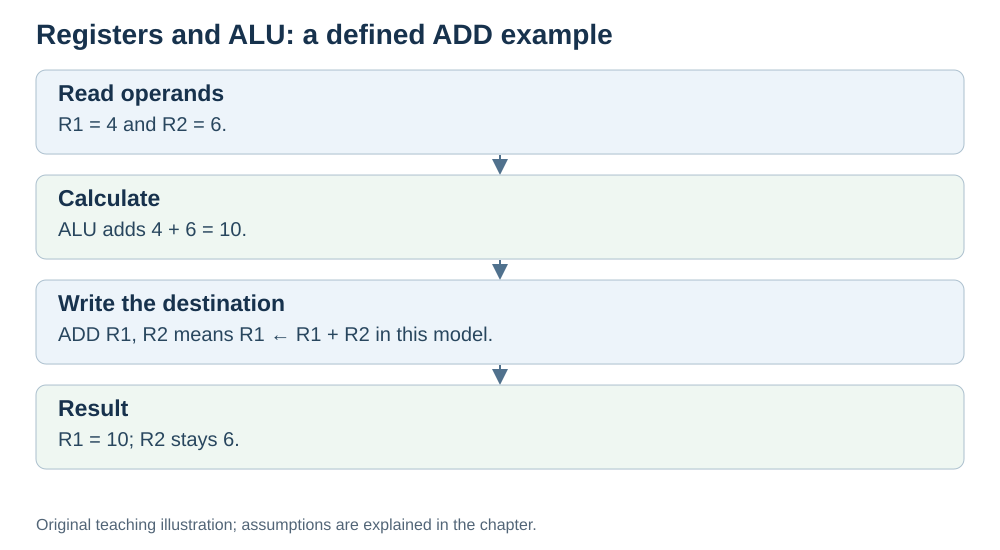

*Original teaching diagram created for the 26 October revision. Read the stated model assumptions alongside it.*


<a id="lesson-02-inside-the-cpu02-registers-and-alu--4-example"></a>
#### 4. Example

`ADD R1, R2` (meaning "R1 = R1 + R2"):

- R1 = 5, R2 = 3.
- The ALU receives 5 and 3 as inputs.
- The ALU computes 5 + 3 = 8.
- The result 8 is written back to R1.

After the instruction: R1 = 8, R2 = 3. The ALU did the math; the registers held the values.

<a id="lesson-02-inside-the-cpu02-registers-and-alu--5-check-yourself"></a>
#### 5. Check yourself

Try these first, then use the [explained answers](#h02-02).

1. What are registers, and why are they fast?
2. What does the ALU do? Give two examples of operations.
3. In `ADD R1, R2`, what goes into the ALU, and where does the result go?
4. Why can't the CPU keep all its values in registers?

<a id="lesson-02-inside-the-cpu02-registers-and-alu--6-sources"></a>
#### 6. Sources

- [MIT OpenCourseWare, 6.004 (Spring 2017), 13.1 Building the Beta](https://ocw.mit.edu/courses/6-004-computation-structures-spring-2017/pages/c13/c13s1/)
- [RISC-V International, RV32I specification v20260120, programmer model and load/store instructions](https://docs.riscv.org/reference/isa/v20260120/unpriv/rv32.html)

These sources support the technical concepts; our pseudocode, examples and analogies are teaching simplifications. Course-specific coverage is still to be checked by the team.

<a id="lesson-02-inside-the-cpu03-control-unit"></a>
### The control unit: the manager of the CPU

**Status:** Revised on 26 October 2026 with AI-assisted technical checks; awaiting team peer review.

[Reading order](#reading-order-and-conventions) · [Teaching-machine conventions](#reading-order-and-conventions--teaching-machine-conventions) · [Explained answers](#h02-03)

**Learning objective:** after this section, a beginner should be able to explain what the control unit does and why the CPU needs a "manager".

<a id="lesson-02-inside-the-cpu03-control-unit--1-why-this-matters"></a>
#### 1. Why this matters

The CPU has many parts: registers, ALU, buses, memory. Someone has to tell each part what to do and when. That someone is the control unit. Without it, the parts would not work together.

<a id="lesson-02-inside-the-cpu03-control-unit--2-explanation"></a>
#### 2. Explanation

The **control unit** is the part of the CPU that **reads the instruction and tells the other parts what to do**.

Here is what it does:

1. It reads the current instruction from IR.
2. It works out what the instruction means: what operation, which registers, where the result goes.
3. It sends **control signals** to the other parts: "read this register", "tell the ALU to add", "write the result here".

The control unit does not do math itself. It is not the storage location for the program's operand values; real control circuits can hold internal control state. It **directs**. It is the manager: it does not cook, but it tells the cook what to do next.

This is the "decode" part of the fetch–decode–execute cycle. The control unit is what turns an instruction into a set of actions.

<a id="lesson-02-inside-the-cpu03-control-unit--3-diagram"></a>
#### 3. Diagram

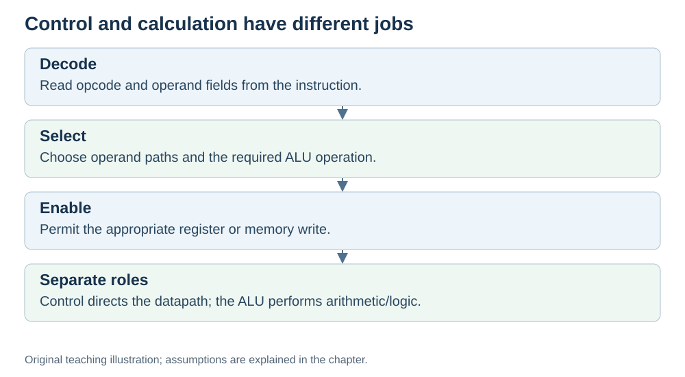

*Original teaching diagram created for the 26 October revision. Read the stated model assumptions alongside it.*


<a id="lesson-02-inside-the-cpu03-control-unit--4-example"></a>
#### 4. Example

Instruction in IR: `ADD R1, R2`.

- The control unit reads it and understands: "this is an add, sources are R1 and R2, destination is R1".
- It sends a signal to the registers: "put R1 and R2 on the ALU inputs".
- It sends a signal to the ALU: "add".
- It sends a signal to the register file: "write the ALU result into R1".

In this example, the control unit directed the data movement; the register file held operands and the ALU performed the addition. It just told everyone what to do — and that is exactly its job.

<a id="lesson-02-inside-the-cpu03-control-unit--5-check-yourself"></a>
#### 5. Check yourself

Try these first, then use the [explained answers](#h02-03).

1. What does the control unit do?
2. Does the control unit do math? Why or why not?
3. In `ADD R1, R2`, what signals does the control unit send?
4. What does the control unit determine during decode, and why are control signals also needed in other phases?

<a id="lesson-02-inside-the-cpu03-control-unit--6-sources"></a>
#### 6. Sources

- [MIT OpenCourseWare, 6.004 (Spring 2017), 13.1 Building the Beta](https://ocw.mit.edu/courses/6-004-computation-structures-spring-2017/pages/c13/c13s1/)
- [RISC-V International, RV32I specification v20260120, programmer model and load/store instructions](https://docs.riscv.org/reference/isa/v20260120/unpriv/rv32.html)

These sources support the technical concepts; our pseudocode, examples and analogies are teaching simplifications. Course-specific coverage is still to be checked by the team.

<a id="lesson-02-inside-the-cpu04-buses"></a>
### Buses: the roads between parts

**Status:** Revised on 26 October 2026 with AI-assisted technical checks; awaiting team peer review.

[Reading order](#reading-order-and-conventions) · [Teaching-machine conventions](#reading-order-and-conventions--teaching-machine-conventions) · [Explained answers](#h02-04)

**Learning objective:** after this section, a beginner should be able to explain what a bus is, and the difference between the address bus and the data bus.

<a id="lesson-02-inside-the-cpu04-buses--1-why-this-matters"></a>
#### 1. Why this matters

The CPU, memory, and other parts need to exchange information. They do it over **buses** — sets of wires that carry signals. If you do not know the buses, you cannot understand how the CPU talks to memory.

<a id="lesson-02-inside-the-cpu04-buses--2-explanation"></a>
#### 2. Explanation

A **bus** is a communication path and its signalling rules for exchanging information between components. Our simple drawing separates address, data and control paths; modern interconnects can combine or packetise these signals. Think of it as a road: things travel along it from one place to another.

Two buses matter most:

**Address path** — carries **addresses**. For the CPU-initiated memory operation shown here, direction: CPU → memory. The CPU says: "give me what is at this address."

**Data bus** — carries **data** (values and instructions). Direction: memory → CPU (and back). Memory says: "here is the value."

The difference is simple:

- **Address bus** = "which place?" (a location)
- **Data bus** = "what is in it?" (the content)

In kitchen terms: the address bus is the cook pointing at a shelf; the data bus is the hand bringing the item back.

There is also a **control bus**, which carries signals like "read" or "write" — telling memory whether the CPU wants to read a value or write one. For now, the two main buses (address and data) are enough.

<a id="lesson-02-inside-the-cpu04-buses--3-diagram"></a>
#### 3. Diagram

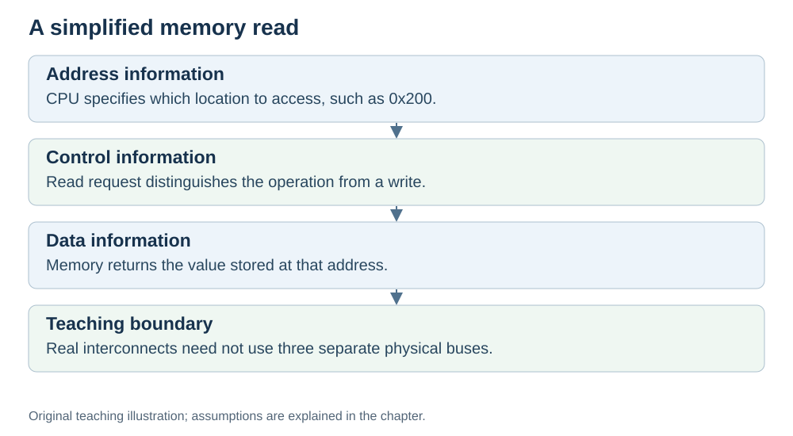

*Original teaching diagram created for the 26 October revision. Read the stated model assumptions alongside it.*


<a id="lesson-02-inside-the-cpu04-buses--4-example"></a>
#### 4. Example

The CPU wants to read the instruction at address `0x100`:

- The CPU puts `0x100` on the **address bus**.
- Memory finds the cell at `0x100`.
- Memory puts the contents of that cell on the **data bus**.
- The CPU reads the value from the data bus.

Two buses, two jobs: one says *where*, the other carries *what*.

<a id="lesson-02-inside-the-cpu04-buses--5-check-yourself"></a>
#### 5. Check yourself

Try these first, then use the [explained answers](#h02-04).

1. What is a bus?
2. What does the address bus carry? In which direction?
3. What does the data bus carry? In which direction?
4. What is the difference between "which place" and "what is in it"?
5. In the kitchen analogy, what matches the address bus?

<a id="lesson-02-inside-the-cpu04-buses--6-sources"></a>
#### 6. Sources

- [MIT OpenCourseWare, 6.004 (Spring 2017), 13.1 Building the Beta](https://ocw.mit.edu/courses/6-004-computation-structures-spring-2017/pages/c13/c13s1/)
- [RISC-V International, RV32I specification v20260120, programmer model and load/store instructions](https://docs.riscv.org/reference/isa/v20260120/unpriv/rv32.html)

These sources support the technical concepts; our pseudocode, examples and analogies are teaching simplifications. Course-specific coverage is still to be checked by the team.


<a id="section-03-fetch-decode-execute"></a>
## 03 Fetch Decode Execute

<a id="lesson-03-fetch-decode-execute01-fetch"></a>
### Fetch: get the next instruction

**Status:** Revised on 26 October 2026 with AI-assisted technical checks; awaiting team peer review.

[Reading order](#reading-order-and-conventions) · [Teaching-machine conventions](#reading-order-and-conventions--teaching-machine-conventions) · [Explained answers](#h03-01)

**Learning objective:** after this section, a beginner should be able to describe the steps of the fetch phase and explain what the PC and the two buses do during it.

<a id="lesson-03-fetch-decode-execute01-fetch--1-why-this-matters"></a>
#### 1. Why this matters

Before the CPU can do anything with an instruction, it has to get it. Fetch is the first phase of the cycle — the step where the CPU reads the next instruction from memory. If you understand fetch, you understand how the CPU keeps moving forward.

<a id="lesson-03-fetch-decode-execute01-fetch--2-explanation"></a>
#### 2. Explanation

Fetch answers one question: **what is the next instruction, and where is it?**

In our simplified sequential teaching cycle:

1. **PC holds the address** of the next instruction.
2. The CPU puts that address on the **address bus**.
3. **Memory returns the instruction** on the **data bus**.
4. The instruction is loaded into **IR**.
5. **PC is incremented** — it now points to the following instruction.

Notice the order: the PC moves forward *before* the instruction is executed. During decode/execute in this model, PC therefore holds the following sequential address. Other implementations and branches need different details.

In kitchen terms: the cook looks at the next line of the recipe and reads it. The bookmark (PC) moves to the next line, and the current line (IR) is now in hand.

<a id="lesson-03-fetch-decode-execute01-fetch--3-diagram"></a>
#### 3. Diagram

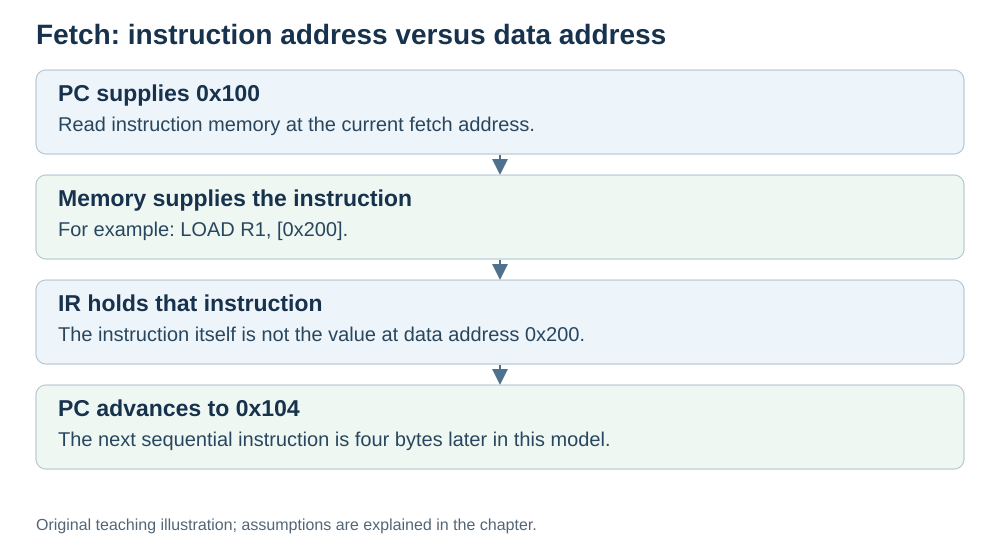

*Original teaching diagram created for the 26 October revision. Read the stated model assumptions alongside it.*


<a id="lesson-03-fetch-decode-execute01-fetch--4-example"></a>
#### 4. Example

Suppose the PC = `0x100`, and each instruction is 4 bytes.

- Address `0x100` goes on the address bus.
- Memory returns the instruction at `0x100` on the data bus.
- The instruction lands in IR.
- PC becomes `0x104`.

Now the CPU has the instruction in IR and is ready to decode it. The PC is already pointing at the next one.

<a id="lesson-03-fetch-decode-execute01-fetch--5-check-yourself"></a>
#### 5. Check yourself

Try these first, then use the [explained answers](#h03-01).

1. What question does fetch answer?
2. List the five steps of fetch in order.
3. Why does PC already point to the following instruction during execute in this teaching model?
4. Which bus carries the address, and which carries the instruction?
5. In the kitchen analogy, what does fetch match?

<a id="lesson-03-fetch-decode-execute01-fetch--6-sources"></a>
#### 6. Sources

- [MIT OpenCourseWare, 6.004 (Spring 2017), 13.1 Building the Beta](https://ocw.mit.edu/courses/6-004-computation-structures-spring-2017/pages/c13/c13s1/)
- [MIT OpenCourseWare, 6.004 (Spring 2017), 15.1 Pipelining the Beta](https://ocw.mit.edu/courses/6-004-computation-structures-spring-2017/pages/c15/c15s1/)

These sources support the technical concepts; our pseudocode, examples and analogies are teaching simplifications. Course-specific coverage is still to be checked by the team.

<a id="lesson-03-fetch-decode-execute02-decode"></a>
### Decode: figure out what the instruction means

**Status:** Revised on 26 October 2026 with AI-assisted technical checks; awaiting team peer review.

[Reading order](#reading-order-and-conventions) · [Teaching-machine conventions](#reading-order-and-conventions--teaching-machine-conventions) · [Explained answers](#h03-02)

**Learning objective:** after this section, a beginner should be able to explain what the decode phase does and what the control unit works out during it.

<a id="lesson-03-fetch-decode-execute02-decode--1-why-this-matters"></a>
#### 1. Why this matters

An instruction is just a number. On its own, it means nothing. Before the CPU can execute it, something has to work out what it means: what operation, which registers, where the result goes. That is what decode does.

<a id="lesson-03-fetch-decode-execute02-decode--2-explanation"></a>
#### 2. Explanation

Decode answers one question: **what does this instruction mean?**

The **control unit** reads the instruction from IR and works out three things:

1. **What operation is this?** Add, subtract, load, store, jump…
2. **Which registers are the operands?** Where do the input values come from?
3. **Where does the result go?** Which register or memory location?

Once it knows these three things, the control unit sends **control signals** to the other parts: "read this register", "tell the ALU to add", "write the result here".

In kitchen terms: the cook reads "chop the onion" and figures out which knife and which board to use. The instruction is understood; the tools are chosen.

In this model, decode does not yet change the program's destination register or data memory. It determines control signals and can read operands into internal working state.

<a id="lesson-03-fetch-decode-execute02-decode--3-diagram"></a>
#### 3. Diagram

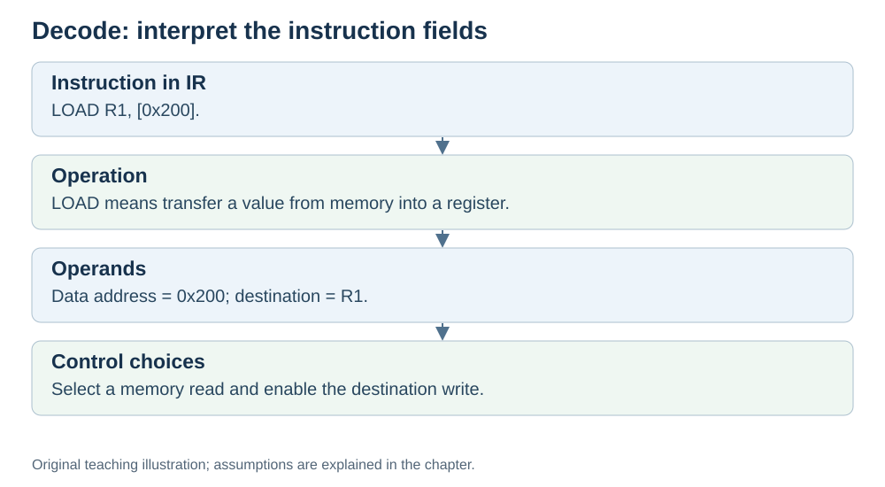

*Original teaching diagram created for the 26 October revision. Read the stated model assumptions alongside it.*


<a id="lesson-03-fetch-decode-execute02-decode--4-example"></a>
#### 4. Example

Instruction in IR: `ADD R1, R2`.

The control unit works out:

- **Operation:** add.
- **Operands:** R1 and R2.
- **Destination:** R1.

It then sends signals: "put R1 and R2 on the ALU inputs", "tell the ALU to add", "write the result into R1".

No values have changed yet. The CPU is now ready to execute.

<a id="lesson-03-fetch-decode-execute02-decode--5-check-yourself"></a>
#### 5. Check yourself

Try these first, then use the [explained answers](#h03-02).

1. What question does decode answer?
2. What three things does the control unit work out during decode?
3. Does decode change the destination register or data memory in our model? What does it prepare?
4. In `LOAD R1, [0x200]`, what does the control unit work out?
5. In the kitchen analogy, what does decode match?

<a id="lesson-03-fetch-decode-execute02-decode--6-sources"></a>
#### 6. Sources

- [MIT OpenCourseWare, 6.004 (Spring 2017), 13.1 Building the Beta](https://ocw.mit.edu/courses/6-004-computation-structures-spring-2017/pages/c13/c13s1/)
- [MIT OpenCourseWare, 6.004 (Spring 2017), 15.1 Pipelining the Beta](https://ocw.mit.edu/courses/6-004-computation-structures-spring-2017/pages/c15/c15s1/)

These sources support the technical concepts; our pseudocode, examples and analogies are teaching simplifications. Course-specific coverage is still to be checked by the team.

<a id="lesson-03-fetch-decode-execute03-execute"></a>
### Execute: actually do it

**Status:** Revised on 26 October 2026 with AI-assisted technical checks; awaiting team peer review.

[Reading order](#reading-order-and-conventions) · [Teaching-machine conventions](#reading-order-and-conventions--teaching-machine-conventions) · [Explained answers](#h03-03)

**Learning objective:** after this section, a beginner should be able to explain what happens during the execute phase, for both arithmetic and memory instructions.

<a id="lesson-03-fetch-decode-execute03-execute--1-why-this-matters"></a>
#### 1. Why this matters

Fetch gets the instruction, decode understands it — execute is where the work actually happens. This is the phase where values change and results appear.

<a id="lesson-03-fetch-decode-execute03-execute--2-explanation"></a>
#### 2. Explanation

Execute answers one question: **do the operation.**

For an **arithmetic instruction** (like `ADD`):

1. Operands are read from registers.
2. They are fed into the **ALU**.
3. The ALU performs the operation.
4. The result is written back to a register.

For a **memory instruction** (like `LOAD` or `STORE`):

1. The address is put on the **address bus**.
2. Memory reads or writes the value on the **data bus**.
3. The value is written into a register (for `LOAD`) or taken from a register (for `STORE`).

A real load/store may first calculate an **effective address**, often using an ALU or an address-generation unit (AGU). Our absolute-address pseudocode supplies the complete address directly, so the trace omits that calculation. In a load-store instruction set, arithmetic uses register operands and separate load/store instructions access data memory; this does not mean that loads can never use an ALU.

In kitchen terms: the cook actually chops, stirs, or plates. The work happens here.

<a id="lesson-03-fetch-decode-execute03-execute--3-diagram"></a>
#### 3. Diagram

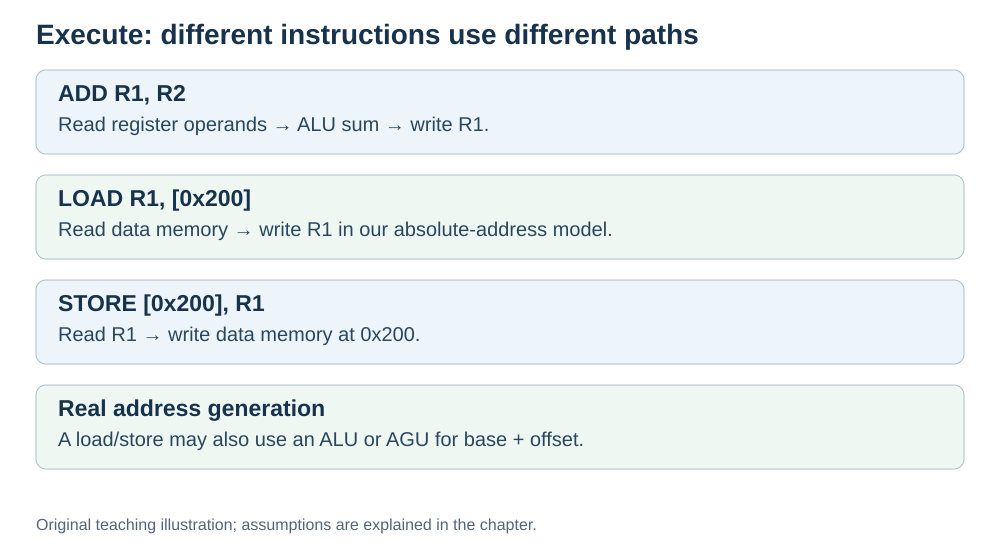

*Original teaching diagram created for the 26 October revision. Read the stated model assumptions alongside it.*


<a id="lesson-03-fetch-decode-execute03-execute--4-example"></a>
#### 4. Example

**Arithmetic:** `ADD R1, R2`, R1 = 5, R2 = 3.

- ALU receives 5 and 3.
- ALU computes 8.
- Result 8 goes back to R1.

**Memory:** `LOAD R1, [0x200]`.

- Address `0x200` goes on the address bus.
- Memory returns the value on the data bus.
- The value is written into R1.
- This absolute-address teaching trace omits address arithmetic. A base-plus-offset load would also need an address calculation.

Same phase, different paths — depending on the instruction.

<a id="lesson-03-fetch-decode-execute03-execute--5-check-yourself"></a>
#### 5. Check yourself

Try these first, then use the [explained answers](#h03-03).

1. What question does execute answer?
2. What happens during execute for an `ADD` instruction?
3. What happens during execute for a `LOAD` instruction?
4. What moves during `LOAD`, and how might a real processor calculate its memory address?
5. In the kitchen analogy, what does execute match?

<a id="lesson-03-fetch-decode-execute03-execute--6-sources"></a>
#### 6. Sources

- [MIT OpenCourseWare, 6.004 (Spring 2017), 13.1 Building the Beta](https://ocw.mit.edu/courses/6-004-computation-structures-spring-2017/pages/c13/c13s1/)
- [MIT OpenCourseWare, 6.004 (Spring 2017), 15.1 Pipelining the Beta](https://ocw.mit.edu/courses/6-004-computation-structures-spring-2017/pages/c15/c15s1/)

These sources support the technical concepts; our pseudocode, examples and analogies are teaching simplifications. Course-specific coverage is still to be checked by the team.

<a id="lesson-03-fetch-decode-execute04-repeat-and-clock"></a>
### Repeat and the clock: why the cycle never stops

**Status:** Revised on 26 October 2026 with AI-assisted technical checks; awaiting team peer review.

[Reading order](#reading-order-and-conventions) · [Teaching-machine conventions](#reading-order-and-conventions--teaching-machine-conventions) · [Explained answers](#h03-04)

**Learning objective:** after this section, a beginner should be able to explain why the fetch–decode–execute cycle repeats and what the clock does.

<a id="lesson-03-fetch-decode-execute04-repeat-and-clock--1-why-this-matters"></a>
#### 1. Why this matters

A program is not one instruction — it is millions or billions of them. The CPU runs them by repeating the same three phases over and over. The **clock** is what keeps this loop moving at a steady pace.

<a id="lesson-03-fetch-decode-execute04-repeat-and-clock--2-explanation"></a>
#### 2. Explanation

After execute finishes, the cycle **repeats** with the next PC value. The CPU goes back to fetch, reads the next instruction, decodes it, executes it, and so on. This loop never stops while the program runs.

What drives the loop is the **clock**. The clock is a timing signal. Our examples assume a fixed rate; real CPUs may change frequency while running. Each tick is one **cycle**. A 3 GHz clock ticks about 3 billion times per second — about 0.33 nanoseconds per cycle.

The clock does not decide *what* to do. It decides *when* to move to the next step. It is the heartbeat: every phase of the cycle is timed by it.

In kitchen terms: the clock is the rhythm of the kitchen — the pace at which the cook moves from one step to the next.

<a id="lesson-03-fetch-decode-execute04-repeat-and-clock--3-diagram"></a>
#### 3. Diagram

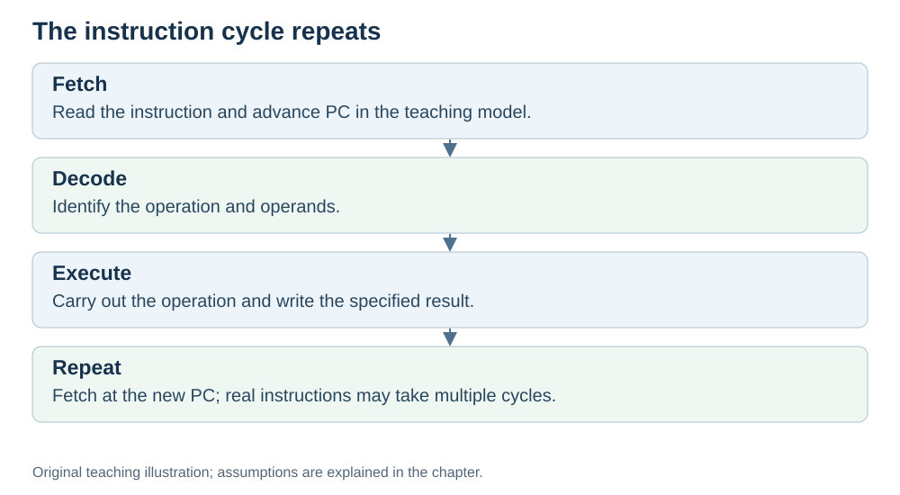

*Original teaching diagram created for the 26 October revision. Read the stated model assumptions alongside it.*


<a id="lesson-03-fetch-decode-execute04-repeat-and-clock--4-example"></a>
#### 4. Example

A program with 1,000 instructions:

- Instruction 1: fetch, decode, execute.
- Instruction 2: fetch, decode, execute.
- …
- Instruction 1,000: fetch, decode, execute.

Each phase takes some number of clock cycles. For a non-overlapping teaching CPU, we can add the cycles used by the individual instructions. In a pipeline, instructions overlap, so use the total elapsed CPU-cycle count rather than adding their individual latencies. That is why the clock rate matters — but, as we will see in the Performance file, it is not the only thing that matters.

<a id="lesson-03-fetch-decode-execute04-repeat-and-clock--5-check-yourself"></a>
#### 5. Check yourself

Try these first, then use the [explained answers](#h03-04).

1. Why does the cycle repeat?
2. What does the clock do? What does it *not* do?
3. A 3 GHz clock ticks how many times per second? How long is one cycle?
4. In the kitchen analogy, what does the clock match?

<a id="lesson-03-fetch-decode-execute04-repeat-and-clock--6-sources"></a>
#### 6. Sources

- [MIT OpenCourseWare, 6.004 (Spring 2017), 13.1 Building the Beta](https://ocw.mit.edu/courses/6-004-computation-structures-spring-2017/pages/c13/c13s1/)
- [MIT OpenCourseWare, 6.004 (Spring 2017), 15.1 Pipelining the Beta](https://ocw.mit.edu/courses/6-004-computation-structures-spring-2017/pages/c15/c15s1/)

These sources support the technical concepts; our pseudocode, examples and analogies are teaching simplifications. Course-specific coverage is still to be checked by the team.

<a id="lesson-03-fetch-decode-execute05-worked-examples"></a>
### Worked examples: tracing instructions

**Status:** Revised on 26 October 2026 with AI-assisted technical checks; awaiting team peer review.

[Reading order](#reading-order-and-conventions) · [Teaching-machine conventions](#reading-order-and-conventions--teaching-machine-conventions) · [Explained answers](#h03-05)

**Learning objective:** after this section, a beginner should be able to trace a simple instruction through fetch, decode, and execute, and state the final register values and the new PC.

<a id="lesson-03-fetch-decode-execute05-worked-examples--1-why-this-matters"></a>
#### 1. Why this matters

Reading about the cycle is one thing; tracing a real instruction is another. This file puts the three phases together with concrete numbers, so you can see exactly what changes at each step.

<a id="lesson-03-fetch-decode-execute05-worked-examples--2-explanation"></a>
#### 2. Explanation

To trace an instruction, follow the same pattern every time:

1. **Start:** note the PC, the instruction, and the register values.
2. **Fetch:** PC → address bus → memory → data bus → IR; PC += 4.
3. **Decode:** control unit works out operation, operands, destination.
4. **Execute:** ALU computes (or memory is accessed); result written back.
5. **End:** state the new register values and the new PC.

This pattern applies to our four-byte, straight-line teaching instructions. Branches, interrupts and real processor implementation details are outside these particular traces.

<a id="lesson-03-fetch-decode-execute05-worked-examples--3-diagram"></a>
#### 3. Diagram

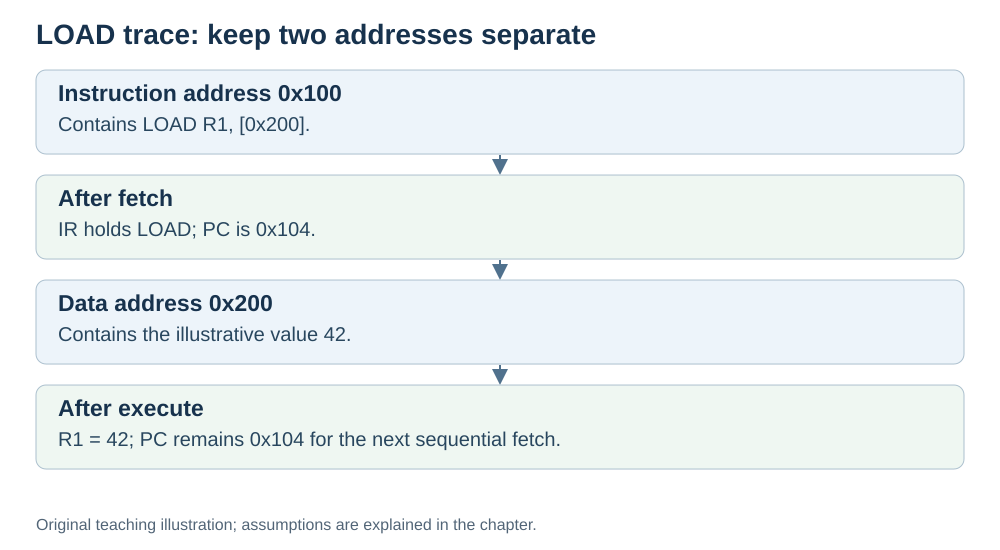

*Original teaching diagram created for the 26 October revision. Read the stated model assumptions alongside it.*


<a id="lesson-03-fetch-decode-execute05-worked-examples--4-example"></a>
#### 4. Example

<a id="lesson-03-fetch-decode-execute05-worked-examples--example-1-add-r1-r2"></a>
##### Example 1: `ADD R1, R2`

Suppose `ADD R1, R2` sits at address `0x100`. PC = `0x100`. R1 = 5, R2 = 3.

**Fetch:**
- PC = `0x100` → address bus.
- Memory returns the instruction → IR.
- PC becomes `0x104`.

**Decode:**
- Control unit reads IR: operation ADD, sources R1 and R2, destination R1.
- Prepares R1 and R2 as ALU inputs.

**Execute:**
- ALU receives 5 and 3, computes 8.
- Result 8 is written back to R1.

**Result:** R1 = 8, R2 = 3, PC = `0x104`.

<a id="lesson-03-fetch-decode-execute05-worked-examples--example-2-load-r1-0x200"></a>
##### Example 2: `LOAD R1, [0x200]`

Suppose `LOAD R1, [0x200]` sits at address `0x100`. PC = `0x100`. Memory at `0x200` holds the value 42.

**Fetch:**
- PC = `0x100` → address bus.
- Memory returns the instruction → IR.
- PC becomes `0x104`.

**Decode:**
- Control unit reads IR: this is a load, address `0x200`, destination R1.

**Execute:**
- Address `0x200` goes on the address bus.
- Memory returns 42 on the data bus.
- 42 is written into R1.

**Result:** R1 = 42, PC = `0x104`.

<a id="lesson-03-fetch-decode-execute05-worked-examples--example-3-sub-r3-r4"></a>
##### Example 3: `SUB R3, R4`

Suppose `SUB R3, R4` sits at address `0x200`. PC = `0x200`. R3 = 10, R4 = 4.

**Fetch:**
- PC = `0x200` → address bus.
- Memory returns the instruction → IR.
- PC becomes `0x204`.

**Decode:**
- Control unit reads IR: operation SUB, sources R3 and R4, destination R3.

**Execute:**
- ALU receives 10 and 4, computes 6.
- Result 6 is written back to R3.

**Result:** R3 = 6, R4 = 4, PC = `0x204`.

<a id="lesson-03-fetch-decode-execute05-worked-examples--5-check-yourself"></a>
#### 5. Check yourself

Try these first, then use the [explained answers](#h03-05).

1. Trace `ADD R5, R6` with R5 = 7, R6 = 2, instruction at `0x300`. What are the final values and the new PC?
2. Trace `LOAD R2, [0x400]`, located at instruction address `0x300`, with PC initially `0x300`. Memory at `0x400` holds 99. Assume a four-byte instruction. What is R2, and what is the new PC?
3. In all three examples, what stays the same? What changes?
4. Why does the PC always increase by 4 in these examples?

<a id="lesson-03-fetch-decode-execute05-worked-examples--6-sources"></a>
#### 6. Sources

- [MIT OpenCourseWare, 6.004 (Spring 2017), 13.1 Building the Beta](https://ocw.mit.edu/courses/6-004-computation-structures-spring-2017/pages/c13/c13s1/)
- [MIT OpenCourseWare, 6.004 (Spring 2017), 15.1 Pipelining the Beta](https://ocw.mit.edu/courses/6-004-computation-structures-spring-2017/pages/c15/c15s1/)

These sources support the technical concepts; our pseudocode, examples and analogies are teaching simplifications. Course-specific coverage is still to be checked by the team.


<a id="section-04-memory-hierarchy"></a>
## 04 Memory Hierarchy

<a id="lesson-04-memory-hierarchy01-why-layers"></a>
### Why memory has layers

**Status:** Revised on 26 October 2026 with AI-assisted technical checks; awaiting team peer review.

[Reading order](#reading-order-and-conventions) · [Teaching-machine conventions](#reading-order-and-conventions--teaching-machine-conventions) · [Explained answers](#h04-01)

**Learning objective:** after this section, a beginner should be able to explain why memory is organized in layers and why the CPU cannot use just one kind of memory.

<a id="lesson-04-memory-hierarchy01-why-layers--1-why-this-matters"></a>
#### 1. Why this matters

The CPU is extremely fast. RAM is much slower. If the CPU had to wait for RAM every time it needed a value, it would spend most of its life doing nothing. The memory hierarchy is the trick that hides this gap.

<a id="lesson-04-memory-hierarchy01-why-layers--2-explanation"></a>
#### 2. Explanation

There is a trade-off in memory:

- **Fast memory is small and expensive.**
- **Large memory is slow and cheap.**

You cannot have a huge memory that is also as fast as the CPU. So computers use **several layers** instead of one.

| Layer | Size | Speed | What it holds |
|---|---|---|---|
| Registers | Tiny (architecture-dependent count) | Fastest | Values the CPU is using right now |
| Cache (L1/L2/L3) | Small (KB–MB) | Very fast | Recently used data and instructions |
| RAM | Large (GB) | Fast | The program and its active data |
| SSD/disk | Very large (TB) | Slow | Everything that must be saved |

In a typical hierarchy, the fast layers are small and on or near the processor. This reflects technology, cost and wiring trade-offs, not a rule that physical distance alone determines speed. Instructions explicitly name registers; cache hardware retains blocks of memory. **Temporal locality** means reusing an address soon, while **spatial locality** means accessing nearby addresses. These patterns make caching useful.

This is why a computer can feel fast even though RAM is much slower than the CPU: the fast layers (registers and cache) hide most of the waiting.

<a id="lesson-04-memory-hierarchy01-why-layers--3-diagram"></a>
#### 3. Diagram

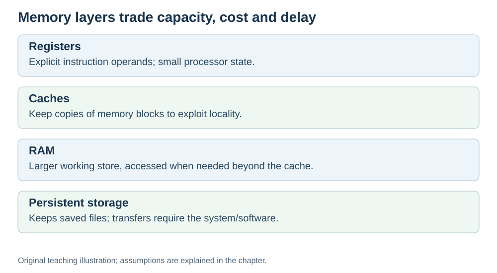

*Original teaching diagram created for the 26 October revision. Read the stated model assumptions alongside it.*


<a id="lesson-04-memory-hierarchy01-why-layers--4-example"></a>
#### 4. Example

You run a loop that sums an array of 1,000 numbers.

- The **array** lives in RAM.
- The **current numbers** being added are copied into **cache**, then into **registers**.
- The CPU adds them in the ALU.
- The **result** stays in a register, then is written back to RAM.

Most of the work happens in registers and cache, not RAM. That is the hierarchy at work.

<a id="lesson-04-memory-hierarchy01-why-layers--5-check-yourself"></a>
#### 5. Check yourself

Try these first, then use the [explained answers](#h04-01).

1. Why can't a computer have one memory that is both huge and fast?
2. List the four layers from fastest to slowest.
3. Which layer is closest to the CPU? Which is farthest?
4. Why does the hierarchy make a computer feel faster than RAM alone would?

<a id="lesson-04-memory-hierarchy01-why-layers--6-sources"></a>
#### 6. Sources

- [MIT OpenCourseWare, 6.004 (Spring 2017), 14.1 Caches and the Memory Hierarchy](https://ocw.mit.edu/courses/6-004-computation-structures-spring-2017/pages/c14/c14s1/)
- [Cornell CS 3410 (Fall 2024), Caches: memory technology, locality and cache levels](https://www.cs.cornell.edu/courses/cs3410/2024fa/notes/caches.html)

These sources support the technical concepts; our pseudocode, examples and analogies are teaching simplifications. Course-specific coverage is still to be checked by the team.

<a id="lesson-04-memory-hierarchy02-registers-and-cache"></a>
### Registers and cache: the fast layers

**Status:** Revised on 26 October 2026 with AI-assisted technical checks; awaiting team peer review.

[Reading order](#reading-order-and-conventions) · [Teaching-machine conventions](#reading-order-and-conventions--teaching-machine-conventions) · [Explained answers](#h04-02)

**Learning objective:** after this section, a beginner should be able to explain what registers and cache are, and why they are the fastest memory in the machine.

<a id="lesson-04-memory-hierarchy02-registers-and-cache--1-why-this-matters"></a>
#### 1. Why this matters

The CPU cannot wait for RAM on every operation. To keep running fast, it keeps the values it needs most in the two fastest layers: registers and cache. Understanding these two explains why some programs run much faster than others.

<a id="lesson-04-memory-hierarchy02-registers-and-cache--2-explanation"></a>
#### 2. Explanation

**Registers** are the fastest storage in the machine. They live *inside* the CPU. The visible register count depends on the instruction set; 16 or 32 general-purpose registers are common teaching examples. They hold the values the CPU is working on right now: operands, results, addresses.

Registers are tiny. A whole large array generally cannot remain in registers; small fixed collections sometimes can. But for the values the CPU uses in the next microsecond, they are perfect.

**Cache** is the next layer. It is small memory (kilobytes to megabytes) that sits between the CPU and RAM. It holds **recently used data and instructions**, so the CPU can grab them again quickly.

Cache is organized in levels:

- **L1** — smallest, fastest, closest to the CPU.
- **L2** — bigger, a bit slower.
- **L3** — often the largest on-chip cache and shared between cores, generally slower to access than L1/L2. Exact topology varies by processor.

Instructions name the registers they read and write; the CPU does not search registers as an address cache. A memory load can be served by L1, a later cache, or RAM. A **hit** means the requested cache level contains the memory block; a **miss** means the request must proceed to a later level. An L1 miss can still hit in L2 or L3.

<a id="lesson-04-memory-hierarchy02-registers-and-cache--3-diagram"></a>
#### 3. Diagram

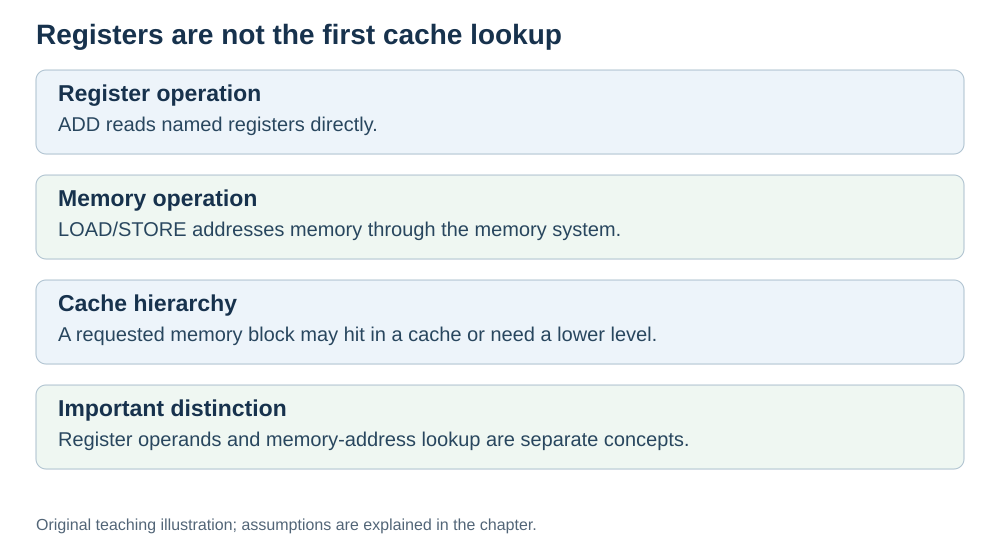

*Original teaching diagram created for the 26 October revision. Read the stated model assumptions alongside it.*


<a id="lesson-04-memory-hierarchy02-registers-and-cache--4-example"></a>
#### 4. Example

A loop reads the same array element many times.

- Assume the first read misses in all caches: the block is fetched from RAM.
- If the block remains in cache, further loads can hit there and avoid a RAM access.
- The values being added sit in **registers** during the addition.

Data reuse can improve performance through temporal locality. Sequential access to new nearby elements can also benefit from spatial locality, because a cache line holds several bytes. A compiler may keep a repeatedly used value in a register instead of loading it again.

<a id="lesson-04-memory-hierarchy02-registers-and-cache--5-check-yourself"></a>
#### 5. Check yourself

Try these first, then use the [explained answers](#h04-02).

1. Where do registers live? Why are they the fastest?
2. What is cache, and what does it hold?
3. What is the difference between a cache hit and a cache miss?
4. Why do loops that reuse data run faster?
5. Order these from fastest to slowest: RAM, L1 cache, registers, L3 cache.

<a id="lesson-04-memory-hierarchy02-registers-and-cache--6-sources"></a>
#### 6. Sources

- [MIT OpenCourseWare, 6.004 (Spring 2017), 14.1 Caches and the Memory Hierarchy](https://ocw.mit.edu/courses/6-004-computation-structures-spring-2017/pages/c14/c14s1/)
- [Cornell CS 3410 (Fall 2024), Caches: memory technology, locality and cache levels](https://www.cs.cornell.edu/courses/cs3410/2024fa/notes/caches.html)

These sources support the technical concepts; our pseudocode, examples and analogies are teaching simplifications. Course-specific coverage is still to be checked by the team.

<a id="lesson-04-memory-hierarchy03-ram"></a>
### RAM: the working memory

**Status:** Revised on 26 October 2026 with AI-assisted technical checks; awaiting team peer review.

[Reading order](#reading-order-and-conventions) · [Teaching-machine conventions](#reading-order-and-conventions--teaching-machine-conventions) · [Explained answers](#h04-03)

**Learning objective:** after this section, a beginner should be able to explain what RAM is, what it holds, and how it differs from registers and disk.

<a id="lesson-04-memory-hierarchy03-ram--1-why-this-matters"></a>
#### 1. Why this matters

In the ordinary desktop model used here, executable code is loaded or mapped into main memory and fetched through the memory hierarchy, rather than executed directly from a disk. Some embedded systems can execute from other memory such as flash; that is outside this example. Understanding RAM explains why "more RAM" can help some workloads, and why it does not make the CPU itself faster.

<a id="lesson-04-memory-hierarchy03-ram--2-explanation"></a>
#### 2. Explanation

**RAM (Random Access Memory)** is the main working memory of the computer. It is:

- **Large** — gigabytes, not kilobytes.
- **Fast** — much faster than disk, but slower than cache.
- **Volatile** — ordinary DRAM needs power to retain its contents.
- **Addressable** — bytes have addresses. A running program may access only addresses permitted by the system; address translation and protection are hidden in our simplified examples.

When you start a program, it is loaded from disk into RAM. While it runs, its code and active data live in RAM. The CPU reads instructions and data from RAM (through cache) and writes results back.

The key difference:

- **Registers** hold values the CPU is using *right now* (tiny, fastest).
- **RAM** holds the program and its active data (large, fast).
- **Disk/SSD** retains saved data without power (persistent, generally slower to access). Persistent does not mean indestructible or automatically backed up.

<a id="lesson-04-memory-hierarchy03-ram--3-diagram"></a>
#### 3. Diagram

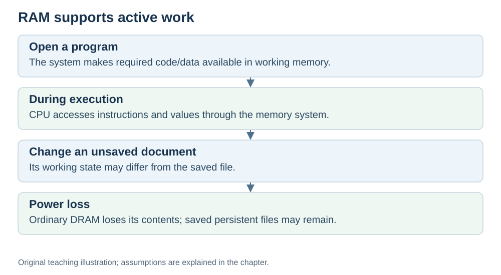

*Original teaching diagram created for the 26 October revision. Read the stated model assumptions alongside it.*


<a id="lesson-04-memory-hierarchy03-ram--4-example"></a>
#### 4. Example

You open a text editor.

- The editor's program file is on **disk**.
- When you launch it, it is loaded into **RAM**.
- As you type, the text is kept in **RAM**.
- The CPU reads and modifies the text through **cache** and **registers**.
- When you save, the file goes back to **disk**.

If the power goes off before saving, RAM is lost — but the disk copy remains.

<a id="lesson-04-memory-hierarchy03-ram--5-check-yourself"></a>
#### 5. Check yourself

Try these first, then use the [explained answers](#h04-03).

1. What does RAM hold while a program runs?
2. How is RAM different from registers? From disk?
3. Why is RAM called "temporary"?
4. Why is code fetched through working memory rather than read directly from disk in our desktop example?
5. Does more RAM make the CPU faster? Why or why not?

<a id="lesson-04-memory-hierarchy03-ram--6-sources"></a>
#### 6. Sources

- [Cornell CS 3410 (Fall 2024), Caches: memory technology, locality and cache levels](https://www.cs.cornell.edu/courses/cs3410/2024fa/notes/caches.html)
- [Cornell CS 3410 (Spring 2025), Input/Output: devices, storage and interconnects](https://www.cs.cornell.edu/courses/cs3410/2025sp/notes/io.html)
- [Microsoft Learn, No-Execute (NX) Nonpaged Pool: memory execution permissions](https://learn.microsoft.com/en-us/windows-hardware/drivers/kernel/no-execute-nonpaged-pool)

These sources support the technical concepts; our pseudocode, examples and analogies are teaching simplifications. Course-specific coverage is still to be checked by the team.

<a id="lesson-04-memory-hierarchy04-storage"></a>
### Storage: the persistent layer

**Status:** Revised on 26 October 2026 with AI-assisted technical checks; awaiting team peer review.

[Reading order](#reading-order-and-conventions) · [Teaching-machine conventions](#reading-order-and-conventions--teaching-machine-conventions) · [Explained answers](#h04-04)

**Learning objective:** after this section, a beginner should be able to explain what storage is, why it is slower than RAM, and why it is still essential.

<a id="lesson-04-memory-hierarchy04-storage--1-why-this-matters"></a>
#### 1. Why this matters

RAM is fast but temporary. If everything lived only in RAM, all your files would disappear when you turn off the computer. Storage is the layer that retains saved data without power — and understanding its speed matters for programs that read and write large files.

<a id="lesson-04-memory-hierarchy04-storage--2-explanation"></a>
#### 2. Explanation

**Storage** (SSD or hard disk) is the slowest and largest layer of memory. It is:

- **Very large** — terabytes.
- **Slow** — much slower than RAM (especially hard disks; SSDs are faster but still slower than RAM).
- **Persistent** — saved data remains when power is off, but can still be deleted, corrupted or lost through device failure.

Storage holds everything that must survive a reboot: the operating system, your programs, your files, your photos, your videos.

Designers combine different technologies and access methods. DRAM provides working capacity; flash or magnetic disks provide persistent capacity at higher access latency. Speed, capacity and cost are engineering trade-offs, not consequences of size alone.

When a program needs data from storage, it is **loaded into RAM first**, then used by the CPU through cache and registers. That is why opening a large file can take a moment: the data has to travel from disk to RAM.

<a id="lesson-04-memory-hierarchy04-storage--3-diagram"></a>
#### 3. Diagram

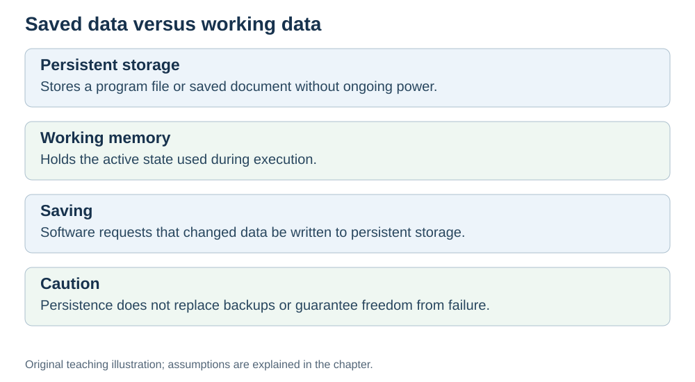

*Original teaching diagram created for the 26 October revision. Read the stated model assumptions alongside it.*


<a id="lesson-04-memory-hierarchy04-storage--4-example"></a>
#### 4. Example

You open a 1 GB video file.

- The file sits on **storage** (disk/SSD).
- The video player loads chunks into **RAM**.
- The CPU decodes frames using **cache** and **registers**.
- The picture goes to the screen.

The first moment may feel slow — that is the disk → RAM transfer. During playback the player keeps buffering more chunks; sustained storage speed, decoding capability and available memory must all keep up. Buffering can hide brief delays, but it cannot fix a source that is consistently too slow.

<a id="lesson-04-memory-hierarchy04-storage--5-check-yourself"></a>
#### 5. Check yourself

Try these first, then use the [explained answers](#h04-04).

1. What does storage hold?
2. Why is storage slower than RAM?
3. Why is storage still essential even though it is slow?
4. What happens when a program needs data from storage?
5. Order these by speed, fastest first: storage, RAM, cache, registers.

<a id="lesson-04-memory-hierarchy04-storage--6-sources"></a>
#### 6. Sources

- [MIT OpenCourseWare, 6.004 (Spring 2017), 14.1 Caches and the Memory Hierarchy](https://ocw.mit.edu/courses/6-004-computation-structures-spring-2017/pages/c14/c14s1/)
- [Cornell CS 3410 (Fall 2024), Caches: memory technology, locality and cache levels](https://www.cs.cornell.edu/courses/cs3410/2024fa/notes/caches.html)

These sources support the technical concepts; our pseudocode, examples and analogies are teaching simplifications. Course-specific coverage is still to be checked by the team.


<a id="section-05-how-program-runs"></a>
## 05 How Program Runs

<a id="lesson-05-how-program-runs01-stored-program-idea"></a>
### The stored-program idea

**Status:** Revised on 26 October 2026 with AI-assisted technical checks; awaiting team peer review.

[Reading order](#reading-order-and-conventions) · [Teaching-machine conventions](#reading-order-and-conventions--teaching-machine-conventions) · [Explained answers](#h05-01)

**Learning objective:** after this section, a beginner should be able to explain what the stored-program idea is and why code and data can live in the same memory.

<a id="lesson-05-how-program-runs01-stored-program-idea--1-why-this-matters"></a>
#### 1. Why this matters

You write code in a text file, but the CPU never sees text. It sees numbers. The stored-program idea is what connects your code to those numbers: instructions are stored in memory just like data. Without this idea, computers as we know them would not exist.

<a id="lesson-05-how-program-runs01-stored-program-idea--2-explanation"></a>
#### 2. Explanation

The **stored-program idea** means instructions are stored in memory rather than fixed by rewiring a machine. In the shared-memory model used here, instructions and data occupy one address space. Other implementations can use separate instruction/data memories or caches.

Before this idea, early computers had to be rewired for each new task. With it, a program is just data in memory — you load a new program, and the same machine can do something completely different.

Here is what this means in practice:

- Memory is a large array of numbered cells.
- Some cells hold **data** (numbers, text, values).
- Some cells hold **instructions** (encoded as numbers).
- The current operation determines whether bits are fetched as an instruction or read as data. Modern systems also enforce memory permissions; not every address is readable, writable or executable.

That is why a program is called a **sequence of instructions sitting in memory**. The CPU walks through them one by one.

<a id="lesson-05-how-program-runs01-stored-program-idea--3-diagram"></a>
#### 3. Diagram

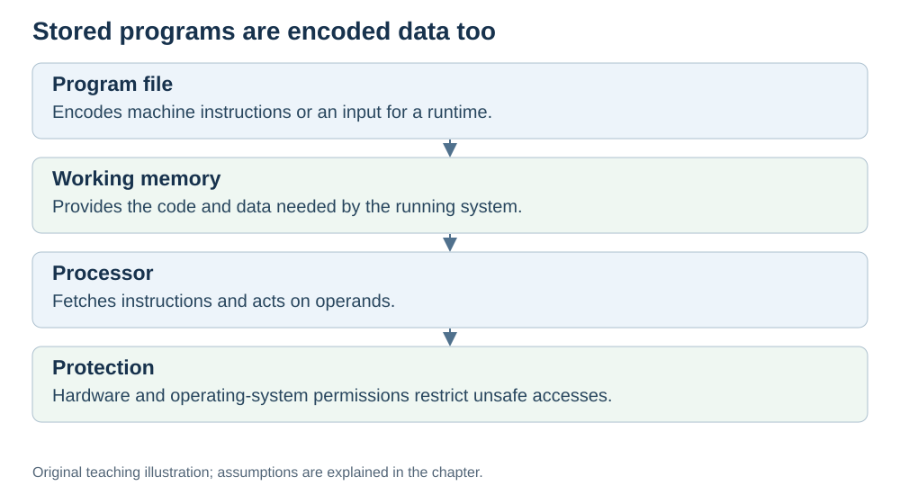

*Original teaching diagram created for the 26 October revision. Read the stated model assumptions alongside it.*


<a id="lesson-05-how-program-runs01-stored-program-idea--4-example"></a>
#### 4. Example

A tiny program that adds two numbers:

```text
address 0x100: LOAD R1, [0x300] ← instruction
address 0x104: LOAD R2, [0x304] ← instruction
address 0x108: ADD R3, R1, R2 ← instruction
address 0x10C: STORE [0x308], R3 ← instruction
...
address 0x300: 5 ← data
address 0x304: 7 ← data
address 0x308: 0 ← data (result)
```

This is pseudocode for four-byte teaching instructions and four-byte integer data; it is not an assembler listing for a specific CPU.

The instructions at `0x100–0x10C` and the data at `0x300–0x308` live in the **same memory**. The CPU reads the instructions in order; the data is read and written by those instructions.

<a id="lesson-05-how-program-runs01-stored-program-idea--5-check-yourself"></a>
#### 5. Check yourself

Try these first, then use the [explained answers](#h05-01).

1. What does the stored-program idea say?
2. Why is it useful that code and data live in the same memory?
3. How are instructions and data both represented, and why can memory permissions still distinguish executable and non-executable regions?
4. What does the PC point to in the example above?

<a id="lesson-05-how-program-runs01-stored-program-idea--6-sources"></a>
#### 6. Sources

- [MIT OpenCourseWare, 6.004 (Spring 2017), 13.1 Building the Beta](https://ocw.mit.edu/courses/6-004-computation-structures-spring-2017/pages/c13/c13s1/)
- [RISC-V International, RV32I specification v20260120, programmer model and load/store instructions](https://docs.riscv.org/reference/isa/v20260120/unpriv/rv32.html)
- [Microsoft Learn, No-Execute (NX) Nonpaged Pool: memory execution permissions](https://learn.microsoft.com/en-us/windows-hardware/drivers/kernel/no-execute-nonpaged-pool)

These sources support the technical concepts; our pseudocode, examples and analogies are teaching simplifications. Course-specific coverage is still to be checked by the team.

<a id="lesson-05-how-program-runs02-compiler-and-instructions"></a>
### The compiler: from code to instructions

**Status:** Revised on 26 October 2026 with AI-assisted technical checks; awaiting team peer review.

[Reading order](#reading-order-and-conventions) · [Teaching-machine conventions](#reading-order-and-conventions--teaching-machine-conventions) · [Explained answers](#h05-02)

**Learning objective:** after this section, a beginner should be able to explain what a compiler does and why the CPU does not understand variables.

<a id="lesson-05-how-program-runs02-compiler-and-instructions--1-why-this-matters"></a>
#### 1. Why this matters

You write `a = b + c`. The CPU has never seen a variable in its life. Something has to translate your code into the instructions the CPU can execute. That something is the **compiler**.

<a id="lesson-05-how-program-runs02-compiler-and-instructions--2-explanation"></a>
#### 2. Explanation

A **compiler** translates a program into another representation. A native-code toolchain, for example for C, can produce machine instructions for a target CPU. CPython commonly compiles Python into **bytecode** for its interpreter; Java commonly targets JVM bytecode, which may be interpreted or compiled further at runtime. Our example uses simplified native-code pseudocode.

The key point for beginners: **the CPU does not know about variables.** It knows **registers** and **memory addresses**. The compiler's job is to connect the two:

- A variable like `b` becomes a **memory address** (or a register).
- An operation like `+` becomes an **instruction** (like `ADD`).
- If `a` must be saved in memory, assigning its result needs a **store**; an optimised value may instead remain in a register.

So the compiler takes your readable code and produces a list of small, exact steps the CPU can follow. That is why the same line of code can become several instructions.

Different compilers can produce different instruction lists for the same code. One may use more instructions, another fewer. This is one reason why **instruction count** matters for performance — we will see that in the Performance file.

<a id="lesson-05-how-program-runs02-compiler-and-instructions--3-diagram"></a>
#### 3. Diagram

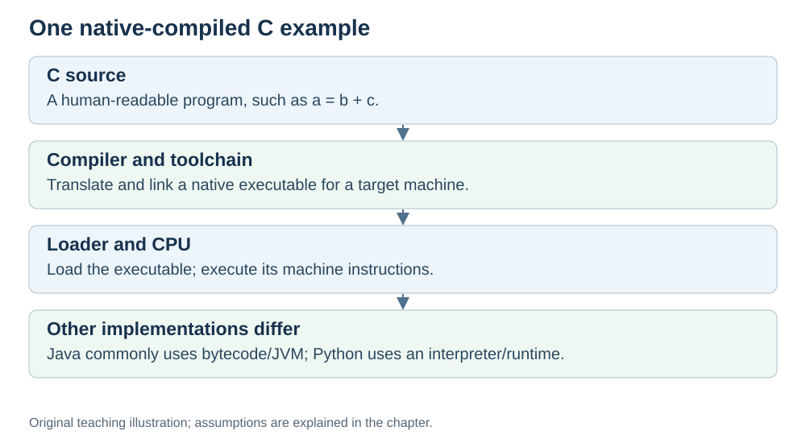

*Original teaching diagram created for the 26 October revision. Read the stated model assumptions alongside it.*


<a id="lesson-05-how-program-runs02-compiler-and-instructions--4-example"></a>
#### 4. Example

Your source expression:

```text
a = b + c
```

An illustrative load-store translation (pseudocode, not a real assembler):

```text
load R1, [b] # load b into register R1
load R2, [c] # load c into register R2
add R3, R1, R2 # R3 = R1 + R2
store [a], R3 # write R3 back to memory
```

Four instructions for one line. The CPU only does small steps; the compiler is what turns a big step into small ones.

If `b` and `c` are already in registers, the loads can be skipped. The result needs `add` plus `store` if `a` must be written to memory, or just `add` if the result may remain in a register.

<a id="lesson-05-how-program-runs02-compiler-and-instructions--5-check-yourself"></a>
#### 5. Check yourself

Try these first, then use the [explained answers](#h05-02).

1. What does a compiler do?
2. Why does the CPU not understand variables?
3. What do variables become after compilation?
4. Why can the same code produce different numbers of instructions on different compilers?
5. In the example, why might the compiler skip the two `load` instructions?

<a id="lesson-05-how-program-runs02-compiler-and-instructions--6-sources"></a>
#### 6. Sources

- [MIT OpenCourseWare, 6.004 (Spring 2017), 11.1 Compilers](https://ocw.mit.edu/courses/6-004-computation-structures-spring-2017/pages/c11/c11s1/)
- [Python documentation, Glossary: bytecode](https://docs.python.org/3/glossary.html#term-bytecode)
- [Oracle JVM Specification, Java SE 26, §2.13 Public Design, Private Implementation](https://docs.oracle.com/javase/specs/jvms/se26/html/jvms-2.html#jvms-2.13)

These sources support the technical concepts; our pseudocode, examples and analogies are teaching simplifications. Course-specific coverage is still to be checked by the team.

<a id="lesson-05-how-program-runs03-example-a-equals-b-plus-c"></a>
### Worked example: `a = b + c`

**Status:** Revised on 26 October 2026 with AI-assisted technical checks; awaiting team peer review.

[Reading order](#reading-order-and-conventions) · [Teaching-machine conventions](#reading-order-and-conventions--teaching-machine-conventions) · [Explained answers](#h05-03)

**Learning objective:** after this section, a beginner should be able to translate a simple line of code into instructions and trace how the values change.

<a id="lesson-05-how-program-runs03-example-a-equals-b-plus-c--1-why-this-matters"></a>
#### 1. Why this matters

This is the smallest complete example of "how a program runs": one line of code, four instructions, concrete values. If you can follow this, you can follow any larger program.

<a id="lesson-05-how-program-runs03-example-a-equals-b-plus-c--2-explanation"></a>
#### 2. Explanation

We will trace `a = b + c` with `b = 4`, `c = 6`, and `a` initially 0. Suppose:

- `b` is at memory address `0x300`
- `c` is at memory address `0x304`
- `a` is at memory address `0x308`

One possible translation is the following pseudocode:

```text
load R1, [0x300] # R1 = b
load R2, [0x304] # R2 = c
add R3, R1, R2 # R3 = R1 + R2
store [0x308], R3 # a = R3
```

We will walk through what happens at each instruction.

<a id="lesson-05-how-program-runs03-example-a-equals-b-plus-c--3-diagram"></a>
#### 3. Diagram

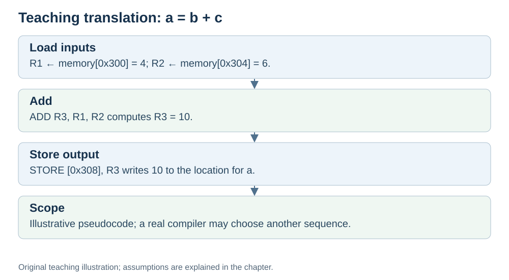

*Original teaching diagram created for the 26 October revision. Read the stated model assumptions alongside it.*

<a id="lesson-05-how-program-runs03-example-a-equals-b-plus-c--4-example"></a>
#### 4. Example

**Step 1:** `load R1, [0x300]`
- Address `0x300` goes on the address bus.
- Memory returns 4.
- R1 = 4.

**Step 2:** `load R2, [0x304]`
- Address `0x304` goes on the address bus.
- Memory returns 6.
- R2 = 6.

**Step 3:** `add R3, R1, R2`
- ALU receives R1 = 4 and R2 = 6.
- ALU computes 10.
- R3 = 10.

**Step 4:** `store [0x308], R3`
- Address `0x308` goes on the address bus.
- Value 10 (from R3) goes on the data bus.
- Memory at `0x308` now holds 10.

**Final state:**
- `a` = 10 (at address `0x308`)
- R1 = 4, R2 = 6, R3 = 10

One line of code → four instructions → one result. This illustrates the machine-level data flow. A real compiler can change the instruction sequence while preserving the required program behaviour.

<a id="lesson-05-how-program-runs03-example-a-equals-b-plus-c--5-check-yourself"></a>
#### 5. Check yourself

Try these first, then use the [explained answers](#h05-03).

1. Why are there two `load` instructions before the `add`?
2. What are the values of R1, R2, R3 after step 3?
3. What does the `store` instruction do?
4. If `b` and `c` were already in registers, how many instructions are needed when `a` must be stored in memory? What if the result may remain in a register?
5. What is the final value of `a`?

<a id="lesson-05-how-program-runs03-example-a-equals-b-plus-c--6-sources"></a>
#### 6. Sources

- [MIT OpenCourseWare, 6.004 (Spring 2017), 11.1 Compilers](https://ocw.mit.edu/courses/6-004-computation-structures-spring-2017/pages/c11/c11s1/)
- [RISC-V International, RV32I specification v20260120, programmer model and load/store instructions](https://docs.riscv.org/reference/isa/v20260120/unpriv/rv32.html)

These sources support the technical concepts; our pseudocode, examples and analogies are teaching simplifications. Course-specific coverage is still to be checked by the team.


<a id="section-06-performance"></a>
## 06 Performance

<a id="lesson-06-performance01-why-ghz-is-not-speed"></a>
### Why "more GHz" is not the same as "faster"

**Status:** Revised on 26 October 2026 with AI-assisted technical checks; awaiting team peer review.

[Reading order](#reading-order-and-conventions) · [Teaching-machine conventions](#reading-order-and-conventions--teaching-machine-conventions) · [Explained answers](#h06-01)

**Learning objective:** after this section, a beginner should be able to explain why a higher clock speed does not automatically mean a faster CPU.

<a id="lesson-06-performance01-why-ghz-is-not-speed--1-why-this-matters"></a>
#### 1. Why this matters

"A 4 GHz CPU must finish any program sooner than a 3 GHz CPU" sounds plausible, but clock rate alone cannot establish that. This is one of the most common beginner misconceptions, and it leads to bad decisions — both when buying a computer and when optimizing a program.

<a id="lesson-06-performance01-why-ghz-is-not-speed--2-explanation"></a>
#### 2. Explanation

The **clock speed** (in GHz) tells you how many cycles the CPU completes per second. A 3 GHz CPU completes about 3 billion cycles per second.

But a cycle is not a fixed amount of work. Different CPUs do different amounts of work per cycle, and different programs need different numbers of cycles per instruction.

Here we model **CPU execution time** — time spent executing the program on the CPU. Elapsed user-observed time may also include I/O and scheduling waits. It depends on three things:

- **Instruction count** — how many instructions the program needs.
- **CPI** — average cycles per instruction.
- **Clock period** — how long one cycle lasts (1 / clock frequency).

Clock speed is only one of the three. A faster clock can be cancelled out by worse CPI or a larger instruction count.

This is why two CPUs with the same GHz can perform very differently, and why a 3 GHz CPU can sometimes beat a 4 GHz one.

<a id="lesson-06-performance01-why-ghz-is-not-speed--3-diagram"></a>
#### 3. Diagram

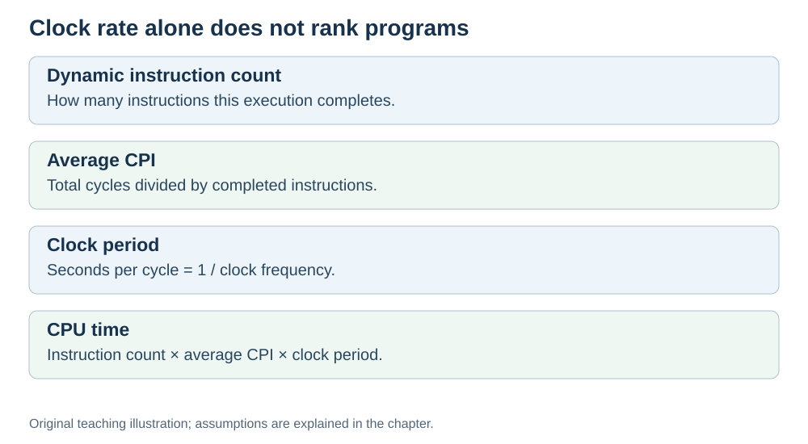

*Original teaching diagram created for the 26 October revision. Read the stated model assumptions alongside it.*


<a id="lesson-06-performance01-why-ghz-is-not-speed--4-example"></a>
#### 4. Example

Program A: 2,000,000 instructions.

- CPU 1: 2 GHz, CPI = 2.0 → time ≈ 2 ms.
- CPU 2: 3 GHz, CPI = 3.0 → time ≈ 2 ms.

CPU 2 has the higher clock, but the same execution time. The faster clock was cancelled out by worse CPI. That is the whole point of this file.

<a id="lesson-06-performance01-why-ghz-is-not-speed--5-check-yourself"></a>
#### 5. Check yourself

Try these first, then use the [explained answers](#h06-01).

1. What does GHz actually measure?
2. Why is a cycle not a fixed amount of work?
3. Name the three factors that decide execution time.
4. Can a 3 GHz CPU be faster than a 4 GHz CPU? Why?
5. What would you look at instead of GHz to compare two CPUs?

<a id="lesson-06-performance01-why-ghz-is-not-speed--6-sources"></a>
#### 6. Sources

- [Intel VTune Profiler, CPU Metrics Reference: cycles per instructions retired](https://www.intel.com/content/www/us/en/docs/vtune-profiler/user-guide/2024-2/cpu-metrics-reference.html)
- [Cornell CS 3410 (Spring 2026), Pipelining & Performance](https://www.cs.cornell.edu/courses/cs3410/2026sp/notes/pipelining.html)
- [Cornell CS 5220 (2020), Code Optimization: timing and CPU versus wall time](https://www.cs.cornell.edu/courses/cs5220/2020fa/lec/2020-09-15-opt.html)

These sources support the technical concepts; our pseudocode, examples and analogies are teaching simplifications. Course-specific coverage is still to be checked by the team.

<a id="lesson-06-performance02-instruction-count-and-cpi"></a>
### Instruction count and CPI

**Status:** Revised on 26 October 2026 with AI-assisted technical checks; awaiting team peer review.

[Reading order](#reading-order-and-conventions) · [Teaching-machine conventions](#reading-order-and-conventions--teaching-machine-conventions) · [Explained answers](#h06-02)

**Learning objective:** after this section, a beginner should be able to explain what instruction count and CPI are, and why both matter for performance.

<a id="lesson-06-performance02-instruction-count-and-cpi--1-why-this-matters"></a>
#### 1. Why this matters

Clock speed is only one of three factors that decide execution time. The other two — instruction count and CPI — are just as important, and they are the ones beginners usually forget.

<a id="lesson-06-performance02-instruction-count-and-cpi--2-explanation"></a>
#### 2. Explanation

**Dynamic instruction count** is the number of instructions actually executed, including repeated loop iterations. Ten instructions repeated 100 times contribute 1,000 executed instructions, not ten. It depends on:

- **The algorithm and input** — changing the method or input can change how many instructions execute.
- **The compiler** — a better compiler can produce fewer instructions.
- **The instruction set** — some architectures need more instructions to do the same thing.

**CPI (Cycles Per Instruction)** is total CPU cycles divided by completed instructions for the measured program. It measures the average completion rate, not the start-to-finish latency of one instruction. Instructions can overlap; completing two per cycle gives CPI = 0.5. It depends on:

- **The instruction type** — a simple add may take 1 cycle; a memory load may take many.
- **The pipeline** — an ideal single-issue pipeline can approach CPI = 1; a processor completing several instructions per cycle can have CPI below 1.
- **Cache hits and misses** — a cache miss makes the instruction wait, raising CPI.

For a fixed clock, CPU time depends on the product of dynamic instruction count and average CPI. Reducing one factor helps only if changes to the other do not cancel the gain.

A useful way to think about it:

- Instruction count = "how many steps does the program take?"
- CPI = "how many cycles does each step cost?"

Both multiply together to give the total number of cycles.

<a id="lesson-06-performance02-instruction-count-and-cpi--3-diagram"></a>
#### 3. Diagram

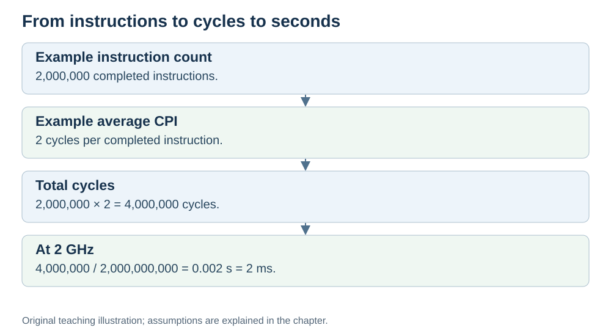

*Original teaching diagram created for the 26 October revision. Read the stated model assumptions alongside it.*


<a id="lesson-06-performance02-instruction-count-and-cpi--4-example"></a>
#### 4. Example

Two versions of the same program:

- **Version A:** 1,000,000 instructions, CPI = 2 → 2,000,000 cycles.
- **Version B:** 1,500,000 instructions, CPI = 1 → 1,500,000 cycles.

Version B has *more* instructions but *fewer* total cycles, because each instruction is cheaper. On the same clock, Version B is faster. This is why counting only instructions — or only CPI — is not enough.

<a id="lesson-06-performance02-instruction-count-and-cpi--5-check-yourself"></a>
#### 5. Check yourself

Try these first, then use the [explained answers](#h06-02).

1. What is instruction count? What three things affect it?
2. What is CPI? What three things affect it?
3. How do instruction count and CPI combine to give total cycles?
4. Can a program with more instructions be faster? Why?
5. Why does a cache miss raise CPI?

<a id="lesson-06-performance02-instruction-count-and-cpi--6-sources"></a>
#### 6. Sources

- [Intel VTune Profiler, CPU Metrics Reference: cycles per instructions retired](https://www.intel.com/content/www/us/en/docs/vtune-profiler/user-guide/2024-2/cpu-metrics-reference.html)
- [Cornell CS 3410 (Spring 2026), Pipelining & Performance](https://www.cs.cornell.edu/courses/cs3410/2026sp/notes/pipelining.html)
- [Cornell CS 5220 (2020), Code Optimization: timing and CPU versus wall time](https://www.cs.cornell.edu/courses/cs5220/2020fa/lec/2020-09-15-opt.html)

These sources support the technical concepts; our pseudocode, examples and analogies are teaching simplifications. Course-specific coverage is still to be checked by the team.

<a id="lesson-06-performance03-clock-period"></a>
### Clock period: the length of one cycle

**Status:** Revised on 26 October 2026 with AI-assisted technical checks; awaiting team peer review.

[Reading order](#reading-order-and-conventions) · [Teaching-machine conventions](#reading-order-and-conventions--teaching-machine-conventions) · [Explained answers](#h06-03)

**Learning objective:** after this section, a beginner should be able to explain what clock period is, how it relates to clock frequency, and why it is only one of three performance factors.

<a id="lesson-06-performance03-clock-period--1-why-this-matters"></a>
#### 1. Why this matters

Clock speed is usually given in GHz, but the formula for execution time uses **clock period** — the length of one cycle. If you do not know how to convert between the two, you cannot calculate execution time.

<a id="lesson-06-performance03-clock-period--2-explanation"></a>
#### 2. Explanation

**Clock period** is the time one clock cycle takes. It is the inverse of clock frequency:

```text
clock period = 1 / clock frequency
```

Examples:

- 2 GHz = 2 × 10⁹ cycles per second → clock period = 1 / (2 × 10⁹) s = 0.5 ns.
- 3 GHz → clock period ≈ 0.333 ns.
- 4 GHz → clock period = 0.25 ns.

So a higher frequency means a *shorter* period — each cycle takes less time. That is why higher GHz usually helps: each cycle is shorter.

But remember: execution time is not just the clock period. It is:

```text
CPU execution time = dynamic instruction count × average CPI × clock period
```


A shorter clock period helps, but if instruction count or CPI goes up, the gain can disappear. That is exactly what we saw in the previous files.

<a id="lesson-06-performance03-clock-period--3-diagram"></a>
#### 3. Diagram

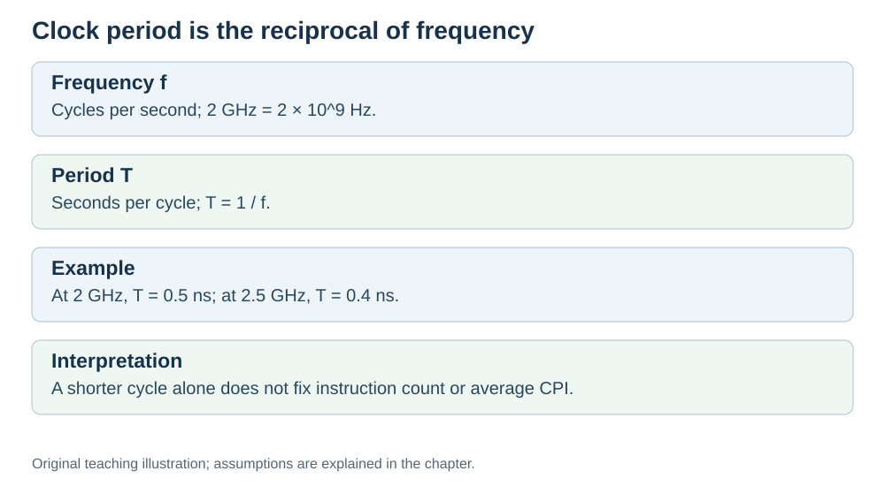

*Original teaching diagram created for the 26 October revision. Read the stated model assumptions alongside it.*


<a id="lesson-06-performance03-clock-period--4-example"></a>
#### 4. Example

A program needs 10,000,000 cycles.

- On a 2 GHz CPU: time = 10,000,000 × 0.5 ns = 5 ms.
- On a 4 GHz CPU: time = 10,000,000 × 0.25 ns = 2.5 ms.

Same number of cycles, half the time — because each cycle is half as long. That is the benefit of a higher clock. But if the 4 GHz CPU needed 20,000,000 cycles due to worse CPI, the gain would vanish.

<a id="lesson-06-performance03-clock-period--5-check-yourself"></a>
#### 5. Check yourself

Try these first, then use the [explained answers](#h06-03).

1. What is clock period? How does it relate to clock frequency?
2. What is the clock period of a 3 GHz CPU?
3. Why does a higher frequency mean a shorter period?
4. Does a shorter clock period always make a program faster? Why or why not?
5. Convert: a 2.5 GHz clock has what period?

<a id="lesson-06-performance03-clock-period--6-sources"></a>
#### 6. Sources

- [Intel VTune Profiler, CPU Metrics Reference: cycles per instructions retired](https://www.intel.com/content/www/us/en/docs/vtune-profiler/user-guide/2024-2/cpu-metrics-reference.html)
- [Cornell CS 3410 (Spring 2026), Pipelining & Performance](https://www.cs.cornell.edu/courses/cs3410/2026sp/notes/pipelining.html)
- [Cornell CS 5220 (2020), Code Optimization: timing and CPU versus wall time](https://www.cs.cornell.edu/courses/cs5220/2020fa/lec/2020-09-15-opt.html)

These sources support the technical concepts; our pseudocode, examples and analogies are teaching simplifications. Course-specific coverage is still to be checked by the team.

<a id="lesson-06-performance04-worked-calculation"></a>
### Worked calculation: putting it all together

**Status:** Revised on 26 October 2026 with AI-assisted technical checks; awaiting team peer review.

[Reading order](#reading-order-and-conventions) · [Teaching-machine conventions](#reading-order-and-conventions--teaching-machine-conventions) · [Explained answers](#h06-04)

**Learning objective:** after this section, a beginner should be able to calculate execution time from instruction count, CPI, and clock frequency, and compare two CPUs.

<a id="lesson-06-performance04-worked-calculation--1-why-this-matters"></a>
#### 1. Why this matters

The previous files gave you the pieces: instruction count, CPI, clock period. This file puts them together in one formula and shows how to use it to compare real CPUs.

<a id="lesson-06-performance04-worked-calculation--2-explanation"></a>
#### 2. Explanation

The formula for execution time is:

```text
CPU execution time = dynamic instruction count × average CPI × clock period
```

And since:

```text
clock period = 1 / clock frequency
```

you can also write:

```text
CPU execution time = (dynamic instruction count × average CPI) / clock frequency
```

To use it:

1. Find the **instruction count** (how many instructions the program runs).
2. Find the **CPI** (average cycles per instruction).
3. Find the **clock frequency** (in Hz), then convert to period if needed.
4. Multiply.

The result is in seconds (or milliseconds, if you keep the units consistent). These examples assume a constant clock and do not add periods when the program is waiting for I/O or not scheduled on the CPU. For different CPUs, use the dynamic instruction count of each measured version; “same program” does not always imply the same count.

<a id="lesson-06-performance04-worked-calculation--3-diagram"></a>
#### 3. Diagram

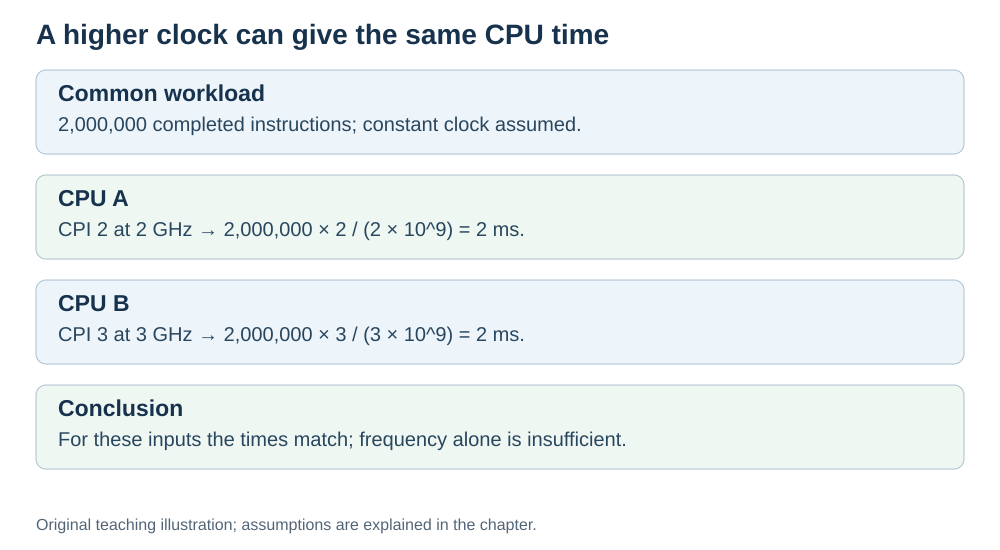

*Original teaching diagram created for the 26 October revision. Read the stated model assumptions alongside it.*


<a id="lesson-06-performance04-worked-calculation--4-example"></a>
#### 4. Example

**CPU A:** 2 GHz, CPI = 2.0, program = 2,000,000 instructions.

- Clock period = 1 / (2 × 10⁹) = 0.5 ns.
- Time = 2,000,000 × 2.0 × 0.5 ns = 2,000,000 ns = 2 ms.

**CPU B:** 3 GHz, CPI = 3.0, same program.

- Clock period = 1 / (3 × 10⁹) ≈ 0.333 ns.
- Time = 2,000,000 × 3.0 × 0.333 ns ≈ 2,000,000 ns = 2 ms.

Same result. CPU B has the faster clock, but its worse CPI cancels the advantage. This is the main takeaway of the Performance section.

**A second example:** program of 5,000,000 instructions, CPI = 1.5, clock = 2.5 GHz.

- Clock period = 1 / (2.5 × 10⁹) = 0.4 ns.
- Time = 5,000,000 × 1.5 × 0.4 ns = 3,000,000 ns = 3 ms.

<a id="lesson-06-performance04-worked-calculation--5-check-yourself"></a>
#### 5. Check yourself

Try these first, then use the [explained answers](#h06-04).

1. Write the execution time formula.
2. A program has 1,000,000 instructions, CPI = 2, clock = 2 GHz. What is the execution time?
3. A program has 3,000,000 instructions, CPI = 1.5, clock = 3 GHz. What is the execution time?
4. CPU A: 2 GHz, CPI = 1. CPU B: 4 GHz, CPI = 3. Which is faster for the same program? Show your calculation.
5. Why can two CPUs with different GHz have the same execution time?

<a id="lesson-06-performance04-worked-calculation--6-sources"></a>
#### 6. Sources

- [Intel VTune Profiler, CPU Metrics Reference: cycles per instructions retired](https://www.intel.com/content/www/us/en/docs/vtune-profiler/user-guide/2024-2/cpu-metrics-reference.html)
- [Cornell CS 3410 (Spring 2026), Pipelining & Performance](https://www.cs.cornell.edu/courses/cs3410/2026sp/notes/pipelining.html)
- [Cornell CS 5220 (2020), Code Optimization: timing and CPU versus wall time](https://www.cs.cornell.edu/courses/cs5220/2020fa/lec/2020-09-15-opt.html)

These sources support the technical concepts; our pseudocode, examples and analogies are teaching simplifications. Course-specific coverage is still to be checked by the team.


<a id="section-07-pipelining"></a>
## 07 Pipelining

<a id="lesson-07-pipelining01-problem-with-sequence"></a>
### The problem with doing one thing at a time

**Status:** Revised on 26 October 2026 with AI-assisted technical checks; awaiting team peer review.

[Reading order](#reading-order-and-conventions) · [Teaching-machine conventions](#reading-order-and-conventions--teaching-machine-conventions) · [Explained answers](#h07-01)

**Learning objective:** after this section, a beginner should be able to explain why a CPU that does fetch, then decode, then execute, one instruction at a time, wastes time.

<a id="lesson-07-pipelining01-problem-with-sequence--1-why-this-matters"></a>
#### 1. Why this matters

The basic fetch–decode–execute cycle works, but it is inefficient. Understanding *why* it is inefficient is the first step to understanding pipelining — one of the main reasons modern CPUs are fast.

<a id="lesson-07-pipelining01-problem-with-sequence--2-explanation"></a>
#### 2. Explanation

In the basic cycle, each instruction goes through three phases in sequence:

1. Fetch — get the instruction.
2. Decode — figure out what it means.
3. Execute — do it.

The problem: **during each phase, most of the CPU is idle.**

- During **fetch**, some execution resources may wait. Fetch address updates can still use an adder.
- During **decode**, arithmetic execution resources may wait while control signals and operands are prepared.
- During **execute**, fetch hardware may wait in an unpipelined design; a load/store still uses data memory.

So a CPU running one instruction at a time uses only a small part of its hardware at any moment. The rest waits.

In kitchen terms: the cook reads the recipe (fetch), thinks about it (decode), then cooks (execute). While reading and thinking, the stove is idle. While cooking, the cook is not reading the next line. A lot of waiting.

If we could overlap these phases — read the next line while cooking the current dish — the kitchen would produce more meals in the same time.

<a id="lesson-07-pipelining01-problem-with-sequence--3-diagram"></a>
#### 3. Diagram

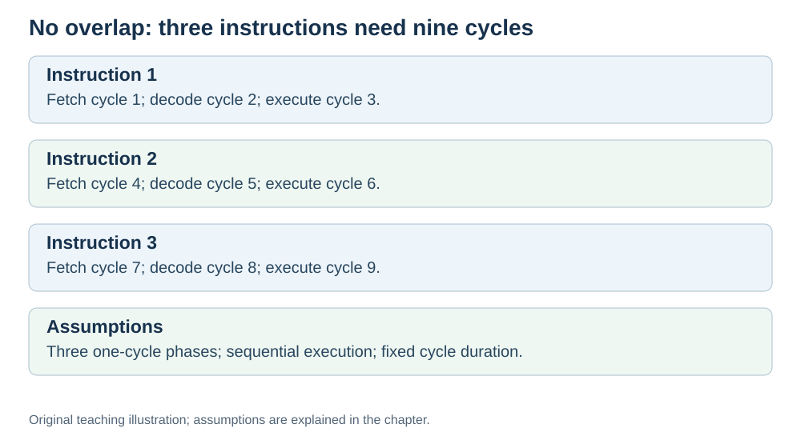

*Original teaching diagram created for the 26 October revision. Read the stated model assumptions alongside it.*


<a id="lesson-07-pipelining01-problem-with-sequence--4-example"></a>
#### 4. Example

For this timing example, assume a non-overlapping teaching CPU: three independent instructions, each taking three cycles (one per phase), with a fixed cycle duration. We ignore cache delays and shared-resource conflicts:

- Instruction 1: fetch (cycle 1), decode (cycle 2), execute (cycle 3).
- Instruction 2: fetch (cycle 4), decode (cycle 5), execute (cycle 6).
- Instruction 3: fetch (cycle 7), decode (cycle 8), execute (cycle 9).

Total: **9 cycles** for 3 instructions. During cycle 1, the ALU is idle. During cycle 3, the fetch hardware is idle. That is the waste.

<a id="lesson-07-pipelining01-problem-with-sequence--5-check-yourself"></a>
#### 5. Check yourself

Try these first, then use the [explained answers](#h07-01).

1. Why is the sequential cycle inefficient?
2. Which parts of the CPU are idle during fetch? During execute?
3. In the example, how many cycles do 3 instructions take?
4. In the kitchen analogy, what is idle while the cook reads the recipe?
5. What would you want to overlap to save time?

<a id="lesson-07-pipelining01-problem-with-sequence--6-sources"></a>
#### 6. Sources

- [Cornell CS 3410 (Spring 2026), Pipelining & Performance](https://www.cs.cornell.edu/courses/cs3410/2026sp/notes/pipelining.html)
- [MIT OpenCourseWare, 6.004 (Spring 2017), 15.1 Pipelining the Beta](https://ocw.mit.edu/courses/6-004-computation-structures-spring-2017/pages/c15/c15s1/)

These sources support the technical concepts; our pseudocode, examples and analogies are teaching simplifications. Course-specific coverage is still to be checked by the team.

<a id="lesson-07-pipelining02-assembly-line-idea"></a>
### The assembly-line idea

**Status:** Revised on 26 October 2026 with AI-assisted technical checks; awaiting team peer review.

[Reading order](#reading-order-and-conventions) · [Teaching-machine conventions](#reading-order-and-conventions--teaching-machine-conventions) · [Explained answers](#h07-02)

**Learning objective:** after this section, a beginner should be able to explain what pipelining is, using the assembly-line analogy, and why it makes the CPU faster.

<a id="lesson-07-pipelining02-assembly-line-idea--1-why-this-matters"></a>
#### 1. Why this matters

Pipelining is the trick that fixes the idle-time problem from the previous file. It is one of the main reasons a modern CPU can run billions of instructions per second. The idea is simple — and the assembly-line analogy makes it easy to grasp.

<a id="lesson-07-pipelining02-assembly-line-idea--2-explanation"></a>
#### 2. Explanation

**Pipelining** means overlapping the phases of different instructions.

Instead of doing fetch → decode → execute for one instruction, then starting the next, the CPU works on several instructions at once, each in a different phase:

- While instruction 1 **executes**, instruction 2 **decodes**, and instruction 3 **fetches**.
- Next cycle: instruction 1 finishes, instruction 2 executes, instruction 3 decodes, instruction 4 fetches.
- And so on.

This is exactly how an **assembly line** works. A car factory does not build one car at a time, start to finish. Each station does one step, and many cars move through the line at once. Each car still goes through every station, but a new car rolls off the line much more often.

In our ideal three-stage model, **each instruction still spans three cycles**, but once the pipeline is full it completes one instruction per cycle instead of one every three. We assume the same cycle duration, balanced stages, independent instructions and no stalls or resource conflicts. That is the speedup.

The goal is higher **throughput** for the instruction stream, not lower latency for an individual instruction. Real pipeline-register overhead or a changed clock can change individual instruction latency.

<a id="lesson-07-pipelining02-assembly-line-idea--3-diagram"></a>
#### 3. Diagram

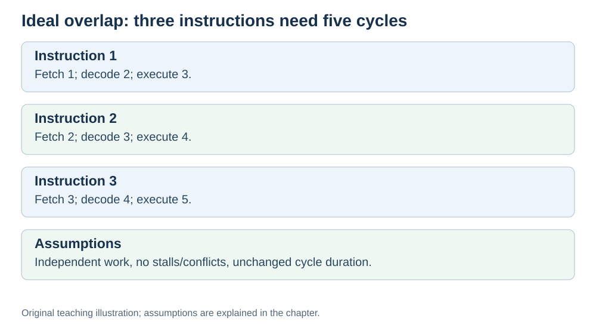

*Original teaching diagram created for the 26 October revision. Read the stated model assumptions alongside it.*


<a id="lesson-07-pipelining02-assembly-line-idea--4-example"></a>
#### 4. Example

Three instructions, three phases, with a 3-stage pipeline:

- Cycle 1: I1 fetch.
- Cycle 2: I1 decode, I2 fetch.
- Cycle 3: I1 execute, I2 decode, I3 fetch.
- Cycle 4: I2 execute, I3 decode.
- Cycle 5: I3 execute.

Total: **5 cycles** for 3 instructions, instead of 9. Each instruction still took 3 cycles, but they overlapped — so the CPU finished them much sooner.

<a id="lesson-07-pipelining02-assembly-line-idea--5-check-yourself"></a>
#### 5. Check yourself

Try these first, then use the [explained answers](#h07-02).

1. What does pipelining overlap?
2. Does pipelining make a single instruction faster? Why or why not?
3. In the example, how many cycles do 3 instructions take with a pipeline? Without?
4. What is the assembly-line analogy for pipelining?
5. Why does the CPU finish instructions more often with a pipeline?

<a id="lesson-07-pipelining02-assembly-line-idea--6-sources"></a>
#### 6. Sources

- [Cornell CS 3410 (Spring 2026), Pipelining & Performance](https://www.cs.cornell.edu/courses/cs3410/2026sp/notes/pipelining.html)
- [MIT OpenCourseWare, 6.004 (Spring 2017), 15.1 Pipelining the Beta](https://ocw.mit.edu/courses/6-004-computation-structures-spring-2017/pages/c15/c15s1/)

These sources support the technical concepts; our pseudocode, examples and analogies are teaching simplifications. Course-specific coverage is still to be checked by the team.

<a id="lesson-07-pipelining03-throughput"></a>
### Throughput: why the pipeline is faster overall

**Status:** Revised on 26 October 2026 with AI-assisted technical checks; awaiting team peer review.

[Reading order](#reading-order-and-conventions) · [Teaching-machine conventions](#reading-order-and-conventions--teaching-machine-conventions) · [Explained answers](#h07-03)

**Learning objective:** after this section, a beginner should be able to explain what throughput is, how pipelining increases it, and why latency and throughput are different.

<a id="lesson-07-pipelining03-throughput--1-why-this-matters"></a>
#### 1. Why this matters

Pipelining does not make one instruction faster — so why is the CPU faster overall? The answer is **throughput**: how many instructions finish per unit of time. Understanding throughput explains the real benefit of pipelining.

<a id="lesson-07-pipelining03-throughput--2-explanation"></a>
#### 2. Explanation

Two different measures:

- **Latency** — how long one instruction takes from start to finish.
- **Throughput** — how many instructions finish per unit of time.

In our ideal three-stage example, an instruction still spans three cycles and the cycle duration is unchanged, so latency stays the same. In real designs, pipeline-register overhead and clock changes can alter latency. Pipelining primarily targets throughput.

But pipelining **increases throughput**. Because phases overlap, the CPU can finish one instruction every cycle (in the ideal case), instead of one every three cycles.

An analogy: a highway with more lanes does not make any single car faster. Each car still drives at the same speed. But **more cars arrive per hour** — the throughput is higher.

That is why pipelining matters: most programs run millions of instructions, so finishing them more often makes the whole program much faster, even if each individual instruction takes the same time.

<a id="lesson-07-pipelining03-throughput--3-diagram"></a>
#### 3. Diagram

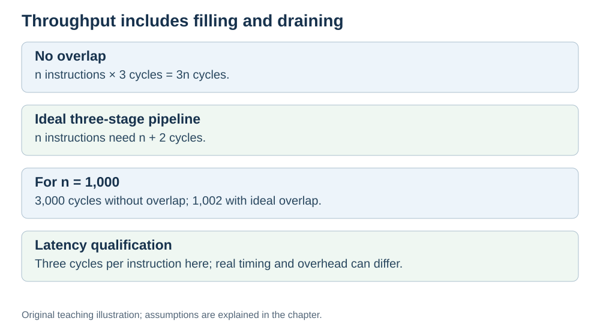

*Original teaching diagram created for the 26 October revision. Read the stated model assumptions alongside it.*


<a id="lesson-07-pipelining03-throughput--4-example"></a>
#### 4. Example

Assume 1,000 independent instructions, three one-cycle stages, the same clock period in both designs, and no stalls or resource conflicts. In general, the ideal three-stage pipeline takes `n + 2` cycles for `n` instructions, versus `3n` without overlap.

- **Without pipeline:** 1,000 × 3 = 3,000 cycles.
- **With a 3-stage pipeline (ideal):** roughly 1,000 + 2 = 1,002 cycles.

Each instruction still takes 3 cycles (latency unchanged), but the total time is about **3× shorter** because the CPU finishes one instruction per cycle after the pipeline fills. That is the throughput gain.

(In practice, hazards and stalls reduce the gain — but the idea is the same.)

<a id="lesson-07-pipelining03-throughput--5-check-yourself"></a>
#### 5. Check yourself

Try these first, then use the [explained answers](#h07-03).

1. What is latency? What is throughput?
2. In our ideal model, what happens to latency? Why might a real pipeline differ?
3. How does pipelining increase throughput?
4. In the example, how many cycles does the pipelined version take? The non-pipelined version?
5. What is the highway analogy for throughput?

<a id="lesson-07-pipelining03-throughput--6-sources"></a>
#### 6. Sources

- [Cornell CS 3410 (Spring 2026), Pipelining & Performance](https://www.cs.cornell.edu/courses/cs3410/2026sp/notes/pipelining.html)
- [MIT OpenCourseWare, 6.004 (Spring 2017), 15.1 Pipelining the Beta](https://ocw.mit.edu/courses/6-004-computation-structures-spring-2017/pages/c15/c15s1/)

These sources support the technical concepts; our pseudocode, examples and analogies are teaching simplifications. Course-specific coverage is still to be checked by the team.


<a id="section-08-hardware-and-ai-networks"></a>
## 08 Hardware and AI Networks

<a id="lesson-08-hardware-and-ai-networks01-gpu-and-ai-accelerators"></a>
### GPU and AI accelerators

**Status:** Revised on 26 October 2026 with AI-assisted technical checks; awaiting team peer review.

[Reading order](#reading-order-and-conventions) · [Teaching-machine conventions](#reading-order-and-conventions--teaching-machine-conventions) · [Explained answers](#h08-01)

**Learning objective:** after this section, a beginner should be able to explain what a GPU is, why AI workloads use it, and what an AI accelerator is.

<a id="lesson-08-hardware-and-ai-networks01-gpu-and-ai-accelerators--1-why-this-matters"></a>
#### 1. Why this matters

Large neural networks often expose many calculations that can run in parallel. **GPUs** and specialised **accelerators** can benefit these workloads, while CPUs also support parallel work and can be efficient for small models or control-heavy tasks. This file connects everything you learned about the CPU to the hardware that powers AI.

<a id="lesson-08-hardware-and-ai-networks01-gpu-and-ai-accelerators--2-explanation"></a>
#### 2. Explanation

The **CPU** is designed to run a few complex tasks quickly, one after another, with lots of branching and decision-making. It has general-purpose cores; their number varies widely by processor.

The **GPU (Graphics Processing Unit)** is designed differently: it provides many parallel arithmetic execution resources, often described as hundreds or thousands of small cores. These are not directly comparable to full CPU cores, and not every resource necessarily runs useful work at once. It is not good at complex logic, but it is excellent at doing the same simple operation on many pieces of data at once.

This matters for large neural networks because much of their computation is **matrix math**: multiplying and adding huge arrays of numbers. The same operation is applied to millions of values. That is exactly what a GPU is good at.

An **AI accelerator** (like a TPU, NPU, or other specialized chip) takes this further: it is designed specifically for the operations AI models use most. It trades general-purpose flexibility for speed on a narrow set of tasks.

So the picture is:

- **CPU** — few powerful cores, good for general work.
- **GPU** — thousands of small cores, good for parallel math.
- **AI accelerator** — specialized hardware for AI operations.

There is no universal months-versus-days speedup. Performance depends on the model, input size, batch size, numeric precision, memory and transfer costs. Use a relevant benchmark. The small tabular Q-learning example in our AI module can run on a CPU.

<a id="lesson-08-hardware-and-ai-networks01-gpu-and-ai-accelerators--3-diagram"></a>
#### 3. Diagram

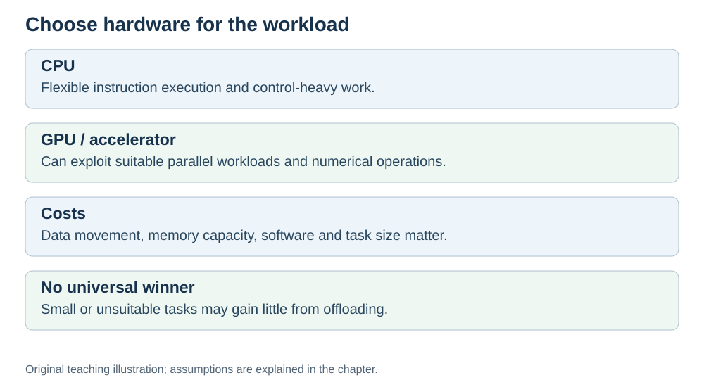

*Original teaching diagram created for the 26 October revision. Read the stated model assumptions alongside it.*


<a id="lesson-08-hardware-and-ai-networks01-gpu-and-ai-accelerators--4-example"></a>
#### 4. Example

Suppose you want to multiply two large matrices (a common AI operation).

- A **CPU** can use multiple cores and vector operations, and avoids device-transfer overhead for data already in its memory.
- A **GPU** can provide high throughput for sufficiently large parallel matrix work. Small tasks or excessive transfers can erase the benefit.
- An **AI accelerator** can speed supported operations, but it is not automatically faster than every GPU. Supported shapes, precision and software matter.

The CPU is not "worse" — it is simply built for a different job.

<a id="lesson-08-hardware-and-ai-networks01-gpu-and-ai-accelerators--5-check-yourself"></a>
#### 5. Check yourself

Try these first, then use the [explained answers](#h08-01).

1. How is a GPU different from a CPU?
2. Why do large neural networks contain much matrix arithmetic, and why does that not describe every AI algorithm?
3. What is an AI accelerator, and how is it different from a GPU?
4. Why can a GPU train an AI model much faster than a CPU?
5. Is a GPU always better than a CPU? Why or why not?

<a id="lesson-08-hardware-and-ai-networks01-gpu-and-ai-accelerators--6-sources"></a>
#### 6. Sources

- [NVIDIA CUDA C++ Best Practices Guide, §§2.4 and 3: workload assessment and heterogeneous computing](https://docs.nvidia.com/cuda/cuda-c-best-practices-guide/)
- [Cornell CS 3410 (Spring 2025), Input/Output: devices, storage and interconnects](https://www.cs.cornell.edu/courses/cs3410/2025sp/notes/io.html)

These sources support the technical concepts; our pseudocode, examples and analogies are teaching simplifications. Course-specific coverage is still to be checked by the team.

<a id="lesson-08-hardware-and-ai-networks02-nic-latency-bandwidth"></a>
### Network cards, latency, and bandwidth

**Status:** Revised on 26 October 2026 with AI-assisted technical checks; awaiting team peer review.

[Reading order](#reading-order-and-conventions) · [Teaching-machine conventions](#reading-order-and-conventions--teaching-machine-conventions) · [Explained answers](#h08-02)

**Learning objective:** after this section, a beginner should be able to explain what a network card does, and the difference between latency and bandwidth.

<a id="lesson-08-hardware-and-ai-networks02-nic-latency-bandwidth--1-why-this-matters"></a>
#### 1. Why this matters

Computers rarely work alone. They send and receive data over networks — web pages, messages, cloud storage, AI training data. The hardware that connects a computer to a network is the **network interface controller (NIC)**. End-to-end performance also depends on the path and other machines; two useful measures are **latency** and **bandwidth**. Confusing these two is a common beginner mistake.

<a id="lesson-08-hardware-and-ai-networks02-nic-latency-bandwidth--2-explanation"></a>
#### 2. Explanation

A **network card (NIC — Network Interface Card)** is the hardware that connects a computer to a network. It sends data out and receives data in. Every computer that talks to a network has one (sometimes built into the motherboard).

Two different measures describe network performance:

**Latency** — a specified transfer delay, such as one-way packet delay or request/response round-trip time; always say which measurement is meant. Measured in milliseconds (ms). Low latency means quick responses.

**Bandwidth** — here, the connection's data-carrying capacity per second. **Throughput** is the rate actually achieved, which can be lower because of contention, protocol overhead and bottlenecks. Measured in megabits or gigabits per second (Mbps, Gbps). High bandwidth means more data at once.

The difference matters:

- **Latency** is about **speed of a single message**.
- **Bandwidth** is about **volume of data**.

An analogy: a highway.

- **Latency** is how long one car takes to drive from A to B.
- **Bandwidth** is how many cars can drive side by side per hour.

More lanes illustrate higher capacity; they do not shorten the route. The analogy has limits: a higher link rate can reduce the time needed to serialise a finite packet, and lower queueing can reduce delay. That is why a high-bandwidth connection can still feel slow if latency is high.

<a id="lesson-08-hardware-and-ai-networks02-nic-latency-bandwidth--3-diagram"></a>
#### 3. Diagram

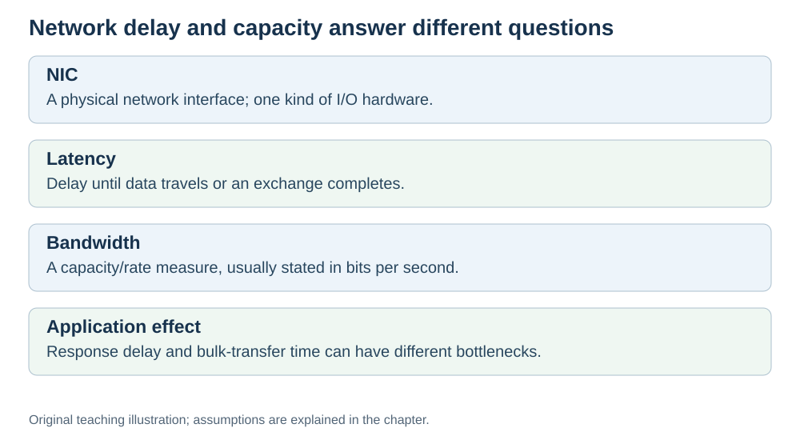

*Original teaching diagram created for the 26 October revision. Read the stated model assumptions alongside it.*

<a id="lesson-08-hardware-and-ai-networks02-nic-latency-bandwidth--4-example"></a>
#### 4. Example

You download a large file and make a video call.

- **Download:** bandwidth matters most. A high-bandwidth connection moves the file quickly.
- **Video call:** latency matters most. Even with high bandwidth, a high-latency connection makes the conversation feel delayed.

Same network, different needs. That is why "fast internet" is not one number — it is both latency and bandwidth.

<a id="lesson-08-hardware-and-ai-networks02-nic-latency-bandwidth--5-check-yourself"></a>
#### 5. Check yourself

Try these first, then use the [explained answers](#h08-02).

1. What does a network card do?
2. What is latency? What is bandwidth?
3. Which matters more for a video call? For downloading a large file?
4. What is the highway analogy for latency and bandwidth?
5. Why can a high-bandwidth connection still feel slow?

<a id="lesson-08-hardware-and-ai-networks02-nic-latency-bandwidth--6-sources"></a>
#### 6. Sources

- [Cornell CS 3410 (Spring 2025), Input/Output: devices, storage and interconnects](https://www.cs.cornell.edu/courses/cs3410/2025sp/notes/io.html)
- [IETF RFC 5136, Defining Network Capacity, §§2 and 3.4](https://www.rfc-editor.org/rfc/rfc5136.html)

These sources support the technical concepts; our pseudocode, examples and analogies are teaching simplifications. Course-specific coverage is still to be checked by the team.

<a id="lesson-08-hardware-and-ai-networks03-where-hardware-meets-ai-and-networks"></a>
### Where hardware meets AI and networks

**Status:** Revised on 26 October 2026 with AI-assisted technical checks; awaiting team peer review.

[Reading order](#reading-order-and-conventions) · [Teaching-machine conventions](#reading-order-and-conventions--teaching-machine-conventions) · [Explained answers](#h08-03)

**Learning objective:** after this section, a beginner should be able to explain how the hardware topics connect to the AI and networks parts of the project.

<a id="lesson-08-hardware-and-ai-networks03-where-hardware-meets-ai-and-networks--1-why-this-matters"></a>
#### 1. Why this matters

Our project covers three areas: hardware, behavioral AI, and networks. They are not separate — they meet in specific places. This file shows those meeting points, so you can see the whole picture instead of three isolated topics.

<a id="lesson-08-hardware-and-ai-networks03-where-hardware-meets-ai-and-networks--2-explanation"></a>
#### 2. Explanation

Here is where hardware meets the other two parts.

**Hardware ↔ AI:**

- Large neural-network workloads often benefit from parallel **matrix math** on GPUs or accelerators. Small tabular RL and control-heavy work can run efficiently on CPUs; the right device depends on the workload.
- The **memory hierarchy** matters: AI models are huge, and moving data between RAM, cache, and the chip is often the bottleneck.
- **Performance** matters: instruction count, CPI, and clock period apply to AI workloads too — but on a GPU, the "instructions" are parallel operations on many values.

**Hardware ↔ Networks:**

- The **network card (NIC)** is the hardware that connects a computer to a network.
- **Latency and bandwidth** describe network performance, and they depend on hardware: the NIC, the cables, the switches.
- **Interconnects** connect the NIC to the host system, often using PCIe. The address/data/control model introduced earlier gives the idea of communication, but a real NIC connection need not use those exact separate buses.
- In data centers, networks connect thousands of machines; the hardware of those networks decides how fast AI training can run across many GPUs.

**The common thread:** every AI model runs on hardware, and every network message travels through hardware. Algorithms, software implementation, data movement and hardware together determine execution time.

<a id="lesson-08-hardware-and-ai-networks03-where-hardware-meets-ai-and-networks--3-diagram"></a>
#### 3. Diagram

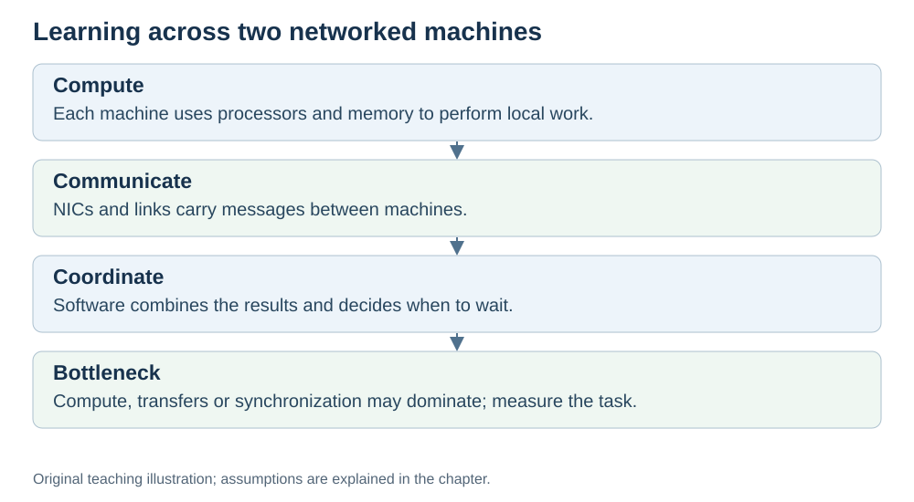

*Original teaching diagram created for the 26 October revision. Read the stated model assumptions alongside it.*


<a id="lesson-08-hardware-and-ai-networks03-where-hardware-meets-ai-and-networks--4-example"></a>
#### 4. Example

Training an AI model across multiple machines:

- **Hardware:** each machine has GPUs and a NIC.
- **AI:** work may be split by data (replicas process different batches) or by model (different GPUs hold different parts). Both can require communication.
- **Networks:** the GPUs exchange data over the network — latency and bandwidth decide how fast they can cooperate.

If the network is slow (high latency, low bandwidth), the GPUs sit idle waiting for data. The AI is only as fast as the hardware and network allow.

<a id="lesson-08-hardware-and-ai-networks03-where-hardware-meets-ai-and-networks--5-check-yourself"></a>
#### 5. Check yourself

Try these first, then use the [explained answers](#h08-03).

1. Why do AI workloads use GPUs and accelerators?
2. How does the memory hierarchy matter for AI?
3. What hardware connects a computer to a network?
4. How do latency and bandwidth affect AI training across machines?
5. In your own words: why are hardware, AI, and networks not separate topics?

<a id="lesson-08-hardware-and-ai-networks03-where-hardware-meets-ai-and-networks--6-sources"></a>
#### 6. Sources

- [NVIDIA CUDA C++ Best Practices Guide, §§2.4 and 3: workload assessment and heterogeneous computing](https://docs.nvidia.com/cuda/cuda-c-best-practices-guide/)
- [Cornell CS 3410 (Spring 2025), Input/Output: devices, storage and interconnects](https://www.cs.cornell.edu/courses/cs3410/2025sp/notes/io.html)

These sources support the technical concepts; our pseudocode, examples and analogies are teaching simplifications. Course-specific coverage is still to be checked by the team.


<a id="section-09-practice-and-summary"></a>
## 09 Practice and Summary

<a id="lesson-09-practice-and-summary01-worked-examples"></a>
### Worked examples: putting it all together

**Status:** Revised on 26 October 2026 with AI-assisted technical checks; awaiting team peer review.

[Reading order](#reading-order-and-conventions) · [Teaching-machine conventions](#reading-order-and-conventions--teaching-machine-conventions) · [Explained answers](#h09-01)

**Learning objective:** after this section, a beginner should be able to solve mixed problems that combine tracing, memory, performance, and pipelining.

<a id="lesson-09-practice-and-summary01-worked-examples--1-why-this-matters"></a>
#### 1. Why this matters

Each file so far focused on one topic. Real questions mix topics. This file gives you mixed examples, so you can practise using several ideas at once — which is exactly what the test bank and the Study Guide will ask.

<a id="lesson-09-practice-and-summary01-worked-examples--2-explanation"></a>
#### 2. Explanation

When you face a mixed problem, follow this checklist:

1. **What is being asked?** Tracing? A calculation? An explanation?
2. **Which topics are involved?** The cycle, memory, performance, pipelining?
3. **What are the given values?** PC, registers, instruction count, CPI, clock.
4. **Which formula or pattern applies?** Trace pattern, execution time formula, pipeline overlap.
5. **Write each step.** Do not skip; the steps are the answer.

The examples below show this checklist in action.

<a id="lesson-09-practice-and-summary01-worked-examples--3-diagram"></a>
#### 3. Diagram

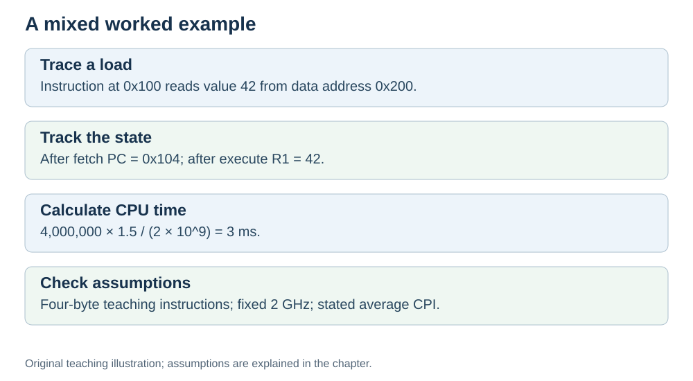

*Original teaching diagram created for the 26 October revision. Read the stated model assumptions alongside it.*


<a id="lesson-09-practice-and-summary01-worked-examples--4-example"></a>
#### 4. Example

<a id="lesson-09-practice-and-summary01-worked-examples--example-1---trace-memory"></a>
##### Example 1 — trace + memory

`LOAD R1, [0x200]` sits at `0x100`. PC = `0x100`. Memory at `0x200` holds 42.

**Fetch:** PC `0x100` → memory → IR; PC becomes `0x104`.
**Decode:** control unit sees: load, address `0x200`, destination R1.
**Execute:** address `0x200` → address bus; memory returns 42 → data bus; R1 = 42.
**Result:** R1 = 42, PC = `0x104`. This absolute-address pseudocode omits address arithmetic; a real load may use an ALU or AGU to calculate its address.

<a id="lesson-09-practice-and-summary01-worked-examples--example-2---performance-calculation"></a>
##### Example 2 — performance calculation

Program: 4,000,000 instructions, CPI = 1.5, clock = 2 GHz.

- Clock period = 1 / (2 × 10⁹) = 0.5 ns.
- Time = 4,000,000 × 1.5 × 0.5 ns = 3,000,000 ns = 3 ms.

<a id="lesson-09-practice-and-summary01-worked-examples--example-3---comparing-two-cpus"></a>
##### Example 3 — comparing two CPUs

CPU A: 3 GHz, CPI = 3. CPU B: 2 GHz, CPI = 1. Same program of 3,000,000 instructions.

- CPU A: period ≈ 0.333 ns → time = 3,000,000 × 3 × 0.333 ≈ 3 ms.
- CPU B: period = 0.5 ns → time = 3,000,000 × 1 × 0.5 = 1.5 ms.

CPU B is faster despite the lower clock, because its CPI is much better.

<a id="lesson-09-practice-and-summary01-worked-examples--example-4---pipeline-throughput"></a>
##### Example 4 — pipeline throughput

Assume 1,000 independent instructions, three one-cycle stages, equal cycle duration in both designs, and no stalls or resource conflicts.

- Without pipeline: 1,000 × 3 = 3,000 cycles.
- With a 3-stage pipeline (ideal): about 1,000 + 2 = 1,002 cycles.

In this ideal model latency is unchanged and total-time speedup is approximately 3×. Real register overhead, dependencies and stalls can change the result.

<a id="lesson-09-practice-and-summary01-worked-examples--5-check-yourself"></a>
#### 5. Check yourself

Try these first, then use the [explained answers](#h09-01).

1. Trace `ADD R2, R3` with R2 = 4, R3 = 9, instruction at `0x400`. Final values and PC?
2. Program: 2,000,000 instructions, CPI = 2, clock = 4 GHz. Execution time?
3. CPU A: 4 GHz, CPI = 2. CPU B: 2 GHz, CPI = 0.5. Same program. Which is faster? Show the calculation.
4. Why does our ideal pipeline improve throughput while leaving latency unchanged, and why might real latency differ?
5. What does Example 1 omit about effective-address calculation in a real load?

<a id="lesson-09-practice-and-summary01-worked-examples--6-sources"></a>
#### 6. Sources

- [MIT OpenCourseWare, 6.004 (Spring 2017), 13.1 Building the Beta](https://ocw.mit.edu/courses/6-004-computation-structures-spring-2017/pages/c13/c13s1/)
- [Intel VTune Profiler, CPU Metrics Reference: cycles per instructions retired](https://www.intel.com/content/www/us/en/docs/vtune-profiler/user-guide/2024-2/cpu-metrics-reference.html)
- [Cornell CS 3410 (Spring 2026), Pipelining & Performance](https://www.cs.cornell.edu/courses/cs3410/2026sp/notes/pipelining.html)

These sources support the technical concepts; our pseudocode, examples and analogies are teaching simplifications. Course-specific coverage is still to be checked by the team.

<a id="lesson-09-practice-and-summary02-common-misconceptions"></a>
### Common misconceptions

**Status:** Revised on 26 October 2026 with AI-assisted technical checks; awaiting team peer review.

[Reading order](#reading-order-and-conventions) · [Teaching-machine conventions](#reading-order-and-conventions--teaching-machine-conventions) · [Explained answers](#h09-02)

**Learning objective:** after this section, a beginner should be able to recognize and correct the most common beginner mistakes about hardware.

<a id="lesson-09-practice-and-summary02-common-misconceptions--1-why-this-matters"></a>
#### 1. Why this matters

Most beginner errors are not calculation errors — they are wrong mental models. Fixing the model is faster than fixing every individual mistake. This file lists the misconceptions that come up again and again.

<a id="lesson-09-practice-and-summary02-common-misconceptions--2-explanation"></a>
#### 2. Explanation

**"The CPU understands variables."**
No. The CPU understands registers and memory addresses. The compiler links variables to them. When you write `a = b + c`, the CPU only sees loads, adds, and stores.

**"Higher GHz is always faster."**
No. CPU execution time = dynamic instruction count × average CPI × clock period (constant-clock model; I/O and scheduling waits are separate). A faster clock can be cancelled out by worse CPI. Compare benchmarks, not GHz.

**"More RAM makes the CPU faster."**
No. More RAM means more data fits in memory, so the computer can keep more programs open. It does not make individual instructions faster. If a program is CPU-bound, extra RAM will not speed it up.

**"Cache is just extra RAM."**
No. Cache is a different layer: small, very fast, and managed automatically by the hardware. It holds recently used data to avoid going to RAM.

**"Pipelining makes each instruction faster."**
Pipelining primarily increases throughput: more instructions finish per unit time. Our ideal model leaves latency unchanged; real overhead and clock changes can alter it.

**"A GPU is always better than a CPU."**
No. A GPU is better for parallel math (like AI). A CPU is better for complex, branchy, general-purpose work. They are built for different jobs.

**"Latency and bandwidth are the same thing."**
No. Latency is how long one message takes; bandwidth is how much data can flow per second. High bandwidth does not fix high latency.

<a id="lesson-09-practice-and-summary02-common-misconceptions--3-diagram"></a>
#### 3. Diagram

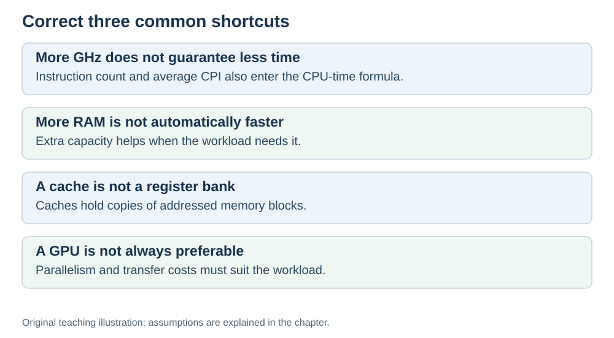

*Original teaching diagram created for the 26 October revision. Read the stated model assumptions alongside it.*


<a id="lesson-09-practice-and-summary02-common-misconceptions--4-example"></a>
#### 4. Example

A friend says: "I upgraded from 3 GHz to 4 GHz, so my program must be 33% faster."

What is wrong:
- The program's instruction count and CPI may be different on the new CPU.
- A 33% higher clock does not guarantee 33% less time.
- You would need to measure or calculate execution time, not compare GHz.

Correct answer: "Maybe faster, but not necessarily by 33%. Check instruction count, CPI, and benchmark results."

<a id="lesson-09-practice-and-summary02-common-misconceptions--5-check-yourself"></a>
#### 5. Check yourself

Try these first, then use the [explained answers](#h09-02).

1. Why does the CPU not understand variables?
2. Why is higher GHz not always faster?
3. Does more RAM make the CPU faster? Why or why not?
4. What does pipelining primarily improve? What happens to latency in our ideal model and potentially in real hardware?
5. What is the difference between latency and bandwidth?
6. Which misconception have you held yourself? How would you correct it now?

<a id="lesson-09-practice-and-summary02-common-misconceptions--6-sources"></a>
#### 6. Sources

- [MIT OpenCourseWare, 6.004 (Spring 2017), 13.1 Building the Beta](https://ocw.mit.edu/courses/6-004-computation-structures-spring-2017/pages/c13/c13s1/)
- [Intel VTune Profiler, CPU Metrics Reference: cycles per instructions retired](https://www.intel.com/content/www/us/en/docs/vtune-profiler/user-guide/2024-2/cpu-metrics-reference.html)
- [Cornell CS 3410 (Spring 2026), Pipelining & Performance](https://www.cs.cornell.edu/courses/cs3410/2026sp/notes/pipelining.html)

These sources support the technical concepts; our pseudocode, examples and analogies are teaching simplifications. Course-specific coverage is still to be checked by the team.

<a id="lesson-09-practice-and-summary03-summary-map"></a>
### Summary map: how it all fits together

**Status:** Revised on 26 October 2026 with AI-assisted technical checks; awaiting team peer review.

[Reading order](#reading-order-and-conventions) · [Teaching-machine conventions](#reading-order-and-conventions--teaching-machine-conventions) · [Explained answers](#h09-03)

**Learning objective:** after this section, a beginner should be able to describe the whole Hardware part in one page and see how the nine topics connect.

<a id="lesson-09-practice-and-summary03-summary-map--1-why-this-matters"></a>
#### 1. Why this matters

Nine sections can feel like nine separate topics. They are not — they are one story. This file is the one-page map: if you understand this, you understand the whole Hardware part.

<a id="lesson-09-practice-and-summary03-summary-map--2-explanation"></a>
#### 2. Explanation

Here is the story in order.

**1. What is hardware.** We group the hardware discussion as CPU, RAM, persistent storage and I/O, with special attention to networking, which is a type of I/O. Software is the recipe; hardware is the kitchen.

**2. Inside the CPU.** The CPU has PC (next instruction), IR (current instruction), registers (values), ALU (math), control unit (manager), and buses (address and data).

**3. Fetch–decode–execute.** The CPU repeats one loop: fetch the next instruction, decode what it means, execute it. The clock drives the loop.

**4. Memory hierarchy.** Registers → cache → RAM → disk. The usual technology/cost trade-off places small fast layers near the processor; this is a model, not a law of distance alone. The hierarchy hides the speed gap.

**5. How programs run.** Native compilation produces CPU instructions; interpreters and virtual machines add other translation/execution steps. The CPU does not understand variables — only registers and addresses.

**6. Performance.** CPU execution time = dynamic instruction count × average CPI × clock period (constant-clock model; I/O and scheduling waits are separate). GHz is one lever, not the whole story.

**7. Pipelining.** Overlap phases of different instructions. Throughput improves in the ideal model; unchanged latency relies on its timing assumptions.

**8. Hardware, AI, and networks.** AI uses GPUs and accelerators for parallel math. Networks use NICs; latency and bandwidth describe their performance. Everything runs on the same hardware foundations.

**9. Practice and summary.** Mixed examples, misconceptions, and self-check questions.

The thread that ties it all together: **small parts, each with one job, working together in a loop, as fast as the hardware allows.**

<a id="lesson-09-practice-and-summary03-summary-map--3-diagram"></a>
#### 3. Diagram

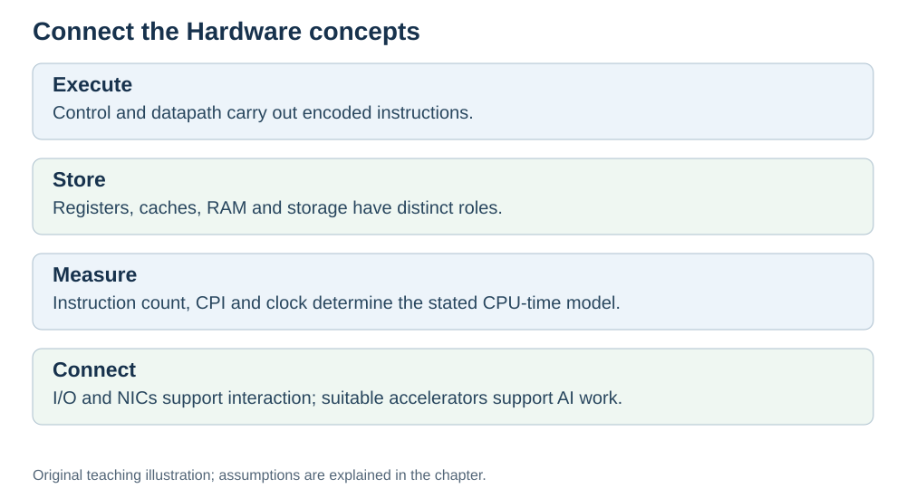

*Original teaching diagram created for the 26 October revision. Read the stated model assumptions alongside it.*


<a id="lesson-09-practice-and-summary03-summary-map--4-example"></a>
#### 4. Example

You are asked: "Why is my Python loop slow?"

Using the map, you can answer at several levels:
- **Instruction level:** CPython bytecode runs through an interpreter, whose machine instructions contribute to dynamic instruction count. Native or JIT-compiled versions can behave differently.
- **Memory level:** the data may not fit in cache, causing misses (CPI goes up).
- **Performance level:** the clock is only one factor; instruction count and CPI matter too.
- **Parallel level:** a GPU could do the same math much faster if the work is parallel.

One question, several layers of the map. That is how the topics connect.

<a id="lesson-09-practice-and-summary03-summary-map--5-check-yourself"></a>
#### 5. Check yourself

Try these first, then use the [explained answers](#h09-03).

1. Name the nine topics in order.
2. Which topic explains why GHz is not the whole story?
3. Which topic explains the difference between registers and RAM?
4. Which topic connects hardware to AI and networks?
5. In your own words: what is the one thread that ties all nine topics together?

<a id="lesson-09-practice-and-summary03-summary-map--6-sources"></a>
#### 6. Sources

- [MIT OpenCourseWare, 6.004 (Spring 2017), 13.1 Building the Beta](https://ocw.mit.edu/courses/6-004-computation-structures-spring-2017/pages/c13/c13s1/)
- [Intel VTune Profiler, CPU Metrics Reference: cycles per instructions retired](https://www.intel.com/content/www/us/en/docs/vtune-profiler/user-guide/2024-2/cpu-metrics-reference.html)
- [Cornell CS 3410 (Spring 2026), Pipelining & Performance](https://www.cs.cornell.edu/courses/cs3410/2026sp/notes/pipelining.html)

These sources support the technical concepts; our pseudocode, examples and analogies are teaching simplifications. Course-specific coverage is still to be checked by the team.

<a id="lesson-09-practice-and-summary04-check-yourself"></a>
### Check yourself: final questions

**Status:** Revised on 26 October 2026 with AI-assisted technical checks; awaiting team peer review.

[Reading order](#reading-order-and-conventions) · [Teaching-machine conventions](#reading-order-and-conventions--teaching-machine-conventions) · [Explained answers](#h09-04)

**Learning objective:** after this section, a beginner should be able to test their understanding of the whole Hardware part and identify what to review.

<a id="lesson-09-practice-and-summary04-check-yourself--1-why-this-matters"></a>
#### 1. Why this matters

This is the final self-test. It covers all nine topics. Use the explained answer key to identify what to review. The key links each topic to its supporting lessons; the guide and Test Bank can reuse these checked activities.

<a id="lesson-09-practice-and-summary04-check-yourself--2-explanation"></a>
#### 2. Explanation

Answer the questions below without looking at the files first. Then check your answers and note which topics you need to review. The questions mix topics on purpose — that is how real understanding is tested.

<a id="lesson-09-practice-and-summary04-check-yourself--3-diagram"></a>
#### 3. Diagram

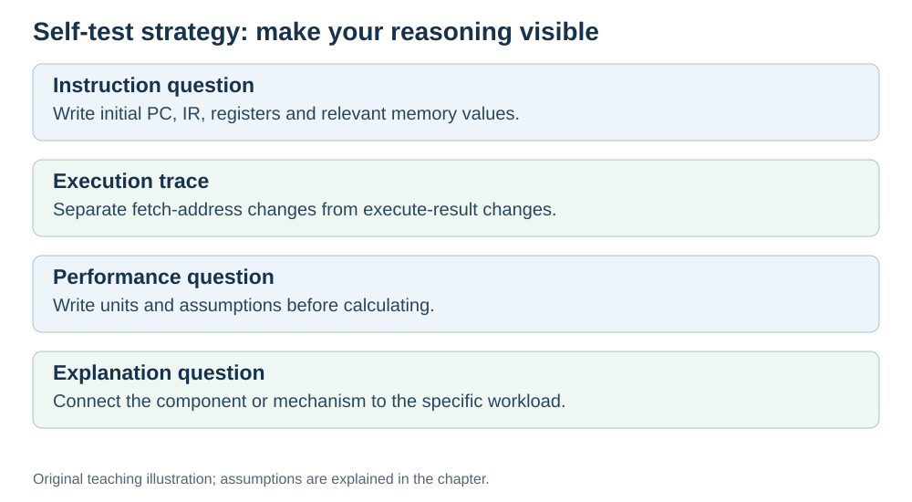

*Original teaching diagram created for the 26 October revision. Read the stated model assumptions alongside it.*

<a id="lesson-09-practice-and-summary04-check-yourself--4-example"></a>
#### 4. Example

<a id="lesson-09-practice-and-summary04-check-yourself--topic-1---what-is-hardware"></a>
##### Topic 1 — What is hardware
1. Name the hardware groups used in this project and one job for each.
2. Why is software "the recipe" and hardware "the kitchen"?

<a id="lesson-09-practice-and-summary04-check-yourself--topic-2---inside-the-cpu"></a>
##### Topic 2 — Inside the CPU
3. What is the difference between PC and IR?
4. What does the control unit do, and what does the ALU do?

<a id="lesson-09-practice-and-summary04-check-yourself--topic-3---fetch-decode-execute"></a>
##### Topic 3 — Fetch–decode–execute
5. List the five steps of fetch.
6. Trace `ADD R1, R2` with R1 = 6, R2 = 4, instruction at `0x100`. Final values and PC?

<a id="lesson-09-practice-and-summary04-check-yourself--topic-4---memory-hierarchy"></a>
##### Topic 4 — Memory hierarchy
7. Order registers, cache, RAM, and disk from fastest to slowest.
8. What is the difference between a cache hit and a cache miss?

<a id="lesson-09-practice-and-summary04-check-yourself--topic-5---how-programs-run"></a>
##### Topic 5 — How programs run
9. What does the compiler do?
10. Why does the CPU not understand variables?

<a id="lesson-09-practice-and-summary04-check-yourself--topic-6---performance"></a>
##### Topic 6 — Performance
11. Write the execution time formula.
12. Program: 2,000,000 instructions, CPI = 2, clock = 2 GHz. Execution time?

<a id="lesson-09-practice-and-summary04-check-yourself--topic-7---pipelining"></a>
##### Topic 7 — Pipelining
13. What happens to latency in our ideal pipeline, what may happen in real hardware, and what does pipelining primarily increase?
14. Why does a pipeline make the program faster overall?

<a id="lesson-09-practice-and-summary04-check-yourself--topic-8---hardware-ai-networks"></a>
##### Topic 8 — Hardware, AI, networks
15. Why do AI workloads use GPUs?
16. What is the difference between latency and bandwidth?

<a id="lesson-09-practice-and-summary04-check-yourself--topic-9---summary"></a>
##### Topic 9 — Summary
17. Name the one thread that ties all nine topics together.
18. Which topic do you need to review most? Why?

All 18 questions have [explained answers in this snapshot](#final-self-test). Reflection prompts below also have sample responses.

<a id="lesson-09-practice-and-summary04-check-yourself--5-check-yourself"></a>
#### 5. Check yourself

Try these first, then use the [explained answers](#h09-04).

1. Which questions did you answer without hesitation?
2. Which ones needed the files? Those are your review topics.
3. Can you explain each answer to a friend in one minute?
4. If not, which file will you reread first?

<a id="lesson-09-practice-and-summary04-check-yourself--6-sources"></a>
#### 6. Sources

- [MIT OpenCourseWare, 6.004 (Spring 2017), 13.1 Building the Beta](https://ocw.mit.edu/courses/6-004-computation-structures-spring-2017/pages/c13/c13s1/)
- [Intel VTune Profiler, CPU Metrics Reference: cycles per instructions retired](https://www.intel.com/content/www/us/en/docs/vtune-profiler/user-guide/2024-2/cpu-metrics-reference.html)
- [Cornell CS 3410 (Spring 2026), Pipelining & Performance](https://www.cs.cornell.edu/courses/cs3410/2026sp/notes/pipelining.html)

These sources support the technical concepts; our pseudocode, examples and analogies are teaching simplifications. Course-specific coverage is still to be checked by the team.


<a id="explained-answers"></a>
## Explained Answers

**Status:** Revised on 26 October 2026 with AI-assisted technical checks; awaiting team peer review.

[Reading order and learning goals](#reading-order-and-conventions) · [Teaching-machine conventions](#reading-order-and-conventions--teaching-machine-conventions)

Attempt each lesson's questions before opening its answers. The explanations below use the lesson's stated assumptions. Reflection/sample responses illustrate an acceptable approach and are not uniquely correct. Technical sources are listed with each linked lesson.

<a id="h01-01"></a>
### H01-01

Lesson: [Why hardware matters](#lesson-01-what-is-hardware01-why-hardware-matters).

**1. In your own words: why does a program need hardware?**

Instructions represented by bits do not execute themselves. Physical circuits must fetch them, choose operations, move data and produce output; that is the role of hardware.

**2. What does "software is the recipe, hardware is the kitchen" mean?**

The recipe represents the operations described by software; the kitchen represents the equipment that carries them out. The analogy separates a description from the physical system performing it.

**3. Why does knowing hardware help you understand why a program is slow?**

Hardware knowledge suggests testable causes of slowness, such as many executed instructions, cache misses or time waiting for I/O. Measurement is still needed to decide which cause dominates a particular program.

**4. Give one example of a program you use, and name two hardware parts it depends on.**

Example: a video player uses working memory to buffer frames and a processor or decoder to produce pictures. The display is an output device, while a local file also depends on persistent storage. Other valid examples should connect each named part to a specific job.

<a id="h01-02"></a>
### H01-02

Lesson: [The hardware groups used in this project](#lesson-01-what-is-hardware02-five-parts-of-a-computer).

**1. Name the hardware groups used in this project.**

CPU executes instructions; RAM holds active code/data; persistent storage retains saved files; I/O exchanges information with devices or users. A NIC provides networking as one kind of I/O. This is our project grouping, not five independent universal components.

**2. Which group is working memory, and which retains saved data without power?**

Ordinary DRAM is volatile working memory: it needs power to retain information. SSD/disk storage retains saved data without power. Persistent storage can still fail, so persistence is not a guarantee of permanent safety.

**3. What does I/O mean, and give two examples.**

I/O means input/output. A keyboard supplies input, a display supplies output, and a NIC can both receive and send data. Each connects the computation to something outside the CPU and main memory.

**4. Why is a computer "not one thing"?**

A computer works through cooperation: a CPU needs instructions and operands, memory holds them, and devices provide useful input/output. No single named part performs every role by itself.

**5. Which part connects your computer to the internet?**

A network interface controller (NIC), wired or wireless, connects the machine to a network. Reaching the wider Internet also depends on a working network path, routing and other configuration; having a NIC alone does not guarantee Internet access.

<a id="h01-03"></a>
### H01-03

Lesson: [The kitchen analogy](#lesson-01-what-is-hardware03-kitchen-analogy).

**1. Which kitchen part matches the CPU? Which matches RAM?**

The cook models the CPU and the counter/fridge models working memory. The cook uses ingredients kept close by, just as instructions operate on values supplied by the memory hierarchy.

**2. Why is storage like a pantry, and not like the counter?**

The pantry models persistent capacity that is generally slower to access than working memory. The counter models the smaller active workspace. Real storage differs in technology and access method, so the walking distance is only an analogy.

**3. What do the buses match in the kitchen?**

The hands and transfer window model communication paths carrying addresses, data and control. The analogy helps show movement between parts; it does not describe a particular electrical bus protocol.

**4. In your own words: why does the analogy help you understand hardware?**

Illustrative response: I can remember the CPU as the cook and working memory as the counter, then ask which component holds or transforms a value. A good answer explains a useful connection, rather than only naming kitchen objects.

**5. Where does the analogy break down? Name one thing a kitchen cannot show.**

Example limit: real caches automatically retain blocks of bytes, and CPU instructions can overlap in a pipeline. A single cook does not show these mechanisms accurately. Electrical timing and memory permissions also need explanations beyond the analogy.

<a id="h02-01"></a>
### H02-01

Lesson: [PC and IR: where the CPU keeps its place](#lesson-02-inside-the-cpu01-pc-and-ir).

**1. What does the PC hold? What does the IR hold?**

PC holds an instruction address; IR holds the fetched instruction in our teaching model. During decode/execute, PC has already advanced to the following sequential address, while IR retains the current instruction.

**2. Why does PC already point to the following instruction during execute in our teaching model?**

Our model deliberately advances PC during fetch. That preserves the following fetch address while the fetched instruction is decoded and executed. The timing and architectural meaning of PC are implementation/model dependent, and a branch can redirect it.

**3. What would happen if the CPU had no PC?**

It would need some other mechanism to identify which instruction to fetch. Removing the name PC does not remove the need to track control flow.

**4. What would happen if the CPU had no IR?**

Our teaching CPU would need another way to retain or supply the current instruction while decoding/executing it. A single IR is a simple model; real pipelines can retain several instructions in different internal structures.

<a id="h02-02"></a>
### H02-02

Lesson: [Registers and the ALU: where values live and where math happens](#lesson-02-inside-the-cpu02-registers-and-alu).

**1. What are registers, and why are they fast?**

Registers are small storage locations in the CPU, directly named by instructions. Their on-chip implementation and short access paths make them suitable for operands and intermediate results. Exact timing depends on the processor.

**2. What does the ALU do? Give two examples of operations.**

An ALU performs arithmetic and logical operations, such as addition and bitwise AND. Multiplication/division may be handled by separate functional units; not every arithmetic operation must use the same circuit.

**3. In `ADD R1, R2`, what goes into the ALU, and where does the result go?**

The two-operand shorthand means R1 receives R1 + R2. The existing R1 and R2 values are the inputs, and the sum replaces R1; R2 is unchanged. For 5 and 3, the result is R1 = 8.

**4. Why can't the CPU keep all its values in registers?**

Only a limited number of architectural registers are available. Large arrays, program state and many live values require other memory; compilers choose what to keep in registers and explicitly load/store other values.

<a id="h02-03"></a>
### H02-03

Lesson: [The control unit: the manager of the CPU](#lesson-02-inside-the-cpu03-control-unit).

**1. What does the control unit do?**

The control unit interprets the instruction and generates signals selecting data paths and actions, such as register reads, an ALU operation and a destination write. It coordinates execution rather than being the operand store.

**2. Does the control unit do math? Why or why not?**

In our functional division, the ALU and other execution units perform arithmetic on program values. The control unit selects and sequences those operations; real control circuitry can still contain internal state and logic.

**3. In `ADD R1, R2`, what signals does the control unit send?**

For ADD R1, R2, control selects R1 and R2 as inputs, chooses addition and enables writing the result into R1. No write to R2 is requested.

**4. What does the control unit determine during decode, and why are control signals also needed in other phases?**

Decode determines the operation, operands and destination. Control signals are also needed to fetch an instruction, read/write memory and commit a result, so control is not active only during decode.

<a id="h02-04"></a>
### H02-04

Lesson: [Buses: the roads between parts](#lesson-02-inside-the-cpu04-buses).

**1. What is a bus?**

A bus/interconnect is a communication path plus rules for exchanging information. Our simple diagrams separate address, data and control signals; real systems may use packetised or combined channels.

**2. What does the address bus carry? In which direction?**

It carries a location to access. In the CPU-initiated memory read in the lesson, the address travels from CPU to memory. This direction describes that example, not every possible bus master.

**3. What does the data bus carry? In which direction?**

It carries the instruction or data value. A read transfers data from memory to CPU; a write transfers data from CPU to memory.

**4. What is the difference between "which place" and "what is in it"?**

The address identifies where to access; the data is the content being transferred. The address 0x100 and the instruction stored there are different kinds of information.

**5. In the kitchen analogy, what matches the address bus?**

Pointing at a particular shelf models choosing an address. Bringing the ingredient back models carrying its data. This separates location from content.

<a id="h03-01"></a>
### H03-01

Lesson: [Fetch: get the next instruction](#lesson-03-fetch-decode-execute01-fetch).

**1. What question does fetch answer?**

Fetch obtains the instruction to process from the address indicated by PC. It prepares the instruction for decode; it does not yet perform its arithmetic or memory-data operation.

**2. List the five steps of fetch in order.**

In our teaching model: (1) PC supplies the instruction address; (2) CPU sends it on the address path; (3) memory returns instruction bits on the data path; (4) IR retains those bits; (5) PC advances by four for the following sequential instruction.

**3. Why does PC already point to the following instruction during execute in this teaching model?**

Because this teaching cycle updates PC during fetch, before execution. The fetched instruction remains in IR, so it is still available even after PC changes. Branches and other implementations require additional details.

**4. Which bus carries the address, and which carries the instruction?**

The address path carries the instruction location; the data path carries its encoded bits back. Both are needed to distinguish which location is requested from what it contains.

**5. In the kitchen analogy, what does fetch match?**

The cook reads the next recipe step and keeps it in mind, while moving the bookmark to the following step. This is only a model of sequencing and instruction retention.

<a id="h03-02"></a>
### H03-02

Lesson: [Decode: figure out what the instruction means](#lesson-03-fetch-decode-execute02-decode).

**1. What question does decode answer?**

Decode interprets the encoded instruction: which operation should run, where the inputs come from and where the result should go.

**2. What three things does the control unit work out during decode?**

It determines the operation, the operands or address information, and the destination. These choices become control signals for the data paths and execution units.

**3. Does decode change the destination register or data memory in our model? What does it prepare?**

No program destination register or data-memory result changes yet in our model. Decode prepares signals and can read operands into internal working state; saying no values anywhere change would be too broad.

**4. In `LOAD R1, [0x200]`, what does the control unit work out?**

For LOAD R1, [0x200], the operation is a load, the supplied absolute address is 0x200, and R1 is the destination register. A real base-plus-offset form would additionally require address calculation.

**5. In the kitchen analogy, what does decode match?**

The cook interprets the current recipe step and selects ingredients/tools. The actual transformation happens in the execution analogy, after that preparation.

<a id="h03-03"></a>
### H03-03

Lesson: [Execute: actually do it](#lesson-03-fetch-decode-execute03-execute).

**1. What question does execute answer?**

Execute performs the instruction operation, which may calculate a value, transfer data or redirect control flow. Here we show register arithmetic and data-memory transfers.

**2. What happens during execute for an `ADD` instruction?**

Read the named registers, supply their values to the arithmetic unit, add them, and write the result to the destination. With ADD R1, R2 and inputs 5 and 3, R1 becomes 8 and R2 remains 3.

**3. What happens during execute for a `LOAD` instruction?**

For LOAD R1, [0x200], request data at memory address 0x200 and transfer the returned value into R1. Our pseudocode supplies an absolute address; cache and address-generation details are abstracted away.

**4. What moves during `LOAD`, and how might a real processor calculate its memory address?**

A load moves data from memory to a register. A real processor may calculate the effective address from a base register plus an offset, using an ALU or dedicated address-generation unit. Our complete absolute address does not show that calculation.

**5. In the kitchen analogy, what does execute match?**

The cook actually transforms or moves the ingredients: chopping/stirring resembles computation, while bringing an ingredient to the workspace resembles a data transfer. The analogy does not describe the electrical implementation.

<a id="h03-04"></a>
### H03-04

Lesson: [Repeat and the clock: why the cycle never stops](#lesson-03-fetch-decode-execute04-repeat-and-clock).

**1. Why does the cycle repeat?**

A program normally needs many instructions. After one is processed, the control-flow mechanism supplies the next instruction address, so the CPU repeats the cycle. Other software can run when this program finishes or waits.

**2. What does the clock do? What does it *not* do?**

The clock provides timing boundaries for state changes. It does not decide the operation or the meaning of a program; instructions and control logic do that. Our examples assume a constant rate, although real CPU frequency can vary.

**3. A 3 GHz clock ticks how many times per second? How long is one cycle?**

3 GHz is 3 × 10^9 cycles per second. One period is 1 / (3 × 10^9) seconds, approximately 0.333 × 10^-9 seconds = 0.333 ns.

**4. In the kitchen analogy, what does the clock match?**

The kitchen rhythm models when work steps advance. Unlike this simple analogy, a processor can have many operations in flight, and a phase need not correspond to exactly one tick.

<a id="h03-05"></a>
### H03-05

Lesson: [Worked examples: tracing instructions](#lesson-03-fetch-decode-execute05-worked-examples).

**1. Trace `ADD R5, R6` with R5 = 7, R6 = 2, instruction at `0x300`. What are the final values and the new PC?**

The instruction at 0x300 is fetched into IR and PC advances to 0x304. Decode selects addition of R5 and R6, writing R5. Execute computes 7 + 2 = 9. Final values: R5 = 9, R6 = 2, PC = 0x304.

**2. Trace `LOAD R2, [0x400]`, located at instruction address `0x300`, with PC initially `0x300`. Memory at `0x400` holds 99. Assume a four-byte instruction. What is R2, and what is the new PC?**

Fetch starts at the separate instruction address 0x300 and advances PC to 0x304. Execute reads the value 99 at data address 0x400 into R2. Final values: R2 = 99, PC = 0x304. Do not confuse the data address with the instruction address.

**3. In all three examples, what stays the same? What changes?**

The same teaching sequence is fetch, decode and execute, with a four-byte sequential PC increment. The operation, operand locations, destination and computed/transferred value vary with the instruction.

**4. Why does the PC always increase by 4 in these examples?**

Each example explicitly uses a four-byte instruction in byte-addressed memory and contains no taken branch. Other instruction sizes or control transfers can produce a different next address.

<a id="h04-01"></a>
### H04-01

Lesson: [Why memory has layers](#lesson-04-memory-hierarchy01-why-layers).

**1. Why can't a computer have one memory that is both huge and fast?**

Fast on-chip storage costs more area/cost per stored bit, while denser or persistent technologies usually have higher access latency. A useful machine combines technologies to balance capacity, cost and speed rather than assuming one technology can provide every advantage.

**2. List the four layers from fastest to slowest.**

For the typical hierarchy shown: registers, cache, RAM, then SSD/disk, ordered by increasing access latency. This is a broad teaching order; exact timings and device configurations vary.

**3. Which layer is closest to the CPU? Which is farthest?**

Registers and first-level caches are within the core; main memory and storage are farther along the access paths. Proximity alone does not determine speed: technology, circuitry and the access method also matter.

**4. Why does the hierarchy make a computer feel faster than RAM alone would?**

Locality means many accesses reuse the same or nearby locations. Registers and caches can supply these values with lower latency, reducing how often a load must wait for main memory.

<a id="h04-02"></a>
### H04-02

Lesson: [Registers and cache: the fast layers](#lesson-04-memory-hierarchy02-registers-and-cache).

**1. Where do registers live? Why are they the fastest?**

Registers are inside the CPU and explicitly selected by instructions. Their small size and on-chip implementation allow rapid operand access; they are not a memory-address cache searched automatically by a load.

**2. What is cache, and what does it hold?**

Cache is a hardware-managed store of memory blocks, including data and instructions. It helps satisfy memory requests without reaching slower levels every time.

**3. What is the difference between a cache hit and a cache miss?**

A hit means the specified cache level contains the requested block. A miss means that level does not; another cache may still hit. Only a miss in all relevant caches necessarily proceeds toward main memory in this model.

**4. Why do loops that reuse data run faster?**

Reusing data soon gives temporal locality, so later loads may find the block in cache. Accessing nearby new elements can benefit from spatial locality too. Actual speed also depends on the rest of the loop and compiler behaviour.

**5. Order these from fastest to slowest: RAM, L1 cache, registers, L3 cache.**

Typical order by access latency: registers, L1 cache, L3 cache, RAM. This orders the requested choices; L2 normally lies between L1 and L3.

<a id="h04-03"></a>
### H04-03

Lesson: [RAM: the working memory](#lesson-04-memory-hierarchy03-ram).

**1. What does RAM hold while a program runs?**

It holds working code/data made available to the running system. Registers and caches hold active values/blocks closer to execution, while the stored file remains on persistent storage.

**2. How is RAM different from registers? From disk?**

Registers are tiny and explicitly named by instructions; RAM is much larger working memory accessed through addresses and the cache system. SSD/disk retains saved files without power but usually has higher access latency.

**3. Why is RAM called "temporary"?**

Ordinary DRAM is volatile: maintaining its information requires power and refresh. Saved storage is non-volatile, although not immune to loss or failure.

**4. Why is code fetched through working memory rather than read directly from disk in our desktop example?**

The desktop memory system supplies instruction bytes at much lower latency than a disk and supports the fine-grained access needed for execution. The OS loads/maps code into working memory; embedded execution directly from flash is a different case.

**5. Does more RAM make the CPU faster? Why or why not?**

More RAM does not raise the processor clock or automatically lower instruction latency. It can improve whole-program performance if it avoids paging or allows a useful working set to remain resident; an already CPU-bound workload may not benefit.

<a id="h04-04"></a>
### H04-04

Lesson: [Storage: the persistent layer](#lesson-04-memory-hierarchy04-storage).

**1. What does storage hold?**

Persistent storage retains saved operating-system files, applications and user data without power. It does not automatically save unsaved edits held only in memory.

**2. Why is storage slower than RAM?**

DRAM, flash SSDs and magnetic disks use different technologies/interfaces and access methods. SSD/disk accesses generally have higher latency than working-memory accesses; this is not simply because the device is larger.

**3. Why is storage still essential even though it is slow?**

Without persistent storage or another persistent source, saved files would not survive a loss of power. Working memory provides speed, while persistent storage provides retention.

**4. What happens when a program needs data from storage?**

In this desktop example, the system transfers requested file data into RAM buffers; the CPU can then work through registers/cache. Large files can be streamed in chunks instead of loaded completely at once.

**5. Order these by speed, fastest first: storage, RAM, cache, registers.**

Typical order from lowest access latency: registers, cache, RAM, storage. The comparison is about access latency, not a guarantee that every transfer or whole workload has that ranking.

<a id="h05-01"></a>
### H05-01

Lesson: [The stored-program idea](#lesson-05-how-program-runs01-stored-program-idea).

**1. What does the stored-program idea say?**

A program is represented by instructions stored in memory rather than by physically rewiring the machine for each task. Our shared-address-space example stores instruction bytes and data in the same overall memory system.

**2. Why is it useful that code and data live in the same memory?**

The same hardware can run different computations by loading different instruction sequences. The bit representation also lets programs be stored and moved as data; permissions still limit what may be executed or changed.

**3. How are instructions and data both represented, and why can memory permissions still distinguish executable and non-executable regions?**

Both are represented by bits. Whether an access fetches an instruction or reads data depends on the operation. Modern systems can mark pages non-executable or read-only, so a shared address space does not mean unrestricted execution of every cell.

**4. What does the PC point to in the example above?**

At the start PC = 0x100 identifies the first LOAD. In our fetch model it advances through 0x104, 0x108, 0x10C and then 0x110. The separate data addresses 0x300–0x308 do not become the PC just because data is loaded or stored.

<a id="h05-02"></a>
### H05-02

Lesson: [The compiler: from code to instructions](#lesson-05-how-program-runs02-compiler-and-instructions).

**1. What does a compiler do?**

A compiler translates a program to another representation. A native toolchain can produce CPU machine code; CPython and Java commonly involve bytecode and an interpreter or virtual machine. Translation steps depend on the language implementation.

**2. Why does the CPU not understand variables?**

Source names such as b are abstractions used by the language implementation. Native instructions refer to encoded operands such as register identifiers, addresses and constants rather than understanding the source variable name.

**3. What do variables become after compilation?**

In a native translation, live values may occupy registers or memory locations, or be optimised away. For languages using a runtime, values can also be represented by runtime objects. A one-to-one fixed source-variable/address mapping is not guaranteed.

**4. Why can the same code produce different numbers of instructions on different compilers?**

Compilers can choose different instruction sequences and optimisations, and target different instruction sets. Fewer instructions alone does not prove lower time because CPI and clock behaviour matter too.

**5. In the example, why might the compiler skip the two `load` instructions?**

If b/c already occupy suitable registers, fetching the same values from memory is unnecessary. The result needs ADD plus STORE when a must reach memory, or only ADD when a may remain in a register.

<a id="h05-03"></a>
### H05-03

Lesson: [Worked example: `a = b + c`](#lesson-05-how-program-runs03-example-a-equals-b-plus-c).

**1. Why are there two `load` instructions before the `add`?**

This illustrative translation assumes b and c start in memory, while ADD takes register operands. The loads bring 4 and 6 into R1 and R2 before the arithmetic instruction uses them.

**2. What are the values of R1, R2, R3 after step 3?**

R1 = 4, R2 = 6, R3 = 10. The three-operand form ADD R3, R1, R2 writes the sum into R3 without overwriting either input.

**3. What does the `store` instruction do?**

It copies R3 = 10 into the data-memory location 0x308. It does not move the instruction address or erase the register value.

**4. If `b` and `c` were already in registers, how many instructions are needed when `a` must be stored in memory? What if the result may remain in a register?**

With input values already in registers, ADD plus STORE gives two instructions if a must be written to memory. If the required result may stay in a register, only ADD is needed. The observable output requirement decides which case applies.

**5. What is the final value of `a`?**

a = 10, stored at address 0x308. The trace shows why: load 4, load 6, add them, then store the resulting 10.

<a id="h06-01"></a>
### H06-01

Lesson: [Why "more GHz" is not the same as "faster"](#lesson-06-performance01-why-ghz-is-not-speed).

**1. What does GHz actually measure?**

GHz measures billions of clock cycles per second, not instructions, completed tasks or data bytes per second. The work performed in a cycle depends on the program and processor.

**2. Why is a cycle not a fixed amount of work?**

Different operations and implementations have different completion rates, and instructions may overlap. One tick is a timing interval rather than a fixed semantic task.

**3. Name the three factors that decide execution time.**

The model factors are dynamic instruction count, average cycles per completed instruction (CPI), and clock period. Their product gives CPU execution time at the assumed constant frequency.

**4. Can a 3 GHz CPU be faster than a 4 GHz CPU? Why?**

Yes. If the 3 GHz system needs sufficiently fewer total cycles, it can finish sooner. For example, lower CPI can outweigh a longer clock period; compare all factors for the same required task.

**5. What would you look at instead of GHz to compare two CPUs?**

Measure time for a representative workload and report the input and conditions. CPU-time analysis can help explain the result; elapsed-time benchmarks also include I/O and other waits. Clock rate alone is insufficient.

<a id="h06-02"></a>
### H06-02

Lesson: [Instruction count and CPI](#lesson-06-performance02-instruction-count-and-cpi).

**1. What is instruction count? What three things affect it?**

Dynamic instruction count is the total instructions executed, counting repetitions. Algorithm/input, compiler choices and instruction set can all affect it. The number of written source lines or distinct encoded instructions is not the same quantity.

**2. What is CPI? What three things affect it?**

Average CPI is CPU cycles divided by completed instructions. Instruction mix, pipeline execution and memory stalls can affect it. It describes a rate over the measured run, not one instruction's individual latency.

**3. How do instruction count and CPI combine to give total cycles?**

Total CPU cycles = dynamic instruction count × average CPI, by the definition of average CPI. Multiplying those cycles by seconds per cycle produces CPU time.

**4. Can a program with more instructions be faster? Why?**

Yes. In the example, version B executes 1.5 million instructions × 1 cycle/instruction = 1.5 million cycles, less than A's 1 million × 2 = 2 million. At equal clock rate, B finishes first.

**5. Why does a cache miss raise CPI?**

A miss that delays progress adds cycles without a corresponding increase in completed useful instructions. Some delays can overlap with other work, so the actual CPI impact depends on the processor and workload.

<a id="h06-03"></a>
### H06-03

Lesson: [Clock period: the length of one cycle](#lesson-06-performance03-clock-period).

**1. What is clock period? How does it relate to clock frequency?**

Clock period is seconds per cycle; frequency is cycles per second. For a constant clock, period = 1/frequency, so the units and quantities are reciprocals.

**2. What is the clock period of a 3 GHz CPU?**

1 / (3 × 10^9) s = approximately 0.333 ns. Keeping the unrounded fraction until the final answer avoids accumulating rounding error.

**3. Why does a higher frequency mean a shorter period?**

More cycles fit into each second, so each cycle must take less time. Doubling a constant frequency halves its period.

**4. Does a shorter clock period always make a program faster? Why or why not?**

Only if total required cycles do not rise enough to cancel the gain. CPU time equals total cycles × period; elapsed time can additionally contain waits outside CPU execution.

**5. Convert: a 2.5 GHz clock has what period?**

1 / (2.5 × 10^9) s = 0.4 × 10^-9 s = 0.4 ns.

<a id="h06-04"></a>
### H06-04

Lesson: [Worked calculation: putting it all together](#lesson-06-performance04-worked-calculation).

**1. Write the execution time formula.**

CPU execution time = dynamic instruction count × average CPI × clock period = (dynamic instruction count × average CPI) / clock frequency. Use a consistent constant-clock model and distinguish I/O/scheduling waits.

**2. A program has 1,000,000 instructions, CPI = 2, clock = 2 GHz. What is the execution time?**

1,000,000 instructions × 2 cycles/instruction = 2,000,000 cycles. Divide by 2 × 10^9 cycles/s to get 0.001 s = 1 ms.

**3. A program has 3,000,000 instructions, CPI = 1.5, clock = 3 GHz. What is the execution time?**

3,000,000 × 1.5 = 4,500,000 cycles. Dividing by 3 × 10^9 cycles/s gives 0.0015 s = 1.5 ms.

**4. CPU A: 2 GHz, CPI = 1. CPU B: 4 GHz, CPI = 3. Which is faster for the same program? Show your calculation.**

Assuming equal dynamic instruction counts N: A takes N × 1/(2 × 10^9) = N × 0.5 ns; B takes N × 3/(4 × 10^9) = N × 0.75 ns. A is faster; B's time divided by A's time is 1.5.

**5. Why can two CPUs with different GHz have the same execution time?**

A higher frequency can be offset by a larger dynamic instruction count or average CPI. In the worked example both systems require 2 ms because the CPI/frequency ratio is equal.

<a id="h07-01"></a>
### H07-01

Lesson: [The problem with doing one thing at a time](#lesson-07-pipelining01-problem-with-sequence).

**1. Why is the sequential cycle inefficient?**

With no overlap, later instructions wait while one instruction passes through each stage, leaving some stage resources unused. This is a limitation of the specified teaching design, not a claim that every CPU circuit is idle except one.

**2. Which parts of the CPU are idle during fetch? During execute?**

During fetch, some arithmetic execution resources may wait, although address updates can still use an adder. During execute, fetch resources may wait in the unpipelined model, but a load/store still uses memory. The exact resource use depends on the datapath.

**3. In the example, how many cycles do 3 instructions take?**

3 instructions × 3 cycles/instruction = 9 cycles, because the model does not overlap any stages. The timeline runs from cycle 1 through cycle 9.

**4. In the kitchen analogy, what is idle while the cook reads the recipe?**

The stove may wait while the cook reads the next step. This illustrates an unused execution resource; it does not imply a real fetch operation cannot use arithmetic circuitry.

**5. What would you want to overlap to save time?**

Fetch of a later instruction, decode of another and execution of an earlier one can overlap if resources and dependencies allow it. That is the basic pipeline idea.

<a id="h07-02"></a>
### H07-02

Lesson: [The assembly-line idea](#lesson-07-pipelining02-assembly-line-idea).

**1. What does pipelining overlap?**

It overlaps stages belonging to different instructions. Several instructions are in flight, but each occupies a different stage in the ideal single-issue teaching pipeline.

**2. Does pipelining make a single instruction faster? Why or why not?**

The goal is higher throughput. With the same one-cycle stages and same clock period, an instruction still spans three cycles; real pipeline overhead or clock changes may alter its latency.

**3. In the example, how many cycles do 3 instructions take with a pipeline? Without?**

The non-overlapping version takes 9 cycles. The ideal pipeline takes 5: I1 finishes in cycle 3, I2 in cycle 4 and I3 in cycle 5. The initial fill explains why three instructions do not finish in only three cycles.

**4. What is the assembly-line analogy for pipelining?**

Each factory station performs a stage on a different car. After the line fills, cars finish more often even though each car still passes through all stations. Idle stations, unbalanced work or missing parts limit the real gain.

**5. Why does the CPU finish instructions more often with a pipeline?**

Different stages work concurrently on different instructions, so after filling, the ideal line completes one per cycle. This improves the rate of completion without shortening each instruction's three-stage path in this model.

<a id="h07-03"></a>
### H07-03

Lesson: [Throughput: why the pipeline is faster overall](#lesson-07-pipelining03-throughput).

**1. What is latency? What is throughput?**

Latency is start-to-finish time for one operation. Throughput is completed operations per time interval. Their units differ: time/operation versus operations/time.

**2. In our ideal model, what happens to latency? Why might a real pipeline differ?**

In our equal-clock, three-stage ideal model, latency stays at three cycles. Real pipeline registers add overhead and a real clock may change, so actual instruction latency need not remain identical.

**3. How does pipelining increase throughput?**

It overlaps work on multiple instructions. Once full, the ideal pipeline completes one instruction each cycle instead of waiting three cycles between completions.

**4. In the example, how many cycles does the pipelined version take? The non-pipelined version?**

For n = 1,000 and three one-cycle stages: non-overlapping execution takes 3n = 3,000 cycles; the ideal pipeline takes n + 2 = 1,002 cycles. Equal clock period is required to compare those counts directly as time.

**5. What is the highway analogy for throughput?**

Additional lanes illustrate more cars arriving per hour without shortening the route taken by one car. This models the difference between throughput and latency, although an assembly line more closely matches stage overlap.

<a id="h08-01"></a>
### H08-01

Lesson: [GPU and AI accelerators](#lesson-08-hardware-and-ai-networks01-gpu-and-ai-accelerators).

**1. How is a GPU different from a CPU?**

A CPU has general-purpose cores suited to low-latency control-heavy work as well as parallel execution. A GPU exposes many parallel arithmetic resources to achieve high throughput on suitable data-parallel workloads. GPU execution lanes are not directly equivalent to CPU cores.

**2. Why do large neural networks contain much matrix arithmetic, and why does that not describe every AI algorithm?**

Neural-network layers often combine large arrays through multiply/add operations, exposing parallel work. AI also includes small tabular methods, search and control logic, so it is inaccurate to identify all AI with large matrix calculations.

**3. What is an AI accelerator, and how is it different from a GPU?**

An AI accelerator specialises in a set of model operations or numerical formats. It may trade flexibility for efficiency, but performance depends on supported work and is not automatically higher than every GPU.

**4. Why can a GPU train an AI model much faster than a CPU?**

For a sufficiently large parallel workload, a GPU can execute many arithmetic operations concurrently. Benefits depend on utilisation, memory, precision and transfers; no fixed months-versus-days gain follows without a specified measurement.

**5. Is a GPU always better than a CPU? Why or why not?**

No. A small task, branch-heavy logic or expensive host/device transfer can favour a CPU. Compare a representative end-to-end workload rather than choosing from a universal device ranking.

<a id="h08-02"></a>
### H08-02

Lesson: [Network cards, latency, and bandwidth](#lesson-08-hardware-and-ai-networks02-nic-latency-bandwidth).

**1. What does a network card do?**

A NIC sends and receives data on a network link and connects that link to the host system. It is an I/O device and may be integrated rather than a separate plug-in card.

**2. What is latency? What is bandwidth?**

Latency is a specified delay, such as one-way delay or round-trip time. Bandwidth here means capacity in bits/second; throughput is the rate actually achieved. State the measurement endpoints and distinguish bits from bytes.

**3. Which matters more for a video call? For downloading a large file?**

A video conversation needs low delay for responsive turn-taking, and still needs sufficient throughput for its media rate. A large download benefits from higher available throughput; loss, latency and protocol behaviour can also affect it.

**4. What is the highway analogy for latency and bandwidth?**

Travel time along the road models latency, and lane capacity models how much traffic can pass. The analogy is limited: network link rate affects packet serialisation time, and queueing changes delay.

**5. Why can a high-bandwidth connection still feel slow?**

A long propagation path, queues, remote processing or other bottlenecks can create delay even on a high-capacity link. More capacity alone does not remove every source of latency.

<a id="h08-03"></a>
### H08-03

Lesson: [Where hardware meets AI and networks](#lesson-08-hardware-and-ai-networks03-where-hardware-meets-ai-and-networks).

**1. Why do AI workloads use GPUs and accelerators?**

Some neural-network operations expose large parallel matrix work that suits GPUs/accelerators. Small tabular RL or control-heavy work may suit CPUs. Device choice follows the workload, not simply the label AI.

**2. How does the memory hierarchy matter for AI?**

Models and batches must fit and move through the relevant memory system. Limited capacity or transfer bandwidth can leave arithmetic resources waiting, so data movement as well as arithmetic throughput affects performance.

**3. What hardware connects a computer to a network?**

The NIC is the I/O hardware linking a machine to its network. Interconnects such as PCIe can link it to the host; the network path also includes switches, links and other machines.

**4. How do latency and bandwidth affect AI training across machines?**

Communication delays and limited transfer rates can stall synchronisation or model/data exchanges. The effect depends on how computation is distributed and whether communication overlaps useful work.

**5. In your own words: why are hardware, AI, and networks not separate topics?**

Illustrative response: a robot processes observations on physical compute/memory hardware and may exchange data through network interfaces. Algorithms choose operations, while software, hardware and communication jointly determine behaviour and timing. Explain a concrete connection rather than just naming three areas.

<a id="h09-01"></a>
### H09-01

Lesson: [Worked examples: putting it all together](#lesson-09-practice-and-summary01-worked-examples).

**1. Trace `ADD R2, R3` with R2 = 4, R3 = 9, instruction at `0x400`. Final values and PC?**

Fetch from 0x400 advances PC to 0x404. Decode the shorthand ADD R2, R3 as R2 ← R2 + R3. Execute 4 + 9 = 13. Final: R2 = 13, R3 = 9, PC = 0x404.

**2. Program: 2,000,000 instructions, CPI = 2, clock = 4 GHz. Execution time?**

2,000,000 × 2 = 4,000,000 cycles. At 4 × 10^9 cycles/s, CPU time = 0.001 s = 1 ms.

**3. CPU A: 4 GHz, CPI = 2. CPU B: 2 GHz, CPI = 0.5. Same program. Which is faster? Show the calculation.**

For equal instruction count N: A uses N × 2/(4 × 10^9) = N × 0.5 ns. B uses N × 0.5/(2 × 10^9) = N × 0.25 ns. B is twice as fast. CPI = 0.5 is an average completion-rate measure enabled by overlapping work, not half a physical clock tick for each instruction's latency.

**4. Why does our ideal pipeline improve throughput while leaving latency unchanged, and why might real latency differ?**

Our model overlaps independent stages while keeping three cycles per instruction and the same cycle duration. More instructions finish per unit time; real pipeline overhead, dependencies or a changed clock can alter latency and the total gain.

**5. What does Example 1 omit about effective-address calculation in a real load?**

It omits effective-address calculation because the complete absolute address is provided. A real load can add a base register and offset using an ALU or an address-generation unit before accessing memory.

<a id="h09-02"></a>
### H09-02

Lesson: [Common misconceptions](#lesson-09-practice-and-summary02-common-misconceptions).

**1. Why does the CPU not understand variables?**

A native instruction uses encoded operands such as register identifiers and addresses. The language implementation connects source variable names to runtime representations and can optimise their storage; the CPU does not interpret the source name itself.

**2. Why is higher GHz not always faster?**

A program can need a different dynamic instruction count and average CPI on each system. Clock period is only one factor in CPU time, so a higher frequency alone cannot establish lower runtime.

**3. Does more RAM make the CPU faster? Why or why not?**

Extra RAM can avoid paging or support a larger resident working set, improving some workloads. It does not automatically raise clock speed or make a CPU-bound instruction stream execute faster.

**4. What does pipelining primarily improve? What happens to latency in our ideal model and potentially in real hardware?**

Pipelining primarily improves throughput. Our equal-clock ideal model leaves instruction latency unchanged; real pipeline overhead and clock changes can alter it.

**5. What is the difference between latency and bandwidth?**

Latency is a specified time delay. Bandwidth means capacity per second in this lesson; achieved throughput can be lower. A long-delay path can still have high capacity.

**6. Which misconception have you held yourself? How would you correct it now?**

Illustrative reflection: I used to assume a 4 GHz system was always faster. I would now compare a representative task's execution time and inspect instruction count/CPI instead of using clock rate alone. Any honest reflection with a corrected explanation is acceptable.

<a id="h09-03"></a>
### H09-03

Lesson: [Summary map: how it all fits together](#lesson-09-practice-and-summary03-summary-map).

**1. Name the nine topics in order.**

The sections are: hardware groups; inside the CPU; fetch/decode/execute; memory hierarchy; how programs run; performance; pipelining; hardware/AI/networks; practice and summary. The sequence moves from components to execution and evaluation.

**2. Which topic explains why GHz is not the whole story?**

Section 06 Performance. It relates clock period to frequency and combines dynamic instruction count, average CPI and period into CPU execution time.

**3. Which topic explains the difference between registers and RAM?**

Section 04 Memory Hierarchy, especially Registers and cache and RAM. Section 02 also introduces register operands and the ALU.

**4. Which topic connects hardware to AI and networks?**

Section 08 Hardware and AI Networks. It connects parallel computation and memory costs to AI workloads and NIC/network costs to distributed work.

**5. In your own words: what is the one thread that ties all nine topics together?**

Illustrative response: instructions, data storage, execution units and communication paths cooperate to carry out a computation. Timing depends on the software workload, data movement and hardware, rather than one magic component. Other well-supported summaries are valid.

<a id="h09-04"></a>
### H09-04

Lesson: [Check yourself: final questions](#lesson-09-practice-and-summary04-check-yourself).

**1. Which questions did you answer without hesitation?**

Illustrative reflection: I could explain PC versus IR and solve the clock-period question without notes. Name the actual questions you answered confidently; the sample is not a claim about your performance.

**2. Which ones needed the files? Those are your review topics.**

Illustrative reflection: I needed the memory lesson to distinguish a cache miss from a RAM access, so I will reread it and attempt the question again. Choose review topics from your own errors.

**3. Can you explain each answer to a friend in one minute?**

Illustrative expected outcome: give a short explanation, a concrete example and its key assumption for each answer. If you cannot do so, the answer key can guide practice; simply repeating a memorised sentence is not the goal.

**4. If not, which file will you reread first?**

Illustrative reflection: I will reread Instruction count and CPI because I confused completion rate with an instruction's latency, then redo the CPI = 0.5 comparison. A useful response names a lesson and a specific misunderstanding.

<a id="final-self-test"></a>
### Final self-test

All 18 main questions from [Check yourself: final questions](#lesson-09-practice-and-summary04-check-yourself), in the original order.

**1. Name the hardware groups used in this project and one job for each.**

CPU executes instructions; RAM supplies working capacity; persistent storage retains saved files; I/O exchanges information with users/devices. Networking is an I/O use through a NIC, highlighted separately for this project.

**2. Why is software "the recipe" and hardware "the kitchen"?**

The recipe specifies operations, while the kitchen is the physical equipment performing them. The analogy distinguishes software from hardware but does not explain electrical timing or parallel execution.

**3. What is the difference between PC and IR?**

PC identifies an instruction address. In our teaching cycle it advances during fetch; IR keeps the fetched instruction during decode/execute. These are different from the address or value of data used by that instruction.

**4. What does the control unit do, and what does the ALU do?**

Control logic determines operations, operands, destinations and timing signals. The ALU performs selected arithmetic/logical operations on program values. Other execution units can perform specialised work.

**5. List the five steps of fetch.**

PC supplies the fetch address; CPU sends it to memory; instruction bits return; IR retains them; PC advances by four in this teaching model. Those steps do not execute the instruction's data operation yet.

**6. Trace `ADD R1, R2` with R1 = 6, R2 = 4, instruction at `0x100`. Final values and PC?**

Fetch at 0x100 makes PC = 0x104. ADD R1, R2 computes 6 + 4 and writes R1. Final: R1 = 10, R2 = 4, PC = 0x104. This assumes a four-byte straight-line teaching instruction.

**7. Order registers, cache, RAM, and disk from fastest to slowest.**

Typical access-latency order: registers, cache, RAM, then SSD/disk. Technologies and access paths explain the trade-off; physical distance alone is not a universal speed law.

**8. What is the difference between a cache hit and a cache miss?**

At a given cache level, a hit finds the requested memory block; a miss does not. A miss may be served by a later cache, so not every L1 miss causes a RAM access.

**9. What does the compiler do?**

A compiler translates code into another representation. Native toolchains can produce CPU machine code; CPython commonly uses bytecode and an interpreter, and Java commonly uses JVM bytecode with interpretation or runtime compilation.

**10. Why does the CPU not understand variables?**

Source names are language-level abstractions. Machine instructions use encoded registers, addresses, constants and operations; runtimes/compilers connect these mechanisms to source program values.

**11. Write the execution time formula.**

CPU time = dynamic instruction count × average CPI × clock period = instruction count × CPI / frequency. The examples assume a constant clock; I/O and scheduling waits can add elapsed time outside CPU execution.

**12. Program: 2,000,000 instructions, CPI = 2, clock = 2 GHz. Execution time?**

2,000,000 instructions × 2 cycles/instruction = 4,000,000 cycles. Divide by 2 × 10^9 cycles/s: 0.002 s = 2 ms.

**13. What happens to latency in our ideal pipeline, what may happen in real hardware, and what does pipelining primarily increase?**

Our ideal three-stage equal-clock model keeps each instruction at three cycles latency. Real pipeline overhead and clock changes can alter latency. The primary benefit is higher throughput: more completions per time interval.

**14. Why does a pipeline make the program faster overall?**

It overlaps stages from different instructions so hardware can do useful work concurrently. For independent instructions with no stalls, the line finishes one per cycle after filling; hazards and overhead limit the real gain.

**15. Why do AI workloads use GPUs?**

Large parallel matrix workloads in some neural networks can use GPU throughput effectively. Not all AI requires a GPU: small tabular Q-learning can run on a CPU, and transfers or control-heavy work can make CPU execution preferable.

**16. What is the difference between latency and bandwidth?**

Latency is an identified one-way or round-trip delay. Bandwidth here is capacity per second; throughput is the achieved rate. Capacity and delay describe different properties of the path.

**17. Name the one thread that ties all nine topics together.**

Illustrative summary: physical storage, execution and communication cooperate to run instructions, with performance determined by both the workload/software and the hardware/data paths. A different explanation is acceptable if it connects the topics accurately.

**18. Which topic do you need to review most? Why?**

Illustrative reflection: I need to review pipelining because I added individual instruction latencies instead of counting overlapping cycles. Name your own weakest topic, why it is difficult, and one next practice step.

<a id="h00"></a>
### H00

Lesson: [Hardware — How Computers Actually Work (Introduction)](#introduction).

**1. In your own words: what is hardware, and why does software need it?**

Hardware is the physical equipment that stores, moves and processes encoded instructions and data. Software describes operations, but it needs an executing physical system to produce a result.

**2. Name the hardware groups used in this project and one job for each.**

Our groups are CPU (execute instructions), RAM (working storage), persistent storage (retain saved files) and I/O (exchange data with the outside world). Networking is a highlighted I/O use, not an extra compulsory component of every computer.

**3. Describe in 2–3 sentences what happens when a program runs.**

A language implementation translates or interprets the source. Machine instructions and active data are made available through working memory; the CPU fetches, decodes and executes instructions, moving values through registers, caches and memory as needed.

**4. Which file would you read to learn why 4 GHz is not always faster than 3 GHz?**

Read section 06 Performance, starting with Why more GHz is not the same as faster. It introduces dynamic instruction count, average CPI and clock period, then calculates CPU time from their product.
