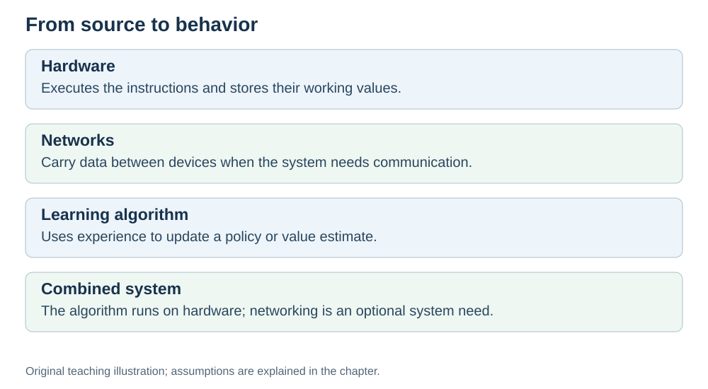
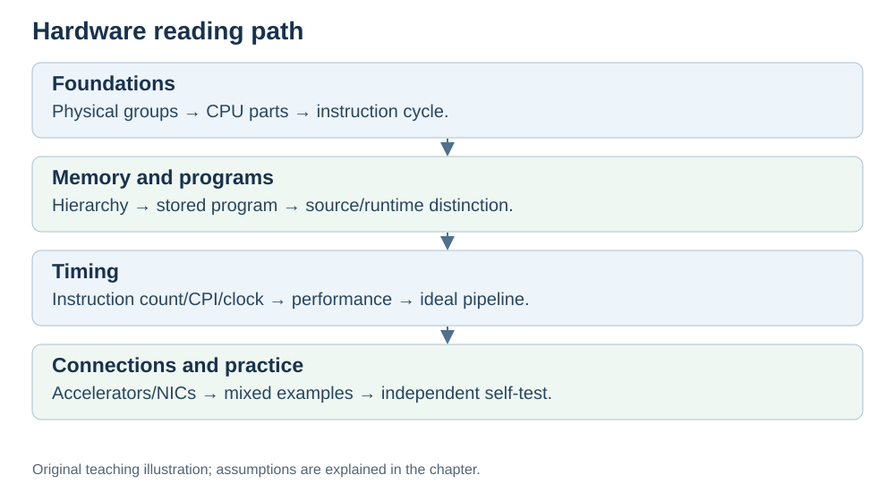

# Hardware — How Computers Actually Work (Introduction)

**Status:** Revised on 26 October 2026 with AI-assisted technical checks; awaiting team peer review.

[Reading order](OUTLINE.md) · [Teaching-machine conventions](OUTLINE.md#teaching-machine-conventions) · [Explained answers](ANSWER-KEY.md#h00)

**File:** `/content/Hardware/INTRODUCTION.md`
**Role:** Opening chapter of the Hardware part. It gives the big picture and a reading map. Details live in section folders 01–09; use the linked outline below.
**Audience:** complete beginners. No prior hardware knowledge assumed.

---

## 0. What you will be able to do after this chapter

By the end of this chapter, you should be able to:

- Explain in plain words what hardware is and why software needs it.
- Name the main hardware groups used in this project and say what each one does.
- Describe, at a high level, what happens when a program runs.
- Know which file to read next for each topic.

You do **not** need any prior hardware knowledge. If you can write a simple loop in any programming language, you are ready.

---

## 1. What "hardware" means

A program by itself does nothing. Its source may be text, but executable instructions are encoded as bits. Something physical has to read it and execute it. That physical something is **hardware**.

A simple way to remember it: **software is the recipe, hardware is the kitchen.** The recipe tells you what to do. The kitchen — the cook, the counter, the fridge, the pantry, the hands — is what actually gets it done.

This part of the project is about that kitchen: what it is made of, how it works, and why some kitchens are faster than others.

---

## 2. The big picture: hardware groups used in this project

We group the topics as CPU, main memory, persistent storage and I/O, then give networking special attention. Network interfaces are I/O devices; a standalone computer does not require a network connection.

| Part | In plain words | Kitchen analogy |
|---|---|---|
| CPU (processor) | Runs instructions, does the actual work | The cook |
| Memory (RAM) | Fast, temporary storage for active data | Counter and fridge |
| Storage (SSD/disk) | Persistent storage, usually slower to access than RAM | Pantry |
| Input/Output | Keyboard, screen, network card | Serving window, delivery |
| Network | Connects this computer to others | Delivery route |

You do not need to memorize this now. The point is simple: **a computer is not one thing — it is a few parts working together.** Each part has one job, and the next files look at each job in turn.

*Original teaching diagram created for the 26 October revision. Read the stated model assumptions alongside it.*

---

## 3. What happens when a program runs (the short version)

When you run a program, this is the story in one paragraph:

Your code is turned into a list of **instructions**. Those instructions sit in **memory**. The **CPU** reads them one at a time, figures out what each one means, and does it. Results go back to memory or to the screen. This repeats until the program ends.

That is the whole idea. The details — how the CPU reads an instruction, what is inside it, why some CPUs are faster — are in the files below.

*Original teaching diagram created for the 26 October revision. Read the stated model assumptions alongside it.*

---

## 4. How to read this part

The Hardware part has nine section folders containing 33 lessons. Read the sections in this order; [OUTLINE.md](OUTLINE.md) links every lesson and its prerequisites:

1. **[What is hardware](01%20What%20is%20Hardware/)** — the hardware groups used in this project (this chapter gives the map; section 01 goes deeper).
2. **[Inside the CPU](02%20Inside%20the%20CPU/)** — what is inside the processor: PC, IR, registers, ALU, control unit, buses.
3. **[Fetch–decode–execute](03%20Fetch%20Decode%20Execute/)** — how the CPU actually runs one instruction, with worked examples.
4. **[Memory hierarchy](04%20Memory%20Hierarchy/)** — registers, cache, RAM, disk: why some memory is fast and some is slow.
5. **[How programs run](05%20How%20Program%20Runs/)** — from your code to instructions the CPU can execute.
6. **[Performance](06%20Performance/)** — why "more GHz" does not always mean "faster".
7. **[Pipelining](07%20Pipelining/)** — the assembly-line idea that makes CPUs faster.
8. **[Hardware, AI and networks](08%20Hardware%20and%20AI%20Networks/)** — how hardware connects to the other parts of our project.
9. **[Practice and summary](09%20Practice%20and%20Summary/)** — examples, common misconceptions, and questions.

You do not have to read everything at once. Each lesson has an objective, examples, questions, sources and an answer-key link. Follow the prerequisite order in the outline rather than treating all lessons as independent.

---

## 5. Three things to keep in mind

These ideas come back in almost every file, so remember them now:

- **The CPU does not understand your variables.** It understands registers and memory addresses. The compiler is what connects your code to them.
- **"More GHz" is not the same as "faster".** Speed depends on several things, not just the clock.
- **Every part has one job.** CPU computes, memory holds, buses carry. Once you know each job, the whole machine stops being a black box.

---

## 6. Check yourself

1. In your own words: what is hardware, and why does software need it?
2. Name the hardware groups used in this project and one job for each.
3. Describe in 2–3 sentences what happens when a program runs.
4. Which file would you read to learn why 4 GHz is not always faster than 3 GHz?

[Read the explained answers](ANSWER-KEY.md#h00). They are included in this snapshot; the future Study Guide can reuse them.

---

## 7. Scope boundaries

- **This chapter covers:** what hardware is, the hardware groups used in this project, the short version of how a program runs, and a reading map.
- **This chapter does not cover:** CPU internals, the fetch–decode–execute cycle in detail, memory hierarchy, performance calculations, pipelining. Those are in the linked section folders.
- **Out of scope for the whole Hardware part:** pipeline hazards, superscalar/out-of-order execution, cache replacement policies, instruction encoding details.

---

## 8. Sources

- [MIT OpenCourseWare, 6.004 (Spring 2017), 13.1 Building the Beta](https://ocw.mit.edu/courses/6-004-computation-structures-spring-2017/pages/c13/c13s1/)
- [Cornell CS 3410 (Spring 2025), Input/Output: devices, storage and interconnects](https://www.cs.cornell.edu/courses/cs3410/2025sp/notes/io.html)

These sources support the technical concepts; our pseudocode, examples and analogies are teaching simplifications. Course-specific coverage is still to be checked by the team.
