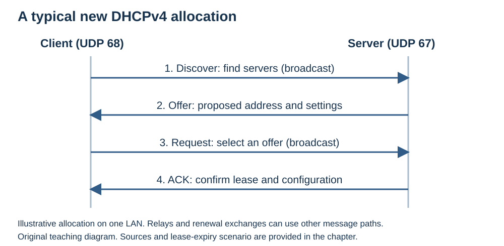

# DHCP (Dynamic Host Configuration Protocol) — A Micro-Textbook for Beginners

This chapter explains how devices automatically obtain IP addresses and other network settings. It focuses on **DHCP for IPv4 (DHCPv4)**.

**Status:** Revised with AI-assisted technical checks; awaiting team peer review.

[Module outline and reading order](OUTLINE.md) · [Explained answers](ANSWER-KEY.md)

---

## Learning Objectives

After this section, a beginner should be able to:

1. Explain what DHCP does and why automatic configuration is useful.
2. Describe the four steps of the DORA exchange.
3. Identify the main network settings a DHCP server supplies.
4. Explain address leases, renewal, and reservations.

---

## 1. What Is DHCP and Why Do We Need It?

When you connect a laptop to a network, it needs an IP address and suitable network settings. Entering these manually for every device would take time and make mistakes more likely.

The **Dynamic Host Configuration Protocol (DHCP)** automates this process. A **DHCP client** requests configuration, and a **DHCP server** supplies it.

The server manages an **address pool**: a collection of addresses available for assignment. Think of it as a reception desk that assigns available rooms to arriving guests. Instead of keeping a room forever, each guest receives permission to use it for a period of time. [Microsoft DHCP overview](https://learn.microsoft.com/en-us/windows-server/networking/technologies/dhcp/dhcp-top)

---

## 2. The DORA Exchange: Getting an Address

A typical new DHCPv4 lease begins with four messages, often remembered as **DORA**:

1. **Discover — DHCPDISCOVER:** The client broadcasts a message to find available DHCP servers.
2. **Offer — DHCPOFFER:** A server proposes an IP address and configuration.
3. **Request — DHCPREQUEST:** The client selects an offer and broadcasts its request, informing servers which offer it chose.
4. **Acknowledgment — DHCPACK:** The selected server confirms the lease and supplies the configuration.

DHCPv4 uses **UDP port 67 on the server** and **UDP port 68 on the client**.

*Original teaching diagram. The selecting Request is broadcast; later renewal behavior differs.*

A server can also serve clients on another subnet through a **DHCP relay agent**, which passes DHCP messages between them. Not every DHCP message is broadcast; later exchanges can use direct communication. [DHCP specification: RFC 2131](https://www.rfc-editor.org/rfc/rfc2131)

---

## 3. More Than an IP Address: Network Settings

DHCP can provide several pieces of information. For example, a device on a home network might receive:

- **IP address:** `192.168.1.50` — the address assigned to its network interface.
- **Subnet mask:** `255.255.255.0`, also written as `/24` — identifies the network portion of the address.
- **Default gateway:** `192.168.1.1` — the router used to reach destinations outside the local network when no more specific route applies.
- **DNS server:** `192.168.1.1` — a server the device can ask to resolve domain names.
- **Lease duration:** `24 hours` — how long the address assignment remains valid without renewal.

These values are illustrative; actual settings depend on the network. Settings such as the subnet mask, gateway, DNS servers, and lease duration are carried in **DHCP options**. [DHCP options: RFC 2132](https://www.rfc-editor.org/rfc/rfc2132)

---

## 4. Leases, Renewals, and Reservations

A **lease** grants temporary use of an IP address. Before it expires, the client requests a renewal and can continue using the same address if the server approves.

If the lease expires without renewal, the client must stop using that address. The server can make an expired address available for reassignment. [DHCP lease behavior: RFC 2131](https://www.rfc-editor.org/rfc/rfc2131)

Sometimes a device, such as a printer, needs a predictable address. A **DHCP reservation** associates a particular client with a specific address so the server consistently assigns it that address.

A reservation still uses DHCP. A **static IP configuration**, by contrast, is entered directly on the device. [Microsoft DHCP overview](https://learn.microsoft.com/en-us/windows-server/networking/technologies/dhcp/dhcp-top)

**Worked scenario:** A client receives a two-hour lease at 09:00. It attempts renewal before 11:00. A successful renewal extends the assignment; if no renewal succeeds and the original lease expires at 11:00, the client must stop using that address. It must obtain valid configuration again before using a DHCP-assigned address. These times are illustrative and do not prescribe the detailed renewal timers.

---

## 5. Common Misconceptions

- **"DHCP and DNS do the same job."** False. DHCP provides network configuration, including DNS server addresses. DNS resolves names such as `example.com` into information such as IP addresses.
- **"DHCP gives me a different IP address every time I connect."** False. A client may renew or obtain its previous address, and a reservation can keep the assignment consistent. [Microsoft DHCP overview](https://learn.microsoft.com/en-us/windows-server/networking/technologies/dhcp/dhcp-top)

---

## 6. Check Yourself

1. **Trace the DORA exchange:** What is the purpose of Discover, Offer, Request, and Acknowledgment?
2. **Name three settings besides an IP address** that DHCP can provide, and explain their purpose.
3. **Explain a lease:** What happens if it expires without renewal, and how does a reservation differ from manually configuring a static address?

[Explained answers: DHCP Q1–Q3](ANSWER-KEY.md#dhcp)

---

## 7. Scope Boundaries

- **Detailed:** DHCPv4 client-server roles, address pools, DORA, common network settings, leases and renewal.
- **Brief:** DHCP reservations and relay agents.
- **Out of scope:** DHCP server configuration files, packet-field formats, detailed renewal timers, failover mechanisms, DHCPv6 and SLAAC operation.
