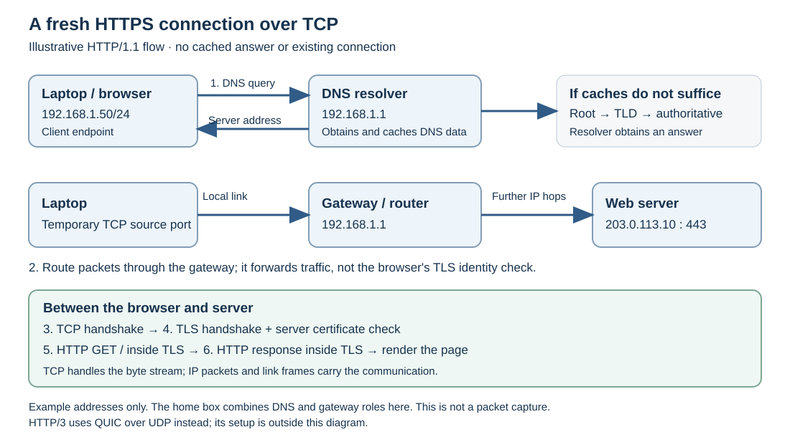
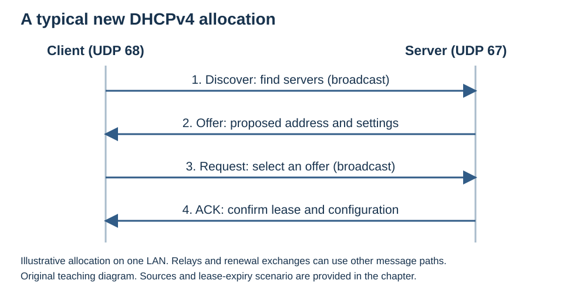

# Networks — A Micro-Textbook for Beginners

This guide combines the Networks overview, reading map, nine learning sections, and explained answers in one document. The examples are explanatory models, not claims of experiments performed by the team.

**Status:** Revised with AI-assisted technical checks; awaiting team peer review.

## Contents

1. [Reading order and scope](#reading-order-and-scope)
2. [Introduction: how networks communicate](#introduction)
3. [OSI model and network stacks](#osi-model)
4. [Network types](#network-types)
5. [IP addressing and routing](#ip-and-routing)
6. [TCP and UDP](#tcp-and-udp)
7. [DNS](#dns)
8. [DHCP](#dhcp)
9. [HTTP, HTTPS, and security](#http-and-security)
10. [SSH](#ssh)
11. [Explained answers](#explained-answers)

<a id="reading-order-and-scope"></a>
## Reading Order and Scope

**Audience:** Beginners who can use a browser but have not studied network protocols.

**Module outcome:** Explain how a configured device finds a service, routes packets, establishes appropriate transport and protection, and exchanges application data.

| Order | Section | Main learning outcome | Prerequisite |
|---|---|---|---|
| 1 | [Introduction](#introduction) | Trace a fresh HTTPS-over-TCP exchange through the stack | Basic browser use |
| 2 | [OSI Model](#osi-model) | Explain layer order, model grouping, and encapsulation | Introduction overview |
| 3 | [Network Types](#network-types) | Distinguish network scale and access point/router roles | Introduction |
| 4 | [IP and Routing](#ip-and-routing) | Use a simple prefix and default route to explain forwarding | Network types; basic layer names |
| 5 | [TCP and UDP](#tcp-and-udp) | Compare transport services and application requirements | IP and routing |
| 6 | [DNS](#dns) | Trace a cold-cache lookup and interpret records/TTL | IP address concept |
| 7 | [DHCP](#dhcp) | Explain DHCPv4 configuration and lease behavior | IP/subnet/gateway; UDP and DNS roles |
| 8 | [HTTP and Security](#http-and-security) | Explain messages and HTTPS protection | DNS; TCP; IP/gateway |
| 9 | [SSH](#ssh) | Distinguish server identity checks and user authentication | TCP; basic encryption/authentication concepts |

All **30 chapter questions** have [explained answers](#explained-answers). Try each question before reading its answer.

### Scope and model assumptions

- This module teaches core concepts and small examples, not production server administration.
- The introduction uses a five-layer model; the OSI section explains its relationship to four-layer TCP/IP and seven-layer OSI models.
- The worked web trace assumes a fresh HTTP/1.1 HTTPS connection over TCP. HTTP/3 is named as a boundary; its QUIC mechanics are not taught.
- The subnet example is a normally configured IPv4 `/24` LAN. IPv6 address size and notation are introduced, but its on-link discovery is outside scope.
- DHCP means **DHCPv4** in its section. DHCPv6 and SLAAC operation are outside scope.
- Detailed exclusions are recorded at the end of each section. These are explanatory materials; no team peer-review approval or live networking experiment is claimed.

### Reuse in study resources

- **Study guide:** the introduction's worked HTTPS trace, diagram, and explained answers to Q3–Q4.
- **Slides:** one diagram slide, followed by DNS, TCP/TLS, and HTTP stages with a short ordering activity.
- **Video:** narrate the same illustrative trace, then pause at the missing-TLS misconception and explain its correction.

These are proposed uses of the content, not claims that those resources have been produced.

<a id="introduction"></a>
## Introduction: A Network Actually Moves Data

This section introduces the network stack and follows a web request from a browser to a remote server.

### Learning objectives

After this section, a beginner should be able to:

1. Explain what happens between typing a URL and seeing a page load.
2. Name the main layers of the network stack and their responsibilities.
3. Distinguish packet delivery from TCP's reconstruction of an ordered byte stream.
4. Explain the different roles of IP, TCP, and UDP.
5. Describe how DNS, routing, and TLS contribute to an HTTPS request.

### What a network actually does

A network moves **data** between devices. Links can fail, packets can be lost, and many applications share the same connections.

The core idea is **layering**: different protocols handle different parts of communication. Your browser can use either Wi-Fi or Ethernet because its web protocol does not need to implement either link technology.

### The layers in plain terms

This chapter uses a **five-layer teaching model**. A four-layer TCP/IP model groups Link and Physical together as network access; these are different ways to describe the same functions. [RFC 1122, Internet protocol suite and layering](https://www.rfc-editor.org/rfc/rfc1122.html#section-1.1.3)

| Layer | Responsibility | Example |
|---|---|---|
| **Application** | Defines communication between applications | HTTP, DNS, SSH |
| **Transport** | Connects application endpoints using ports; delivery features depend on the protocol | TCP, UDP |
| **Network** | Addresses and forwards packets across IP networks | IP |
| **Link** | Moves frames across a local link | Ethernet, Wi-Fi |
| **Physical** | Encodes and transmits bits as signals | Copper cable, optical fiber, radio |

Think of sending a letter: the application writes the message, addressing identifies its destination, and successive delivery systems carry it. The analogy helps explain separate responsibilities; it does not imply every protocol guarantees delivery.

### Packets: smaller pieces of data

Links have size limits, so large transfers normally use many smaller packets. Sharing a link between packets also lets different conversations make progress.

An **IP packet** carries source and destination IP addresses. It does not contain a general-purpose sequence number for rebuilding an application's byte stream. When TCP is used, a **TCP segment** inside that packet carries sequence information. TCP uses this to restore byte order. UDP itself supplies neither ordered-stream reconstruction nor retransmission. [IPv4 header: RFC 791 §3.1](https://www.rfc-editor.org/rfc/rfc791.html#section-3.1), [TCP: RFC 9293 §2.2](https://www.rfc-editor.org/rfc/rfc9293.html#section-2.2)

### IP, TCP, and UDP: different jobs

- **IP** provides addressing and packet forwarding. Its service is **best-effort**: delivery and ordering are not guaranteed.
- **TCP** provides an ordered byte stream. It tracks received data and retransmits losses. If recovery fails, the connection can time out or abort; reliability does not promise success through a permanent outage.
- **UDP** sends individual datagrams with a small header. It has no built-in handshake, ordering, or retransmission. Applications can add any recovery they need.

Both TCP and UDP use **ports** to distinguish application endpoints. UDP's smaller set of mechanisms can suit time-sensitive messages, but it is not universally faster than TCP. Performance depends on the application and network conditions. [UDP: RFC 768](https://www.rfc-editor.org/rfc/rfc768.html), [UDP usage: RFC 8085](https://datatracker.ietf.org/doc/html/rfc8085), [TCP timeout: RFC 5482 §1](https://www.rfc-editor.org/rfc/rfc5482.html#section-1)

### DNS and routing: finding a destination

**DNS** retrieves information associated with names. For a web connection, the browser needs an address for the hostname. A resolver can answer from its cache or consult authoritative DNS servers. A lookup without useful cached information may involve root, TLD, and domain-authoritative servers. [RFC 1034 §5.3.3](https://www.rfc-editor.org/rfc/rfc1034.html#section-5.3.3)

**Routing** determines where to send each IP packet. A routing table maps destination prefixes to an outgoing interface or next hop. A default route is used when no more specific route matches. [RFC 1812 §5.2.4](https://www.rfc-editor.org/rfc/rfc1812.html#section-5.2.4)

### Worked example: a new HTTPS connection

Suppose a laptop opens `https://example.com/` using **HTTP/1.1 over TCP**. For this illustrative exercise:

- The laptop is already configured as `192.168.1.50/24`.
- Its default gateway and DNS resolver are both `192.168.1.1`.
- The name resolves to `203.0.113.10`, an address used here for documentation, not a claim about the live website.
- No useful DNS answer or web connection is cached, and the route to the server uses the default gateway.



1. **Find the address.** The laptop asks its DNS resolver for `example.com`. The resolver obtains the answer and returns it; results may be cached.
2. **Choose a route.** `203.0.113.10` is outside the laptop's `192.168.1.0/24` subnet. The laptop sends server-bound traffic through `192.168.1.1`. On the local link, frames go to the gateway; IP identifies the remote destination. Further routers forward packets hop by hop. A home router may also translate private source addresses; NAT details are outside this example.
3. **Establish TCP.** The client uses a temporary source port and destination port **443**. The usual SYN → SYN-ACK → ACK exchange establishes the TCP connection. These messages themselves travel in IP packets and link frames.
4. **Establish TLS protection.** The browser and server perform a TLS handshake. The browser validates the server certificate for `example.com`, and the endpoints establish keys for protected communication.
5. **Request the resource.** The browser sends an HTTP `GET /` request with the website's hostname, carried inside TLS over TCP. TCP handles its byte stream; IP and link protocols carry the resulting packets and frames.
6. **Receive the response.** The server returns an HTTP response, such as `200 OK` with HTML. TLS checks and decrypts protected records; TCP delivers bytes in order or reports connection failure if recovery cannot succeed.
7. **Display the page.** The browser interprets the HTML and may request images, stylesheets, and scripts. Existing connections and caches can reduce later work.

The physical layer transmits signals on every link; link framing is rebuilt for each link. This is an explanatory trace, **not a recorded network experiment**. HTTP/2 also commonly uses TLS over TCP; **HTTP/3 uses QUIC over UDP**, so its setup differs. [HTTPS: RFC 9110 §4.2.2](https://www.rfc-editor.org/rfc/rfc9110.html#section-4.2.2), [TLS: RFC 8446 §2](https://www.rfc-editor.org/rfc/rfc8446.html#section-2), [HTTP/3: RFC 9114](https://www.rfc-editor.org/rfc/rfc9114.html)

### Common misconceptions

- **“IP and TCP are the same thing.”** IP forwards packets; TCP adds byte-stream ordering and recovery.
- **“Every packet contains enough information to reconstruct a file.”** Reconstruction depends on the protocols and application involved.
- **“DNS is one central lookup computer.”** It is a distributed, hierarchically delegated system with caching.
- **“The internet is a single local network.”** It connects many networks through routers.
- **“UDP is broken TCP.”** It offers a different, deliberately minimal service.

<a id="introduction-check-yourself"></a>
### Check yourself: introduction

1. **Order the five teaching-model layers** from application to physical and give a protocol, technology, or medium for each.
2. **Explain** why a large file is normally sent in many packets.
3. **Compare IP and TCP:** what service does each provide, and can TCP always finish a transfer?
4. **Trace a fresh HTTPS-over-TCP request:** include DNS, the gateway/IP path, TCP, TLS, and HTTP.
5. **Spot the error:** “TCP is faster than UDP because it is more reliable.” What is wrong with this claim?

[Explained answers: Introduction Q1–Q5](#answers-introduction)

### Scope boundaries

- **Detailed:** Five-layer teaching model, packets, IP/TCP/UDP responsibilities, DNS and routing basics, the HTTPS-over-TCP trace.
- **Brief:** DNS caching, private addresses/NAT context, TLS purpose, the HTTP/3 boundary.
- **Out of scope:** Congestion-control algorithms, cryptographic calculations, BGP internals, NAT configuration, socket programming.

<a id="osi-model"></a>
## OSI Model and Network Stacks

This section uses models to organize networking responsibilities and explain encapsulation.

### Learning objectives

1. Explain why layered models are useful.
2. Name the seven OSI layers in order.
3. Relate OSI to four-layer TCP/IP and five-layer teaching models.
4. Describe encapsulation and decapsulation in a simple Internet example.

### Why do we need a model?

The **OSI (Open Systems Interconnection) model** separates communication into seven layers. It is a reference framework for describing responsibilities, not a rule that every real implementation must contain seven separate software components. [ITU-T X.200, Basic Reference Model](https://www.itu.int/rec/T-REC-X.200-199407-I/en)

Layering helps isolate problems. A damaged cable and an incorrect HTTP request belong to different parts of the communication process.

### The seven layers

**“Please Do Not Throw Sausage Pizza Away” runs from bottom to top: Layer 1 to Layer 7.** Read the table downward for the opposite order, Application to Physical.

| Layer | Name | Main responsibility | Illustrative examples |
|---|---|---|---|
| **7** | **Application** | Network services used by application processes | HTTP, DNS, SMTP |
| **6** | **Presentation** | Representation, encoding, and transformation of data | Text encodings, image formats |
| **5** | **Session** | Organizing and coordinating a dialogue | Session establishment and control |
| **4** | **Transport** | End-to-end transport; reliability and ordering depend on the protocol | TCP, UDP |
| **3** | **Network** | Addressing and forwarding between networks | IP, router forwarding |
| **2** | **Data Link** | Framing and delivery over a local link | Ethernet/Wi-Fi link functions |
| **1** | **Physical** | Encoding and transmitting bits as signals | Copper, fiber, radio |

These Internet examples are **approximate functional mappings** onto the OSI reference model. For example, Internet applications often implement functions associated with OSI's upper three layers together. TLS provides security between application protocols and their transport; assigning it one universal OSI layer would be misleading.

### OSI, TCP/IP, and the five-layer teaching model

A common **four-layer TCP/IP model** groups functions as follows:

1. **Application:** broadly covers OSI's Application, Presentation, and Session functions.
2. **Transport:** corresponds broadly to OSI Layer 4.
3. **Internet:** corresponds broadly to OSI Layer 3.
4. **Link / Network Access:** includes link and physical transmission functions.

The [Introduction](#introduction) uses **five layers** by separating Physical from Link. The layer count is a modelling choice, not a claim about different Internets. Strict layering is itself an imperfect description of implementations. [RFC 1122 §§1.1.3 and 1.3.1](https://www.rfc-editor.org/rfc/rfc1122.html#section-1.1.3)

### Encapsulation: adding control information

Consider application data sent with TCP over IPv4 and Ethernet:

1. **Application:** produces data for its protocol.
2. **TCP:** adds a TCP header, forming a **segment**.
3. **IPv4:** adds an IP header, forming an **IP packet**.
4. **Ethernet:** carries the packet in a **frame** with link control information, including a header and trailer.
5. **Physical transmission:** encodes the frame as signals on the medium.

This wrapping is **encapsulation**. The physical step transmits signals; it is not simply another protocol header. At the receiving endpoint, **decapsulation** processes the corresponding framing and headers to deliver the data upward. [TCP segmentation: RFC 9293 §2.2](https://www.rfc-editor.org/rfc/rfc9293.html#section-2.2), [Ethernet/IP encapsulation: RFC 1122 §2.3.3](https://www.rfc-editor.org/rfc/rfc1122.html#section-2.3.3)

A router removes incoming link framing, examines the IP packet, and uses suitable new framing on the next link. It does not normally reconstruct the application's entire message merely to forward a packet.

### Common misconceptions

- **“Every network strictly implements all seven OSI layers.”** OSI is a reference model; real protocol suites group responsibilities differently.
- **“Four-layer and five-layer descriptions contradict each other.”** The five-layer teaching model separates physical transmission from the four-layer model's network-access layer.
- **“Routers forward packets by interpreting webpage content.”** Ordinary IP forwarding primarily uses network-layer information, especially the destination address and routing table.

<a id="osi-model-check-yourself"></a>
### Check yourself: OSI model

1. **List** the seven OSI layers from top to bottom.
2. **Compare** OSI with the four-layer TCP/IP model, and explain the introduction's fifth layer.
3. **Explain encapsulation:** what happens in the TCP/IPv4/Ethernet example from application data to physical signals?

[Explained answers: OSI Q1–Q3](#answers-osi-model)

### Scope boundaries

- **Detailed:** Layer order, model mappings, encapsulation and decapsulation.
- **Brief:** Presentation/session responsibilities and router link-framing changes.
- **Out of scope:** OSI protocol-suite history, detailed Ethernet frame fields, strict classification of every Internet protocol into an OSI layer.

<a id="network-types"></a>
## Network Types: PAN, LAN, MAN, and WAN

This section compares networks by their typical geographic scope.

### Learning objectives

1. Distinguish PAN, LAN, MAN, and WAN by typical scope.
2. Give an example of each category.
3. Explain the different roles of an access point and a router.

### Categorizing networks

A connection between a phone and headphones has a different scope from a network linking offices in different countries. The labels below describe useful categories, rather than fixed distance thresholds or mandatory hardware designs.

| Type | Full name | Typical scope | Example |
|---|---|---|---|
| **PAN** | Personal Area Network | Devices around one person | Phone and Bluetooth headphones |
| **LAN** | Local Area Network | Home, office, building, or campus | Devices sharing an office Ethernet/Wi-Fi network |
| **MAN** | Metropolitan Area Network | A city or metropolitan area | A network connecting municipal sites across a city |
| **WAN** | Wide Area Network | Connections across larger geographic areas | Enterprise links between distant offices |

The Internet connects many networks worldwide and is a useful WAN-scale example. A PAN is often short-range, but “10 meters” is not a universal Bluetooth limit: achievable range depends on radio design and environment. [Bluetooth SIG, understanding range](https://www.bluetooth.com/learn-about-bluetooth/key-attributes/range/)

### Connecting local and wider networks

An **access point** lets Wi-Fi devices join a local wireless network. A **switch** connects devices within a local wired network. A **router** forwards packets between IP networks; it can connect a LAN to a provider's wider network.

A home “Wi-Fi router” usually combines several roles, including an access point and router. The roles are still different. A local network can operate without an Internet connection. [Cisco, networking basics](https://www.cisco.com/site/us/en/learn/topics/small-business/networking-basics.html), [Cisco, access points](https://www.cisco.com/site/us/en/learn/topics/small-business/what-is-an-access-point.html)

WAN connections can use provider fiber, cellular, or other links. They are not defined by a particular cable or by crossing an ocean.

**Example:** A laptop can reach a home printer over Wi-Fi while the home's Internet service is down. Its local link works; the path to remote Internet services does not. This is an illustrative scenario, not a measured test.

### Common misconceptions

- **“Wi-Fi and the Internet are the same thing.”** Wi-Fi provides local wireless connectivity. Reaching the Internet requires a working path beyond that local network.
- **“Full Wi-Fi signal proves good Internet service.”** Signal strength says something about the local wireless link, not the entire path to a remote service.

<a id="network-types-check-yourself"></a>
### Check yourself: network types

1. **Differentiate** a PAN and a LAN with examples.
2. **What connects a LAN to a WAN?** Name the primary device role and distinguish it from an access point.
3. **Spot the error:** “My house has a great WAN connection because my Wi-Fi router covers every room.” Correct the terminology.

[Explained answers: Network Types Q1–Q3](#answers-network-types)

### Scope boundaries

- **Detailed:** Network scale categories and access point/switch/router roles.
- **Brief:** MAN examples and different WAN link technologies.
- **Out of scope:** Fixed distance classifications, provider network design, submarine cables, and cellular radio engineering.

<a id="ip-and-routing"></a>
## IP Addressing and Routing

This section explains interface addresses, subnet prefixes, and hop-by-hop forwarding.

### Learning objectives

1. Explain IP addresses and compare IPv4 with IPv6.
2. Use a simple IPv4 prefix to distinguish local and remote destinations.
3. Describe how a router uses a routing table.
4. Explain the default gateway's role.

### IP addresses: logical network addresses

To communicate using IP, a network interface uses an **IP address**. A device may have several interfaces or addresses. An address is not a permanent physical-device identity, and private addresses can be reused on separate networks. [IPv6 addressing model: RFC 4291 §2.1](https://www.rfc-editor.org/rfc/rfc4291.html#section-2.1), [Private IPv4: RFC 1918 §3](https://www.rfc-editor.org/rfc/rfc1918.html#section-3)

A **MAC address** is used for local-link communication on technologies such as Ethernet and Wi-Fi. Interfaces may have factory-assigned MAC addresses, but software can also configure or randomize the address used. [Apple, private Wi-Fi addresses](https://support.apple.com/en-nz/102509)

- **IPv4:** 32 bits, usually written as four decimal numbers from 0 to 255, such as `192.168.1.50`. There are about 4.3 billion possible values, including reserved ranges. The original IANA unallocated pool was exhausted in 2011; existing IPv4 networks continue to operate. [NRO, IPv4 free-pool exhaustion](https://www.nro.net/ipv4-free-pool-depleted/)
- **IPv6:** 128 bits, written using hexadecimal groups and colons, such as the documentation address `2001:db8::50`. Its much larger address space addresses the shortage inherent in IPv4. [RFC 4291 §§2–2.2](https://www.rfc-editor.org/rfc/rfc4291.html#section-2)

### Subnets: prefix and interface portion

For a simple IPv4 LAN, a **subnet mask** identifies the network prefix. The remaining bits distinguish interface addresses within that subnet. **CIDR notation** writes the prefix length after a slash: `/24` means the first 24 bits are the prefix. [RFC 4632 §3.1](https://www.rfc-editor.org/rfc/rfc4632.html#section-3.1)

**Worked example:** A laptop has `192.168.1.50/24`, with mask `255.255.255.0`. Its subnet is `192.168.1.0/24`.

- Destination `192.168.1.80` shares that prefix. In this normally configured LAN, the laptop can send to it on the local link.
- Destination `192.168.2.20` does not share the prefix. The laptop needs an appropriate route through a router.

This example assumes the devices are attached to the expected links and communication is permitted. Matching address digits alone cannot repair a disconnected cable or an incorrect network setup. IPv6 also uses prefixes, but its on-link discovery details are outside this section.

### Routers and routing tables

A **router** forwards IP packets between networks. It checks a destination against its routing table and chooses an outgoing interface or next hop. The most specific matching prefix is preferred; a default route provides a fallback. [RFC 1812 §5.2.4](https://www.rfc-editor.org/rfc/rfc1812.html#section-5.2.4)

A router does not need to store the complete journey for each packet. One entry might mean: “For this destination prefix, send to the next router on this interface.” Each hop makes its own forwarding decision.

### The default gateway

A host's **default gateway** is the next-hop router used by its default route when no more specific route applies. On a home network, this is commonly the home router.

For example, the laptop above might use gateway `192.168.1.1`. To contact `203.0.113.10` in the [HTTPS example](#introduction), it sends frames to the gateway while the IP packet identifies the remote destination. The gateway forwards it toward another network.

The decision concerns addresses and routes, not country borders. A nearby server can be on another network; a remote service's geographic location is not encoded directly in the host's subnet comparison.

### Common misconceptions

- **“An IP address permanently belongs to a physical device.”** Addresses may be configured manually or automatically, for example with DHCP. They can remain stable or change. A router only assigns DHCP addresses if it also runs that service. [Microsoft DHCP overview](https://learn.microsoft.com/en-us/windows-server/networking/technologies/dhcp/dhcp-top)
- **“Routers must read webpage content to forward packets.”** Ordinary IP forwarding uses network-layer information. A device that also performs firewall or proxy functions may inspect more.

<a id="ip-and-routing-check-yourself"></a>
### Check yourself: IP and routing

1. **Compare** IPv4 and IPv6: why was a larger address space needed?
2. **Explain a subnet mask.** For `192.168.1.50/24`, which destination is local in the example: `192.168.1.80` or `192.168.2.20`, and why?
3. **Explain a default gateway** when a destination is outside the local subnet and no more specific route applies.

[Explained answers: IP and Routing Q1–Q3](#answers-ip-and-routing)

### Scope boundaries

- **Detailed:** Address versus device identity, IPv4/IPv6 size, a `/24` example, routing tables, default gateway.
- **Brief:** Private address reuse, configurable MAC addresses, static versus automatic configuration.
- **Out of scope:** General subnet arithmetic, IPv6 on-link discovery, NAT internals, BGP, OSPF, and EIGRP.

<a id="tcp-and-udp"></a>
## Transport Layer: TCP and UDP

This section compares two transport services and explains ports without assuming one protocol is always faster.

### Learning objectives

1. Distinguish connection-oriented and connectionless transport.
2. Explain TCP's ordering and loss recovery, including their limits.
3. Describe UDP's minimal service and why an application may choose it.
4. Explain ports and application endpoints.
5. Relate transport choices to an application's delivery requirements.

### The transport layer's role

IP forwards packets to destination addresses. **Transport protocols** provide communication between application endpoints. TCP and UDP use **ports** as part of that addressing: for example, a service may listen on port 443 while clients use temporary source ports.

TCP and UDP also provide different delivery behavior. This choice affects what an application must do when data is missing, duplicated, or out of order.

### TCP: an ordered byte stream

**TCP (Transmission Control Protocol)** provides a reliable, ordered byte stream. It does not preserve the boundaries of an application's individual messages; the application protocol must identify those boundaries when needed. [RFC 9293 §2.2](https://www.rfc-editor.org/rfc/rfc9293.html#section-2.2)

Its main mechanisms include:

- **Connection setup:** The usual three-way handshake is SYN → SYN-ACK → ACK.
- **Sequence numbers:** TCP tracks positions in the byte stream so received data can be ordered.
- **Acknowledgments and retransmission:** Acknowledgments report received data. TCP retransmits when it detects loss, for example after a retransmission timeout.
- **Flow control:** A receiver advertises how much data it can accept, helping prevent a sender from overwhelming it.
- **Congestion control:** The sender adapts to network conditions; detailed algorithms are outside this section.

Reliability is not a promise that every transfer finishes. If a peer or path remains unavailable, the connection can fail and the application must handle an error or timeout. [RFC 5482 §1](https://www.rfc-editor.org/rfc/rfc5482.html#section-1)

### UDP: individual datagrams

**UDP (User Datagram Protocol)** carries separate messages called **datagrams**. Its header is **8 bytes**, containing source and destination ports, length, and checksum. It has no built-in connection handshake, retransmission, or ordering mechanism. [RFC 768, header format](https://www.rfc-editor.org/rfc/rfc768.html)

The small set of mechanisms lets an application choose its own behavior. A time-sensitive position update in a game may become useless after newer updates arrive. Other messages, such as a purchase confirmation, still need reliable handling.

Retransmission is not always useless in real-time media: it can help when the application's delay budget allows it. The important question is whether recovered data can still arrive in time. [RFC 4588 §3](https://www.rfc-editor.org/rfc/rfc4588.html#section-3)

UDP itself lacks congestion control and recovery, but applications or protocols built above it may supply them. “UDP” therefore does not mean an entire application has no reliability. [RFC 8085](https://datatracker.ietf.org/doc/html/rfc8085)

### Ports: addressing application endpoints

Ports resemble apartment numbers within a building, while an IP address helps identify the building. The analogy is approximate: connection identification also uses addresses, transport protocol, and the ports at both ends.

- **Standard service ports:** Common defaults include HTTP on 80, HTTPS on 443, and DNS on 53. Ports 0–1023 form the system/well-known range; services can be configured differently.
- **Temporary client ports:** The operating system commonly chooses an available source port when an application opens communication.

For the [HTTPS example](#introduction), a client might connect from temporary port `49152` to server port `443`. Replies use the corresponding endpoint information to reach the correct connection.

| Feature | TCP | UDP |
|---|---|---|
| **Service** | Byte stream | Individual datagrams |
| **Ordering/recovery** | Built in; connection failure remains possible | Not built in |
| **Connection setup** | Normally a three-way handshake | No UDP handshake |
| **Overhead and timing** | Includes mechanisms for setup, ordering, recovery, and flow/congestion control | Small header; higher layers add mechanisms as needed |
| **Examples** | HTTP/1.1 and HTTP/2, SMTP, many file transfers | Many game/media protocols and traditional DNS queries |

These are examples, not exclusive pairings. **DNS also uses TCP**, and **HTTP/3 uses QUIC over UDP**. QUIC provides reliable streams above UDP. [RFC 7766 §5](https://www.rfc-editor.org/rfc/rfc7766.html#section-5), [RFC 9114](https://www.rfc-editor.org/rfc/rfc9114.html), [RFC 9000](https://www.rfc-editor.org/rfc/rfc9000.html)

### Common misconceptions

- **“TCP is always slower; UDP is always faster.”** Neither is a universal performance rule. Results depend on requirements, network conditions, and the mechanisms used above the transport.
- **“UDP provides zero overhead.”** It has an 8-byte header; applications may add more.
- **“UDP data is always corrupted.”** Its checksum can detect accidental corruption. IPv4 permits an omitted UDP checksum; a checksum is normally required with IPv6. A checksum does not repair loss. [RFC 768](https://www.rfc-editor.org/rfc/rfc768.html), [RFC 8200 §8.1](https://www.rfc-editor.org/rfc/rfc8200.html#section-8.1)
- **“An IP address alone tells the operating system which application endpoint should receive TCP/UDP data.”** Transport ports also matter. Ordinary router forwarding, however, does not require identifying the application.

<a id="tcp-and-udp-check-yourself"></a>
### Check yourself: TCP and UDP

1. **Describe** the usual TCP three-way handshake.
2. **Explain** why a real-time game might use UDP for frequent position updates. Why might other game messages need reliable handling?
3. **What is a port**, and why is an IP address alone insufficient to identify a TCP/UDP application endpoint?
4. **Spot the error:** “If one packet is lost using TCP, the application crashes because TCP cannot recover.” What can TCP do, and what if recovery ultimately fails?

[Explained answers: TCP and UDP Q1–Q4](#answers-tcp-and-udp)

### Scope boundaries

- **Detailed:** Stream versus datagram service, TCP setup/ordering/recovery, ports, application trade-offs.
- **Brief:** UDP header/checksum, temporary ports, flow/congestion control purpose, DNS/HTTP transport variants.
- **Out of scope:** Congestion-control algorithms, detailed packet-field diagrams, sliding-window mathematics, socket programming.

<a id="dns"></a>
## DNS (Domain Name System)

This section explains how names lead to network addresses and why caching reduces lookup work.

### Learning objectives

1. Explain DNS's role in retrieving information associated with names.
2. Describe recursive resolvers, root servers, TLD servers, and authoritative servers.
3. Explain caching and TTL.
4. Distinguish A, AAAA, CNAME, and MX records.

### What is DNS?

People can remember names such as `example.com` more easily than numeric addresses. The **Domain Name System (DNS)** is a distributed, hierarchical system for retrieving records associated with names. Address lookup is one important use; DNS also stores other information, such as mail-routing records.

The “phonebook of the Internet” analogy captures name lookup, although real DNS is distributed across many independently operated servers. Without DNS, applications would need another way to obtain destination addresses. [RFC 1034 §§2–3](https://www.rfc-editor.org/rfc/rfc1034.html#section-2)

### A lookup without useful cached information

If neither the device nor its resolver has a usable answer, a simple lookup for `example.com` can involve:

1. **Recursive resolver:** Receives the device's question and obtains an answer on its behalf. It may be provided by an ISP, an organization, or a public DNS service.
2. **Root name server:** Directs the resolver toward servers for the relevant top-level domain, such as `.com`.
3. **TLD name server:** Supplies delegation information pointing toward the authoritative servers for `example.com`.
4. **Authoritative name server:** Answers from the records for the relevant zone. An answer may contain an address, an alias, or other information depending on the question.

The resolver returns the result to the client. Cached answers or delegations can let it skip parts of this path. [RFC 1034 §5.3.3](https://www.rfc-editor.org/rfc/rfc1034.html#section-5.3.3)

The root system has **13 named authorities**, served by many physical instances worldwide. This does not mean that only 13 physical root servers exist. [IANA root servers](https://www.iana.org/domains/root/servers)

### Common record types

| Type | What it supplies | Illustrative use |
|---|---|---|
| **A** | IPv4 address | `example.com` → `192.0.2.10` |
| **AAAA** | IPv6 address | `example.com` → `2001:db8::10` |
| **CNAME** | Another DNS name, making the owner name an alias | `www.example.com` → `example.com` |
| **MX** | Mail server names and their preferences | Identifies where mail for a domain should be delivered |

These are documentation examples, not results of live DNS queries. A and CNAME differ because one supplies an address while the other points to another name. [RFC 1034 §3.6](https://www.rfc-editor.org/rfc/rfc1034.html#section-3.6), [AAAA: RFC 3596 §2](https://www.rfc-editor.org/rfc/rfc3596.html#section-2)

### Caching: making lookups faster

The operating system, browser, and recursive resolver may retain lookup results. A **TTL (Time To Live)** on DNS data specifies how long it can ordinarily be reused from a cache before a fresh lookup is needed.

**Worked example:** A resolver caches an address with a TTL of 300 seconds. One minute later, a second client asks for the same record. The resolver can normally reuse the cached answer, with less time remaining on its TTL. If the authoritative address changes meanwhile, clients using the old cached record may temporarily receive the old value. [RFC 1034 §3.6](https://www.rfc-editor.org/rfc/rfc1034.html#section-3.6)

The TTL is not a promise that all caches update together at one global instant.

### Common misconceptions

- **“DNS is stored on one master computer.”** It is distributed and hierarchically delegated.
- **“Every lookup contacts root, TLD, and authoritative servers.”** Caches can answer directly or shorten the path.
- **“Changing a record updates every user's answer immediately.”** Existing cached records can remain in use until their cache lifetime ends.

<a id="dns-check-yourself"></a>
### Check yourself: DNS

1. **Trace a lookup without useful caches:** what do the recursive resolver, root, TLD, and authoritative servers do?
2. **Compare an A record with a CNAME record.** Which returns an address and which returns another name?
3. **Explain TTL:** why can two clients briefly receive different addresses after a record changes?

[Explained answers: DNS Q1–Q3](#answers-dns)

### Scope boundaries

- **Detailed:** Resolver hierarchy, A/AAAA/CNAME/MX records, caching and TTL.
- **Brief:** Local caches and the distinction between named root authorities and physical instances.
- **Out of scope:** Anycast routing, DNSSEC, zone-file configuration, advanced delegation cases, reverse DNS, and encrypted DNS transports.

<a id="dhcp"></a>
## DHCP (Dynamic Host Configuration Protocol)

This section explains how devices automatically obtain IP addresses and other network settings. It focuses on **DHCP for IPv4 (DHCPv4)**.

### Learning objectives

1. Explain what DHCP does and why automatic configuration is useful.
2. Describe the four steps of the DORA exchange.
3. Identify the main network settings a DHCP server supplies.
4. Explain address leases, renewal, and reservations.

### What is DHCP and why do we need it?

When you connect a laptop to a network, it needs an IP address and suitable network settings. Entering these manually for every device would take time and make mistakes more likely.

The **Dynamic Host Configuration Protocol (DHCP)** automates this process. A **DHCP client** requests configuration, and a **DHCP server** supplies it.

The server manages an **address pool**: a collection of addresses available for assignment. Think of it as a reception desk that assigns available rooms to arriving guests. Instead of keeping a room forever, each guest receives permission to use it for a period of time. [Microsoft DHCP overview](https://learn.microsoft.com/en-us/windows-server/networking/technologies/dhcp/dhcp-top)

### The DORA exchange: getting an address

A typical new DHCPv4 lease begins with four messages, often remembered as **DORA**:

1. **Discover — DHCPDISCOVER:** The client broadcasts a message to find available DHCP servers.
2. **Offer — DHCPOFFER:** A server proposes an IP address and configuration.
3. **Request — DHCPREQUEST:** The client selects an offer and broadcasts its request, informing servers which offer it chose.
4. **Acknowledgment — DHCPACK:** The selected server confirms the lease and supplies the configuration.

DHCPv4 uses **UDP port 67 on the server** and **UDP port 68 on the client**.



*Original teaching diagram. The selecting Request is broadcast; later renewal behavior differs.*

A server can also serve clients on another subnet through a **DHCP relay agent**, which passes DHCP messages between them. Not every DHCP message is broadcast; later exchanges can use direct communication. [DHCP specification: RFC 2131](https://www.rfc-editor.org/rfc/rfc2131)

### More than an IP address: network settings

DHCP can provide several pieces of information. For example, a device on a home network might receive:

- **IP address:** `192.168.1.50` — the address assigned to its network interface.
- **Subnet mask:** `255.255.255.0`, also written as `/24` — identifies the network portion of the address.
- **Default gateway:** `192.168.1.1` — the router used to reach destinations outside the local network when no more specific route applies.
- **DNS server:** `192.168.1.1` — a server the device can ask to resolve domain names.
- **Lease duration:** `24 hours` — how long the address assignment remains valid without renewal.

These values are illustrative; actual settings depend on the network. Settings such as the subnet mask, gateway, DNS servers, and lease duration are carried in **DHCP options**. [DHCP options: RFC 2132](https://www.rfc-editor.org/rfc/rfc2132)

### Leases, renewals, and reservations

A **lease** grants temporary use of an IP address. Before it expires, the client requests a renewal and can continue using the same address if the server approves.

If the lease expires without renewal, the client must stop using that address. The server can make an expired address available for reassignment. [DHCP lease behavior: RFC 2131](https://www.rfc-editor.org/rfc/rfc2131)

Sometimes a device, such as a printer, needs a predictable address. A **DHCP reservation** associates a particular client with a specific address so the server consistently assigns it that address.

A reservation still uses DHCP. A **static IP configuration**, by contrast, is entered directly on the device. [Microsoft DHCP overview](https://learn.microsoft.com/en-us/windows-server/networking/technologies/dhcp/dhcp-top)

**Worked scenario:** A client receives a two-hour lease at 09:00. It attempts renewal before 11:00. A successful renewal extends the assignment; if no renewal succeeds and the original lease expires at 11:00, the client must stop using that address. It must obtain valid configuration again before using a DHCP-assigned address. These times are illustrative and do not prescribe the detailed renewal timers.

### Common misconceptions

- **“DHCP and DNS do the same job.”** False. DHCP provides network configuration, including DNS server addresses. DNS resolves names such as `example.com` into information such as IP addresses.
- **“DHCP gives me a different IP address every time I connect.”** False. A client may renew or obtain its previous address, and a reservation can keep the assignment consistent. [Microsoft DHCP overview](https://learn.microsoft.com/en-us/windows-server/networking/technologies/dhcp/dhcp-top)

<a id="dhcp-check-yourself"></a>
### Check yourself: DHCP

1. **Trace the DORA exchange:** What is the purpose of Discover, Offer, Request, and Acknowledgment?
2. **Name three settings besides an IP address** that DHCP can provide, and explain their purpose.
3. **Explain a lease:** What happens if it expires without renewal, and how does a reservation differ from manually configuring a static address?

[Explained answers: DHCP Q1–Q3](#answers-dhcp)

### Scope boundaries

- **Detailed:** DHCPv4 client-server roles, address pools, DORA, common network settings, leases and renewal.
- **Brief:** DHCP reservations and relay agents.
- **Out of scope:** DHCP server configuration files, packet-field formats, detailed renewal timers, failover mechanisms, DHCPv6 and SLAAC operation.

<a id="http-and-security"></a>
## HTTP, HTTPS, and Security

This section explains web requests and responses, then the protection supplied by TLS.

### Learning objectives

1. Explain HTTP's client-server model.
2. Identify methods, targets, headers, bodies, and status codes.
3. Explain how HTTPS adds confidentiality, server authentication, and tamper detection.

### HTTP: communication on the web

**HTTP (Hypertext Transfer Protocol)** is an application protocol. A **client**, often a browser, requests a resource or submits information. A **server** processes the request and returns a response. The resource could be HTML, an image, or data for an application. [RFC 9110 §§1–3](https://www.rfc-editor.org/rfc/rfc9110.html#section-1)

A page can require many requests. Conversely, cached content or an existing connection can avoid some network work, so every click does not necessarily begin a fresh connection.

### Requests and responses

A request identifies a **method**, a **target** such as `/about`, and **headers**. It can also contain a **body**, for example form data.

- **GET:** Request a representation of a resource.
- **POST:** Submit data for the target resource to process, such as a form.
- **PUT:** Request creation or replacement of the target resource's state with the submitted representation.
- **DELETE:** Request removal of the target resource's association with its current functionality.

A response includes a **status code**, headers, and sometimes a body. Common examples are:

| Status | Meaning |
|---|---|
| **200 OK** | The request succeeded |
| **301 Moved Permanently** | A permanent redirect |
| **302 Found** | A temporary redirect |
| **404 Not Found** | The server did not find a current representation, or will not disclose one |
| **500 Internal Server Error** | An unexpected server-side problem prevented completion |

A 500 does not necessarily mean the server crashed. Status classes provide a broader guide: **1xx** informational, **2xx** successful, **3xx** redirection, **4xx** client error, **5xx** server error. [RFC 9110 §§9 and 15](https://www.rfc-editor.org/rfc/rfc9110.html#section-15)

**Illustrative HTTP/1.1 request:**

```http
GET /about HTTP/1.1
Host: example.com
Accept: text/html

```

The server might respond with `200 OK`, a `Content-Type: text/html` header, and an HTML body. With HTTPS, these HTTP details travel inside protected communication rather than appearing as cleartext on the network.

**Cookies in brief:** A response can use `Set-Cookie` to ask the browser to store a cookie. Subject to its scope and browser rules, the browser later includes it in a `Cookie` request header. This can help associate requests with a session. [RFC 6265 §3](https://www.rfc-editor.org/rfc/rfc6265.html#section-3)

### Plain HTTP

Plain `http://` provides no transport encryption of HTTP data. Someone able to observe the traffic on its path may read it, and an active intermediary may alter it. Local Wi-Fi encryption does not supply protection across the entire route to the web server.

### HTTPS and TLS

**HTTPS** protects HTTP communication using **TLS (Transport Layer Security)**. In a new certificate-based HTTPS connection over TCP:

1. The client and server establish TCP, normally to server port **443**.
2. A TLS handshake establishes security parameters and keys. The client validates the server's certificate and its association with the requested hostname.
3. HTTP requests and responses travel in protected TLS records. **Encryption** protects their contents from network observers. **Integrity protection** detects tampering, so altered records are rejected.

TLS does not prevent an attacker from dropping traffic or interrupting a connection, and connection metadata can remain visible. It protects communication between its endpoints; it does not prove that the website's content or business is honest. [RFC 8446 §§1–2](https://www.rfc-editor.org/rfc/rfc8446.html#section-1), [HTTPS: RFC 9110 §4.2.2](https://www.rfc-editor.org/rfc/rfc9110.html#section-4.2.2)

The [complete worked trace](#introduction) connects DNS, routing, TCP, TLS, and HTTP. HTTP/3 uses QUIC over UDP instead of this TCP setup; its details are outside this section. [RFC 9114](https://www.rfc-editor.org/rfc/rfc9114.html)

### Common misconceptions

- **“HTTP and HTML are the same thing.”** HTTP is a communication protocol; HTML describes the structure of a webpage.
- **“HTTPS means a site cannot be a scam.”** An encrypted, authenticated connection can still lead to a malicious site.
- **“TLS makes data impossible to modify.”** It detects tampering with protected data; it cannot prevent every network disruption.

<a id="http-and-security-check-yourself"></a>
### Check yourself: HTTP and Security

1. **Describe** the difference between GET and POST using a webpage or form example.
2. **Explain 404:** what does it mean, and which kind of component returns that HTTP response?
3. **Explain HTTPS protection** compared with plain HTTP on an untrusted network. What does it not establish about the website?

[Explained answers: HTTP and Security Q1–Q3](#answers-http-and-security)

### Scope boundaries

- **Detailed:** Client-server exchange, methods, message components, selected status codes and classes, TLS protection.
- **Brief:** Cookie exchange, certificate/name validation, the HTTP/3 boundary.
- **Out of scope:** Cryptographic mathematics, complete HTTP syntax, cookie security policy, HTTP/2 multiplexing, QUIC mechanics.

<a id="ssh"></a>
## SSH (Secure Shell)

This section explains how users securely connect to remote computers and run commands over a network.

### Learning objectives

1. Explain what SSH is and why remote connections need protection.
2. Describe the roles of an SSH client and an SSH server.
3. Compare password authentication with public-key authentication.
4. Explain why checking a server's host key matters.

### What is SSH and why do we need it?

Imagine managing a computer in another building—or another country. You need to run commands on it, but you do not want people on the network to read your password or change your commands.

**Secure Shell (SSH)** is a protocol for secure remote access. It provides **encryption** to keep session data private, **integrity protection** to detect tampering, and **authentication** to verify identities. Think of it as a protected connection between your computer and a remote machine. [SSH architecture: RFC 4251](https://www.rfc-editor.org/rfc/rfc4251)

A **shell** is a program that interprets commands. With SSH, you can use a remote computer's shell from your own terminal.

### Clients and servers: how a connection starts

SSH uses a **client-server model**:

- **SSH client:** The program on your computer that initiates the connection.
- **SSH server:** The program on the remote computer that accepts connections, commonly called `sshd`.

A typical connection follows these steps:

1. **Connect:** The client contacts the server, normally using **TCP port 22**.
2. **Establish protection:** Both sides negotiate security settings and perform a key exchange. The client also checks the server's identity using its host key.
3. **Authenticate the user:** The server checks whether the user can access the requested account.
4. **Start a session:** If access is allowed, the server can open a shell or execute a command. Session data travels through the encrypted connection. [OpenSSH server documentation](https://man.openbsd.org/sshd)

For example, `ssh student@server.example.com` requests access to the account `student` on the specified server. Commands entered after a successful shell login run on that remote computer. [OpenSSH client documentation](https://man.openbsd.org/ssh)

### Authentication: passwords and key pairs

Two common ways to authenticate are:

- **Password authentication:** You provide the remote account's password. SSH sends it through the encrypted connection.
- **Public-key authentication:** You use a mathematically related pair of keys: a **public key** and a **private key**.

The public key is registered with the account on the server. The private key stays under your control. During authentication, the client creates a digital signature that the server verifies using the public key. **The private key itself is not sent to the server.** [SSH authentication: RFC 4252](https://www.rfc-editor.org/rfc/rfc4252)

A private key can also be protected by a **passphrase**, which helps protect the stored key if someone obtains the key file. This passphrase is separate from the remote account's password. [OpenSSH client documentation](https://man.openbsd.org/ssh)

### Host keys: checking the server's identity

Authentication works in both directions: the server checks the user, and the client checks the server.

A **host key** identifies the server. On a first connection, an SSH client may display its **fingerprint**, a short representation of the public host key. Compare it with a value obtained through a trusted channel, such as the server administrator.

OpenSSH remembers accepted host keys in its `known_hosts` file. If a key changes later, it warns you. A change might follow a legitimate server replacement, but it can also indicate impersonation, so investigate before accepting it. [OpenSSH host-key verification](https://man.openbsd.org/ssh#VERIFYING_HOST_KEYS)

**Worked scenario:** An administrator gives a student the expected host-key fingerprint through a trusted channel. The client displays a different fingerprint. The student pauses the connection and checks the discrepancy with the administrator before trusting the key. This avoids treating an unexpected identity as verified; a legitimate key replacement is one possible explanation. This is an illustrative scenario, not a recorded test.

**Other uses in brief:** SFTP transfers files over an SSH connection. Port forwarding can carry selected connections through SSH; it does not automatically protect every application on the computer. [OpenSSH SFTP](https://man.openbsd.org/sftp), [OpenSSH forwarding](https://man.openbsd.org/ssh)

### Common misconceptions

- **“My public key must remain secret.”** False. Public keys are designed to be shared. The private key must remain protected.
- **“Opening an SSH session encrypts all my internet traffic.”** False. SSH protects data carried through its connection. Other application traffic does not automatically pass through it. [SSH architecture: RFC 4251](https://www.rfc-editor.org/rfc/rfc4251)

<a id="ssh-check-yourself"></a>
### Check yourself: SSH

1. **Trace an SSH connection:** What happens between contacting the server and opening a remote shell?
2. **Compare public and private keys:** Which key is registered on the server, and which must remain protected?
3. **Explain host-key verification:** Why should you check a server's fingerprint before trusting it?

[Explained answers: SSH Q1–Q3](#answers-ssh)

### Scope boundaries

- **Detailed:** Client-server roles, TCP port 22, encrypted sessions, password and public-key authentication, host-key verification.
- **Brief:** File transfers with SFTP, port forwarding, private-key passphrases.
- **Out of scope:** Cryptographic mathematics, advanced SSH configuration, certificate authorities, complex tunneling setups.

<a id="explained-answers"></a>
## Explained Answers

These explanations cover all **30 questions** in the nine learning sections. Question numbers match each section's Check Yourself questions. Equivalent accurate explanations are acceptable. Sources for concepts are linked in the corresponding sections; these answers are not a claim of completed human peer review or an official marking rubric.

<a id="answers-introduction"></a>
### Introduction

[Questions and worked trace](#introduction-check-yourself)

1. **Five-layer order.** Application → Transport → Network → Link → Physical. Suitable examples are HTTP, TCP, IP, Ethernet link framing, and optical signals in fiber. A physical medium is not itself an application protocol. This model separates Physical from the network-access layer used in the four-layer TCP/IP description.
2. **Why many packets?** Links limit the size of individual transmissions, and packet-sized pieces let multiple conversations share capacity. A large file therefore normally uses many packets. Recovery belongs to the relevant protocol: TCP can retransmit missing data; IP alone does not promise this service.
3. **IP versus TCP.** IP addresses and forwards packets on a best-effort basis. TCP, carried over IP, supplies an ordered byte stream using sequence tracking, acknowledgments, and recovery. TCP can report a failed connection if the network or peer does not recover, so reliable service does not guarantee every transfer will finish.
4. **HTTPS trace.** DNS supplies an address for the hostname. The host chooses a route; in the example, a remote destination uses its default gateway. IP packets travel through successive links and routers. TCP establishes the connection, then TLS validates the server identity and establishes protection. The browser exchanges HTTP requests/responses inside TLS and renders the returned content. Omitting TLS would omit the protection that makes this example HTTPS.
5. **Speed claim.** Reliability does not establish that TCP is faster. It also does not prove that UDP is always faster. Completion time and delay depend on conditions and requirements, including any recovery or other mechanisms supplied by an application above UDP.

<a id="answers-osi-model"></a>
### OSI Model

[Questions](#osi-model-check-yourself)

1. **Top-to-bottom order.** Application, Presentation, Session, Transport, Network, Data Link, Physical. “Please Do Not Throw Sausage Pizza Away” gives the reverse direction, Physical to Application. The direction must be stated when using the mnemonic.
2. **Model comparison.** The common TCP/IP Application layer broadly groups OSI Layers 5–7; Transport corresponds broadly to 4; Internet to 3; Network Access includes 1–2. The introduction splits that last group into Link and Physical, producing five teaching layers. These groupings organize functions rather than requiring a fixed number of software components.
3. **Encapsulation.** In the example, TCP adds its header to application data, IPv4 carries the segment in an IP packet, and Ethernet carries the packet in a frame with link control information. Physical transmission encodes that frame as signals. The receiver processes the corresponding framing/headers upward. A router replaces link framing as it forwards the IP packet to another link.

<a id="answers-network-types"></a>
### Network Types

[Questions](#network-types-check-yourself)

1. **PAN versus LAN.** A PAN connects devices around one person, such as a phone and headphones. A LAN serves a local setting such as an office or campus. These labels describe typical scope; they are not fixed meter limits or interchangeable names for Bluetooth and Wi-Fi.
2. **LAN-to-WAN device.** A router forwards packets between IP networks, including from a LAN toward a provider's wider network. An access point supplies local wireless access. A home Wi-Fi router can contain both functions, which explains why the devices are often confused.
3. **Coverage versus WAN service.** Covering every room describes local Wi-Fi coverage. It does not establish the speed, reliability, or availability of the Internet/WAN connection. A device could communicate with a local printer while the external service is down.

<a id="answers-ip-and-routing"></a>
### IP and Routing

[Questions](#ip-and-routing-check-yourself)

1. **IPv4 and IPv6.** IPv4 uses 32-bit addresses, normally written as four decimal numbers. IPv6 uses 128-bit addresses and hexadecimal notation. IPv4's limited supply motivated the much larger space. Exhaustion of original unallocated pools does not mean previously assigned IPv4 addresses stopped working.
2. **Mask and local destination.** `/24` means the first 24 bits are the prefix; for this example, that is `192.168.1.0/24`. `192.168.1.80` shares it; `192.168.2.20` does not. The first is on the example's local subnet, while reaching the second needs an appropriate route. This answer assumes the normally configured LAN specified in the section.
3. **Default gateway.** If no more specific route matches, the host sends the packet to the next-hop router specified by its default route. The local frame targets that gateway while IP identifies the remote destination. The router then makes its own forwarding decision. Distance or country alone does not determine whether the default route is used.

<a id="answers-tcp-and-udp"></a>
### TCP and UDP

[Questions](#tcp-and-udp-check-yourself)

1. **Handshake.** In the usual TCP setup, the client sends SYN, the server replies SYN-ACK, and the client acknowledges with ACK. This establishes connection state, including initial sequence information. It is not a TLS handshake and does not itself encrypt the application data.
2. **Game updates.** A position update that arrives after newer updates may no longer help. UDP lets the application choose whether to wait, recover, or continue. Reliable handling may still be needed for account changes or purchases. That reliability can use TCP or another suitable protocol; choosing UDP for one message type does not remove every application's need for recovery.
3. **Ports.** Ports identify transport endpoints within an addressed host. A client source port and server destination port help distinguish one communication from others. The complete connection context also includes addresses and the transport protocol. Routers normally forward by IP routes without deciding which browser tab or application owns the data.
4. **Loss and failure.** TCP can detect missing data and retransmit it, then provide bytes in order. A single lost packet therefore does not inherently crash an application. If recovery ultimately fails, the connection can abort or time out; the application must handle that outcome. TCP cannot restore a permanently unavailable peer.

<a id="answers-dns"></a>
### DNS

[Questions](#dns-check-yourself)

1. **Uncached lookup.** The recursive resolver works on the client's behalf. A root server directs it toward the TLD; a TLD server supplies the next delegation; an authoritative server answers from the relevant zone's records. The resolver returns the result. Cached answers or delegations can skip stages, so the full chain is not repeated for every lookup.
2. **A versus CNAME.** An A record supplies an IPv4 address. A CNAME identifies another DNS name as the canonical target of an alias. Resolving that target may require another lookup. A CNAME is therefore not simply a differently formatted IP address.
3. **TTL and changing answers.** TTL limits how long cached data can normally be reused. One resolver may still hold an unexpired old address, while another obtains the new authoritative value. Those clients can briefly receive different results. A change is not pushed instantly to all independent caches.

<a id="answers-dhcp"></a>
### DHCP

[Questions](#dhcp-check-yourself)

1. **DORA.** In a typical new DHCPv4 allocation, Discover finds servers, Offer proposes configuration, Request selects an offer, and ACK confirms the lease and configuration. Discover and the selecting Request are broadcast in this example; it does not follow that every later DHCP message must also be broadcast.
2. **Other settings.** A subnet mask identifies the IPv4 prefix; a default gateway supplies a router for the default route; DNS server addresses tell the client where to ask name questions. Lease duration is another valid answer: it limits how long the assignment remains valid without renewal. DHCP provides configuration; the client then uses the corresponding services.
3. **Lease and reservation.** If renewal does not succeed before expiry, the client must stop using the expired address. A DHCP reservation associates a client with an address that the server consistently assigns through DHCP. A manually configured static address is entered on the device instead. A renewed lease can retain the same address, so “dynamic” does not mean “different on every connection”.

<a id="answers-http-and-security"></a>
### HTTP and Security

[Questions](#http-and-security-check-yourself)

1. **GET versus POST.** A GET requests a representation, such as an HTML page. A POST submits data for a resource to process, such as a form. POST does not itself encrypt data; HTTPS protection is separate from the HTTP method.
2. **404.** It means that the responding HTTP server did not find a current representation of the target resource or will not disclose one. It does not prove permanent nonexistence. The response comes from an HTTP-serving component, which can be an origin server or an intermediary acting as a server; it is not a DNS error code.
3. **HTTPS.** With successful validation, TLS protects the contents of HTTP communication, authenticates the server for the requested name, and detects tampering with protected data. Plain HTTP lacks this transport protection. HTTPS does not establish that the site's content is honest, hide all connection metadata, or prevent an attacker from disrupting connectivity.

<a id="answers-ssh"></a>
### SSH

[Questions](#ssh-check-yourself)

1. **Connection sequence.** The client contacts the server, normally on TCP port 22. The endpoints negotiate protection and perform key exchange; the client verifies the server's host identity. The server then authenticates the user for the requested account. If permitted, it starts the requested shell or command over the protected connection.
2. **Public and private keys.** The public key is registered for the account on the server; the private key remains protected under the user's control. The client proves possession through a signature. The server verifies that signature with the public key; it does not need to receive the private key.
3. **Host-key verification.** An encrypted connection is useful only if it reaches the intended server. Comparing the fingerprint with a trusted value helps detect an unexpected identity. An unfamiliar or changed key should be investigated: legitimate replacement is possible, but automatically accepting it would skip the identity check.
