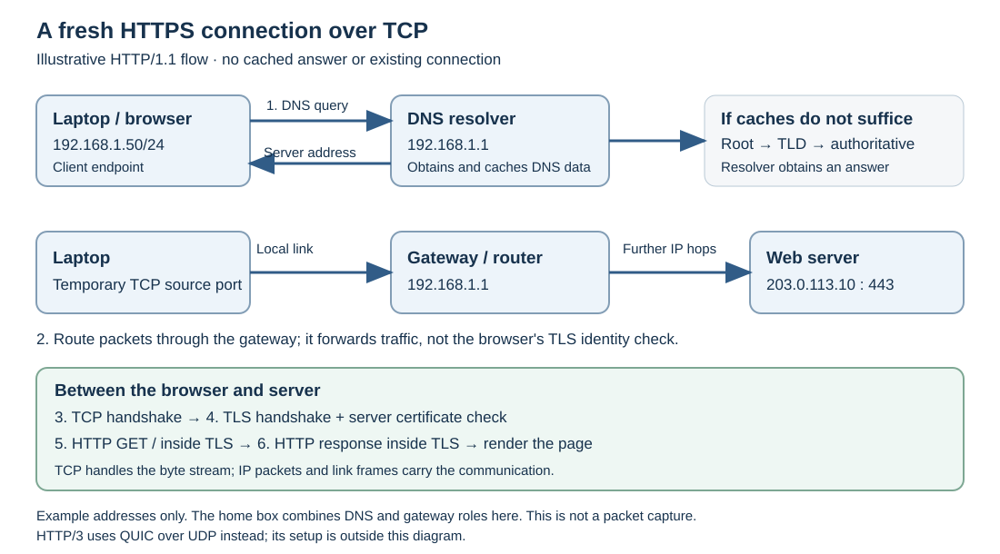

# Networks — A Micro-Textbook for Beginners

This chapter introduces the network stack and follows a web request from a browser to a remote server.

**Status:** Revised with AI-assisted technical checks; awaiting team peer review.

[Module outline and reading order](OUTLINE.md) · [Explained answers](ANSWER-KEY.md)

---

## Learning Objectives

After this section, a beginner should be able to:

1. Explain what happens between typing a URL and seeing a page load.
2. Name the main layers of the network stack and their responsibilities.
3. Distinguish packet delivery from TCP's reconstruction of an ordered byte stream.
4. Explain the different roles of IP, TCP, and UDP.
5. Describe how DNS, routing, and TLS contribute to an HTTPS request.

---

## 1. What a Network Actually Does

A network moves **data** between devices. Links can fail, packets can be lost, and many applications share the same connections.

The core idea is **layering**: different protocols handle different parts of communication. Your browser can use either Wi-Fi or Ethernet because its web protocol does not need to implement either link technology.

## 2. The Layers in Plain Terms

This chapter uses a **five-layer teaching model**. A four-layer TCP/IP model groups Link and Physical together as network access; these are different ways to describe the same functions. [RFC 1122, Internet protocol suite and layering](https://www.rfc-editor.org/rfc/rfc1122.html#section-1.1.3)

| Layer | Responsibility | Example |
|---|---|---|
| **Application** | Defines communication between applications | HTTP, DNS, SSH |
| **Transport** | Connects application endpoints using ports; delivery features depend on the protocol | TCP, UDP |
| **Network** | Addresses and forwards packets across IP networks | IP |
| **Link** | Moves frames across a local link | Ethernet, Wi-Fi |
| **Physical** | Encodes and transmits bits as signals | Copper cable, optical fiber, radio |

Think of sending a letter: the application writes the message, addressing identifies its destination, and successive delivery systems carry it. The analogy helps explain separate responsibilities; it does not imply every protocol guarantees delivery.

## 3. Packets: Smaller Pieces of Data

Links have size limits, so large transfers normally use many smaller packets. Sharing a link between packets also lets different conversations make progress.

An **IP packet** carries source and destination IP addresses. It does not contain a general-purpose sequence number for rebuilding an application's byte stream. When TCP is used, a **TCP segment** inside that packet carries sequence information. TCP uses this to restore byte order. UDP itself supplies neither ordered-stream reconstruction nor retransmission. [IPv4 header: RFC 791 §3.1](https://www.rfc-editor.org/rfc/rfc791.html#section-3.1), [TCP: RFC 9293 §2.2](https://www.rfc-editor.org/rfc/rfc9293.html#section-2.2)

## 4. IP, TCP, and UDP: Different Jobs

- **IP** provides addressing and packet forwarding. Its service is **best-effort**: delivery and ordering are not guaranteed.
- **TCP** provides an ordered byte stream. It tracks received data and retransmits losses. If recovery fails, the connection can time out or abort; reliability does not promise success through a permanent outage.
- **UDP** sends individual datagrams with a small header. It has no built-in handshake, ordering, or retransmission. Applications can add any recovery they need.

Both TCP and UDP use **ports** to distinguish application endpoints. UDP's smaller set of mechanisms can suit time-sensitive messages, but it is not universally faster than TCP. Performance depends on the application and network conditions. [UDP: RFC 768](https://www.rfc-editor.org/rfc/rfc768.html), [UDP usage: RFC 8085](https://datatracker.ietf.org/doc/html/rfc8085), [TCP timeout: RFC 5482 §1](https://www.rfc-editor.org/rfc/rfc5482.html#section-1)

## 5. DNS and Routing: Finding a Destination

**DNS** retrieves information associated with names. For a web connection, the browser needs an address for the hostname. A resolver can answer from its cache or consult authoritative DNS servers. A lookup without useful cached information may involve root, TLD, and domain-authoritative servers. [RFC 1034 §5.3.3](https://www.rfc-editor.org/rfc/rfc1034.html#section-5.3.3)

**Routing** determines where to send each IP packet. A routing table maps destination prefixes to an outgoing interface or next hop. A default route is used when no more specific route matches. [RFC 1812 §5.2.4](https://www.rfc-editor.org/rfc/rfc1812.html#section-5.2.4)

## 6. Worked Example: A New HTTPS Connection

Suppose a laptop opens `https://example.com/` using **HTTP/1.1 over TCP**. For this illustrative exercise:

- The laptop is already configured as `192.168.1.50/24`.
- Its default gateway and DNS resolver are both `192.168.1.1`.
- The name resolves to `203.0.113.10`, an address used here for documentation, not a claim about the live website.
- No useful DNS answer or web connection is cached, and the route to the server uses the default gateway.

1. **Find the address.** The laptop asks its DNS resolver for `example.com`. The resolver obtains the answer and returns it; results may be cached.
2. **Choose a route.** `203.0.113.10` is outside the laptop's `192.168.1.0/24` subnet. The laptop sends server-bound traffic through `192.168.1.1`. On the local link, frames go to the gateway; IP identifies the remote destination. Further routers forward packets hop by hop. A home router may also translate private source addresses; NAT details are outside this example.
3. **Establish TCP.** The client uses a temporary source port and destination port **443**. The usual SYN → SYN-ACK → ACK exchange establishes the TCP connection. These messages themselves travel in IP packets and link frames.
4. **Establish TLS protection.** The browser and server perform a TLS handshake. The browser validates the server certificate for `example.com`, and the endpoints establish keys for protected communication.
5. **Request the resource.** The browser sends an HTTP `GET /` request with the website's hostname, carried inside TLS over TCP. TCP handles its byte stream; IP and link protocols carry the resulting packets and frames.
6. **Receive the response.** The server returns an HTTP response, such as `200 OK` with HTML. TLS checks and decrypts protected records; TCP delivers bytes in order or reports connection failure if recovery cannot succeed.
7. **Display the page.** The browser interprets the HTML and may request images, stylesheets, and scripts. Existing connections and caches can reduce later work.

The physical layer transmits signals on every link; link framing is rebuilt for each link. This is an explanatory trace, **not a recorded network experiment**. HTTP/2 also commonly uses TLS over TCP; **HTTP/3 uses QUIC over UDP**, so its setup differs. [HTTPS: RFC 9110 §4.2.2](https://www.rfc-editor.org/rfc/rfc9110.html#section-4.2.2), [TLS: RFC 8446 §2](https://www.rfc-editor.org/rfc/rfc8446.html#section-2), [HTTP/3: RFC 9114](https://www.rfc-editor.org/rfc/rfc9114.html)

## 7. Common Misconceptions

- **“IP and TCP are the same thing.”** IP forwards packets; TCP adds byte-stream ordering and recovery.
- **“Every packet contains enough information to reconstruct a file.”** Reconstruction depends on the protocols and application involved.
- **“DNS is one central lookup computer.”** It is a distributed, hierarchically delegated system with caching.
- **“The internet is a single local network.”** It connects many networks through routers.
- **“UDP is broken TCP.”** It offers a different, deliberately minimal service.

## 8. Check Yourself

1. **Order the five teaching-model layers** from application to physical and give a protocol, technology, or medium for each.
2. **Explain** why a large file is normally sent in many packets.
3. **Compare IP and TCP:** what service does each provide, and can TCP always finish a transfer?
4. **Trace a fresh HTTPS-over-TCP request:** include DNS, the gateway/IP path, TCP, TLS, and HTTP.
5. **Spot the error:** “TCP is faster than UDP because it is more reliable.” What is wrong with this claim?

[Explained answers: Introduction Q1–Q5](ANSWER-KEY.md#introduction)

## 9. Scope Boundaries

- **Detailed:** Five-layer teaching model, packets, IP/TCP/UDP responsibilities, DNS and routing basics, the HTTPS-over-TCP trace.
- **Brief:** DNS caching, private addresses/NAT context, TLS purpose, the HTTP/3 boundary.
- **Out of scope:** Congestion-control algorithms, cryptographic calculations, BGP internals, NAT configuration, socket programming.
